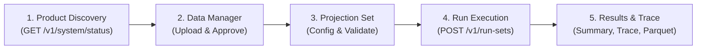

# MentorAmp Frontend Integration Guide — MYGA Governed Valuation Engine

| Metadata | Details |
|---|---|
| **Target Audience** | Sam Yung (Lead Frontend Engineer) |
| **From / Reviewer** | Samuel Ayinla (Technical Lead / Core Backend Architecture) |
| **Product** | 5-Year Multi-Year Guarantee Annuity (MYGA) |
| **Backend Release** | Milestone 2B (M2B) Merge-Ready Delivery |
| **API Base Path** | `/v1` |
| **Backend HEAD SHA** | `5e48606c98b2ae4895cf76d5e9ccf0901bfbd501` |

---

## 1. Executive Summary & Flow Overview

MYGA integrates directly into MentorAmp's existing governed platform workflow. There are **no separate, unversioned, or custom run endpoints** for MYGA. The execution flow follows the exact same 5 stages as SPIA:



> [!IMPORTANT]
> **Illustrative Status:** All MYGA runs, summaries, and output schemas carry `illustrative: true`. The frontend must surface this badge across the UI. This model uses contractual nonforfeiture floors and illustrative assumptions; it does not claim statutory NAIC Model #805 or VM-22 certifications.

---

## 2. Product Discovery & System Status

Check available products and engine backends on startup or project load.

### Endpoint
`GET /v1/system/status`

### Response Payload
```json
{
  "status": "healthy",
  "app": "MentorAmp Backend",
  "version": "1.0.0",
  "app_env": "development",
  "database": {
    "status": "connected",
    "latency_ms": 1.25
  },
  "engine": {
    "registered_functions": 35,
    "products": ["SPIA", "MYGA"],
    "execution_backend": "declarative_graph",
    "engine_version": "v1.0"
  },
  "time": "2026-10-24T03:30:00Z"
}
```

### UI Implementation Rule
- When `engine.products` includes `"MYGA"`, enable the MYGA product selection in **Model Library**, **Projection Set Creator**, and **Data Manager**.

---

## 3. Data Manager: Ingestion, Schemas & Dual-Control Approval

MYGA requires 4 dataset categories. Each dataset follows the governed lifecycle:
`Upload Source` $\rightarrow$ `Preview & Map` $\rightarrow$ `Validate` $\rightarrow$ `Commit` $\rightarrow$ `Approve`.

### A. In-force Policies (`liability_inforce`)
- **Canonical Schema Identifier:** `mentoramp.myga.inforce/v1`

| Column Name | Type | Unit / Format | Description | Validation Rules |
| :--- | :--- | :--- | :--- | :--- |
| `policy_id` | String | Unique ID | Stable policy identifier | Required, non-empty |
| `product_type` | String | Code | Product identifier | Must be strictly `"MYGA"` |
| `issue_date` | Date | `YYYY-MM-DD` | Inception date | ISO 8601 date |
| `issue_age` | Integer | Years | Primary annuitant age | $40 \le \text{age} \le 85$ |
| `gender` | String | `M` or `F` | Mortality lookup key | Must be `"M"` or `"F"` |
| `premium` | Float | USD | Single gross premium | $> 0$, finite float |
| `guarantee_period_years` | Integer | Years | Guarantee term | Must be `5` for 5-Year MYGA |
| `declared_rate` | Float | Decimal annual | Guaranteed credited rate | e.g., `0.045` ($4.50\%$) |
| `gmir` | Float | Decimal annual | Guaranteed minimum interest rate | Policy minimum floor (e.g., `0.0025`) |
| `gmsv_rate` | Float | Decimal annual | Contractual floor crediting rate | Must be $\ge 0.0015$ ($15\text{ bps}$) |
| `mva_ref_yield_at_issue`| Float | Decimal annual | Baseline reference yield for MVA | Benchmark yield at issue (e.g., `0.050`) |
| `account_value` | Float | USD | Opening account value | $\ge 0$, finite float |
| `mgsv_value` | Float | USD | Opening contractual floor value | Initial $87.5\%$ premium load |
| `free_wd_base` | Float | USD | Annual free withdrawal allowance base | Typically equals opening AV |

> [!NOTE]
> **Harmonized Aliasing:** If user inforce files use `guarantee_term_years` or `credited_rate`, the Data Manager mapping profile can map them to `guarantee_period_years` and `declared_rate`.
> **Strict Versioning:** Omitting schema version defaults to `v1`. Supplying an unknown version (e.g. `v99`) fails immediately with `INFORCE_SCHEMA_VERSION_NOT_SUPPORTED`.

### B. Mortality Assumption Table (`assumption_table`)
- **Table Name:** `SYNTH_MORT_GOMPERTZ_2026`
- **Columns:** `age` (integer), `gender` (`M`/`F`), `qx` (float annual mortality probability).

### C. Factor Tables (`factor_table`)
Two factor tables are required for MYGA:
1. **Surrender Charges (`myga_surrender_charge`):**
   - Columns: `schedule` (`"initial"` or `"renewal"`), `year_in_gp` (integer 1–5), `rate` (float, e.g., `0.09` for $9\%$).
2. **Age Caps (`myga_sc_age_cap`):**
   - Columns: `attained_age` (integer), `cap` (float maximum allowable charge, stepping down at older ages).

### D. Economic Scenarios (`scenario`)
- **Columns:** `scenario_name`, `target_variable`, `operation`, `value`, `applies_from_period`, `applies_to_period`.
- **Supported Targets for MYGA:**
  - `market_rate`: Re-investment market rate (affects renewal rates & dynamic lapses). In "Rates Up 150bp", shocked by +150bp (to 5.95%).
  - `mva_ref_yield`: Prevailing CMT reference yield (drives MVA factor). In "Rates Up 150bp", shocked by +150bp (to 6.50%).
  - `discount_rate_annual`: Discount rate used for reserve present-value calculations (remains constant at `0.045` in "Rates Up 150bp", isolating reinvestment/MVA yield shifts from liability discount basis).
  - `withdrawal`: Monthly beginning-of-month policyholder withdrawal (defaults to 0).

### E. Dual-Control Approval Rules
- An uploader cannot approve their own dataset (`409 SELF_APPROVAL_FORBIDDEN`).
- Datasets must be approved by a second user with `reviewer` or `admin` role before they can be pinned to a projection set.

---

## 4. Model Version Governance & Actuarial Decisions

### Lifecycle Transitions
```
draft ──[validate]──> validated ──[approve]──> approved ──[publish]──> published (immutable)
  │                      │
  └──[reject]            └──[reject]
```
- **Independent Approval:** A user who modified a version cannot approve it (`409 SELF_APPROVAL_FORBIDDEN`). Requires `models:approve` permission.
- **Whole-Model Immutability:** Published versions cannot be altered, rolled back, or deleted.
- **Actuarial Note on Death Benefit:**
  - Code marker: `STATUS: NEEDS ACTUARIAL PRODUCT OWNER DECISION`
  - Active Implementation: Option A (Account Value post beginning-of-month withdrawal).
  - Alternative Options Documented: Option B ($\max(\text{AV}, \text{CSV})$) and Option C ($\max(\text{AV}, \text{MGSV})$).

---

## 5. Projection Set Configuration

### Endpoint
`POST /v1/projects/{project_id}/projection-sets`

### Request Body
```json
{
  "name": "MYGA Illustrative Base and Rates Up",
  "model_version_id": "<model_version_uuid>",
  "inforce_file_ids": ["<inforce_uuid>"],
  "assumption_table_ids": ["<mortality_table_uuid>"],
  "factor_table_ids": [
    "<surrender_charge_uuid>",
    "<sc_age_cap_uuid>"
  ],
  "scenario_ids": [
    "<base_scenario_uuid>",
    "<rates_up_scenario_uuid>"
  ],
  "valuation_date": "2026-12-31",
  "horizon_months": 480,
  "time_step": "monthly",
  "output_variables": [
    "account_value_close",
    "mgsv_close",
    "surrender_benefit",
    "death_benefit",
    "death_claims",
    "surrender_claims",
    "annuitization_transfer",
    "maturity_benefit",
    "maintenance_expense",
    "liability_outgo",
    "net_cash_flow",
    "reserve"
  ],
  "trace_scope": {
    "mode": "selected_policies",
    "policy_ids": ["MYGA-0001"]
  },
  "parameters": {
    "decrement_methodology": "best_estimate"
  }
}
```

### Parameter: `decrement_methodology`
- `"best_estimate"`: Standard actuarial decrements (mortality, surrender, annuitization, maturity).
- `"zero_decrements"`: Zero decrements benchmark (pure policyholder account value rollforward).

---

## 6. Run Execution & Controls

### 1. Submit Run Set
`POST /v1/run-sets`
```json
{
  "project_id": "<project_uuid>",
  "name": "MYGA Valuation Run Set",
  "notes": "25-policy portfolio valuation",
  "projection_set_ids": ["<projection_set_uuid>"],
  "scenario_ids": ["<base_scenario_uuid>", "<rates_up_scenario_uuid>"]
}
```

### 2. Poll Run Progress
`GET /v1/runs/{run_id}`
- Status states: `pending` $\rightarrow$ `running` $\rightarrow$ `success` (or `failed`, `cancelled`, `partial_success`).
- Progress: `progress.done`, `progress.total`, `progress.percent`.

### 3. Run Controls
- **Cancel:** `POST /v1/runs/{id}/cancel` (valid when `can_cancel === true`).
- **Retry:** `POST /v1/runs/{id}/retry` (valid when `can_retry === true`). Retried run links via `retried_from_run_id`.

---

## 7. Published Outputs & Results Explorer

All 12 MYGA output variables have dimension `Policy x Scenario x Projection Month` and unit `USD`.

| Variable Name | Actuarial Meaning | Aggregation Rule | Display Label |
| :--- | :--- | :--- | :--- |
| `account_value_close` | End-of-month account value | `end_of_period` | Account Value (EOM) |
| `mgsv_close` | Minimum guaranteed surrender floor | `end_of_period` | Contractual MGSV Floor |
| `surrender_benefit` | Net benefit paid after MVA & SC floor | `end_of_period` | Cash Surrender Benefit |
| `death_benefit` | Death benefit paid ($\ge \text{AV}$) | `end_of_period` | Death Benefit |
| `death_claims` | Monthly volume-weighted death claims | `sum` | Death Claims |
| `surrender_claims` | Monthly volume-weighted surrender claims | `sum` | Surrender Claims |
| `annuitization_transfer`| Volume converted to payout annuity | `sum` | Annuitization Outgo |
| `maturity_benefit` | Payout at attained age 100 | `sum` | Maturity Claims |
| `maintenance_expense` | Monthly policy maintenance expense | `sum` | Maintenance Expenses |
| `liability_outgo` | Total policyholder and expense outgo | `sum` | Total Liability Outgo |
| `net_cash_flow` | Inflows (premium) minus Outflows | `sum` | Net Cash Flow |
| `reserve` | Prospective present value of outgo | `end_of_period` | Illustrative Reserve |

### Headline Summary API
`GET /v1/runs/{run_id}/summary`
```json
{
  "run_id": "<uuid>",
  "status": "success",
  "illustrative": true,
  "headline": {
    "variable": "reserve",
    "value": 4163674.90181,
    "unit": "USD"
  },
  "totals": {
    "liability_outgo": { "value": 5298179.05845, "unit": "USD" },
    "net_cash_flow": { "value": -3298179.05845, "unit": "USD" }
  },
  "failed_policy_count": 0
}
```

### Frozen Regression Benchmarks (25-Policy Block)
- **Base Scenario:**
  * Prospective Reserve: **$4,163,674.90**
  * Undiscounted Outgo: **$5,298,179.06**
- **Rates Up 150bp Scenario:**
  * Prospective Reserve: **$4,201,201.55**
  * Undiscounted Outgo: **$5,358,149.66**
- **Anchor Policy `MYGA-0001` Month 30 Surrender Benefit:** **$51,979.60**

---

## 8. Calculation Lineage & Trace Explorer

### Endpoint
`GET /v1/runs/{run_id}/trace?policy_id=MYGA-0001&month=30&variable=surrender_benefit&depth=8`

### Tree Structure (`root.children`)
The frontend receives a nested tree demonstrating the unbroken nonforfeiture chain:

```
surrender_benefit ($51,979.60) [max(surrender_value, mgsv_close)]
 ├── surrender_value ($51,979.60) [AV + MVA - SC]
 │    ├── account_value_close ($53,421.15)
 │    ├── market_value_adjustment ($0.00) [bounded by -SC and +SC]
 │    │    ├── surrender_excess ($51,979.60)
 │    │    │    └── free_withdrawal_available ($0.00)
 │    │    └── mva_ref_yield (0.050)
 │    └── surrender_charge ($1,441.55)
 │         └── surrender_charge_rate (0.07) [from table myga_surrender_charge]
 └── mgsv_close ($46,820.13) [Contractual 87.5% premium floor accumulated at gmsv_rate]
```

---

## 9. Parquet Storage & Artifact Provenance

Each run stores immutable Parquet artifacts under attempt-scoped storage paths:
`runs/{run_id}/attempts/{attempt_number}/artifacts/{artifact_type}.parquet`

- **Listing Run Artifacts:** `GET /v1/runs/{run_id}/artifacts`
- **Downloading Parquet Export:** `GET /v1/runs/{run_id}/artifacts/{artifact_id}/download`
- **CSV Export:** `GET /v1/runs/{run_id}/export.csv`
  * Reads `X-MentorAmp-Complete` header (`true` or `false`).

---

## 10. Summary Checklist for Sam

- [ ] **System Status:** Wire `GET /v1/system/status` to show `MYGA` dynamically in product selectors.
- [ ] **Data Manager:** Implement the 4 tabs (`liability_inforce`, `assumption_table`, `factor_table`, `scenario`).
- [ ] **Dual-Control UI:** Prevent self-approval of datasets; show "Awaiting Reviewer Approval".
- [ ] **Model Governance:** Implement Validate, Approve (with author segregation), Reject (with reason modal), and Publish buttons. Show Actuarial Decision Alert on `death_benefit`.
- [ ] **Projection Setup:** Wire Factor Tables multi-select and `decrement_methodology` parameter dropdown.
- [ ] **Execution Center:** Implement Cancel and Retry buttons based on `can_cancel` and `can_retry`.
- [ ] **Results Explorer:** Render the `Illustrative` badge, handle `partial_success` with confirmation modal, and verify against golden values ($4,163,674.90 Base reserve).
- [ ] **Trace Explorer:** Wire recursive tree renderer to display the nonforfeiture calculation chain.
