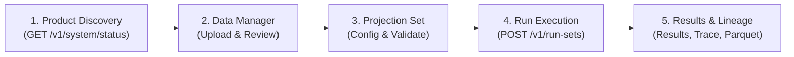

# MentorAmp Frontend Integration Guide — MYGA Governed Valuation Engine

This guide details everything the frontend team (Samuel) needs to consume and integrate the newly delivered **5-Year Multi-Year Guarantee Annuity (MYGA)** product workflow.

---

## 1. Executive Summary & Flow Overview

MYGA integrates into MentorAmp's existing governed platform workflow. There are **no separate, unversioned, or custom run endpoints** for MYGA. The execution flow follows the exact same 5 stages as SPIA:



> [!IMPORTANT]
> **Illustrative Status:** All MYGA runs, summaries, and output schemas carry `illustrative: true`. The frontend must surface this badge across the UI. This model does not make statutory CARVM compliance claims.

---

## 2. Product Discovery & System Status

Check available products and engine backends on startup or project load.

### Endpoint
`GET /v1/system/status`

### Response Payload
```json
{
  "status": "healthy",
  "app": "MentorAmp Backend",
  "version": "1.0.0",
  "app_env": "development",
  "database": {
    "status": "connected",
    "latency_ms": 1.25
  },
  "engine": {
    "registered_functions": 35,
    "products": ["SPIA", "MYGA"],
    "execution_backend": "declarative_graph",
    "engine_version": "v1.0"
  },
  "time": "2026-10-22T13:30:00Z"
}
```

### UI Implementation Rule
- When `engine.products` includes `"MYGA"`, enable the MYGA product selection in **Model Library**, **Projection Set Creator**, and **Data Manager**.

---

## 3. Data Manager: Ingestion & Schemas

MYGA requires 4 dataset categories. Each dataset follows the governed lifecycle:
`Upload Source` $\rightarrow$ `Preview & Map` $\rightarrow$ `Validate` $\rightarrow$ `Commit` $\rightarrow$ `Approve`.

### A. In-force Policies (`liability_inforce`)

| Column Name | Type | Unit / Format | Description | Validation Rules |
| :--- | :--- | :--- | :--- | :--- |
| `policy_id` | String | Unique ID | Stable policy identifier | Required, non-empty |
| `product_type` | String | Code | Product identifier | Must be strictly `"MYGA"` |
| `issue_date` | Date | `YYYY-MM-DD` | Inception date | ISO 8601 date |
| `issue_age` | Integer | Years | Primary annuitant age | $40 \le \text{age} \le 85$ |
| `gender` | String | `M` or `F` | Mortality lookup key | Must be `"M"` or `"F"` |
| `premium` | Float | USD | Single gross premium | $> 0$, finite float |
| `guarantee_period_years` | Integer | Years | Guarantee term | Must be `5` for 5-Year MYGA |
| `declared_rate` | Float | Decimal annual | Guaranteed credited rate | e.g., `0.045` ($4.50\%$) |
| `gmir` | Float | Decimal annual | Guaranteed minimum interest rate | Policy minimum floor (e.g., `0.0025`) |
| `gmsv_rate` | Float | Decimal annual | Nonforfeiture floor accumulation rate | Must be $\ge 0.0015$ ($15\text{ bps}$) |
| `mva_ref_yield_at_issue`| Float | Decimal annual | Baseline reference yield for MVA | Benchmark yield at issue (e.g., `0.050`) |
| `account_value` | Float | USD | Opening account value | $\ge 0$, finite float |
| `mgsv_value` | Float | USD | Opening contractual floor value | Initial $87.5\%$ premium load |
| `free_wd_base` | Float | USD | Annual free withdrawal allowance base | Typically equals opening AV |

> [!NOTE]
> **Legacy Field Aliasing:** If inforce files use `guarantee_term_years` or `credited_rate`, the Data Manager mapping profile can map them to `guarantee_period_years` and `declared_rate`.

### B. Mortality Assumption Table (`assumption_table`)
- **Table Name:** `SYNTH_MORT_GOMPERTZ_2026`
- **Columns:** `age` (integer), `gender` (`M`/`F`), `qx` (float annual mortality probability).

### C. Factor Tables (`factor_table`)
Two factor tables are attached for MYGA:
1. **Surrender Charges (`myga_surrender_charge.csv`):**
   - Columns: `schedule` (`"initial"` or `"renewal"`), `year_in_gp` (integer 1–5), `rate` (float, e.g., `0.09` for $9\%$).
2. **Age Caps (`myga_sc_age_cap.csv`):**
   - Columns: `issue_age` (integer), `max_charge` (float maximum allowable charge, stepping down at older ages).

### D. Economic Scenarios (`scenario`)
- **Columns:** `scenario_name`, `target_variable`, `operation`, `value`, `applies_from_period`, `applies_to_period`.
- **Supported Targets for MYGA:**
  - `market_rate`: Re-investment market rate (affects renewal rates & dynamic lapses). In "Rates Up 150bp", shocked by +150bp (to 5.95%).
  - `mva_ref_yield`: Prevailing CMT reference yield (drives MVA factor). In "Rates Up 150bp", shocked by +150bp (to 6.50%).
  - `discount_rate_annual`: Discount rate used for reserve present-value calculations (remains constant at `0.045` in "Rates Up 150bp", isolating reinvestment/MVA yield shifts from liability discount basis).
  - `withdrawal`: Monthly gross withdrawal dollar override (default `0.0`). Debited from AV at BOM; net policyholder benefit and insurer outgo reflect 10% free allowance thresholding, surrender charge on excess, and MVA.

---

## 4. Governed Data Manager API Endpoints

### 1. Create Import Session
`POST /v1/projects/{project_id}/import-sessions`
```json
{
  "category": "liability_inforce",
  "name": "2026 Q4 MYGA Inforce"
}
```

### 2. Upload Source File
`POST /v1/import-sessions/{session_id}/file` (Multipart form-data with `file`)

### 3. Preview & Column Mapping
`GET /v1/import-sessions/{session_id}/preview`

### 4. Validate Ingested Records
`POST /v1/import-sessions/{session_id}/validate`
```json
{
  "mapping_profile_id": "<optional_profile_id>",
  "mapping_fields": [
    {"source_column": "PolicyID", "target_field": "policy_id"},
    {"source_column": "GrossPremium", "target_field": "premium"}
  ]
}
```
*Returns validation issues, error counts, and rejected rows (e.g. `GMSV_RATE_BELOW_MINIMUM`, `NEGATIVE_AMOUNT`).*

### 5. Commit Validated Dataset
`POST /v1/import-sessions/{session_id}/commit`

### 6. Actuarial Approval Gate
`POST /v1/datasets/{dataset_id}/review`
```json
{
  "action": "approve",
  "review_reason": "Verified contract fields and 2.80% GMSV rate against product spec."
}
```
*(Requires `actuary`, `reviewer`, or `admin` platform role).*

---

## 5. Projection Set Setup

Projection Sets bind the approved model version with inforce, tables, and scenarios.

### Endpoint
`POST /v1/projects/{project_id}/projection-sets`

### Request Payload
```json
{
  "name": "MYGA 5-Year Valuation Set",
  "description": "Base and Rates Up 150bp valuation run",
  "model_version_id": "<myga_model_version_uuid>",
  "inforce_file_ids": ["<approved_inforce_dataset_uuid>"],
  "assumption_table_ids": ["<mortality_dataset_uuid>"],
  "factor_table_ids": ["<surrender_charge_dataset_uuid>", "<age_cap_dataset_uuid>"],
  "scenario_ids": ["<base_scenario_uuid>", "<rates_up_scenario_uuid>"],
  "valuation_date": "2026-12-31",
  "horizon_months": 480,
  "time_step": "monthly",
  "output_variables": [
    "account_value_close",
    "mgsv_close",
    "surrender_benefit",
    "death_benefit",
    "death_claims",
    "surrender_claims",
    "annuitization_transfer",
    "maturity_benefit",
    "maintenance_expense",
    "liability_outgo",
    "net_cash_flow",
    "reserve"
  ],
  "trace_scope": {
    "mode": "selected_policies",
    "policy_ids": ["MYGA-0001"]
  },
  "parameters": {}
}
```

### Preflight Validation Check
`POST /v1/projection-sets/{id}/validate`
- Verifies input closure, formula graph acyclicity, and table parameter compatibility.
- Status must return `"validated"` before run submission.

---

## 6. Run Execution & Monitoring

### 1. Submit Run Set
`POST /v1/run-sets`
```json
{
  "project_id": "<project_uuid>",
  "name": "MYGA E2E Valuation Batch",
  "notes": "Full portfolio valuation",
  "projection_set_ids": ["<projection_set_uuid>"],
  "scenario_ids": ["<base_scenario_uuid>", "<rates_up_scenario_uuid>"]
}
```
**Status Response:** `202 Accepted`

### 2. Poll Run Progress
`GET /v1/runs/{run_id}`
- Status states: `pending` $\rightarrow$ `running` $\rightarrow$ `success` (or `failed`, `cancelled`, `partial_success`).
- Progress payload:
  ```json
  {
    "status": "running",
    "progress": {
      "done": 12,
      "total": 25,
      "percent": 48.0,
      "unit": "policies",
      "eta_seconds": 15
    }
  }
  ```

---

## 7. Published Outputs & Results Explorer

All 12 MYGA output variables have dimension `Policy x Scenario x Projection Month` and unit `USD`.

| Variable Name | Actuarial Meaning | Aggregation Rule | Display Label |
| :--- | :--- | :--- | :--- |
| `account_value_close` | End-of-month account value | `end_of_period` | Account Value (EOM) |
| `mgsv_close` | Minimum guaranteed surrender floor | `end_of_period` | Contractual MGSV Floor |
| `surrender_benefit` | Net benefit paid after MVA & SC floor | `end_of_period` | Cash Surrender Benefit |
| `death_benefit` | Death benefit paid ($\ge \text{AV}$) | `end_of_period` | Death Benefit |
| `death_claims` | Monthly volume-weighted death claims | `sum` | Death Claims |
| `surrender_claims` | Monthly volume-weighted surrender claims | `sum` | Surrender Claims |
| `annuitization_transfer`| Volume converted to payout annuity | `sum` | Annuitization Outgo |
| `maturity_benefit` | Payout at attained age 100 | `sum` | Maturity Claims |
| `maintenance_expense` | Monthly policy maintenance expense | `sum` | Maintenance Expenses |
| `liability_outgo` | Total policyholder and expense outgo | `sum` | Total Liability Outgo |
| `net_cash_flow` | Inflows (premium) minus Outflows | `sum` | Net Cash Flow |
| `reserve` | Prospective present value of outgo | `end_of_period` | Illustrative Reserve |

### Headline Summary API
`GET /v1/runs/{run_id}/summary`
```json
{
  "run_id": "<uuid>",
  "status": "success",
  "headline": {
    "metric": "reserve",
    "value": 4163674.90,
    "unit": "USD"
  },
  "totals": {
    "liability_outgo": { "value": 5298179.06, "unit": "USD" },
    "net_cash_flow": { "value": -3298179.06, "unit": "USD" }
  },
  "failed_policy_count": 0,
  "elapsed_seconds": 14.8
}
```

---

## 8. Calculation Lineage & Trace Explorer

For any traced policy and month, fetch the hierarchical calculation DAG.

### Endpoint
`GET /v1/runs/{run_id}/trace?policy_id=MYGA-0001&month=30&variable=surrender_benefit&depth=8`

### Tree Structure (`root.children`)
The frontend receives a nested tree (not a flat list) demonstrating the unbroken nonforfeiture chain:

```
surrender_benefit ($96,829.85) [max(surrender_value, mgsv_close)]
 ├── surrender_value ($96,829.85) [AV + MVA - SC]
 │    ├── account_value_close ($107,229.09)
 │    ├── market_value_adjustment (-$3,627.64) [capped by SC]
 │    │    ├── surrender_excess ($96,737.09)
 │    │    │    └── free_withdrawal_available ($10,492.00)
 │    │    └── mva_ref_yield (0.0650)
 │    └── surrender_charge ($6,771.60)
 │         └── surrender_charge_rate (0.07)
 └── mgsv_close ($89,585.05) [NAIC Model #805 2.80% floor]
```

---

## 9. Parquet Storage & Artifact Exports

Each successful run produces an immutable, identity-neutral `.parquet` dataset in the artifact store.

- **Listing Run Artifacts:** `GET /v1/runs/{run_id}/artifacts`
- **Downloading Parquet Export:** `GET /v1/runs/{run_id}/artifacts/{artifact_id}/download`
- **Integrity Validation:** Frontend displays the SHA-256 fingerprint from the artifact record.

---

## 10. Summary Checklist for Frontend (Samuel)

- [ ] **System Status:** Verify `products` contains `"MYGA"`.
- [ ] **Data Manager:** In Inforce Import, display required MYGA columns (`guarantee_period_years`, `declared_rate`, `gmsv_rate`, etc.).
- [ ] **Review Actions:** Display the "Approve / Reject" button for datasets when user role is `actuary`, `reviewer`, or `admin`.
- [ ] **Projection Setup:** Allow selecting MYGA model version, attaching 2 factor tables (charges and age caps), and setting trace mode to `selected_policies`.
- [ ] **Run Evidence:** Surface the run package fingerprint, manifest fingerprint, and execution steps using the existing `RunEvidencePanel`.
- [ ] **Trace Explorer:** Render nested `root.children` for `surrender_benefit`.
