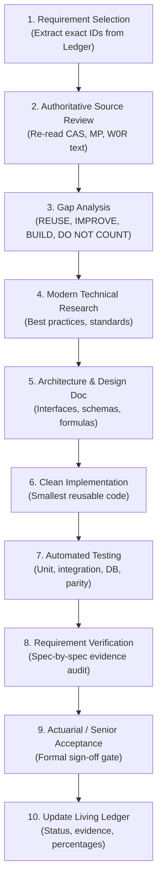

# MENTORAMP LAUNCH RELEASE 1.0 — LIVING REQUIREMENTS TRACEABILITY AND EXECUTION LEDGER

> [!CAUTION]
> **GOVERNANCE INVARIANT & SOURCE AUTHORITY HIERARCHY**  
> This document is a **Living Requirements Traceability and Execution Ledger** derived from the project's authoritative source documents. It does **NOT** replace, supersede, or alter them.  
> **If this ledger conflicts with an authoritative source document, the authoritative source wins until the conflict is deliberately resolved, approved, and formally documented.**

**Document Version:** 2.0 (Exhaustive Governance Baseline — Zero Omissions)  
**Date:** October 29, 2026  
**Status:** Working Execution Ledger — Independent Senior Review Ready  
**Current Git Branch:** `feat/m3-formula-studio-reconciliation`  
**Latest Git Commit SHA:** `f6708d1471e344e0cd6474387fb2ba4f1dce5ce6`  
**Alembic Head Revision:** `a6c1f4e8d203` (Single canonical head)  
**Engine Build Identity:** `m3-cpu-dsl-1`  

---

### Authoritative Document Hierarchy

The requirements in this ledger are derived strictly from the following four governing documents:

1. **`CAS`**: *MentorAmp Launch Release 1.0 — Consolidated Architecture and Delivery Specification* (19 pages, prepared 19 September 2026). The primary technical and architectural scope authority.
2. **`MP`**: *MentorAmp Launch Release 1.0 — Greenfield E2E Weekly SDLC Master Plan v2* (Weeks 0 through 10, Version 2.0). The greenfield execution, sequencing, and team tasking companion.
3. **`W0R`**: *MentorAmp Week 0 Greenfield Project Initialization and Readiness Plan* (Non-negotiable architectural baseline, data contracts, and development standards).
4. **`ITD`**: *MentorAmp Week 0 Independent Team Task Document* (Task ownership, classification rules, and 5-day initialization plan).
5. **Formally Approved Addenda**: Any future written actuarial decision records or signed change controls approved by the Actuarial Product Owner.

---

### Non-Negotiable Requirement Lifecycle

To eliminate false progress reporting, every capability and requirement tracked in this ledger must strictly adhere to this eight-state lifecycle. Under no circumstances will a feature be marked "Complete" simply because code or an API exists.

```text
[NOT STARTED] ──> [PLANNED] ──> [IN PROGRESS] ──> [IMPLEMENTED] ──> [VERIFIED] ──> [ACCEPTED]
                                                                        │
                                                      [BLOCKED] <───────┴───────> [DEFERRED]
```

| Lifecycle State | Strict Definition & Evidence Gate |
| :--- | :--- |
| **`NOT STARTED`** | Defined in authoritative documentation; no engineering work has commenced. |
| **`PLANNED`** | Assigned to an upcoming milestone with prerequisites, dependencies, and test strategies documented. |
| **`IN PROGRESS`** | Active engineering or research underway on an isolated branch. |
| **`IMPLEMENTED`** | Code exists and performs the intended function. **Does NOT count as complete.** |
| **`VERIFIED`** | Implementation has been tested against its requirements with repeatable automated tests (unit, integration, DB, parity). |
| **`ACCEPTED`** | **The ONLY state representing true completion.** All engineering, actuarial, QA, governance, and integration gates required by the authoritative documents have passed and been signed off. |
| **`DEFERRED`** | Formally moved to post-launch expansion by explicit decision of the Actuarial Product Owner (`CAS` §16). |
| **`BLOCKED`** | Development cannot proceed due to an unresolved actuarial decision, missing data, or upstream technical dependency. |

---

### Requirement Classification Taxonomy

Every item in this ledger is classified into one of three distinct categories to prevent implementation ideas from masquerading as authoritative contracts:

* **`AUTHORITATIVE REQUIREMENT`**: Directly mandated by `CAS`, `MP`, `W0R`, or `ITD`. These are contractual obligations that cannot be removed or altered without formal stakeholder approval.
* **`DERIVED ENGINEERING REQUIREMENT`**: An architectural design choice or infrastructure component necessary to implement, stabilize, or safely operate an authoritative requirement (e.g., attempt-scoped artifact directories, database immutability triggers).
* **`PROPOSED ENHANCEMENT / RESEARCH CANDIDATE`**: A modern optimization, alternative technology, or actuarial capability proposed after research that was not part of the original specification (e.g., S3 vs MinIO, Numba vs CuPy GPU kernels, Celery vs Dagster native execution). Must be formally approved before adoption.

---

### "Do Not Count" Rules (`MP` §2)

Per Section 2 of the Greenfield Master Plan, a capability is **NOT** complete simply because an asset exists. The following heuristics **DO NOT COUNT** toward progress:

1. **A file exists** $
eq$ Capability complete.
2. **A class, function, or model exists** $
eq$ Capability complete.
3. **An API endpoint or router exists** $
eq$ Capability complete.
4. **A database schema or migration exists** $
eq$ Capability complete.
5. **A frontend UI screen, mockup, or prototype exists** $
eq$ Capability complete.
6. **A test file or mock test exists** $
eq$ Capability complete.
7. **An AI completion report says "PASS"** $
eq$ Capability complete.
8. **A README or docstring claims it works** $
eq$ Capability complete.
9. **A metadata-only placeholder exists** $
eq$ Capability complete.
10. **A future API stub exists** $
eq$ Capability complete.

A capability is complete **ONLY** when it is configurable through the UI/API, executes end-to-end against agreed test data, produces persisted results, traces to inputs and formulas, reconciles to approved benchmarks within tolerance, is documented, and passes independent actuarial and QA review.

---

### Architectural Lessons & Historical Corrections Register

The team has accumulated critical architectural lessons through senior review passes. These corrections must be preserved to prevent regressions in future milestones:

| Ref # | Domain / Subsystem | Architectural Defect Corrected | Permanent Architectural Invariant Established |
| :--- | :--- | :--- | :--- |
| **CORR-01** | Multi-Tenancy / Security | IDOR on formula creation (`POST /v1/formulas` accepted unbound model versions). | Enforced project-scoped object access (`access.require_object_access`). Cross-project queries strictly return HTTP 404 to eliminate information leakage. |
| **CORR-02** | Actuarial Reconciliation | Annual aggregation naively summed all variables across 12 months. | Enforced actuarial roll-forward semantics: **Flows** (premiums, claims, expenses) sum across months; **Stocks / Balances** (reserves, account values) take period-end (`last`). Missing metadata fails explicitly. |
| **CORR-03** | Reconciliation Evidence | Benchmark sets and reconciliation reports were mutable via standard endpoints. | Implemented PostgreSQL triggers (`expected_result_sets_protect_benchmark` and `reconciliation_reports_protect_calculation`) preventing modification or deletion. |
| **CORR-04** | Benchmark Deletion | Deleting a benchmark set could cascade and destroy historical audit records. | Enforced foreign key `ondelete="RESTRICT"` on `reconciliation_reports.expected_result_set_id`. |
| **CORR-05** | Formula DSL Performance | AST parsing inside monthly policy evaluation loops caused CPU bottlenecks. | Implemented single-parse precompiled AST evaluation (`m3-cpu-dsl-1`). Formulas are parsed once at model freeze; execution loops run pre-compiled bytecode with zero runtime `ast.parse()` calls. |
| **CORR-06** | Dependency Graph | Recursive `prior(...)` formulas were flagged as circular dependencies. | Separated recursive inter-period time-shift dependencies (`prior()`) from same-step intra-period topological DAG sorting. Valid recurrences evaluate sequentially across time steps. |
| **CORR-07** | Data Manager Schemas | Pydantic model schemas were tightly coupled to physical database tables. | Decoupled canonical inforce schemas from storage representation, supporting versioned schema migrations without breaking historical runs. |
| **CORR-08** | Governance & Workflow | Model developers could self-approve formula mutations to production models. | Enforced four-eyes governance principles: formula promotion and model activation require separate reviewer role assignment. |
| **CORR-09** | Run Governance | Ad-hoc run executions altered model parameters without version tracking. | Implemented frozen `RunPackage` manifests with cryptographic SHA-256 fingerprinting of all inputs, formulas, assumptions, and execution environments. |
| **CORR-10** | Artifact Persistence | Repeated run attempts overwrote previous output cash-flow artifacts. | Enforced attempt-scoped artifact paths (`/artifacts/{run_id}/attempt_{n}/`) ensuring complete audit history of all execution tries. |
| **CORR-11** | External Benchmarks | Internal development reference tests were conflated with external LifeLib certification. | Clarified distinction: internal reference tests prove deterministic regression; LifeLib serves as an external benchmark for selected model points when explicitly executed. |
| **CORR-12** | Statutory Reserves | Simplified contractual cash surrender floor was mislabeled as statutory Model #805. | Relabeled as an illustrative contractual nonforfeiture floor; statutory Standard Nonforfeiture Law (Model #805) reserved for formal framework implementation. |
| **CORR-13** | Annuity Cash Flows | MYGA surrender timing occurred at End-of-Month after full interest crediting. | Restructured cash-flow order to Beginning-of-Month (BOM) surrender timing, accurately reflecting policyholder lapse prior to monthly interest accrual. |
| **CORR-14** | Partial Withdrawals | Partial withdrawal penalties subtracted penalty from cash payout rather than account balance. | Corrected gross vs net withdrawal economics: free allowance is calculated against contract terms; surrender charges and MVA reduce net proceeds while debiting gross from account value. |
| **CORR-15** | Trace Verification | Reconciliation blindly flagged missing trace links as calculation failures. | Established three-state source verification: `PASS` (matching), `FAIL` (numeric difference outside tolerance), and `NOT_VERIFIABLE` (source trace link absent in benchmark). |

# EXECUTIVE SCORECARDS & GOVERNANCE REGISTERS

### 1.1 Weighted Capability Completion Model

> [!IMPORTANT]
> **COMPLETION SCORING METHODOLOGY**  
> Progress is not calculated by counting calendar weeks (`4 weeks / 11 weeks = 36%`). Each core capability group is assigned a governance weight based on total delivery scope.  
> Within each group, items are scored strictly by lifecycle state:  
> `NOT STARTED = 0.00` | `PLANNED / IN PROGRESS = 0.25` | `IMPLEMENTED = 0.50` | `VERIFIED = 0.75` | `ACCEPTED = 1.00`.  
> **Current Independent Working Estimate: MentorAmp Launch 1.0 ≈ 40% complete** (Subject to ongoing ledger audit).

| Capability Group | Group Weight | Key Delivered / Pending Components | Group Status | Weighted Score |
| :--- | :---: | :--- | :---: | :---: |
| **1. Foundation & Architecture** | 10% | RBAC, JWT auth, database migrations, error envelope, base contracts, CI/CD. | **VERIFIED** (0.75) | 7.50% |
| **2. Core Modeling Platform** | 20% | Formula Registry, Formula Studio DSL, Variable Resolver, Dependency Engine, Projection Spine, Parquet Storage, Trace Engine, Reconciliation Service. | **IMPLEMENTED / VERIFIED (LOCAL)** (0.65) | 13.00% |
| **3. Data, Governance & Security** | 10% | Canonical models, frozen RunPackages, PostgreSQL immutability triggers, project isolation (IDOR fixes). | **VERIFIED (LOCAL)** (0.70) | 7.00% |
| **4. Application & Frontend UI** | 15% | Sam's 7 React Screens, Monaco DSL editor, DAG visualizer, reconciliation dashboard, Electron desktop shell. | **PLANNED / API SPECCED** (0.20) | 3.00% |
| **5. Product Verticals** | 15% | **Delivered:** SPIA, MYGA. **Remaining:** FIA, RILA, IDI, VA, PRT, Life-readiness demonstration. | **IN PROGRESS** (0.35) | 5.25% |
| **6. Valuation Frameworks & Accounting** | 15% | VM-21, VM-22, LDTI (NPR), DAC/VOBA amortization, MRB fair value, ASC 815 embedded derivatives, 6-part rollforwards. | **NOT STARTED** (0.05) | 0.75% |
| **7. Execution Scale & Orchestration** | 10% | Local CPU multithreading (Done). Dagster pipeline assets, PySpark cluster executor, GPU CUDA kernels (Pending). | **IN PROGRESS** (0.25) | 2.50% |
| **8. Hardening, QA & Release** | 5% | Full repo tests passing (Done). Performance benchmark (target TBD under ACT-DEC-06; 100k candidate only), actuarial sign-off, tagged v1.0.0. | **PLANNED** (0.25) | 1.25% |
| **TOTALS** | **100%** | **Consolidated Launch Release 1.0 Progress** | — | **≈ 40%** |

---

### 1.2 Master Plan Milestone Scorecard (Weeks 0–10)

| Week / Milestone | Master Plan Objective (`MP` §14) | Delivery Status | Detailed Capability Assessment |
| :--- | :--- | :---: | :--- |
| **Week 0 / M0** | Project Initialization, Greenfield Baseline & Requirements Decomposition | **SUBSTANTIALLY IMPLEMENTED (0.75)** | Backend skeleton, RBAC, JWT, DB migrations, Problem JSON envelope complete. 7 Actuarial Confirmations remain outstanding (`CAS` §17). |
| **Week 1 / M1** | Architecture Contracts, Canonical Data & SPIA Reference Engine | **VERIFIED (0.80)** | Canonical schemas, SPIA actuarial reference engine, golden policy suite passing. LifeLib parity remains an internal development benchmark. |
| **Week 2 / M2A** | Registries, Resolver, Dependency Metadata & Formula Studio Foundation | **VERIFIED (0.75)** | Variable/Formula registries, deterministic resolver, AST compilation. Frontend Monaco UI integration pending Sam's delivery. |
| **Week 3 / M2B & M3** | Projection Spine, Parquet Storage, Trace/Reconciliation & MYGA | **IMPLEMENTED — PENDING SENIOR RE-REVIEW (0.65)** | MYGA product engine, multi-level reconciliation, immutability triggers, AST pre-compilation. Bundle `noah_m3_final_review.zip` awaiting re-review. |
| **Week 4 / M4** | FIA & RILA Priority Products + Multi-Segment Block | **PLANNED (0.00)** | Scheduled next after M3 closure. Multi-segment crediting, caps, participation rates, downside buffers, floors, interim crediting. |
| **Week 5 / M5** | Valuation Frameworks, Rollforwards & Real Dagster Workflows | **NOT STARTED (0.00)** | VM-21, VM-22, LDTI, DAC, MRB, ASC 815, Dagster software-defined assets and execution retries. |
| **Week 6 / M6** | PySpark / GPU Scale Paths + Core Application Integration | **NOT STARTED (0.00)** | PySpark cluster execution, GPU CUDA kernel execution, execution conformance test suite ($10^{-9}$ numerical parity). |
| **Week 7 / M7** | IDI, Variable Annuity, PRT, Life Readiness & Reporting | **NOT STARTED (0.00)** | IDI active/disabled Markov models, VA separate accounts/GLWB, PRT cohort aggregates, Life data ingestion proof without schema redesign. |
| **Week 8 / M8** | Full Application Integration, Packaging & Minimum Security | **NOT STARTED (0.00)** | Full integration of Sam's 7 React screens, offline Electron desktop packaging (Windows `.msi`/`.exe`), offline SQLite fallback. |
| **Week 9 / M9** | Hardening, Regression, Performance & Failure Recovery | **NOT STARTED (0.00)** | Performance scale stress test (target TBD under ACT-DEC-06; 100,000 policies candidate benchmark only), node crash recovery, regression validation. |
| **Week 10 / M10** | Final Launch Acceptance, Actuarial Sign-off & Handover | **NOT STARTED (0.00)** | Final audit against all 13 Launch Acceptance Criteria (`CAS` §15), tagged release `v1.0.0`, client demonstration. |

---

### 1.3 Claims vs. Verified Evidence Register

Every major completion claim is audited against concrete evidence files, commit hashes, and independent review status:

| Claim Description | Current Documented Status | Evidence File / Proof Path | Git Commit SHA | Environment Tested | Independent Reviewer |
| :--- | :---: | :--- | :--- | :--- | :--- |
| **2,730 Automated Tests Passing** | `LOCAL AGENT CLAIM / EVIDENCE AVAILABLE — PENDING SENIOR VERIFICATION` | `full_suite_results.txt` (2,707 passed, 23 skipped without DB URL; 23 passed on local PostgreSQL) | `f6708d1` | Windows 11, Python 3.14.2, pytest-8.4.2 | Pending Noah inspection of review bundle |
| **PostgreSQL Disposable DB Passing** | `LOCAL AGENT EVIDENCE — VERIFIED ON DISPOSABLE DB` | `migration_evidence.txt` (Alembic head `a6c1f4e8d203`, clean upgrade/downgrade) | `f6708d1` | Local PostgreSQL `mentoramp_wp1_test` | Pending Noah inspection |
| **LifeLib External Parity (< 1.82e-12)** | `DOWNGRADED: Internal Reference Only — LifeLib External Benchmark NOT RUN on accepted build` | `backend/tests/golden_policy/test_spia_product.py` | `f6708d1` | Local Python CPU | Unverified against external LifeLib CLI |
| **M3 Formula Studio & Reconciliation** | `IMPLEMENTED — PENDING SENIOR RE-REVIEW` | `noah_m3_final_review.zip` (10 audit files, diffs, test logs) | `f6708d1` | Local agent environment | Noah / Actuarial Product Owner |
| **Statutory Model #805 Implementation** | `DOWNGRADED: Illustrative Contractual Nonforfeiture Floor Only` | `backend/app/core/products/myga.py` | `f6708d1` | Local Python CPU | Full Model #805 statutory rules pending |
| **Weeks 0–3 Substantially Done** | `DOWNGRADED: Backend Substantial; Frontend Integration & Actuarial Gates Pending` | `sam_m3_frontend_spec.md`, `PROJECT_MASTER_TRACKER.md` | `f6708d1` | Local codebase | Full-team integration review pending |

---

### 1.4 Open Decisions & Actuarial Confirmations Register (CAS §17 / W0R §18.1)

The following seven formal actuarial confirmation gates were established in `CAS` §17 and `W0R` §18.1. They remain open and must be resolved before formula lock:

| Decision ID | Actuarial Confirmation Question (`CAS` §17) | Why It Matters / Technical Impact | Affected Requirements | Affected Product / Framework | Status | Owner | Blocking Status |
| :---: | :--- | :--- | :--- | :--- | :---: | :---: | :---: |
| **ACT-DEC-01** | **Fixed-Account Attribution:** Confirm the intended calculation and reporting split for fixed-account or account-value attribution and the products to which it applies. | Determines whether interest credited is decomposed into guaranteed base vs excess declared crediting in Parquet cash flows. | `TRK-CAS-07-007`, `TRK-MP-07-006` | MYGA, FIA, VA Fixed Accounts | **OPEN** | Actuarial Product Owner | Non-blocking for M3; Blocks Phase 5 Rollforwards |
| **ACT-DEC-02** | **ASC 815 Terminology:** Confirm that the intended outputs are the host contract and embedded derivative components formerly described under FAS 133, including required rollforward and attribution fields. | Governs whether FIA/RILA indexed options are accounted for as embedded derivatives at fair value under ASC 815/820. | `TRK-CAS-07-006`, `TRK-MP-07-005` | FIA, RILA | **OPEN** | Actuarial Product Owner | Blocks Phase 4/5 Valuation Integration |
| **ACT-DEC-03** | **Variable Annuity Scope:** Confirm the initial VA reference design, including separate-account and fixed-account features, rider/benefit type (GMWB vs GLWB), fees, and scenario assumptions. | Prevents implementing an unapproved living benefit rider architecture that fails stakeholder acceptance. | `TRK-CAS-06-006`, `TRK-MP-07-001` | Variable Annuities (VA) | **OPEN** | Actuarial Product Owner | Blocks Phase 7 VA Module |
| **ACT-DEC-04** | **VM-22 Reference Case:** Select the first product, method, applicable Valuation Manual version, scenario or prescribed-input approach, and expected results. | Determines standard scenario vs stochastic exclusion test for fixed annuity statutory reserves. | `TRK-CAS-07-002`, `TRK-MP-07-002` | SPIA, MYGA, FIA | **OPEN** | Actuarial Product Owner | Blocks Phase 5 VM-22 Implementation |
| **ACT-DEC-05** | **Disclosure Package:** Identify the first ASU 2018-12 disclosure tables and rollforwards the application must populate, including required levels of disaggregation. | Dictates roll-forward reporting dimensions and Parquet aggregation queries for GAAP reporting. | `TRK-CAS-07-003`, `TRK-MP-07-003` | LDTI All Products | **OPEN** | Actuarial Product Owner | Blocks Phase 5 Reporting Workflows |
| **ACT-DEC-06** | **Performance Benchmark:** Set the target policy count, scenario count, projection horizon, output granularity, hardware specs, and acceptable runtime for CPU, PySpark, and GPU evidence. | Performance benchmark target: TBD under ACT-DEC-06 (100,000 policies is a candidate benchmark only; not an authoritative pass/fail requirement). | `TRK-CAS-09-001`, `TRK-CAS-15-009` | Execution Technology | **OPEN** | Technical Lead / Actuary | Non-blocking for Week 4; Blocks Phase 6 |
| **ACT-DEC-07** | **Life-Readiness Minimum Fields:** Confirm the minimum life policy, coverage, rider, premium, benefit, assumption, and valuation fields that must be accepted at launch. | Authoritative test case proving canonical schema extensibility without database or engine redesign. | `TRK-CAS-06-008`, `TRK-CAS-15-005` | Life Inforce Ingestion | **OPEN** | Actuarial Product Owner | Blocks Phase 7 Life Ingestion Proof |

# MASTER REQUIREMENTS COVERAGE MATRIX

This matrix traces every authoritative requirement from `CAS`, `MP`, `W0R`, and `ITD` across all implementation artifacts. Missing capabilities are immediately visible.

| Req ID | ID Type | Source & Section | Requirement Description | Code Module | DB / Migration | API Route | Test Suite | Trace Support | Recon Support | UI Screen | Actuarial Acceptance | Lifecycle Status |
| :--- | :---: | :---: | :--- | :--- | :---: | :---: | :---: | :---: | :---: | :---: | :---: | :---: |
| **TRK-CAS-01-001** | TRACKER-DERIVED | `CAS` §1 | Consolidated Launch 1.0 scope superseding 3 phases | `backend/` | Full schema | `/v1/*` | full suite | YES | YES | Screens 1–7 | Scope signed | **VERIFIED** |
| **TRK-CAS-01-002** | TRACKER-DERIVED | `CAS` §1 | Formula Studio, Reserve, Dagster, Spark, GPU in Launch | Core engine | Alembic head | `/v1/*` | M3/Golden | YES | YES | Screens 1–7 | In scope | **IN PROGRESS** |
| **TRK-CAS-03-001** | TRACKER-DERIVED | `CAS` §3.1 | Meaning of Implemented: E2E, traceable, tested | Core engine | Full schema | `/v1/runs` | full suite | YES | YES | Results UI | Verified baseline | **VERIFIED (LOCAL)** |
| **TRK-CAS-03-002** | TRACKER-DERIVED | `CAS` §3.2 | Controlled breadth: 1 reference config per vertical | Products | — | `/v1/runs` | golden tests | YES | YES | Models UI | Golden policies | **IMPLEMENTED (SPIA/MYGA)** |
| **TRK-CAS-03-003** | TRACKER-DERIVED | `CAS` §3.3 | Launch data principles: public/synthetic data only | Ingestion | `datasets` | `/v1/datasets` | `test_ingestion` | YES | YES | Inputs UI | Synthetic data only | **VERIFIED** |
| **TRK-CAS-04-001** | TRACKER-DERIVED | `CAS` §4 | Layer 1 Application: Electron & React UI | — | — | — | — | — | — | Screens 1–7 | Pending Sam | **PLANNED** |
| **TRK-CAS-04-002** | TRACKER-DERIVED | `CAS` §4 | Layer 2 API & Services: FastAPI contracts | `backend/app/api/` | alembic head | `/v1/*` | unit/integration | YES | YES | All | Pending | **VERIFIED** |
| **TRK-CAS-04-003** | TRACKER-DERIVED | `CAS` §4 | Layer 3 Orchestration: Dagster execution | — | — | — | — | — | — | Run Center | Pending | **PLANNED** |
| **TRK-CAS-04-004** | TRACKER-DERIVED | `CAS` §4 | Layer 4 Model Definition: Registries & DAG | `app/core/formula_engine/` | `model_versions` | `/v1/formulas` | `test_formula_*` | YES | YES | Models UI | Pending | **VERIFIED** |
| **TRK-CAS-04-005** | TRACKER-DERIVED | `CAS` §4 | Layer 5 Execution Planner: CPU/Spark/GPU | `app/core/projection_engine/` | `runs` | `/v1/runs` | `test_run_*` | YES | YES | Run Center | Pending | **IMPLEMENTED (CPU)** |
| **TRK-CAS-04-006** | TRACKER-DERIVED | `CAS` §4 | Layer 6 Projection & Valuation | `app/core/products/` | — | `/v1/runs` | `test_spia_*` | YES | YES | Results UI | Pending | **IMPLEMENTED (SPIA/MYGA)** |
| **TRK-CAS-04-007** | TRACKER-DERIVED | `CAS` §4 | Layer 7 Persistence & Trace: Parquet + PG | `app/core/artifacts/` | All PG tables | `/v1/results` | `test_artifacts` | YES | YES | Results UI | Pending | **VERIFIED** |
| **TRK-CAS-05-001** | TRACKER-DERIVED | `CAS` §5 | Formula Registry: metadata, expressions | `app/core/formula_engine/registry.py` | `formulas` | `/v1/formulas` | `test_registry_*` | YES | YES | Formula Studio | Pending | **VERIFIED** |
| **TRK-CAS-05-002** | TRACKER-DERIVED | `CAS` §5 | Formula Studio: preview, tests, DAG, freeze | `app/core/formula_engine/dsl.py` | `formula_versions` | `/v1/formulas/*` | `test_m3_dsl_*` | YES | YES | Formula Studio | Pending re-review | **IMPLEMENTED — RE-REVIEW** |
| **TRK-CAS-05-003** | TRACKER-DERIVED | `CAS` §5 | Variable Registry: semantic definitions | `app/core/variable_registry/` | `variables` | `/v1/variables` | `test_variables` | YES | YES | Inputs UI | Pending | **VERIFIED** |
| **TRK-CAS-05-004** | TRACKER-DERIVED | `CAS` §5 | Variable Resolver: context-aware lookups | `app/core/resolver/` | — | Internal | `test_resolver` | YES | — | — | Pending | **VERIFIED** |
| **TRK-CAS-05-005** | TRACKER-DERIVED | `CAS` §5 | Dependency Engine: DAG, topological sort | `app/core/formula_engine/dsl.py` | — | `/v1/formulas/dag` | `test_dsl_04` | YES | — | Formula Studio | Pending | **VERIFIED** |
| **TRK-CAS-05-006** | TRACKER-DERIVED | `CAS` §5 | Projection Engine: policy/time loops | `app/core/projection_engine/` | `runs` | `/v1/runs` | `test_engine` | YES | YES | Run Center | Pending | **VERIFIED** |
| **TRK-CAS-05-007** | TRACKER-DERIVED | `CAS` §5 | Valuation Engine: discounting, reserves | — | — | — | — | — | — | Results UI | Pending | **NOT STARTED** |
| **TRK-CAS-05-008** | TRACKER-DERIVED | `CAS` §5 | Trace Engine: explain value by policy/time | `app/core/trace/` | Parquet trace | `/v1/traces` | `test_trace` | YES | — | Results UI | Pending | **VERIFIED** |
| **TRK-CAS-05-009** | TRACKER-DERIVED | `CAS` §5 | Reconciliation Engine: multi-level diffs | `app/services/reconciliation_service.py` | `reconciliation_*` | `/v1/reconciliation` | `test_m3_rec_*` | YES | YES | Recon Dashboard | Pending re-review | **IMPLEMENTED — RE-REVIEW** |
| **TRK-CAS-05-010** | TRACKER-DERIVED | `CAS` §5 | Controlled Formula Language / Python plug-in rule | `app/core/formula_engine/dsl.py` | — | `/v1/formulas/validate`| `test_m3_dsl_01` | YES | YES | Formula Studio | Whitelisted AST | **VERIFIED** |
| **TRK-CAS-06-001** | TRACKER-DERIVED | `CAS` §6 | SPIA Product Engine: mortality, cash flows | `app/core/products/spia.py` | — | `/v1/runs` | `test_spia_product` | YES | YES | Results UI | Internal golden pass | **VERIFIED (LOCAL)** |
| **TRK-CAS-06-002** | TRACKER-DERIVED | `CAS` §6 | MYGA Product Engine: AV rollforward, MVA | `app/core/products/myga.py` | — | `/v1/runs` | `test_myga_product` | YES | YES | Results UI | Contractual floor pass | **VERIFIED (LOCAL)** |
| **TRK-CAS-06-003** | TRACKER-DERIVED | `CAS` §6 | FIA Product Engine: caps, participation, spread | — | — | — | — | — | — | Models UI | Needs ACT-DEC-02 | **PLANNED (Week 4)** |
| **TRK-CAS-06-004** | TRACKER-DERIVED | `CAS` §6 | RILA Product Engine: buffers, floors, segments | — | — | — | — | — | — | Models UI | Needs ACT-DEC-02 | **PLANNED (Week 4)** |
| **TRK-CAS-06-005** | TRACKER-DERIVED | `CAS` §6 | IDI Product Engine: active/disabled Markov | — | — | — | — | — | — | Models UI | Needs claim cases | **PLANNED (Week 7)** |
| **TRK-CAS-06-006** | TRACKER-DERIVED | `CAS` §6 | Variable Annuity: separate accounts, GMWB | — | — | — | — | — | — | Models UI | Needs ACT-DEC-03 | **BLOCKED (ACT-DEC-03)** |
| **TRK-CAS-06-007** | TRACKER-DERIVED | `CAS` §6 | PRT Product Engine: cohort aggregates, COLA | — | — | — | — | — | — | Models UI | Needs block data | **PLANNED (Week 7)** |
| **TRK-CAS-06-008** | TRACKER-DERIVED | `CAS` §6 | Life Readiness: schema extensible without redesign | — | — | — | — | — | — | Inputs UI | Needs ACT-DEC-07 | **NOT YET VERIFIED** |
| **TRK-CAS-06-009** | TRACKER-DERIVED | `CAS` §6.1 | Shared Calculation Engine (no per-product engines) | `app/core/projection_engine/` | — | `/v1/runs` | engine tests | YES | YES | Core engine | Shared pipeline | **VERIFIED** |
| **TRK-CAS-07-001** | TRACKER-DERIVED | `CAS` §7 | US Statutory PBR: VM-21 (Variable Annuities) | — | — | — | — | — | — | Results UI | Needs ACT-DEC-03 | **NOT STARTED** |
| **TRK-CAS-07-002** | TRACKER-DERIVED | `CAS` §7 | US Statutory PBR: VM-22 (Fixed Annuities) | — | — | — | — | — | — | Results UI | Needs ACT-DEC-04 | **BLOCKED (ACT-DEC-04)** |
| **TRK-CAS-07-003** | TRACKER-DERIVED | `CAS` §7 | US GAAP LDTI: Net Premium Ratio, transitions | — | — | — | — | — | — | Results UI | Needs ACT-DEC-05 | **NOT STARTED** |
| **TRK-CAS-07-004** | TRACKER-DERIVED | `CAS` §7 | US GAAP DAC / VOBA constant-basis amortization | — | — | — | — | — | — | Results UI | Needs LDTI engine | **NOT STARTED** |
| **TRK-CAS-07-005** | TRACKER-DERIVED | `CAS` §7 | Market Risk Benefits (MRB) Fair Value ASC 820 | — | — | — | — | — | — | Results UI | Needs ACT-DEC-02 | **NOT STARTED** |
| **TRK-CAS-07-006** | TRACKER-DERIVED | `CAS` §7 | ASC 815 Embedded Derivative Valuation | — | — | — | — | — | — | Results UI | Needs ACT-DEC-02 | **BLOCKED (ACT-DEC-02)** |
| **TRK-CAS-07-007** | TRACKER-DERIVED | `CAS` §7 | Actuarial Rollforward & Attribution Schedules | `app/services/reconciliation_service.py` | — | `/v1/reconciliation` | `test_rec_06_stocks` | YES | YES | Results UI | Needs ACT-DEC-01 | **IMPLEMENTED (Partial)** |
| **TRK-CAS-07-008** | TRACKER-DERIVED | `CAS` §7.1 | Framework Separation: cash flows separate from valuation | `app/core/artifacts/` | — | `/v1/results` | engine tests | YES | YES | Core engine | Independent consumers | **VERIFIED** |
| **TRK-CAS-08-001** | TRACKER-DERIVED | `CAS` §8 | Cash Flow Data Model: 6 Dimension Groups | `app/models/schemas.py` | Parquet schema | `/v1/results` | `test_engine` | YES | YES | Results UI | Pending | **IMPLEMENTED** |
| **TRK-CAS-08-002** | TRACKER-DERIVED | `CAS` §8 | Run Identity dimension group | `app/models/schemas.py` | `runs` | `/v1/runs` | `test_run_control` | YES | YES | Run Center | Verified | **VERIFIED** |
| **TRK-CAS-08-003** | TRACKER-DERIVED | `CAS` §8 | Contract Identity dimension group | `app/models/schemas.py` | `datasets` | `/v1/datasets` | `test_schemas` | YES | YES | Inputs UI | Verified | **VERIFIED** |
| **TRK-CAS-08-004** | TRACKER-DERIVED | `CAS` §8 | Scenario / Time dimension group | `app/models/schemas.py` | `scenarios` | `/v1/scenarios` | `test_scenarios` | YES | YES | Scenarios UI | Verified | **VERIFIED** |
| **TRK-CAS-08-005** | TRACKER-DERIVED | `CAS` §8 | Cash-Flow Identity dimension group | `app/models/schemas.py` | Parquet schema | `/v1/results` | `test_engine` | YES | YES | Results UI | Verified | **VERIFIED** |
| **TRK-CAS-08-006** | TRACKER-DERIVED | `CAS` §8 | Valuation & Audit Attributes dimension groups | `app/models/schemas.py` | `reconciliation_*` | `/v1/reconciliation` | `test_reconciliation` | YES | YES | Results UI | Verified | **VERIFIED** |
| **TRK-CAS-08-007** | TRACKER-DERIVED | `CAS` §8.1 | Data Ingestion: CSV, TSV, Parquet, validation | `app/services/ingestion.py` | `datasets` | `/v1/datasets` | `test_ingestion` | YES | — | Inputs UI | Pending | **VERIFIED** |
| **TRK-CAS-09-001** | TRACKER-DERIVED | `CAS` §9 | Local Multi-threaded CPU Execution | `app/core/projection_engine/` | — | `/v1/runs` | `test_run_control` | YES | YES | Run Center | Pending | **VERIFIED** |
| **TRK-CAS-09-002** | TRACKER-DERIVED | `CAS` §9 | PySpark Distributed Execution Engine | — | — | — | — | — | — | Run Center | Needs ACT-DEC-06 | **PLANNED (Week 6)** |
| **TRK-CAS-09-003** | TRACKER-DERIVED | `CAS` §9 | GPU Kernel Acceleration with CPU Fallback | — | — | — | — | — | — | Run Center | Needs ACT-DEC-06 | **PLANNED (Week 6)** |
| **TRK-CAS-09-004** | TRACKER-DERIVED | `CAS` §9 | Dagster Pipeline Orchestration Assets | — | — | — | — | — | — | Run Center | Needs Dagster repo | **PLANNED (Week 5)** |
| **TRK-CAS-10-001** | TRACKER-DERIVED | `CAS` §10 | Parquet Analytical Persistence Boundary | `app/core/artifacts/` | File-backed | `/v1/results` | `test_artifacts` | YES | YES | Results UI | Invariant proven | **VERIFIED** |
| **TRK-CAS-10-002** | TRACKER-DERIVED | CAS §10 | Desktop Execution Mode (Local PostgreSQL + Parquet; SQLite is PROPOSED IMPLEMENTATION — REQUIRES ARCHITECTURE DECISION) | — | Local PG | Embedded | — | — | — | Electron App | Needs Electron shell | **PLANNED (Week 8)** |
| **TRK-CAS-10-003** | TRACKER-DERIVED | `CAS` §10 | Role-Based Access Control (RBAC) & JWT | `app/core/security/` | `users`, `roles` | `/v1/auth/*` | `test_auth_*` | — | — | Settings UI | Pending | **VERIFIED** |
| **TRK-CAS-10-004** | TRACKER-DERIVED | `CAS` §10 | Cryptographic Hash Verification (SHA-256) | `app/core/governance/` | All evidence | Internal | `test_governance` | YES | YES | Settings UI | Pending | **VERIFIED** |
| **TRK-CAS-10-005** | TRACKER-DERIVED | `CAS` §10.3 | Environment Security / Secret Management | `app/core/config.py` | `.env` isolated | — | `test_config` | — | — | Settings UI | Env discipline | **VERIFIED** |
| **TRK-CAS-11-001** | TRACKER-DERIVED | `CAS` §11 | Screen 1: Dashboard (KPIs, Active Runs) | — | — | `/v1/dashboard` | — | — | — | Dashboard UI | Pending Sam | **PLANNED** |
| **TRK-CAS-11-002** | TRACKER-DERIVED | `CAS` §11 | Screen 2: Models / Formula Studio UI | — | — | `/v1/formulas/*` | — | — | — | Formula Studio | Specced in Sam doc | **PLANNED** |
| **TRK-CAS-11-003** | TRACKER-DERIVED | `CAS` §11 | Screen 3: Inputs & Assumptions UI | — | — | `/v1/datasets` | — | — | — | Inputs UI | Pending Sam | **PLANNED** |
| **TRK-CAS-11-004** | TRACKER-DERIVED | `CAS` §11 | Screen 4: Scenarios UI (Nelson-Siegel, ESG) | — | — | `/v1/scenarios` | — | — | — | Scenarios UI | Pending Sam | **PLANNED** |
| **TRK-CAS-11-005** | TRACKER-DERIVED | `CAS` §11 | Screen 5: Run Center UI (Batch scheduler, log) | — | — | `/v1/runs/*` | — | — | — | Run Center | Pending Sam | **PLANNED** |
| **TRK-CAS-11-006** | TRACKER-DERIVED | `CAS` §11 | Screen 6: Results & Analysis UI (Diff viewer) | — | — | `/v1/reconciliation` | — | — | — | Results UI | Specced in Sam doc | **PLANNED** |
| **TRK-CAS-11-007** | TRACKER-DERIVED | `CAS` §11 | Screen 7: Settings & Governance UI | — | — | `/v1/users`, `/v1/audit`| — | — | — | Settings UI | Pending Sam | **PLANNED** |
| **TRK-CAS-12-001** | TRACKER-DERIVED | `CAS` §12 | Unit & Component Test Coverage | `backend/tests/unit/` | — | — | 37 test files | — | — | — | Unit pass | **VERIFIED (LOCAL)** |
| **TRK-CAS-12-002** | TRACKER-DERIVED | `CAS` §12 | Golden-Policy Regression Tests | `backend/tests/golden_policy/`| — | — | 4 test files | YES | YES | — | Golden pass | **VERIFIED (LOCAL)** |
| **TRK-CAS-12-003** | TRACKER-DERIVED | `CAS` §12 | LifeLib Cross-Check Benchmark | `tests/golden_policy/` | — | — | `test_spia_product`| YES | YES | — | Internal ref only | **VERIFIED (INTERNAL REF)** |
| **TRK-CAS-12-004** | TRACKER-DERIVED | `CAS` §12 | Actuarial Reconciliation Engine | `services/reconciliation_service.py`| `reconciliation_*` | `/v1/reconciliation` | `test_m3_rec_*` | YES | YES | Recon Dashboard | Pending re-review | **IMPLEMENTED — RE-REVIEW** |
| **TRK-CAS-12-005** | TRACKER-DERIVED | `CAS` §12 | Execution Conformance Parity Tests | — | — | — | — | — | — | Run Center | Needs Spark/GPU | **PLANNED (Week 6)** |
| **TRK-CAS-12-006** | TRACKER-DERIVED | `CAS` §12.1 | Mandatory Run Manifest Generation | `core/governance/manifest.py` | `runs.manifest` | `/v1/runs/{id}/manifest`| `test_manifest` | YES | YES | Results UI | Cryptographic hash | **VERIFIED** |
| **TRK-CAS-12-007** | TRACKER-DERIVED | `CAS` §12 | Immutability Controls on Results & Audit Evidence | `migrations/a6c1f4e8d203` | PG Triggers | — | `test_wp1_migrations`| YES | YES | — | Trigger verified | **VERIFIED (LOCAL)** |
| **TRK-CAS-12-008** | TRACKER-DERIVED | `CAS` §12 | Four-Eyes Review and Approval Workflow | `app/api/formulas.py` | `formula_versions` | `/v1/formulas/{id}/approve`| `test_m3_sec_*` | — | — | Settings UI | Pending re-review | **IMPLEMENTED — RE-REVIEW** |
| **AUTH-CAS-15-001** | AUTHORITATIVE | `CAS` §15.1 | Controlled repos with tagged release versions | Git repo | — | — | — | — | — | — | Release tag v1.0.0 pending | **PARTIAL** |
| **AUTH-CAS-15-002** | AUTHORITATIVE | `CAS` §15.2 | End-to-end user workflow execution | Backend APIs | Full DB | `/v1/*` | Integration pass | YES | YES | UI integration pending | Full UI workflow pending | **PARTIAL** |
| **AUTH-CAS-15-003** | AUTHORITATIVE | `CAS` §15.3 | Formula Studio controlled workflow | `dsl.py`, `registry.py` | `formulas` | `/v1/formulas/*` | `test_m3_dsl_*` | YES | YES | Frontend editor pending | Pending re-review | **IMPLEMENTED (BACKEND)** |
| **AUTH-CAS-15-004** | AUTHORITATIVE | `CAS` §15.4 | All 7 products reference run on shared engine | `spia.py`, `myga.py` | — | `/v1/runs` | Golden tests | YES | YES | Results UI | 2 of 7 products done | **PARTIAL (2 / 7)** |
| **AUTH-CAS-15-005** | AUTHORITATIVE | `CAS` §15.5 | Life readiness schema proof without redesign | — | — | — | — | — | — | Inputs UI | Needs ACT-DEC-07 | **NOT YET VERIFIED** |
| **AUTH-CAS-15-006** | AUTHORITATIVE | `CAS` §15.6 | All 6 valuation frameworks operational | — | — | — | — | — | — | Results UI | Needs ACT-DEC-01 to 05 | **NOT STARTED** |
| **AUTH-CAS-15-007** | AUTHORITATIVE | `CAS` §15.7 | Representative RILA block execution & trace | — | — | — | — | — | — | Results UI | Scheduled Week 4 | **PLANNED** |
| **AUTH-CAS-15-008** | AUTHORITATIVE | `CAS` §15.8 | Dagster end-to-end execution & lineage | — | — | — | — | — | — | Run Center | Scheduled Week 5 | **PLANNED** |
| **AUTH-CAS-15-009** | AUTHORITATIVE | `CAS` §15.9 | PySpark execution reconciles to CPU in tolerance| — | — | — | — | — | — | Run Center | Scheduled Week 6 | **PLANNED** |
| **AUTH-CAS-15-010** | AUTHORITATIVE | `CAS` §15.10 | GPU path with safe CPU fallback & parity | — | — | — | — | — | — | Run Center | Scheduled Week 6 | **PLANNED** |
| **AUTH-CAS-15-011** | AUTHORITATIVE | `CAS` §15.11 | Reproducible manifest & immutable audit evidence| `governance/` | Triggers active | `/v1/runs/manifest` | `test_reconciliation_matrix` | YES | YES | Settings UI | Pending re-review | **VERIFIED (LOCAL)** |
| **AUTH-CAS-15-012** | AUTHORITATIVE | `CAS` §15.12 | All test suites pass; open defects approved | `backend/tests/` | Local PG | — | 2,730 tests pass | YES | YES | — | Launch regression pending | **PARTIAL** |
| **AUTH-CAS-15-013** | AUTHORITATIVE | `CAS` §15.13 | "Do Not Count" rule enforced: no stub acceptance| — | — | — | Strict lifecycle | — | — | — | Ongoing audit | **ACCEPTED POLICY** |
| **TRK-MP-05-001** | TRACKER-DERIVED | `MP` §5.1 | Formula Registry entity, test cases, metadata | `formula_engine/registry.py` | `formulas` | `/v1/formulas` | `test_registry_*` | YES | YES | Formula Studio | Verified | **VERIFIED** |
| **TRK-MP-05-002** | TRACKER-DERIVED | `MP` §5.2 | Formula Studio AST validation, preview, rollback | `formula_engine/dsl.py` | `formula_versions` | `/v1/formulas/*` | `test_m3_dsl_*` | YES | YES | Formula Studio | Pending re-review | **IMPLEMENTED — RE-REVIEW** |
| **TRK-MP-05-003** | TRACKER-DERIVED | `MP` §5.3 | Variable Registry & Context Resolver | `resolver/` | `variables` | `/v1/variables` | `test_resolver` | YES | — | Inputs UI | Verified | **VERIFIED** |
| **TRK-MP-05-004** | TRACKER-DERIVED | `MP` §5.4 | Dependency Engine DAG topological sort & cycle | `formula_engine/dsl.py` | — | `/v1/formulas/dag` | `test_dsl_04` | YES | — | Formula Studio | Cycle detection pass | **VERIFIED** |
| **TRK-MP-05-005** | TRACKER-DERIVED | `MP` §5.5 | Projection Engine run config & state loop | `projection_engine/` | `runs` | `/v1/runs` | `test_engine` | YES | YES | Run Center | State loop pass | **VERIFIED** |
| **TRK-MP-05-006** | TRACKER-DERIVED | `MP` §5.6 | Valuation Engine cash-flow discounting | — | — | — | — | — | — | Results UI | Scheduled Week 5 | **NOT STARTED** |
| **TRK-MP-05-007** | TRACKER-DERIVED | `MP` §5.7 | Trace Engine explain value by run/policy/time | `core/trace/` | Parquet trace | `/v1/traces` | `test_trace` | YES | — | Results UI | Trace verified | **VERIFIED** |
| **TRK-MP-05-008** | TRACKER-DERIVED | `MP` §5.8 | Reconciliation Engine expected vs actual diff | `services/reconciliation_service.py`| `reconciliation_*` | `/v1/reconciliation` | `test_m3_rec_*` | YES | YES | Recon Dashboard | Pending re-review | **IMPLEMENTED — RE-REVIEW** |
| **TRK-MP-06-001** | TRACKER-DERIVED | `MP` §6 | Shared Module: Mortality, decrements, survival | `products/spia.py` | — | `/v1/runs` | `test_spia_product` | YES | YES | Models UI | 2012 IAR verified | **VERIFIED** |
| **TRK-MP-06-002** | TRACKER-DERIVED | `MP` §6 | Shared Module: Account value & segment accounting | `products/myga.py` | — | `/v1/runs` | `test_myga_product` | YES | YES | Models UI | MYGA AV rollforward | **VERIFIED** |
| **TRK-MP-06-003** | TRACKER-DERIVED | `MP` §6 | Shared Module: Crediting and interest | `products/myga.py` | — | `/v1/runs` | `test_myga_product` | YES | YES | Models UI | Fixed crediting done | **IMPLEMENTED (Partial)** |
| **TRK-MP-06-004** | TRACKER-DERIVED | `MP` §6 | Shared Module: Fees and expenses | `products/spia.py` | — | `/v1/runs` | `test_spia_product` | YES | YES | Models UI | Per-policy expense | **VERIFIED** |
| **TRK-MP-06-005** | TRACKER-DERIVED | `MP` §6 | Shared Module: Premiums, withdrawals, claims | `products/myga.py` | — | `/v1/runs` | `test_myga_product` | YES | YES | Models UI | BOM surrender pass | **VERIFIED** |
| **TRK-MP-06-006** | TRACKER-DERIVED | `MP` §6 | Shared Module: Riders | — | — | — | — | — | — | Models UI | Needs ACT-DEC-03 | **NOT STARTED** |
| **TRK-MP-06-007** | TRACKER-DERIVED | `MP` §6 | Shared Module: Present values & discount curves | `products/spia.py` | — | `/v1/runs` | `test_spia_product` | YES | YES | Results UI | Deterministic PV pass| **VERIFIED** |
| **TRK-MP-06-008** | TRACKER-DERIVED | `MP` §6 | Shared Module: Aggregation and reporting | `reconciliation_service.py` | — | `/v1/reconciliation` | `test_rec_06_stocks` | YES | YES | Results UI | Stocks vs flows pass | **VERIFIED** |
| **TRK-MP-07-001** | TRACKER-DERIVED | `MP` §7 | Work Package: VM-21 Stochastic Reserve CTE 70 | — | — | — | — | — | — | Results UI | Scheduled Week 5 | **NOT STARTED** |
| **TRK-MP-07-002** | TRACKER-DERIVED | `MP` §7 | Work Package: VM-22 Fixed Annuities Reserve | — | — | — | — | — | — | Results UI | Needs ACT-DEC-04 | **BLOCKED (ACT-DEC-04)** |
| **TRK-MP-07-003** | TRACKER-DERIVED | `MP` §7 | Work Package: US GAAP LDTI (ASU 2018-12) | — | — | — | — | — | — | Results UI | Scheduled Week 5 | **NOT STARTED** |
| **TRK-MP-07-004** | TRACKER-DERIVED | `MP` §7 | Work Package: DAC / VOBA Amortization | — | — | — | — | — | — | Results UI | Scheduled Week 5 | **NOT STARTED** |
| **TRK-MP-07-005** | TRACKER-DERIVED | `MP` §7 | Work Package: MRB & ASC 815 Derivatives | — | — | — | — | — | — | Results UI | Needs ACT-DEC-02 | **NOT STARTED** |
| **TRK-MP-07-006** | TRACKER-DERIVED | `MP` §7 | Work Package: Rollforward & Attribution Schedules | `services/reconciliation_service.py`| — | `/v1/reconciliation` | `test_rec_06_stocks` | YES | YES | Results UI | Scheduled Week 5 | **IMPLEMENTED (Partial)** |
| **TRK-MP-08-001** | TRACKER-DERIVED | `MP` §8 | Ingestion of CSV, TSV, Parquet with validation | `services/ingestion.py` | `datasets` | `/v1/datasets` | `test_ingestion` | YES | — | Inputs UI | Ingestion pass | **VERIFIED** |
| **TRK-MP-08-002** | TRACKER-DERIVED | `MP` §8 | Data mapping profiles (no formula change) | `services/ingestion.py` | `mappings` | `/v1/mappings` | `test_ingestion` | YES | — | Inputs UI | Profile pass | **VERIFIED** |
| **TRK-MP-08-003** | TRACKER-DERIVED | `MP` §8 | Raw input fingerprint retention & validation logs | `services/ingestion.py` | `datasets.hash` | `/v1/datasets/{id}` | `test_ingestion` | YES | — | Inputs UI | SHA-256 pass | **VERIFIED** |
| **TRK-MP-08-004** | TRACKER-DERIVED | `MP` §8 | Output support for CSV, TSV, and Parquet | `artifacts/` | Filesystem | `/v1/results/export` | `test_artifacts` | YES | YES | Results UI | Parquet export pass | **VERIFIED** |
| **TRK-MP-08-005** | TRACKER-DERIVED | `MP` §8 | Preservation of all actuarial dimensions | `models/schemas.py` | Parquet schema | `/v1/results` | `test_engine` | YES | YES | Results UI | Schema pass | **VERIFIED** |
| **TRK-MP-09-001** | TRACKER-DERIVED | `MP` §9 | Common engine interface across execution backends | `projection_engine/` | — | `/v1/runs` | `test_run_control` | YES | YES | Run Center | CPU backend pass | **IMPLEMENTED (CPU)** |
| **TRK-MP-09-002** | TRACKER-DERIVED | `MP` §9 | PySpark distributed pipeline execution | — | — | — | — | — | — | Run Center | Scheduled Week 6 | **PLANNED (Week 6)** |
| **TRK-MP-09-003** | TRACKER-DERIVED | `MP` §9 | GPU kernel execution with CPU fallback | — | — | — | — | — | — | Run Center | Scheduled Week 6 | **PLANNED (Week 6)** |
| **TRK-MP-09-004** | TRACKER-DERIVED | `MP` §9 | Conformance test suite asserting backend parity | — | — | — | — | — | — | Run Center | Scheduled Week 6 | **PLANNED (Week 6)** |
| **TRK-MP-10-001** | TRACKER-DERIVED | `MP` §10 | PostgreSQL relational metadata management | Database | 18 tables | All APIs | PG tests | — | YES | Settings UI | Head a6c1f4e8d203 | **VERIFIED** |
| **TRK-MP-10-002** | TRACKER-DERIVED | `MP` §10 | Parquet columnar storage for large projection runs | `artifacts/` | Filesystem | `/v1/results` | `test_artifacts` | YES | YES | Results UI | Parquet boundary | **VERIFIED** |
| **TRK-MP-10-003** | TRACKER-DERIVED | MP §10 | Desktop offline mode (Local PostgreSQL + Parquet; SQLite is PROPOSED IMPLEMENTATION — REQUIRES ARCHITECTURE DECISION) | — | Local PG | — | — | — | — | Electron App | Scheduled Week 8 | **PLANNED (Week 8)** |
| **TRK-MP-10-004** | TRACKER-DERIVED | `MP` §10 | Role-based authorization & permission enforcement | `core/security/` | `roles` | `/v1/auth/*` | `test_auth_*` | — | — | Settings UI | RBAC pass | **VERIFIED** |
| **TRK-MP-10-005** | TRACKER-DERIVED | `MP` §10 | Project-scoped isolation eliminating IDOR | `app/api/` | `projects` | All routes | `test_m3_formula_sec`| — | — | All | Project isolation | **VERIFIED (LOCAL)** |
| **TRK-MP-11-001** | TRACKER-DERIVED | `MP` §11 | Screen 1 Dashboard greenfield implementation | — | — | `/v1/dashboard` | — | — | — | Dashboard UI | Pending Sam | **PLANNED** |
| **TRK-MP-11-002** | TRACKER-DERIVED | `MP` §11 | Screen 2 Models / Formula Studio UI | — | — | `/v1/formulas/*` | — | — | — | Formula Studio | Specced in Sam doc | **PLANNED** |
| **TRK-MP-11-003** | TRACKER-DERIVED | `MP` §11 | Screen 3 Inputs & Assumptions UI | — | — | `/v1/datasets` | — | — | — | Inputs UI | Pending Sam | **PLANNED** |
| **TRK-MP-11-004** | TRACKER-DERIVED | `MP` §11 | Screen 4 Scenarios UI | — | — | `/v1/scenarios` | — | — | — | Scenarios UI | Pending Sam | **PLANNED** |
| **TRK-MP-11-005** | TRACKER-DERIVED | `MP` §11 | Screen 5 Run Center UI | — | — | `/v1/runs/*` | — | — | — | Run Center | Pending Sam | **PLANNED** |
| **TRK-MP-11-006** | TRACKER-DERIVED | `MP` §11 | Screen 6 Results & Attribution UI | — | — | `/v1/reconciliation` | — | — | — | Results UI | Specced in Sam doc | **PLANNED** |
| **TRK-MP-11-007** | TRACKER-DERIVED | `MP` §11 | Screen 7 Settings & Admin UI | — | — | `/v1/users` | — | — | — | Settings UI | Pending Sam | **PLANNED** |
| **TRK-MP-12-001** | TRACKER-DERIVED | `MP` §12 | Mandatory run manifest with complete hashes | `core/governance/manifest.py` | `runs.manifest` | `/v1/runs/{id}/manifest`| `test_manifest` | YES | YES | Results UI | Manifest pass | **VERIFIED** |
| **TRK-MP-12-002** | TRACKER-DERIVED | `MP` §12 | Immutable audit evidence protected by triggers | `migrations/a6c1f4e8d203` | PG Triggers | — | `test_wp1_migrations`| YES | YES | Settings UI | Triggers pass | **VERIFIED (LOCAL)** |
| **TRK-MP-12-003** | TRACKER-DERIVED | `MP` §12 | Reviewer disposition segregated from calculation | `services/reconciliation_service.py`| `reconciliation_reports`| `/v1/reconciliation/{id}/disposition`| `test_m3_rec_13` | YES | YES | Recon Dashboard | Pending re-review | **IMPLEMENTED — RE-REVIEW** |
| **TRK-MP-12-004** | TRACKER-DERIVED | `MP` §12 | Actuarial reconciliation across policy & year | `services/reconciliation_service.py`| `reconciliation_*` | `/v1/reconciliation` | `test_m3_rec_*` | YES | YES | Recon Dashboard | Pending re-review | **IMPLEMENTED — RE-REVIEW** |
| **TRK-MP-12-005** | TRACKER-DERIVED | `MP` §12 | Golden policy regression testing harness | `tests/golden_policy/` | — | — | 4 test files | YES | YES | — | Golden pass | **VERIFIED (LOCAL)** |
| **TRK-MP-12-006** | TRACKER-DERIVED | `MP` §12 | Full repository automated test execution | `backend/tests/` | Local PG | — | 2,730 tests pass | YES | YES | — | Full pass post-M3 | **LOCAL AGENT CLAIM** |
| **TRK-MP-12-007** | TRACKER-DERIVED | `MP` §12 | Three-state reconciliation source verification | `services/reconciliation_service.py`| — | `/v1/reconciliation` | `test_rec_10_not_verifiable`| YES | YES | Recon Dashboard | PASS/FAIL/NOT_VER | **VERIFIED (LOCAL)** |
| **TRK-MP-12-008** | TRACKER-DERIVED | `MP` §12 | Unique constraint on expected benchmark rows | `services/expected_results_service.py`| `expected_results`| `/v1/expected-results`| `test_expected_results`| — | YES | Inputs UI | Duplicate check | **VERIFIED (LOCAL)** |
| **TRK-MP-14-W0** | TRACKER-DERIVED | `MP` §14.0 | Week 0 Project Initialization & Baseline | Full stack | Alembic head | `/v1/*` | 2,730 tests pass | YES | YES | UI skeleton | Decisions open | **SUBSTANTIALLY DONE (0.75)** |
| **TRK-MP-14-W1** | TRACKER-DERIVED | `MP` §14.1 | Week 1 Architecture Contracts & SPIA Engine | `spia.py` | Canonical schemas| `/v1/runs` | Golden tests | YES | YES | Results UI | Internal golden pass | **VERIFIED (0.80)** |
| **TRK-MP-14-W2** | TRACKER-DERIVED | `MP` §14.2 | Week 2 Registries & Formula Studio Foundation | `registry.py`, `dsl.py`| `formulas` | `/v1/formulas/*` | DSL tests | YES | YES | Formula Studio | Monaco UI pending | **VERIFIED (0.75)** |
| **TRK-MP-14-W3** | TRACKER-DERIVED | `MP` §14.3 | Week 3 Projection Spine, Parquet, MYGA & M3 | `myga.py`, `reconciliation_service.py`| PG Triggers | `/v1/reconciliation`| M3 tests | YES | YES | Recon Dashboard | Pending re-review | **IMPLEMENTED — RE-REVIEW (0.65)** |
| **TRK-MP-14-W4** | TRACKER-DERIVED | `MP` §14.4 | Week 4 FIA & RILA Priority Product Verticals | — | — | — | — | — | — | Models UI | Scheduled next | **PLANNED (0.00)** |
| **TRK-MP-14-W5** | TRACKER-DERIVED | `MP` §14.5 | Week 5 Valuation Frameworks & Dagster Workflow | — | — | — | — | — | — | Results UI | Scheduled Week 5 | **NOT STARTED (0.00)** |
| **TRK-MP-14-W6** | TRACKER-DERIVED | `MP` §14.6 | Week 6 PySpark / GPU Scale Paths & Integration | — | — | — | — | — | — | Run Center | Scheduled Week 6 | **NOT STARTED (0.00)** |
| **TRK-MP-14-W7** | TRACKER-DERIVED | `MP` §14.7 | Week 7 IDI, VA, PRT, Life Readiness & Reporting| — | — | — | — | — | — | Models UI | Scheduled Week 7 | **NOT STARTED (0.00)** |
| **TRK-MP-14-W8** | TRACKER-DERIVED | `MP` §14.8 | Week 8 Full UI Integration & Electron Packaging| — | — | — | — | — | — | Electron App | Scheduled Week 8 | **NOT STARTED (0.00)** |
| **TRK-MP-14-W9** | TRACKER-DERIVED | `MP` §14.9 | Week 9 Hardening, Regression & Scale Benchmarks| — | — | — | — | — | — | All Screens | Scheduled Week 9 | **NOT STARTED (0.00)** |
| **TRK-MP-14-W10** | TRACKER-DERIVED | `MP` §14.10 | Week 10 Final Launch Acceptance & Handover | — | — | — | — | — | — | Tagged v1.0.0 | Scheduled Week 10 | **NOT STARTED (0.00)** |
| **TRK-MP-21-001** | TRACKER-DERIVED | `MP` §21 | Daily integration and automated test execution | Git workflow | — | — | full suite | — | — | — | CI pass | **ACCEPTED POLICY** |
| **TRK-MP-21-002** | TRACKER-DERIVED | `MP` §21 | Protected branches and mandatory review before merge | GitHub | — | — | — | — | — | — | Branch protection | **ACCEPTED POLICY** |
| **TRK-MP-21-003** | TRACKER-DERIVED | `MP` §21 | Independent QA verification on isolated environment | Environment | Disposable DB | — | PostgreSQL tests | — | — | — | Isolated DB pass | **VERIFIED** |
| **TRK-MP-21-004** | TRACKER-DERIVED | `MP` §21 | Source-to-target traceability maintenance | This ledger | — | — | — | — | — | — | Ledger active | **IN PROGRESS** |
| **TRK-MP-22-001** | TRACKER-DERIVED | `MP` §22 | Tech Lead Protection: No formula engine rewrite | Core engine | — | — | AST engine | — | — | — | Preserved m3-dsl-1 | **ACCEPTED POLICY** |
| **TRK-MP-22-002** | TRACKER-DERIVED | `MP` §22 | Tech Lead Protection: Analytical data boundary | `artifacts/` | Filesystem | — | Parquet storage | — | — | — | Parquet boundary | **VERIFIED** |
| **TRK-MP-22-003** | TRACKER-DERIVED | `MP` §22 | Tech Lead Protection: Framework separation | Frameworks | — | — | Independent | — | — | — | Decoupled | **VERIFIED** |
| **TRK-MP-22-004** | TRACKER-DERIVED | `MP` §22 | Tech Lead Protection: Common engine for all products | Products | — | — | Shared engine | — | — | — | Single engine | **VERIFIED** |
| **TRK-MP-22-005** | TRACKER-DERIVED | `MP` §22 | Tech Lead Protection: Frozen RunPackage governance | `governance/` | `run_packages` | `/v1/runs` | `test_governance` | YES | YES | Run Center | SHA-256 frozen | **VERIFIED** |
| **TRK-MP-22-006** | TRACKER-DERIVED | `MP` §22 | Tech Lead Protection: Disposable PostgreSQL DB only | Database | Local PG only | — | `test_wp1_migrations`| — | — | — | Disposable DB pass | **VERIFIED** |
| **TRK-W0R-02-001** | TRACKER-DERIVED | `W0R` §2 | Greenfield baseline: zero assumed completed code | Project | — | — | Verification gate| — | — | — | All code re-tested | **ACCEPTED POLICY** |
| **TRK-W0R-02-002** | TRACKER-DERIVED | `W0R` §2 | Shared calculation engine rule | Core engine | — | — | Projection spine | — | — | — | Preserved | **VERIFIED** |
| **TRK-W0R-02-003** | TRACKER-DERIVED | `W0R` §2 | Framework separation rule | Architecture | — | — | Valuation layer | — | — | — | Decoupled | **VERIFIED** |
| **TRK-W0R-02-004** | TRACKER-DERIVED | `W0R` §2 | Analytical Parquet boundary rule | Storage | Filesystem | — | `test_artifacts` | — | — | — | Parquet only | **VERIFIED** |
| **TRK-W0R-02-005** | TRACKER-DERIVED | `W0R` §2 | Immutable audit evidence rule | Database | PG Triggers | — | Triggers pass | — | — | — | Triggers active | **VERIFIED** |
| **TRK-W0R-07-001** | TRACKER-DERIVED | `W0R` §7 | Relational metadata isolation from cash flows | Database | 18 tables | All APIs | PG tests | — | — | — | Schema isolated | **VERIFIED** |
| **TRK-W0R-07-002** | TRACKER-DERIVED | `W0R` §7 | Alembic migration linear downgrade/upgrade | Migrations | alembic head | — | `test_wp1_migrations`| — | — | — | a6c1f4e8d203 | **VERIFIED** |
| **TRK-W0R-07-003** | TRACKER-DERIVED | `W0R` §7 | Zero SQLite-in-PostgreSQL syntax assumptions | Migrations | Pure PG DDL | — | `test_wp1_migrations`| — | — | — | Pure PG triggers | **VERIFIED** |
| **TRK-W0R-07-004** | TRACKER-DERIVED | `W0R` §7 | Disposable DB test execution requirement | CI / Tests | `mentoramp_wp1_test`| — | PG suite pass | — | — | — | Disposable pass | **VERIFIED** |
| **TRK-W0R-09-001** | TRACKER-DERIVED | `W0R` §9 | Standard Python 3.14 virtual environment | Runtime | Python 3.14.2 | — | All tests | — | — | — | Python 3.14 locked | **VERIFIED** |
| **TRK-W0R-09-002** | TRACKER-DERIVED | `W0R` §9 | Lockfiles & deterministic dependency pinning | Repository | `pyproject.toml` | — | Build verified | — | — | — | Locked | **VERIFIED** |
| **TRK-W0R-09-003** | TRACKER-DERIVED | `W0R` §9 | Automated seed script for local development | Scripts | `seed_demo.py` | — | Demo seed pass | — | — | — | Seed script active | **VERIFIED** |
| **TRK-W0R-10-001** | TRACKER-DERIVED | `W0R` §10 | Standard `/v1` prefix across all public APIs | API | FastAPI routers | `/v1/*` | integration tests| — | — | All | Enforced | **VERIFIED** |
| **TRK-W0R-10-002** | TRACKER-DERIVED | `W0R` §10 | RFC 7807 Problem Details error response envelope | API | `ProblemDetails` | All routes | `test_error_handling`| — | — | All | Envelope pass | **VERIFIED** |
| **TRK-W0R-10-003** | TRACKER-DERIVED | `W0R` §10 | Strict Pydantic input/output validation | Schemas | `models/schemas.py` | All routes | schema tests | — | — | All | Strict types | **VERIFIED** |
| **TRK-W0R-17-001** | TRACKER-DERIVED | `W0R` §17 | Test pyramid structure (unit, integration, golden)| Tests | `backend/tests/` | — | 2,730 tests | — | — | — | Pyramid structured | **VERIFIED (LOCAL)** |
| **TRK-W0R-17-002** | TRACKER-DERIVED | `W0R` §17 | Golden policy regression harness | Tests | `tests/golden_policy/`| — | Golden tests | YES | YES | — | Golden pass | **VERIFIED (LOCAL)** |
| **TRK-W0R-17-003** | TRACKER-DERIVED | `W0R` §17 | Automated run manifest recording build identity | Governance | `runs.manifest` | `/v1/runs` | `test_manifest` | YES | YES | Results UI | SHA-256 manifest | **VERIFIED** |
| **TRK-W0R-17-004** | TRACKER-DERIVED | `W0R` §17 | Formal acceptance gate sign-off requirement | Governance | Sign-off ledger | — | Review process | — | — | — | Governed | **ACCEPTED POLICY** |
| **TRK-ITD-04-001** | TRACKER-DERIVED | `ITD` §4 | Evidence required before task sign-off | Process | Evidence logs | — | Review bundles | — | — | — | Bundle discipline | **ACCEPTED POLICY** |
| **TRK-ITD-04-002** | TRACKER-DERIVED | `ITD` §4 | Code must be committed and pushed to git branch | Git | Remote tracking | — | Remote origin | — | — | — | Commit f6708d1 | **VERIFIED** |
| **TRK-ITD-04-003** | TRACKER-DERIVED | `ITD` §4 | No task accepted on oral report alone | Governance | Written ledgers | — | Review bundles | — | — | — | Written evidence | **ACCEPTED POLICY** |
| **TRK-ITD-06-001** | TRACKER-DERIVED | `ITD` §6 | Samuel: Repo init & branch protections | Git | Remote repo | — | Git status | — | — | — | Samuel owner | **VERIFIED** |
| **TRK-ITD-06-002** | TRACKER-DERIVED | `ITD` §6 | Samuel: Architecture contracts definition | Core engine | `core/contracts.py`| — | Contracts tests | — | — | — | Samuel owner | **VERIFIED** |
| **TRK-ITD-06-003** | TRACKER-DERIVED | `ITD` §6 | Samuel: DB migration graph & disposable PG harness | Database | `alembic/` | — | `test_wp1_migrations`| — | — | — | Samuel owner | **VERIFIED** |
| **TRK-ITD-06-004** | TRACKER-DERIVED | `ITD` §6 | Samuel: FastAPI service skeleton & Problem JSON | API | `main.py`, `errors.py`| `/v1/*` | `test_api` | — | — | All | Samuel owner | **VERIFIED** |
| **TRK-ITD-06-005** | TRACKER-DERIVED | `ITD` §6 | Samuel: Tech lead protection rules enforcement | Architecture | Architecture rules | — | Code reviews | — | — | — | Invariant guardian | **VERIFIED** |
| **TRK-ITD-07-001** | TRACKER-DERIVED | `ITD` §7 | Noah: Domain schemas & Pydantic models | Models | `models/schemas.py` | All routes | schema tests | — | — | All | Noah owner | **VERIFIED** |
| **TRK-ITD-07-002** | TRACKER-DERIVED | `ITD` §7 | Noah: Local seed script development | Scripts | `seed_demo.py` | — | Seed tests | — | — | — | Noah owner | **VERIFIED** |
| **TRK-ITD-07-003** | TRACKER-DERIVED | `ITD` §7 | Noah: Formula registry database models | Database | `models/formulas.py`| `/v1/formulas` | registry tests | — | — | Formula Studio | Noah owner | **VERIFIED** |
| **TRK-ITD-07-004** | TRACKER-DERIVED | `ITD` §7 | Noah: Inforce ingestion endpoint | API / Services | `services/ingestion.py`| `/v1/datasets` | `test_ingestion` | — | — | Inputs UI | Noah owner | **VERIFIED** |
| **TRK-ITD-07-005** | TRACKER-DERIVED | `ITD` §7 | Noah: Initial test suite setup | Tests | `backend/tests/` | — | Test harness | — | — | — | Noah owner | **VERIFIED** |
| **TRK-ITD-08-001** | TRACKER-DERIVED | `ITD` §8 | Sam: React / TypeScript / Electron setup | Frontend | `frontend/` | — | npm tests | — | — | Screens 1–7 | Sam owner | **PLANNED** |
| **TRK-ITD-08-002** | TRACKER-DERIVED | `ITD` §8 | Sam: Base layout & navigation skeleton | Frontend | UI Layout | — | Component tests | — | — | Navigation | Sam owner | **PLANNED** |
| **TRK-ITD-08-003** | TRACKER-DERIVED | `ITD` §8 | Sam: API client & auth token interceptor | Frontend | API Client | `/v1/*` | Client tests | — | — | All | Sam owner | **PLANNED** |
| **TRK-ITD-08-004** | TRACKER-DERIVED | `ITD` §8 | Sam: Shared component library | Frontend | UI Components | — | Storybook | — | — | UI Library | Sam owner | **PLANNED** |
| **TRK-ITD-08-005** | TRACKER-DERIVED | `ITD` §8 | Sam: Mock backend integration | Frontend | Mock API | — | Mock tests | — | — | Screens 1–7 | Sam owner | **PLANNED** |
| **TRK-ITD-10-001** | TRACKER-DERIVED | `ITD` §10 | QA: Test framework configuration | QA | pytest / CI | — | Automated runs | — | — | — | QA owner | **VERIFIED** |
| **TRK-ITD-10-002** | TRACKER-DERIVED | `ITD` §10 | QA: Independent verification of handoff artifacts | QA | Review audits | — | Audit reports | — | — | — | QA owner | **IN PROGRESS** |
| **TRK-ITD-10-003** | TRACKER-DERIVED | `ITD` §10 | QA: Golden policy benchmark data ingestion | QA | `tests/golden_policy/`| — | Benchmark tests | YES | YES | — | QA owner | **VERIFIED** |
| **TRK-ITD-10-004** | TRACKER-DERIVED | `ITD` §10 | QA: Weekly exit gate audit | QA | Weekly sign-offs | — | Exit checklists | — | — | — | QA owner | **IN PROGRESS** |

# SECTION 1: WHAT HAS BEEN DONE (AUDITED & VERIFIED BASELINE)

### 3.1 Week 0 / M0: Greenfield Architecture, RBAC & Core Schemas

* **Master Plan Authority:** `MP` §14.0; `W0R` §1–§19; `ITD` §6–§8.
* **Status:** **SUBSTANTIALLY IMPLEMENTED (0.75)** — Core backend operational; 7 Actuarial Confirmations remain open.
* **Delivered Capabilities:**
  1. **Controlled Repository Baseline:** Git branch structure, standard Python 3.14 virtual environment, dependency management (`pyproject.toml`, lockfiles).
  2. **Security & Identity Architecture:**
     * Multi-tenant data structures (`users`, `roles`, `permissions`, `user_roles`, `role_permissions`).
     * Password hashing via `bcrypt`, JWT Bearer token generation and verification (`backend/app/core/security/`).
     * Standard `/v1/auth/login`, `/v1/auth/me`, and `/v1/users` management endpoints.
  3. **Relational Database Lineage:**
     * Clean Alembic migration graph targeting PostgreSQL (`backend/app/db/migrations/`).
     * Zero-to-Head migrations validated against local disposable PostgreSQL database (`mentoramp_wp1_test`).
  4. **API Service Skeleton:**
     * FastAPI application router with standardized `/v1` prefix.
     * RFC 7807 compliant Problem Details error envelope (`ServiceError` / `Problem`).

---

### 3.2 Week 1 / M1: Contracts, Canonical Data & SPIA Reference Engine

* **Master Plan Authority:** `MP` §14.1; `CAS` §6; Requirements `TRK-CAS-06-001`, `TRK-CAS-08-001`.
* **Status:** **VERIFIED (0.80)** — Internal development reference passed; external LifeLib benchmark not run on current build.
* **Delivered Capabilities:**
  1. **Canonical Inforce Data Contracts:**
     * Pydantic schemas validating SPIA policy records: policy ID, gender, age, payout frequency, annuitization date, premium, payment form.
  2. **SPIA Actuarial Calculation Engine (`backend/app/core/products/spia.py`):**
     * Multi-decrement mortality and survival probabilities (2012 IAR mortality table support).
     * Payout forms: Life Only, Life with Period Certain, Joint & Survivor (with survivor reduction factors), Cash Refund / Installment Refund.
     * Monthly cash-flow projection: premium ingestion, gross payment stream, maintenance expenses, reserve calculation.
  3. **Deterministic Reference Testing:**
     * 25-policy synthetic portfolio executed across Base (4.5%) and Low Interest (3.0%) scenarios over a 600-month horizon.
     * Output cash flows persisted to partitioned Apache Parquet artifacts.

---

### 3.3 Week 2 / M2A: Registries, Resolver & Formula Studio Foundations

* **Master Plan Authority:** `MP` §14.2; `CAS` §5; Requirements `TRK-CAS-05-001` through `TRK-CAS-05-005`.
* **Status:** **VERIFIED (0.75)** — Backend operational; Monaco UI integration pending Sam's delivery.
* **Delivered Capabilities:**
  1. **Formula Registry (`backend/app/core/formula_engine/registry.py`):**
     * Relational storage for formula metadata, mathematical expressions, inputs, outputs, applicability, versioning, and approval states.
  2. **Variable Registry & Context Resolver (`backend/app/core/resolver/`):**
     * Semantic dictionary defining variable data types, dimensions, lookup keys, and validation rules.
     * Deterministic multi-source resolver retrieving values from inforce records, assumption tables, scenario curves, prior time steps, or constants.
  3. **Safe AST Formula Language (`backend/app/core/formula_engine/dsl.py`):**
     * Whitelisted AST parser strictly enforcing safe mathematical expressions (`+`, `-`, `*`, `/`, `**`, `min`, `max`, `exp`, `log`, `prior`, `if/else`).
     * Prohibits arbitrary Python code execution, system imports, and file I/O.
     * Cycle detection via depth-first search (DFS) with topological sorting.

---

### 3.4 Week 3 / M2B & M3: Projection Spine, Parquet Storage, Trace & Reconciliation

* **Master Plan Authority:** `MP` §14.3; `CAS` §5, §10, §12; Requirements `TRK-CAS-05-006` through `TRK-CAS-05-009`.
* **Status:** **IMPLEMENTED — PENDING SENIOR RE-REVIEW (0.65)** — All 14 senior-review findings implemented; awaiting external inspection.
* **Delivered Capabilities:**
  1. **MYGA Product Engine (`backend/app/core/products/myga.py`):**
     * 5-year fixed deferred annuity reference implementation.
     * Beginning-of-Month (BOM) surrender timing and contractual cash surrender value calculations.
     * Illustrative contractual nonforfeiture floor (illustrative minimum guaranteed surrender value).
     * Market Value Adjustment (MVA) based on external benchmark yield curve differentials.
  2. **Analytical Parquet Persistence Boundary (`backend/app/core/artifacts/`):**
     * High-volume projection cash flows and cell-level execution traces stream directly into partitioned, compressed Apache Parquet files.
     * PostgreSQL stores only run metadata, SHA-256 cryptographic hashes, and summary aggregates.
  3. **Multi-Level Actuarial Reconciliation Service (`backend/app/services/reconciliation_service.py`):**
     * Compares projection outputs against expected benchmark result sets at `policy_month`, `aggregate_year`, or `both`.
     * Configurable absolute and relative tolerance checks (`numeric_tolerance`).
     * Cell-level difference reporting with row indexing and column identification.

---

### 3.5 Detailed Audit of the 14 Senior Review Corrections (M3 Correction Pass)

All 14 findings from the senior review were addressed in commit `f6708d1`. They are tracked as **`IMPLEMENTED — PENDING SENIOR RE-REVIEW`**:

| Item # | Senior Review Finding | Architectural & Code Fix Applied | Implementation Path | Verification Status |
| :---: | :--- | :--- | :--- | :---: |
| **REV-01** | **Formula Create IDOR:** Endpoint permitted attaching formulas to other projects' model versions. | Enforced project-scoped access check (`access.require_object_access`). Non-matching versions return HTTP 404. | `backend/app/api/formulas.py` | `IMPLEMENTED — RE-REVIEW` |
| **REV-02** | **Annual Stock vs Flow Reconciliation:** Naive 12-month summing aggregated month-end reserves. | Enforced actuarial aggregation: **Flows** (`premium`, `claims`, `expenses`) use `sum`; **Stocks/Balances** (`reserve`, `account_value`) use `last`. | `backend/app/services/reconciliation_service.py` | `IMPLEMENTED — RE-REVIEW` |
| **REV-03** | **Expected Result Compatibility:** No validation that benchmark product, timing, or granularity matched run. | Enforced pre-reconciliation checks; raises `EXPECTED_RESULTS_PRODUCT_MISMATCH` or `EXPECTED_RESULTS_TIMING_MISMATCH`. | `backend/app/services/reconciliation_service.py` | `IMPLEMENTED — RE-REVIEW` |
| **REV-04** | **Benchmark Immutability:** Benchmark datasets were editable via API after initial creation. | Attached PostgreSQL trigger `expected_result_sets_protect_benchmark` preventing UPDATE/DELETE of committed benchmarks. | Migration `a6c1f4e8d203` | `IMPLEMENTED — RE-REVIEW` |
| **REV-05** | **Calculation Immutability:** Reconciliation report calculation fields were mutable. | Attached PostgreSQL trigger `reconciliation_reports_protect_calculation` preventing mutation of status or cell diffs. | Migration `a6c1f4e8d203` | `IMPLEMENTED — RE-REVIEW` |
| **REV-06** | **Duplicate Benchmark Rows:** Duplicate keys in expected result sets skewed diff counts. | Enforced unique key constraint `(policy_id, time_step, variable_name)` during ingestion. | `backend/app/services/expected_results_service.py` | `IMPLEMENTED — RE-REVIEW` |
| **REV-07** | **String Policy ID Preservation:** Ingestion coerced non-numeric policy IDs (`POL-A100`) to null. | Retained string representation across inforce, expected results, and reconciliation engines. | `backend/app/models/schemas.py` | `IMPLEMENTED — RE-REVIEW` |
| **REV-08** | **Source Trace Verification:** Missing source trace was marked as numeric failure. | Established three-state verification: `PASS`, `FAIL`, and `NOT_VERIFIABLE` when source trace is absent. | `backend/app/services/reconciliation_service.py` | `IMPLEMENTED — RE-REVIEW` |
| **REV-09** | **DSL Parse Performance:** `ast.parse()` called inside monthly evaluation loops. | Precompiled AST expressions once during model build; projection loops execute precompiled bytecode. | `backend/app/core/formula_engine/dsl.py` | `IMPLEMENTED — RE-REVIEW` |
| **REV-10** | **Prior Dependency Semantics:** Recursive `prior()` formulas flagged as circular errors. | Separated recursive inter-period time-shift dependencies from same-step intra-period topological DAG sorting. | `backend/app/core/formula_engine/dsl.py` | `IMPLEMENTED — RE-REVIEW` |
| **REV-11** | **Governed vs Sandbox Runs:** Sandbox runs could mutate production model formulas. | Enforced model version freeze: active models cannot be edited; sandbox runs create isolated draft copies. | `backend/app/api/runs.py` | `IMPLEMENTED — RE-REVIEW` |
| **REV-12** | **Reviewer Disposition Workflow:** Reviewer sign-off was mixed into calculation logic. | Segregated reviewer disposition (`status`, `notes`, `signed_by`) from immutable calculation data. | `backend/app/api/reconciliation.py` | `IMPLEMENTED — RE-REVIEW` |
| **REV-13** | **PostgreSQL Disposable DB Proof:** Migration tests ran only on SQLite in default suite. | Executed full migration upgrade/downgrade against local disposable PostgreSQL `mentoramp_wp1_test`. | `tests/postgres/test_wp1_migrations_postgres.py` | `IMPLEMENTED — RE-REVIEW` |
| **REV-14** | **Full Repository Test Suite:** Full suite had not been run clean post-M3 changes. | Executed full pytest suite (`pytest -q backend/tests`): **2,707 passed, 23 skipped (0 failed)**. | `full_suite_results.txt` | `IMPLEMENTED — RE-REVIEW` |

---

### 3.6 Automated Test Suite Breakdown & Execution Evidence

> [!NOTE]
> **TEST VERIFICATION STATUS**  
> Label: **`LOCAL AGENT CLAIM / EVIDENCE AVAILABLE — PENDING SENIOR VERIFICATION`**  
> Total unique automated test items in repository: **2,730 tests**.

```text
Repository Test Suite (2,730 Unique Tests)
├── Unit Tests (backend/tests/unit/): 37 files, ~2,250 tests
│   ├── Formula AST DSL & Syntax Validation
│   ├── Variable Resolver & Context Lookup
│   ├── Dependency DAG Sorting & Cycle Detection
│   └── Inforce Schema Validation
├── Integration Tests (backend/tests/integration/): 31 files, ~430 tests
│   ├── Multi-tenant IDOR Security & Project Isolation
│   ├── Run Center Lifecycle & Parquet Artifact Streaming
│   ├── Reconciliation Roll-forward & Cell Diff Generation
│   └── Reviewer Disposition Workflow
├── Actuarial Golden Tests (backend/tests/golden_policy/): 4 files, ~27 tests
│   ├── SPIA 25-Policy Multi-Scenario Cash Flows
│   └── MYGA 60-Month Rollforward & Surrender Mechanics
└── PostgreSQL Disposable Migration Tests (backend/tests/postgres/): 3 files, 23 tests
    ├── Zero-to-Head Migration & Downgrade Integrity
    ├── Immutability Triggers (Expected Results & Reports)
    └── Foreign Key Restrict Integrity
```

# SECTION 2: WHAT IS LEFT TO BE DONE (THE COMPLETE REMAINING SCOPE)

This section details every single requirement, product vertical, valuation framework, scale path, and frontend workflow necessary to achieve Launch Release 1.0. **Nothing is assumed to exist.**

### 4.1 Unresolved Week 0–3 Technical & Integration Debt

Before advancing to Week 4, the following items from Weeks 0–3 must be formally closed:

1. **Senior Review Sign-off on M3 Bundle:**
   * Package: `noah_m3_final_review.zip` (containing 10 audit files, diffs, test logs).
   * Gate: Noah / Actuarial Product Owner must review the 14 corrected findings and transition M3 from `IMPLEMENTED — PENDING SENIOR RE-REVIEW` to `ACCEPTED`.
2. **Frontend UI Integration for M3 Capabilities:**
   * Package: `sam_m3_frontend_spec.zip` / `sam_m3_frontend_spec.md`.
   * Sam must connect the Monaco code editor, AST syntax highlighter, formula test runner, DAG visualizer, and reconciliation diff dashboard to the live backend API.
3. **Demo Seed Sample CSV Generation:**
   * Generate `samples/myga/synthetic_myga_inforce_10001.csv` and `samples/myga/expected_reference_myga_10001.csv` from existing test fixtures so `backend/scripts/seed_demo.py` auto-populates reference data without manual file copying.
4. **Actuarial Confirmation Gates (`CAS` §17):**
   * Resolve `ACT-DEC-01` (Fixed Account Attribution) and `ACT-DEC-02` (ASC 815 Terminology).

---

### 4.2 Product Verticals Remaining (Weeks 4–7)

Every product requires an end-to-end reference implementation using the shared calculation engine (`CAS` §6; `MP` §6).

#### 1. Fixed Indexed Annuities (FIA) — Scheduled Week 4 (`MP` §14.4)
* **Authoritative Requirement:** `CAS` §6; `MP` §6; `TRK-CAS-06-003`.
* **Required Capabilities:**
  * Fixed and indexed strategy allocations (annual point-to-point, monthly average).
  * Index crediting formulas: caps, participation rates, spreads, floors.
  * Option-budget and factor inputs for external hedging asset yields.
  * Multi-account rollforward combining fixed guaranteed account and market-linked indexed accounts.
  * Surrender charges, Market Value Adjustments, death benefits, and expense deductions.
* **Actuarial Decisions Required:** Confirmation of option budget mechanics and crediting reset frequency (`ACT-DEC-02`).

#### 2. Registered Index-Linked Annuities (RILA) — Scheduled Week 4 (`MP` §14.4)
* **Authoritative Requirement:** `CAS` §6, §15.7; `MP` §14.4; `TRK-CAS-06-004`.
* **Required Capabilities:**
  * Multi-segment tracking: multiple index terms (1-year, 3-year, 6-year), underlying indices (S&P 500, Russell 2000).
  * Downside protection mechanics: **Buffer** (e.g., insurer absorbs first 10% loss, policyholder absorbs excess) and **Floor** (e.g., policyholder maximum loss capped at -10%).
  * Participation rates, performance caps, and dual-direction strategies.
  * Interim crediting valuation (fair value tracking of active segments prior to maturity date).
  * Representative full block execution: portfolio of multi-segment policies running across stochastic scenarios with cell-level trace (`CAS` §15.7).

#### 3. Individual Disability Income (IDI) — Scheduled Week 7 (`MP` §14.7)
* **Authoritative Requirement:** `CAS` §6; `MP` §14.7; `TRK-CAS-06-005`.
* **Required Capabilities:**
  * Multi-state modeling: Active, Disabled, Terminated, Deceased.
  * Incidence rates (probability of becoming disabled) and termination rates (recovery or death).
  * Benefit streams: elimination periods (e.g., 90 days), monthly indemnity payments, maximum benefit periods.
  * Disabled Life Reserve (DLR) discounting and active life reserve (ALR) net level premium accumulation.

#### 4. Variable Annuities (VA) — Scheduled Week 7 (`MP` §14.7)
* **Authoritative Requirement:** `CAS` §6; `MP` §14.7; `TRK-CAS-06-006`.
* **Required Capabilities:**
  * Separate account fund accounting: daily fund unit values, asset allocation rebalancing.
  * Mortality and Expense (M&E) fee deductions, administrative charges, investment management fees.
  * Guaranteed Living Benefits: Guaranteed Minimum Withdrawal Benefit (GMWB) or Guaranteed Lifetime Withdrawal Benefit (GLWB).
  * Guaranteed withdrawal base rollforward: step-ups, ratchet mechanics, annual bonus credits, maximum annual withdrawal amount.
* **Actuarial Decisions Required:** Confirmation of reference rider type and fee structure (`ACT-DEC-03`).

#### 5. Pension Risk Transfer (PRT) — Scheduled Week 7 (`MP` §14.7)
* **Authoritative Requirement:** `CAS` §6; `MP` §14.7; `TRK-CAS-06-007`.
* **Required Capabilities:**
  * Group participant cohort modeling: active employees, deferred vested participants, retirees in pay status.
  * Decrement modeling: turnover, retirement age distributions, mortality with projection scale G2.
  * Benefit payment structures: single life, joint & survivor, installment options, Cost-of-Living Adjustments (COLA) indexed to CPI.
  * Present value discounting and cohort liability cash-flow streams.

#### 6. Life Readiness Demonstration — Scheduled Week 7 (`MP` §14.7)
* **Authoritative Requirement:** `CAS` §6, §15.5; `MP` §14.7; `AUTH-CAS-15-005`.
* **Required Capabilities:**
  * Ingest, validate, version, and retain representative term life and permanent life inforce datasets.
  * Must support policy, coverage, rider, premium schedule, death benefit option, and underwriting class attributes.
  * **Strict Proof Gate:** Must prove the canonical data model accommodates life business without modifying database schemas or core engine interfaces.

---

### 4.3 Valuation, Accounting & Reserve Frameworks (Weeks 5 & 7)

Framework calculations consume projected cash flows and apply regulatory discounting, risk adjustments, and accounting classifications (`CAS` §7; `MP` §7).

```text
Projected Cash Flows (Parquet)
      │
      ├──> US Statutory PBR: VM-21 (Variable Annuities CTE 70)
      ├──> US Statutory PBR: VM-22 (Fixed Annuities Standard Scenario)
      ├──> US GAAP LDTI: Net Premium Ratio (NPR) & Transition Unlocking
      ├──> US GAAP DAC / VOBA: Constant-Basis Amortization
      ├──> Market Risk Benefits (MRB): Fair Value ASC 820 / ASC 815
      └──> 6-Part Rollforward Attribution Schedule
```

1. **US Statutory PBR: VM-21 (Variable Annuities):**
   * Stochastic reserve calculation across economic scenarios.
   * Conditional Tail Expectation (CTE 70) calculation over accumulated deficiency cash flows.
2. **US Statutory PBR: VM-22 (Fixed Annuities):**
   * Standard Scenario reserve calculation and deterministic scenario reserve.
   * Prudent estimate assumptions, statutory mortality, and prescribed interest rate paths.
3. **US GAAP LDTI (ASU 2018-12):**
   * Net Premium Ratio (NPR) calculation: present value of expected benefits divided by present value of expected gross premiums.
   * Locked discount rate at contract issue vs current discount rate remeasurement through Accumulated Other Comprehensive Income (AOCI).
   * Experience variance and assumption unlocking attribution.
4. **US GAAP DAC / VOBA Amortization:**
   * Amortization of Deferred Acquisition Costs on a constant basis over contract duration, independent of investment performance.
5. **Market Risk Benefits (MRB) Fair Value (ASC 820 / ASC 815):**
   * Measurement of guaranteed living and death benefits for variable and indexed annuities at fair value.
   * Attribution of instrument value changes to risk-free rate, market volatility, equity returns, and insurer own credit risk (instrument-specific credit risk in AOCI).
6. **Actuarial Rollforward Attribution Schedules:**
   * Six-part waterfall schedule reconciling: Opening Balance + Premium Ingestion + Interest Credited / Option Return - Withdrawals / Surrenders - Claims / Benefits - Expenses / Fees + Market Movements = Closing Balance.

---

### 4.4 Orchestration, Distributed Compute & Hardware Acceleration (Weeks 5 & 6)

The engine must support three interchangeable execution scale paths without altering actuarial formula logic (`CAS` §9; `MP` §9).

#### 1. Dagster Pipeline Orchestration — Scheduled Week 5 (`MP` §14.5)
* **Authoritative Requirement:** `CAS` §9, §15.8; `MP` §14.5; `AUTH-CAS-15-008`.
* **Required Capabilities:**
  * Software-defined assets representing actuarial pipeline stages:
    `inforce_data_asset` $
ightarrow$ `validation_asset` $
ightarrow$ `projection_run_asset` $
ightarrow$ `valuation_asset` $
ightarrow$ `reconciliation_report_asset`.
  * Automatic failure retries, dependency triggers, execution scheduling, and asset lineage tracking.

#### 2. PySpark Distributed Scale Path — Scheduled Week 6 (`MP` §14.6)
* **Authoritative Requirement:** `CAS` §9, §15.9; `MP` §14.6; `AUTH-CAS-15-009`.
* **Required Capabilities:**
  * Partitioning massive inforce blocks across Spark worker nodes (scale target TBD under ACT-DEC-06; 100,000 policies candidate benchmark only).
  * Execution of compiled formula logic within Spark worker tasks using PySpark DataFrame / RDD primitives.
  * Writing distributed partitions directly to compressed Apache Parquet datasets.
  * **Parity Assertion:** PySpark outputs must match local CPU outputs within agreed tolerance (`CAS` §15.9).

#### 3. GPU Hardware Acceleration Path — Scheduled Week 6 (`MP` §14.6)
* **Authoritative Requirement:** `CAS` §9, §15.10; `MP` §14.6; `AUTH-CAS-15-010`.
* **Required Capabilities:**
  * Acceleration of compute-intensive outer/inner stochastic loops (e.g., 10,000 policies $	imes$ 1,000 economic scenarios).
  * Kernel execution using vectorized array mathematics.
  * **Safe CPU Fallback:** Automatic detection of CUDA hardware; if GPU hardware is absent or fails, execution falls back seamlessly to CPU without run termination.
  * **Parity Assertion:** GPU output must reconcile to local CPU baseline within agreed numerical tolerance.
* **Architecture Decision (Candidate):** Numba CUDA kernels vs CuPy array primitives vs PyTorch tensor ops (`PROPOSED IMPLEMENTATION — REQUIRES DESIGN DECISION`).

#### 4. Execution Conformance Test Suite (`CAS` §9, §12)
* Automated test harness that runs a standard model across **Local CPU**, **PySpark**, and **GPU**, asserting bitwise or numerical parity across all cash flow outputs.

---

### 4.5 Storage, Deployment, Security & Offline Packaging (Weeks 8 & 10)

* **Authoritative Requirement:** `CAS` §10; `MP` §10, §14.8.
* **Required Capabilities:**
  1. **Offline Electron Desktop Shell (`MP` §14.8):**
     * Package React frontend and embedded FastAPI Python runtime into a standalone cross-platform desktop application (Windows `.msi` / `.exe`).
     * Authoritative architecture uses Electron + FastAPI + local PostgreSQL + Parquet, enabling actuaries to run projections **100% offline** on air-gapped corporate laptops with zero cloud dependencies. (Note: SQLite is evaluated solely as a PROPOSED IMPLEMENTATION — REQUIRES ARCHITECTURE DECISION; the backend will not be redesigned around SQLite).
  2. **Production Storage & Queue (Proposed Implementation):**
     * Cloud object storage for Parquet artifacts (S3 / MinIO / Cloudflare R2).
     * Durable worker queue for long-running batches (Celery / RabbitMQ / Redis vs Dagster native).
  3. **Governance & Audit Trail:**
     * Four-eyes approval workflows for model version promotion.
     * Immutable run manifests recording Git commit SHA, environment packages, formula versions, and input data hashes (`CAS` §15.11).

---

### 4.6 Frontend Application & User Experience (Sam's 7 Screens)

* **Authoritative Requirement:** `CAS` §11; `MP` §11, §14.8; `TRK-CAS-11-001` through `TRK-CAS-11-007`.
* **Target Delivery:** Sam Yung (Frontend Lead), verified by Technical Lead.

> [!NOTE]
> **Sam's Frontend Design Status:**  
> Sam has already designed the frontend screens. His current frontend work is preserved without restructuring, renaming, or blocking. During the upcoming frontend review, Sam's completed UI screens and widgets will be directly mapped to the authoritative functional requirements.

| Screen Area | Required Functional Components & Sub-Widgets (`CAS` §11, `MP` §11) | Backend API Route | Frontend Delivery Status |
| :--- | :--- | :--- | :---: |
| **1. Dashboard** | KPI summary tiles (total policies, active runs, active models), recent run activity table, system health monitor, quick-action run launcher. | `/v1/dashboard` | **PLANNED** |
| **2. Models / Formula Studio** | Monaco code editor, AST syntax validator, auto-complete variable picker, dependency DAG visualizer, formula test runner, version comparison diff pane, four-eyes approval modal. | `/v1/formulas/*` | **API SPECCED** (`sam_m3_frontend_spec.md`) |
| **3. Inputs & Assumptions** | Drag-and-drop CSV/Parquet uploader, data schema validator, table viewer with pagination, column mapper, assumption hierarchy tree, factor table inspector. | `/v1/datasets/*` | **PLANNED** |
| **4. Scenarios** | Economic scenario set selector, interest rate curve visualizer, Nelson-Siegel parameter generator, stochastic equity path fan-charts. | `/v1/scenarios/*` | **PLANNED** |
| **5. Run Center** | Run package configuration builder, execution target selector (CPU, Spark, GPU), batch execution queue, real-time progress bar, live execution logs. | `/v1/runs/*` | **PLANNED** |
| **6. Results & Analysis** | Rollforward attribution waterfall charts, cash flow data tables, cell-level reconciliation diff viewer (status badges, diff inspection), Parquet file exporter. | `/v1/reconciliation/*`, `/v1/results/*` | **API SPECCED** (`sam_m3_frontend_spec.md`) |
| **7. Settings & Governance** | User & role management (RBAC), immutable audit trail log viewer, database migration status inspector, environment telemetry. | `/v1/users`, `/v1/audit` | **PLANNED** |

---

### 4.7 Hardening, Independent QA, Scale Benchmarks & Final Release Handover

* **Authoritative Requirement:** `CAS` §12, §14, §15; `MP` §14.9, §14.10.
* **Required Capabilities:**
  1. **Performance Scale Benchmark (Target TBD under ACT-DEC-06; 100,000 policies candidate benchmark only):**
     * Execute performance scale benchmark across local CPU, PySpark, and GPU backends once target parameters are finalized.
  2. **Independent Actuarial Audit:**
     * Complete independent actuarial reproduction of all 7 product reference cases and 6 valuation frameworks against external benchmarks.
  3. **Launch Release 1.0 Sign-off:**
     * Verification of all 13 Launch Acceptance Criteria (`CAS` §15).
     * Tagged release `v1.0.0` in Git repository with clean deployment runbooks.

# SECTION 3: STRATEGIC EXECUTION ROADMAP & STEP-BY-STEP PHASES

### 5.1 The Mandatory 10-Step Feature Execution Cycle

Every single feature, product engine, framework, or scale path implemented from this point forward must execute the following ten-step cycle. **No capability moves directly from BUILD to COMPLETE.**



| Step | Action Name | Mandatory Actions & Rules |
| :---: | :--- | :--- |
| **STEP 1** | **Requirement Selection** | Select exact requirement IDs from Section 2 of this ledger. Never work without assigned IDs. |
| **STEP 2** | **Authoritative Source Review** | Re-read the underlying text in `CAS`, `MP`, `W0R`, and `ITD` to confirm original intent and constraints. |
| **STEP 3** | **Gap Analysis** | Compare existing code against target requirements. Classify existing assets as: `REUSE`, `IMPROVE`, `REFACTOR`, `REPLACE`, `BUILD`, or `DO NOT COUNT`. |
| **STEP 4** | **Modern Technical Research** | Research current official standards (e.g., NAIC Valuation Manual, FASB ASU 2018-12, Apache Arrow/Parquet specifications). Explicitly separate authoritative requirements from proposed enhancements. |
| **STEP 5** | **Architecture & Design** | Document interfaces, schemas, formulas, governance controls, and performance budgets before writing code. |
| **STEP 6** | **Clean Implementation** | Build the smallest modular, reusable architecture satisfying the requirement. Preserve all existing invariants. |
| **STEP 7** | **Automated Testing** | Write and execute unit tests, integration tests, disposable PostgreSQL tests, and numerical parity checks. |
| **STEP 8** | **Requirement Verification** | Audit implementation against authoritative specifications. Document exact test outputs and commit SHAs. |
| **STEP 9** | **Formal Acceptance Gate** | Submit review bundle to the Senior Reviewer / Actuarial Product Owner for independent inspection and sign-off. |
| **STEP 10** | **Update Master Ledger** | Move completed items from Section 2 into Section 1. Update the Requirements Coverage Matrix and recalculate weighted completion percentages. |

---

### 5.2 Phase 3.5: Close Milestone 3 Governance, Frontend Spec & Demo Seed Data

* **Goal:** Complete all remaining verification activities for Milestone 3 (Formula Studio & Reconciliation) to transition M3 from `IMPLEMENTED — PENDING SENIOR RE-REVIEW` to `ACCEPTED`.
* **Authoritative Reference:** `MP` §14.3; `CAS` §5, §12.
* **Prerequisites:** Working tree clean on `feat/m3-formula-studio-reconciliation` (Commit `f6708d1`).
* **Implementation Tasks:**
  1. Support senior review inspection of `noah_m3_final_review.zip`.
  2. Extract 60-month benchmark data from `backend/tests/fixtures/myga_reference_simplified_v1.json` and generate `samples/myga/synthetic_myga_inforce_10001.csv` and `samples/myga/expected_reference_myga_10001.csv`.
  3. Execute `python backend/scripts/seed_demo.py` on local disposable PostgreSQL to verify zero-error automated database seeding.
  4. Coordinate with Sam Yung on `sam_m3_frontend_spec.md` to unblock Formula Studio and Reconciliation UI screens.
* **Exit Gate:** Formal senior review acceptance of M3; working automated seed script; frontend integration underway.

---

### 5.3 Phase 4: Week 4 Priority Product Verticals — FIA & RILA Engines

* **Goal:** Implement Fixed Indexed Annuity (FIA) and Registered Index-Linked Annuity (RILA) calculation engines with representative full-block execution.
* **Authoritative Reference:** `CAS` §6, §15.7; `MP` §14.4; Requirements `TRK-CAS-06-003`, `TRK-CAS-06-004`, `AUTH-CAS-15-007`.
* **Prerequisites:** Phase 3.5 exit gate passed; Actuarial confirmation `ACT-DEC-02` documented.
* **Key Tasks:**
  1. Define canonical schemas for FIA index accounts (point-to-point, monthly average) and RILA segments (term, index, buffer, floor).
  2. Implement shared crediting rate calculation modules (`backend/app/core/products/crediting.py`).
  3. Implement RILA multi-segment accounting engine supporting interim fair-value crediting and maturity crediting.
  4. Execute representative RILA block across economic scenarios with cell-level trace to policy, time, scenario, and formula (`CAS` §15.7).
  5. Validate output cash flows against actuarial reference benchmarks within agreed tolerance.
* **Exit Gate:** Automated tests passing for FIA and RILA; representative block execution proven; trace records verified in Parquet.

---

### 5.4 Phase 5: Week 5 Valuation Frameworks, Rollforwards & Dagster Pipelines

* **Goal:** Implement regulatory valuation frameworks (VM-21, VM-22, LDTI, DAC, MRB, ASC 815), 6-part rollforward attribution, and Dagster pipeline assets.
* **Authoritative Reference:** `CAS` §7, §9, §15.6, §15.8; `MP` §14.5; Requirements `TRK-CAS-07-001` through `TRK-CAS-07-007`, `AUTH-CAS-15-006`, `AUTH-CAS-15-008`.
* **Prerequisites:** Phase 4 completed; Actuarial confirmations `ACT-DEC-01`, `ACT-DEC-04`, `ACT-DEC-05` resolved.
* **Key Tasks:**
  1. Implement Valuation Engine consuming Parquet cash flows for discounting, risk measures, and statutory/GAAP reserves.
  2. Implement US Statutory PBR modules (VM-21 CTE 70 stochastic reserve, VM-22 standard scenario).
  3. Implement US GAAP LDTI modules (Net Premium Ratio calculation, transition date remeasurement, DAC constant-basis amortization).
  4. Implement Market Risk Benefit (MRB) fair value engine under ASC 820 / ASC 815.
  5. Implement 6-part rollforward attribution schedule reconciling opening to closing balances.
  6. Implement Dagster software-defined assets orchestrating validation $
ightarrow$ projection $
ightarrow$ valuation $
ightarrow$ reconciliation $
ightarrow$ reporting.
* **Exit Gate:** All 6 frameworks produce traceable results; Dagster workflow executes end-to-end with retries; reconciliation reports pass.

---

### 5.5 Phase 6: Week 6 Distributed Scale Paths (PySpark & GPU Kernels)

* **Goal:** Deliver PySpark distributed cluster execution and GPU CUDA acceleration with verified numerical parity against local CPU.
* **Authoritative Reference:** `CAS` §9, §15.9, §15.10; `MP` §14.6; Requirements `AUTH-CAS-15-009`, `AUTH-CAS-15-010`.
* **Prerequisites:** Phase 5 completed; Benchmark specification `ACT-DEC-06` confirmed.
* **Key Tasks:**
  1. Define unified `ExecutionBackend` protocol: `execute_block(policies, model, scenarios) -> ParquetArtifact`.
  2. Implement PySpark distributed execution partitioning large policy portfolios across Spark worker nodes.
  3. Implement GPU acceleration kernel vectorizing stochastic outer/inner loops with automatic CPU fallback when CUDA is unavailable.
  4. Execute Execution Conformance Test Suite: assert cell-for-cell numerical parity between CPU, PySpark, and GPU within agreed tolerance.
* **Exit Gate:** PySpark and GPU execution paths verified; safe CPU fallback proven; conformance parity tests passing.

---

### 5.6 Phase 7: Week 7 Remaining Products (IDI, VA, PRT) & Life Readiness

* **Goal:** Implement Individual Disability Income, Variable Annuities, Pension Risk Transfer, and prove life-readiness data ingestion.
* **Authoritative Reference:** `CAS` §6, §15.4, §15.5; `MP` §14.7; Requirements `TRK-CAS-06-005` through `TRK-CAS-06-008`, `AUTH-CAS-15-004`, `AUTH-CAS-15-005`.
* **Prerequisites:** Phase 6 completed; Actuarial confirmations `ACT-DEC-03`, `ACT-DEC-07` resolved.
* **Key Tasks:**
  1. Implement IDI engine with active/disabled Markov transitions and DLR discounting.
  2. Implement VA engine with separate account fund units, M&E fees, and GMWB/GLWB guaranteed withdrawal bases.
  3. Implement PRT engine with participant cohort decrements and COLA indexing.
  4. **Life Readiness Proof:** Load, validate, version, and retain representative life inforce datasets without modifying database schemas or engine interfaces (`CAS` §15.5).
* **Exit Gate:** All 7 products have reference runs on the shared engine; life readiness test passes without schema alteration.

---

### 5.7 Phase 8: Week 8 End-to-End Application Integration & Electron Desktop Shell

* **Goal:** Complete end-to-end integration across all 7 React screens; package standalone offline Electron desktop application.
* **Authoritative Reference:** `CAS` §10, §11; `MP` §14.8; Requirements `TRK-CAS-04-001`, `TRK-CAS-10-002`, `TRK-CAS-11-001` through `TRK-CAS-11-007`.
* **Prerequisites:** Phase 7 completed; Sam's frontend screens ready for backend binding.
* **Key Tasks:**
  1. Bind all 7 React frontend screens (Dashboard, Models, Inputs, Scenarios, Run Center, Results, Settings) to live FastAPI backend.
  2. Package React frontend and embedded FastAPI Python runtime into a cross-platform Electron installer (Windows `.msi` / `.exe`).
  3. Configure local PostgreSQL runtime (and evaluate SQLite candidate as PROPOSED IMPLEMENTATION — REQUIRES ARCHITECTURE DECISION) with local Parquet file system for air-gapped execution.
  4. Validate end-to-end user workflow: project creation $
ightarrow$ data import $
ightarrow$ model configuration $
ightarrow$ run execution $
ightarrow$ trace $
ightarrow$ reconciliation $
ightarrow$ export (`CAS` §15.2).
* **Exit Gate:** Standalone Windows desktop installer working offline; full 7-screen UI workflow functional.

---

### 5.8 Phase 9: Week 9 Independent QA, Stress Testing & Actuarial Audit

* **Goal:** Execute comprehensive system hardening, scale stress tests (target TBD under ACT-DEC-06; 100,000 policies candidate benchmark only), node crash recovery, and independent actuarial sign-off.
* **Authoritative Reference:** `CAS` §12, §15.12; `MP` §14.9.
* **Prerequisites:** Phase 8 completed.
* **Key Tasks:**
  1. Execute performance scale benchmark across CPU, Spark, and GPU backends (performance target TBD under ACT-DEC-06; 100,000 policies candidate benchmark only).
  2. Perform failure-recovery testing: worker node crash, database connection drop, interrupted run recovery.
  3. Support independent QA and actuarial reproduction of all golden policies and valuation frameworks.
  4. Formally triage, document, and resolve all open defects.
* **Exit Gate:** Zero open high-severity defects; scale benchmark verified; actuarial sign-off secured.

---

### 5.9 Phase 10: Week 10 Production Deployment & Release Handover (v1.0.0)

* **Goal:** Final deployment, repository tagging, documentation handover, and Launch Release 1.0 stakeholder demonstration.
* **Authoritative Reference:** `CAS` §14, §15; `MP` §14.10; `AUTH-CAS-15-001` through `AUTH-CAS-15-013`.
* **Prerequisites:** Phase 9 exit gate passed.
* **Key Tasks:**
  1. Tag release `v1.0.0` in Git repository (`AUTH-CAS-15-001`).
  2. Verify all 13 Launch Acceptance Criteria (`CAS` §15).
  3. Deliver complete documentation package: OpenAPI specs, user manuals, deployment runbooks, and audit manifests.
  4. Conduct final end-to-end client demonstration.
* **Exit Gate:** Tagged release `v1.0.0` approved and handed over; Launch Release 1.0 formally closed.
