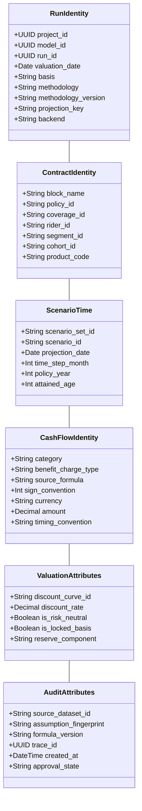
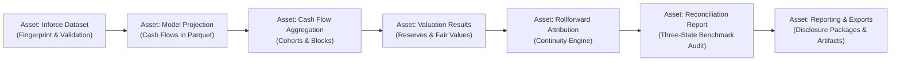

# SAMUEL CONTROLLING SPECIFICATION: MILESTONE 5 (WEEK 5)
# Valuation Frameworks, Configurable Rollforward Attribution, Derived Datasets, and Real Dagster Orchestration

> **Document Type:** Controlling Engineering Specification derived from CAS/MP/W0R/ITD  
> **Assigned Engineer:** Samuel Ayinla — Technical Lead & Core Backend Architecture  
> **Status:** CONTROLLING ARCHITECTURAL SPECIFICATION — INTEGRATION APPROVED  
> **Target Delivery:** Greenfield Launch Release 1.0 — Milestone 5 / SDLC Week 5  
> **Controlling Baseline:** CAS §7, §8, §9, §15.6, §15.8; MP §5.6, §7, §8, §9, §14.5; W0R §5; ITD §6  
> **Approved Integration Baseline Git SHA:** `928dec752ec04e6f63c8bef1da3d6d6f5f850af1` (verified clean on `main`)  
> **Git Tracking Branch:** `feat/m5-valuation-frameworks-dagster`  
> **Evidence Review Bundle:** `samuel_m5_frameworks_dagster_review.zip`  

---

## 1. DOCUMENT PURPOSE, AUTHORITY & SCOPE TAXONOMY

### 1.1 Controlling Purpose
This document establishes the authoritative engineering specification for **Milestone 5 (Week 5)** of the MentorAmp platform. It provides the definitive domain models, metadata schemas, service interfaces, orchestration graphs, and testing gates for:
1. **The Common Valuation & Methodology Foundation (M5A):** Decoupled valuation execution consuming projected Parquet cash flows.
2. **Output-as-Input / Derived Dataset Registry (M5B):** Governed promotion of run outputs into versioned, fingerprinted upstream inputs for subsequent runs (`LR1-CORE-028`).
3. **Generic Rollforward & Attribution Framework (M5C):** A flexible accounting attribution engine enforcing mathematical continuity without hardcoded column lists (`CAS` §7.2).
4. **Real Dagster Orchestration Workflow (M5D):** Production pipeline orchestration across import, validation, projection, valuation, reconciliation, and reporting with retries, lineage, and failure recovery (`CAS` §9, §15.8).
5. **Six Distinct Framework Reference Verticals (M5E):** Isolated, independently testable implementations for **VM-21**, **VM-22**, **LDTI**, **DAC**, **MRB**, and **ASC 815** (`CAS` §7).

### 1.2 Hierarchy of Authority
This specification is subordinate to the project's governing documents:
* **`CAS`**: *MentorAmp Launch Release 1.0 — Consolidated Architecture and Delivery Specification* (Primary scope authority).
* **`MP`**: *MentorAmp Launch Release 1.0 — Greenfield E2E Weekly SDLC Master Plan v2* (Execution and sequencing companion).
* **`W0R`**: *MentorAmp Week 0 Greenfield Project Initialization and Readiness Plan* (Architectural baseline).
* **`ITD`**: *MentorAmp Week 0 Independent Team Task Document* (Role ownership).

If this specification conflicts with any authoritative source, **the authoritative source wins**.

### 1.3 Scope Classification Taxonomy
To maintain strict auditability, every concept in this document is labeled with one of the following:
* `[AUTHORITATIVE PROJECT REQUIREMENT]`: Explicitly mandated by `CAS`, `MP`, `W0R`, or `ITD`. Mandatory for Launch 1.0.
* `[CURRENT EXTERNAL REGULATORY/ACCOUNTING REQUIREMENT]`: Mandated by NAIC Valuation Manual (VM-21, VM-22, VM-31) or US GAAP (FASB ASU 2018-12 / ASC 944, ASC 815, ASC 820).
* `[OWNER-SELECTED REFERENCE CASE]`: Concrete product, cohort, assumption, and tolerance selections requiring formal sign-off from the Actuarial Product Owner before final formula lock.
* `[RESEARCH-BACKED RECOMMENDATION]`: Architectural optimization or design choice derived from industry benchmarks. Advisory only; must not replace authoritative requirements.

---

## 2. STRICT ARCHITECTURAL INVARIANTS & FORBIDDEN ANTI-PATTERNS

### 2.1 Strict Separation of Basis and Methodology
> [!CAUTION]
> **FORBIDDEN:** Do NOT combine Basis and Methodology into a single enum (e.g. `GAAP`, `STAT`, `VM21`).
> That conflates the **regulatory reporting regime** with the **actuarial calculation methodology**.

* **`basis` [AUTHORITATIVE PROJECT REQUIREMENT]:** The governing financial accounting regime:
  * `GAAP` (US GAAP / SEC Reporting)
  * `STATUTORY` (US Statutory Accounting Principles / NAIC)
  * `TAX` (US Federal Income Tax Reserving, if approved)
* **`methodology` [AUTHORITATIVE PROJECT REQUIREMENT]:** The discrete calculation ruleset applied to cash flows:
  * `VM21` (NAIC PBR for Variable Annuities & RILAs)
  * `VM22` (NAIC PBR for Non-Variable Annuities)
  * `LDTI` (US GAAP Long-Duration Targeted Improvements / ASC 944 Liability for Future Policy Benefits)
  * `DAC` (Deferred Acquisition Costs / VOBA Amortization)
  * `MRB` (Market Risk Benefits Fair Value under ASC 944-40)
  * `ASC815` (Embedded Derivative & Host Contract Bifurcation, formerly FAS 133)
* **Rule:** Every valuation run and every model version must independently freeze both `basis` and `methodology`.

### 2.2 Configurable Rollforward & Attribution (No Hardcoded 6-Column Waterfalls)
> [!CAUTION]
> **FORBIDDEN:** Do NOT hardcode a universal "6-part rollforward" table in SQL or TypeScript.
> Different accounting standards mandate different attribution components.

The framework must support a configurable sequence of methodology-defined components:
* `beginning_balance`
* `new_business`
* `expected_change` (or interest accretion / expected growth)
* `actual_experience` (or experience variances)
* `assumption_unlock` (or cash flow assumption remeasurement)
* `discount_rate_movement` (or market rate remeasurement into OCI)
* `cash_flows_paid` (benefits, surrenders, expenses)
* `other_attribution` (methodology-specific component)
* `ending_balance`

**Mathematical Continuity Invariant:**  
$$\text{Beginning Balance} + \sum (\text{Attributed Movements}) = \text{Ending Balance} \quad (\pm \text{governed tolerance})$$

### 2.3 Strict Separation of All Six Frameworks
> [!CAUTION]
> **FORBIDDEN:** Do NOT collapse LDTI + DAC or VM-21 + VM-22 into single hybrid modules.

Each of the six launch frameworks represents an independent calculation discipline:
1. `VM-21` $\neq$ `VM-22`: VM-21 applies to variable and market-index linked contracts (VAs, RILAs) requiring stochastic equity models. VM-22 applies to non-variable contracts (MYGA, fixed annuities, SPIA, PRT) with separate exclusion tests and deterministic/stochastic rules.
2. `LDTI` $\neq$ `DAC`: LDTI computes the Liability for Future Policy Benefits (LFPB) via Net Premium Ratio. DAC is an asset amortization schedule run on a constant-level basis. They share cohort grouping attributes, but their math, balance sheets, and rollforwards are completely distinct.
3. `MRB` $\neq$ `ASC 815`: MRB measures guaranteed living/death benefits under ASC 944-40 at fair value (with instrument-specific credit risk in OCI). ASC 815 bifurcates embedded equity-indexed derivatives from debt host contracts under derivative accounting rules.

### 2.4 Product Projection vs Valuation Separation
Product projection engines (`spia_lite`, `myga_lite`, `fia_lite`, `rila_lite`) produce raw contractual and behavioral cash flows. The **Valuation Engine** consumes those cash flows and applies methodology-specific discounting, compounding, and tail aggregation. Product projection logic must never contain valuation accounting conclusions.

### 2.5 Multi-Tenancy & Project Isolation (Zero IDOR Leakage)
Every valuation run, derived dataset, rollforward schedule, and Dagster asset execution is scoped to a specific `project_id`. Querying or referencing assets from an unauthorized project strictly raises HTTP 404 (Object Not Found), preventing cross-tenant information leakage (`CORR-01`).

### 2.6 Storage Separation: Relational Metadata vs Columnar Parquet
* **PostgreSQL:** Stores governance metadata, run packages, configuration snapshots, rollforward balance summaries, audit trails, and execution states.
* **Apache Parquet:** Stores massive, high-dimensional projection cash flows, monthly cohort rollforwards, stochastic path results, and policy-level valuation outputs.

### 2.7 Canonical Run Architecture Invariant (No Duplicate Run Systems)
> [!CAUTION]
> **FORBIDDEN:** Do NOT invent a second parallel run architecture for valuation.
> Valuation executions are first-class MentorAmp runs that reuse the canonical `Run`, `RunPackage`, `RunArtifact`, model governance, and execution-state infrastructure.

* **Reused Infrastructure:** A valuation run is represented as a normal canonical run with frozen identity fields: `basis`, `methodology`, `methodology_version`, `source_projection_run_id`, and `derived_dataset_id`.
* **Zero Duplication:** Do NOT create duplicate run lifecycles, duplicate approval models, duplicate manifest systems, or duplicate execution status tables. Any valuation extension table must be strictly subordinate to `runs.id`.
* **Permanent Retention of Evidence:** Governed valuation runs, derived datasets, and rollforward attribution evidence must NEVER use `ON DELETE CASCADE`. Historical evidence must be retained (`ON DELETE RESTRICT`) to preserve unbroken audit trails.

---

## 3. COMPONENT CLASSIFICATION OF EXISTING ASSETS

Per Section 15 of the Master Plan, all existing assets must be classified before building new infrastructure:

| Existing Asset | Path | Classification | Technical Rationale |
| :--- | :--- | :---: | :--- |
| **`Run` Model** | `backend/app/db/models/run.py` | `REUSE` | Stores run lifecycle states, timing, project bindings, and manifest fingerprints. Canonical run architecture reused for valuation runs. |
| **`RunPackage` Model** | `backend/app/db/models/run_package.py` | `REUSE` | Immutable frozen run package with SHA-256 fingerprinting. Reused for freezing valuation basis, methodology, and assumption references. |
| **`RunArtifact` Model** | `backend/app/db/models/run_artifact.py` | `REUSE` | Tracks attempt-scoped Parquet storage URIs, checksums, and partitions. Protected by DB update/delete triggers. |
| **`ModelVersion` Model** | `backend/app/db/models/modeling.py` | `IMPROVE` | Already has separate `basis` and `methodology` string columns. Needs validation check to ensure basis and methodology conform to approved vocabularies. |
| **`VariableRegistry` & `ModelVariableDefinition`** | `backend/app/db/models/variable.py`, `model_variable.py` | `IMPROVE` | Already support `kind="prior_output"`. Needs formal binding to fingerprinted derived datasets. |
| **Parquet Storage Engine** | `backend/app/core/artifacts.py` | `REUSE` | Proven Polars-based Zstandard compressed Parquet writer and reader (`verified_parquet_rows`). |
| **Reconciliation Service** | `backend/app/services/reconciliation_service.py` | `REUSE / EXTEND FOR VALUATION DIMENSIONS` | Three-state reconciliation model (`PASS`, `FAIL`, `NOT_VERIFIABLE`) already exists from M3. Reused and extended only for valuation-specific dimensions (methodology, basis, source runs). |
| **Illustrative Prospective Reserve** | `backend/app/core/valuation/illustrative_reserve.py` | `DO NOT COUNT` | M1 illustrative formula stub (`reserve_t = Σ cash_flow * (1+i)^-t`). Does not meet launch valuation criteria. |
| **Derived Dataset Registry** | N/A (None) | `BUILD` | Required Launch capability (`LR1-CORE-028`). Governed output-as-input service and schema. |
| **Rollforward Attribution Engine** | N/A (None) | `BUILD` | Required Launch capability (`CAS` §7.2). Configurable multi-methodology accounting continuity engine. |
| **Dagster Pipeline Orchestrator** | N/A (None) | `BUILD` | Required Launch capability (`CAS` §9, §15.8). Software-defined assets orchestrating existing backend services. |
| **Six Framework Verticals** | N/A (None) | `BUILD` | Required Launch capability (`CAS` §7). Discrete engines for VM-21, VM-22, LDTI, DAC, MRB, and ASC 815 (execution gated by reference cases). |

---

## 4. MILESTONE 5 WORK PACKAGE ARCHITECTURE

Milestone 5 is structured into **dependency-driven / parallel work packages**: M5A, M5B, M5C, and parts of M5D may proceed in parallel once their common interfaces are defined. M5E framework reference verticals depend on approved actuarial/accounting reference cases and expected values.

```
┌────────────────────────────────────────────────────────────────────────────────────────┐
│                        MILESTONE 5 EXECUTION WORK PACKAGES                             │
└────────────────────────────────────────────────────────────────────────────────────────┘
                                            │
         ┌──────────────────────────────────┴──────────────────────────────────┐
         ▼                                                                     ▼
┌─────────────────────────────────┐                                   ┌─────────────────────────────────┐
│              M5A                │                                   │              M5B                │
│    Common Valuation Engine      │ ─── produces prior outputs ────>  │   Derived Dataset Registry      │
│  & Methodology Foundation       │                                   │     (Output-as-Input)           │
└─────────────────────────────────┘                                   └─────────────────────────────────┘
         │                                                                     │
         │ feeds cash flows                                                    │ resolves inputs
         ▼                                                                     ▼
┌─────────────────────────────────┐                                   ┌─────────────────────────────────┐
│              M5C                │                                   │              M5D                │
│   Configurable Rollforward      │                                   │     Real Dagster Workflow       │
│    & Attribution Framework      │ <── orchestrates all stages ────  │       (Asset Lineage)           │
└─────────────────────────────────┘                                   └─────────────────────────────────┘
                                            │
                                            ▼
┌────────────────────────────────────────────────────────────────────────────────────────┐
│                                          M5E                                           │
│                     Framework Reference Verticals (Execution Gated)                     │
│   [VM-21 (RILA/VA)]   [VM-22 (MYGA/SPIA)]   [LDTI]   [DAC]   [MRB]   [ASC 815]         │
└────────────────────────────────────────────────────────────────────────────────────────┘
```

### 4.1 Work Package M5A — Common Valuation & Methodology Foundation
* **Purpose:** Provide the abstract calculation spine for discounting, present value summation, risk-metric extraction, and reserve component construction without hardcoding product-specific assumptions.
* **Architecture Invariant:** Valuation executions are first-class MentorAmp runs that reuse canonical `Run`, `RunPackage`, and `RunArtifact` records.
* **Key Components:**
  * Canonical Run extension: Enforces frozen `basis`, `methodology`, `methodology_version`, `source_projection_run_id`, and `derived_dataset_id`.
  * `DiscountCurve`: Term structure representation supporting locked inception curves, current valuation date curves, and prescribed regulatory spreads.
  * `ValuationContext`: Encapsulates valuation date, basis, methodology, methodology version, scenario weights, and discount curve references.
  * Analytical storage: Parquet analytical cash flow/reserve matrices and PostgreSQL summary components.

### 4.2 Work Package M5B — Output-as-Input / Derived Dataset Registry
* **Purpose:** Authoritative requirement (`CAS` §5, `MP` W5, `LR1-CORE-028`). Enable a completed run's outputs (e.g. baseline projected account values or decrements) to be registered as an immutable, governed dataset that serves as an input to downstream valuation or sensitivity runs.
* **Key Dimensions Preserved:**
  * `source_project_id`, `source_model_id`, `source_run_id`
  * `product_code`, `schema_version`, `dataset_version`
  * `fingerprint` (SHA-256 over canonical record content)
  * `scenario_id`, `policy_id`, `segment_id`, `cohort_id`
  * `provenance`: upstream formula versions and assumption fingerprints
  * `approval_state`: only approved or validated outputs can be promoted to derived inputs.
* **Resolver Integration:** The Variable Resolver inspects `model_variable_definitions` where `kind = 'prior_output'`. It maps the target variable directly to the specified column of the fingerprinted derived dataset without manual data re-entry.

### 4.3 Work Package M5C — Generic Rollforward & Attribution Framework
* **Purpose:** Implement `CAS` §7.2. A configurable accounting attribution engine capable of reconciling opening to closing balances across arbitrary methodology components.
* **Key Capabilities:**
  * Component definition catalog: Maps each methodology to its required attribution components.
  * Mathematical continuity validation: Validates that balance changes equal the sum of attributed movements within tolerance (`Beginning + Sum(Movements) = Ending`).
  * Disaggregation support: Generates rollforward summaries at policy, cohort, segment, and aggregate portfolio levels.
  * Three-state reconciliation integration: Asserts mathematical reconciliation against external benchmarks (`PASS`, `FAIL`, `NOT_VERIFIABLE`).

### 4.4 Work Package M5D — Real Dagster Workflow Orchestration
* **Purpose:** Implement `CAS` §9 and §15.8. A production pipeline orchestrating all calculation and governance stages.
* **Pipeline Sequence:**
  $$\text{Inforce Import} \longrightarrow \text{Validation} \longrightarrow \text{Projection} \longrightarrow \text{Aggregation} \longrightarrow \text{Valuation} \longrightarrow \text{Rollforward / Attribution} \longrightarrow \text{Reconciliation} \longrightarrow \text{Reporting / Export}$$
* **Orchestration Rules:**
  * Dagster assets call MentorAmp service layer interfaces; **Dagster assets contain zero actuarial formulas**.
  * Complete operational tracking: records asset dependencies, execution status, runtime duration, retry attempts, error logs, produced dataset fingerprints, and lineage.
  * Controlled failure and retry policies: automatic retries on transient network/database errors; deterministic halt on calculation assertion failures.

### 4.5 Work Package M5E — Six Framework Reference Verticals
* **Purpose:** Implement `CAS` §7. Dedicated vertical calculation slices for each required framework (execution gated by owner-approved reference cases):
  1. **VM-21:** Versioned RILA/VA principle-based reserving methodology supporting selected Valuation Manual edition requirements, stochastic reserve calculations, prescribed/scenario inputs, supporting assets where required, policyholder behavior, hedging/CDHS treatment, tail-measure calculations, Additional Standard Projection Amount / standard projection requirements, aggregation, trace, and reconciliation.
  2. **VM-22:** Non-variable annuity PBR framework, Stochastic Exclusion Test (SET), Single Scenario Test (SST), Deterministic Reserve (DR), Cash Surrender Value Floor, and methodology versioning.
  3. **LDTI:** ASC 944 Liability for Future Policy Benefits (LFPB), Net Premium Ratio (NPR) capped at 100%, dual discount rate handling (locked-in vs current A-grade), annual assumption unlocking, cohorts, and disclosure-supporting fields.
  4. **DAC:** Independent capitalized-cost tracking, constant-level amortization over contract lifetime, no interest accretion, no shadow adjustments.
  5. **MRB:** ASC 944-40 fair value calculation on market risk benefits under risk-neutral scenarios, attributed fees, and own credit risk in OCI.
  6. **ASC 815:** Hybrid contract bifurcation architecture supporting host debt contract, embedded derivative mark-to-market, account-value attribution, cash flows, discounting, valuation results, and component-to-total reconciliation (exact accounting conclusions deferred to owner-approved reference case).

---

## 5. CANONICAL DATA MODELS & DIMENSION CONTRACTS

Per `CAS` §8, the valuation data model must preserve enough dimensionality to discount, aggregate, attribute, reconcile, and disclose results without rerunning upstream product logic.



### 5.1 Relational Metadata Schemas (PostgreSQL Conceptual Proposals)

> [!NOTE]
> The DDL below represents **conceptual architectural proposals, NOT approved DDL**.
> Before creating physical tables, existing schemas (`runs`, `run_packages`, `run_artifacts`) are evaluated to determine if they can be directly extended.
> In accordance with MentorAmp governance invariants, **all foreign keys to governed evidence use `ON DELETE RESTRICT` (NEVER `CASCADE`)** so that deleting a parent entity cannot destroy historical audit evidence.

```sql
-- 1. Derived Dataset Registry (M5B Conceptual Proposal)
CREATE TABLE derived_datasets (
    id VARCHAR(36) PRIMARY KEY,
    project_id VARCHAR(36) NOT NULL REFERENCES projects(id) ON DELETE RESTRICT,
    source_run_id VARCHAR(36) NOT NULL REFERENCES runs(id) ON DELETE RESTRICT,
    source_artifact_id VARCHAR(36) REFERENCES run_artifacts(id) ON DELETE RESTRICT,
    dataset_name VARCHAR(255) NOT NULL,
    dataset_version VARCHAR(30) NOT NULL,
    product_code VARCHAR(50) NOT NULL,
    schema_version VARCHAR(30) NOT NULL,
    fingerprint VARCHAR(64) NOT NULL,
    storage_uri VARCHAR(1000) NOT NULL,
    row_count INTEGER NOT NULL,
    dimensions_available JSONB NOT NULL,
    status VARCHAR(30) NOT NULL DEFAULT 'draft',
    approved_by VARCHAR(36) REFERENCES users(id) ON DELETE SET NULL,
    approved_at TIMESTAMPTZ,
    created_at TIMESTAMPTZ NOT NULL DEFAULT CURRENT_TIMESTAMP,
    CONSTRAINT uq_derived_dataset_version UNIQUE (project_id, dataset_name, dataset_version)
);

-- 2. Valuation Runs Extension (M5A Conceptual Proposal - subordinate to canonical runs)
-- Note: Subordinate to canonical runs.id; reuses canonical run lifecycle, manifests, and triggers.
CREATE TABLE valuation_run_details (
    run_id VARCHAR(36) PRIMARY KEY REFERENCES runs(id) ON DELETE RESTRICT,
    project_id VARCHAR(36) NOT NULL REFERENCES projects(id) ON DELETE RESTRICT,
    source_projection_run_id VARCHAR(36) NOT NULL REFERENCES runs(id) ON DELETE RESTRICT,
    derived_dataset_id VARCHAR(36) REFERENCES derived_datasets(id) ON DELETE RESTRICT,
    basis VARCHAR(50) NOT NULL,
    methodology VARCHAR(50) NOT NULL,
    methodology_version VARCHAR(50) NOT NULL,
    valuation_date DATE NOT NULL,
    discount_curve_fingerprint VARCHAR(64) NOT NULL,
    configuration JSONB NOT NULL DEFAULT '{}',
    summary_results JSONB NOT NULL DEFAULT '{}',
    created_at TIMESTAMPTZ NOT NULL DEFAULT CURRENT_TIMESTAMP,
    completed_at TIMESTAMPTZ,
    CONSTRAINT ck_valuation_basis CHECK (basis IN ('GAAP', 'STATUTORY', 'TAX')),
    CONSTRAINT ck_valuation_methodology CHECK (methodology IN ('VM21', 'VM22', 'LDTI', 'DAC', 'MRB', 'ASC815'))
);

-- 3. Rollforward Attribution Summaries (M5C Conceptual Proposal)
-- Note: ON DELETE RESTRICT ensures audit continuity cannot be silently purged.
CREATE TABLE rollforward_summaries (
    id VARCHAR(36) PRIMARY KEY,
    run_id VARCHAR(36) NOT NULL REFERENCES runs(id) ON DELETE RESTRICT,
    cohort_id VARCHAR(100) NOT NULL,
    methodology VARCHAR(50) NOT NULL,
    basis VARCHAR(50) NOT NULL,
    currency VARCHAR(10) NOT NULL DEFAULT 'USD',
    component_name VARCHAR(100) NOT NULL,
    component_order INTEGER NOT NULL,
    opening_balance NUMERIC(18, 4) NOT NULL,
    movement_amount NUMERIC(18, 4) NOT NULL,
    closing_balance NUMERIC(18, 4) NOT NULL,
    is_continuity_verified BOOLEAN NOT NULL DEFAULT FALSE,
    trace_identifier VARCHAR(64) NOT NULL,
    created_at TIMESTAMPTZ NOT NULL DEFAULT CURRENT_TIMESTAMP
);
```

### 5.2 Analytical Storage Schemas (Apache Parquet)
Detailed cash flow discounting, monthly cohort balances, and path-by-path stochastic reserves are written to attempt-scoped Parquet files with Zstandard compression:
* **`cash_flows.parquet`**: Contains contract, scenario, time step, category, amount, discount factor, and discounted present value.
* **`valuation_policy_detail.parquet`**: Contains per-policy reserve components across all valuation dates and scenarios.
* **`stochastic_paths.parquet`**: Contains scenario-by-scenario present value of accumulated losses for CTE calculation.

---

## 6. FRAMEWORK-BY-FRAMEWORK TECHNICAL SPECIFICATIONS & REGULATORY RESEARCH

### 6.1 NAIC VM-21 (Requirements for Principle-Based Reserves for Variable Annuities & RILAs)
* **Scope Taxonomy:** `[CURRENT EXTERNAL REGULATORY REQUIREMENT]` & `[AUTHORITATIVE PROJECT REQUIREMENT]`
* **Applicability:** Variable Annuities and Registered Index-Linked Annuities (RILA) carrying market-linked guarantees (`CAS` §7).
* **Reserve Architecture:**
  VM-21 is implemented as a versioned principle-based methodology capable of supporting the explicit requirements of the selected Valuation Manual edition (`ACT-DEC-02`), including:
  * Stochastic reserve calculations across prescribed economic scenarios (e.g., GOES).
  * Prescribed and prudent best-estimate assumptions for policyholder behavior (surrenders, partial withdrawals, annuitization), expenses, and mortality.
  * Supporting asset modeling and asset-liability projection where required by the selected method.
  * Clearly Defined Hedging Strategy (CDHS) integration (supporting both "CTE with hedging" and "CTE without hedging" comparisons).
  * Tail-measure calculations conforming to the governing Valuation Manual requirements (e.g., CTE metrics).
  * Additional Standard Projection Amount (ASPA) / applicable standard projection requirements acting as regulatory guardrails.
  * Multi-level aggregation, cell-level trace, and three-state reconciliation.

### 6.2 NAIC VM-22 (PBR for Non-Variable Annuities)
* **Scope Taxonomy:** `[CURRENT EXTERNAL REGULATORY REQUIREMENT]` & `[AUTHORITATIVE PROJECT REQUIREMENT]`
* **Applicability:** Fixed deferred annuities, MYGA, Fixed Indexed Annuities (FIA), SPIA, and Pension Risk Transfer (PRT).
* **Effective Date Governance:**
  * Effective January 1, 2026 for new business. Optional 3-year transition period (2026–2028). Mandatory full adoption January 1, 2029.
  * Methodology version and effective valuation date must be first-class metadata attributes.
* **Exclusion Tests:**
  * **Stochastic Exclusion Test (SET):** Demonstrates that interest rate risk is not material enough to warrant stochastic modeling.
  * **Single Scenario Test (SST):** Available for payout annuities (SPIA/PRT) with non-economically sensitive policyholder behavior.
* **Calculation Components:**
  * **Deterministic Reserve (DR):** Single prescribed economic scenario alongside company prudent best-estimate assumptions.
  * **Stochastic Reserve (SR):** Evaluated at CTE 70 across GOES scenarios when exclusion tests fail.
  * **Cash Surrender Value (CSV) Floor:** Reserve must never drop below the contractual aggregate cash surrender value floor.

### 6.3 US GAAP LDTI (FASB ASU 2018-12 / ASC 944)
* **Scope Taxonomy:** `[CURRENT EXTERNAL REGULATORY REQUIREMENT]` & `[AUTHORITATIVE PROJECT REQUIREMENT]`
* **Applicability:** Long-duration contracts (traditional life, immediate annuities, fixed deferred annuities).
* **Core Architecture:**
  * Cohort and contract grouping structures.
  * Future cash flow discounting and liability balance rollforwards.
  * Liability for Future Policy Benefits (LFPB) via Net Premium Ratio (NPR) calculation.
  * **100% NPR Cap:** NPR cannot exceed 100%. If expected benefits exceed premiums, NPR is capped at 1.0 and an immediate loss is recognized in net income.
  * **Annual Assumption Unlocking:** Best-estimate demographic and behavioral assumptions are reviewed at least annually; changes update NPR prospectively.
  * **Dual Discount Rate Framework:** Original locked-in rate for NPR interest accretion in net income; current upper-medium grade (A-grade) yield for balance sheet measurement, with delta recognized in Other Comprehensive Income (OCI).
  * Income statement components and disclosure-supporting fields.
  * **Controlled Reference Semantics:** Product applicability, cohort definitions, and specific discount curves are not pre-decided; they belong to owner-approved reference cases (`ACT-DEC-04`).

### 6.4 Deferred Acquisition Costs (DAC) & VOBA Amortization
* **Scope Taxonomy:** `[CURRENT EXTERNAL REGULATORY REQUIREMENT]` & `[AUTHORITATIVE PROJECT REQUIREMENT]`
* **Applicability:** Capitalized policy acquisition costs across covered annuity lines.
* **Independence Invariant:** DAC is an independent framework/work package and must NOT be merged into LDTI architecture.
* **Core Architecture:**
  * Capitalized-cost inputs and grouping attributes.
  * Constant-level amortization architecture over expected contract life.
  * **No Interest Accretion:** Interest is not accrued on unamortized DAC balances.
  * **No Shadow Adjustments:** Shadow DAC adjustments through OCI are eliminated.
  * Balance rollforward, adjustments, attribution, and reconciliation.
  * **Controlled Reference Semantics:** The selected amortization basis (in-force counts vs face amount vs account value units) is not pre-decided; it belongs to owner-approved reference cases (`ACT-DEC-05`).

### 6.5 Market Risk Benefits (MRB — ASC 944-40 / ASC 820)
* **Scope Taxonomy:** `[CURRENT EXTERNAL REGULATORY REQUIREMENT]` & `[AUTHORITATIVE PROJECT REQUIREMENT]`
* **Applicability:** Variable Annuity and RILA guarantees exposing the insurer to capital market risk (GMDB, GMWB, GLWB).
* **Fair Value Measurement:**
  * Measured independently at **Fair Value** each reporting period under risk-neutral market scenarios.
  * Present value of projected benefit cash flows minus present value of attributed guarantee fees.
  * **Earnings vs OCI Split:** Period-over-period fair value changes flow through net income, **except** changes attributable to instrument-specific credit risk (insurer's own nonperformance risk), which flow through OCI.

### 6.6 ASC 815 (formerly FAS 133) Embedded Derivatives & Host Contract Bifurcation
* **Scope Taxonomy:** `[CURRENT EXTERNAL REGULATORY REQUIREMENT]` & `[AUTHORITATIVE PROJECT REQUIREMENT]`
* **Applicability:** Equity-Indexed Annuities (FIA) and Registered Index-Linked Annuities (RILA).
* **Bifurcation & Measurement Architecture:**
  * The architecture supports host contract component identification, embedded derivative component identification, applicable account-value attribution, cash flows, discounting, valuation results, and component-to-total reconciliation.
  * **Accounting Independence:** Predetermined accounting conclusions (e.g. host contract always accreting at guaranteed floor rate, or derivative fair value always zero at inception) are removed. The exact reference accounting treatment (host identification, embedded feature identification, initial measurement, host accretion convention, derivative valuation inputs, subsequent measurement) belongs strictly to the approved ASC 815 reference case (`ACT-DEC-07`). Engineering does not pre-judge accounting conclusions.

---

## 7. TRACEABILITY & THREE-STATE RECONCILIATION ENGINE

To satisfy `CAS` §12 and `CORR-15`, framework results must be traceable through every step:
$$\text{Valuation Result} \longrightarrow \text{Methodology Step} \longrightarrow \text{Projected Cash Flow} \longrightarrow \text{Policy/Time Step} \longrightarrow \text{Formula/Assumption Snapshot}$$

Reconciliation reports must strictly categorize every verification check into one of three states:
1. **`PASS`**: Calculated actual output equals expected benchmark value within specified absolute and relative tolerances ($|\text{actual} - \text{expected}| \le \text{abs\_tol} + \text{rel\_tol} \times |\text{expected}|$).
2. **`FAIL`**: Calculated value differs from expected benchmark beyond tolerance.
3. **`NOT_VERIFIABLE`**: Upstream source evidence, formula trace, or benchmark target data is missing or unlinked. Missing data must **NEVER** silently pass or be treated as zero (`CORR-15`).

---

## 8. DAGSTER ASSET PIPELINE & ORCHESTRATION ARCHITECTURE

The Dagster orchestration module (`app/orchestration/dagster/`) implements the end-to-end pipeline required by `CAS` §9 and §15.8:



### 8.1 Software-Defined Assets Specification
1. **`inforce_data_asset`**: Ingests, validates, and fingerprints policy blocks from `InforceFile`.
2. **`projection_run_asset`**: Invokes `run_projection()` on the core projection engine, writing multi-segment monthly cash flows to Parquet.
3. **`aggregation_asset`**: Performs actuarial roll-forward aggregation: summing monetary flows (premiums, claims) and taking period-end for stocks (account values) (`CORR-02`).
4. **`valuation_asset`**: Invokes the methodology-specific valuation engine (VM-21, VM-22, LDTI, DAC, MRB, ASC 815) on projected cash flows.
5. **`rollforward_asset`**: Executes the configurable attribution framework, verifying that opening balance + movements = closing balance.
6. **`reconciliation_report_asset`**: Compares valuation outputs against approved external benchmarks and persists immutable three-state reports.
7. **`reporting_asset`**: Generates reproducible disclosure packages, balance-sheet schedules, and export manifests.

### 8.2 Failure Recovery & Retry Policies
* **Transient Infrastructure Failures:** Database timeouts or file locks trigger up to 3 automatic retries with exponential backoff (initial delay: 10s, max delay: 120s).
* **Actuarial Assertion Failures:** Math continuity failures, circular dependency errors, or reconciliation tolerance breaches halt the pipeline immediately, mark the asset as `FAILED`, and record the exact failure context in the audit trail without retrying corrupt logic.

---

## 9. ACTUARIAL & ACCOUNTING DECISION REGISTER

Before final formula lock, the Actuarial Product Owner must resolve the following open decisions. Each decision is categorized by its blocking gate:

| Decision ID | Description | Impacted Framework | Gating Impact | Status |
| :--- | :--- | :---: | :---: | :---: |
| **ACT-DEC-01** | Selection of primary RILA/VA reference product, guaranteed benefit types (GMDB vs GLWB), and fee attribution rules. | VM-21, MRB | Blocks Verification / Golden Tests | **OPEN** |
| **ACT-DEC-02** | VM-21 Valuation Manual edition, reference product/case, hedging/CDHS treatment, supporting asset treatment, prescribed assumptions, and required tail-measure implementation. | VM-21 | Blocks Verification / Golden Tests | **OPEN** |
| **ACT-DEC-03** | Selection of VM-22 reference case (MYGA vs SPIA vs PRT), applicable Valuation Manual edition (2026 vs 2027), and SST eligibility. | VM-22 | Blocks Verification / Golden Tests | **OPEN** |
| **ACT-DEC-04** | LDTI reference contract/cohort, initial Net Premium Ratio ceiling, and prescribed A-grade discount curve provider. | LDTI | Blocks Verification / Golden Tests | **OPEN** |
| **ACT-DEC-05** | DAC constant-level amortization basis selection (in-force policy count vs face amount vs account value units). | DAC | Blocks Verification / Golden Tests | **OPEN** |
| **ACT-DEC-06** | Treatment of insurer nonperformance risk (own credit risk) in MRB fair value calculations. | MRB | Blocks Verification / Golden Tests | **OPEN** |
| **ACT-DEC-07** | ASC 815 complete reference accounting treatment, including host identification, embedded feature identification, initial measurement, host accretion/discount convention, derivative valuation inputs, subsequent measurement, and component-to-total reconciliation. | ASC 815 | Blocks Verification / Golden Tests | **OPEN** |
| **ACT-DEC-08** | Specific rollforward attribution component lists and tolerance thresholds for each of the six frameworks. | All Frameworks | Blocks Verification / Golden Tests | **OPEN** |
| **ACT-DEC-09** | Formal confirmation of ASU 2018-12 disclosure table layouts and disaggregation levels. | GAAP Reporting | Blocks Acceptance Gate | **OPEN** |

> [!NOTE]
> None of the open actuarial decisions block **Work Packages M5A, M5B, M5C, or M5D** (infrastructure, data models, derived datasets, rollforward engine, and Dagster workflows). Engineering work proceeds immediately on the core infrastructure.

---

## 10. TEST STRATEGY & VERIFICATION MATRIX

Every milestone capability must pass repeatable automated test gates before acceptance:

```
┌────────────────────────────────────────────────────────────────────────────────────────┐
│                              AUTOMATED TEST MATRIX                                     │
├────────────────────────────┬─────────────────────────────┬─────────────────────────────┤
│ Level 1: Unit & Model      │ Level 2: Engine & Framework │ Level 3: System & Pipeline  │
├────────────────────────────┼─────────────────────────────┼─────────────────────────────┤
│ • Basis/Methodology split  │ • LDTI NPR cap at 100%      │ • Dagster end-to-end run    │
│ • Domain model constraints │ • Dual discount rates (OCI) │ • Failure & retry recovery  │
│ • Variable kind resolution │ • VM-21 CTE tail math       │ • Source-to-result trace    │
│ • Parquet schema format    │ • VM-22 CSV floor clamp     │ • Three-state reconciliation│
│ • Immutability triggers    │ • DAC constant run-off      │ • Zero-to-head migration    │
│ • IDOR project isolation   │ • MRB Fair Value (ASC 820)  │ • Multi-tenancy leak tests  │
│ • Rollforward continuity   │ • ASC 815 Host bifurcation  │ • M1–M4 regression suite    │
└────────────────────────────┴─────────────────────────────┴─────────────────────────────┘
```

### Specific Test Suites Required:
1. **`test_basis_methodology_separation.py`**: Asserts that `basis` and `methodology` are validated independently and frozen in run packages.
2. **`test_derived_dataset_registry.py`**: Verifies that run outputs can be registered as fingerprinted derived datasets and consumed by downstream runs via `kind='prior_output'`.
3. **`test_rollforward_continuity.py`**: Tests opening + movements = closing across various configured component structures. Asserts rejection when balance does not balance.
4. **`test_dagster_orchestration.py`**: Executes the real multi-step Dagster pipeline against test projects; verifies lineage recording and retry behavior on injected faults.
5. **`test_framework_accounting.py`**: Verifies mathematical mechanics for VM-21, VM-22, LDTI, DAC, MRB, and ASC 815 against hand-calculated synthetic unit cases.
6. **`test_m5_migrations.py`**: Executes Alembic upgrade, downgrade, and zero-to-head on disposable PostgreSQL.

---

## 11. FINAL REVIEW BUNDLE & ACCEPTANCE CRITERIA

Upon completion of Milestone 5 engineering, the deliverable must be packaged into:
`samuel_m5_frameworks_dagster_review.zip`

### Review Bundle Contents:
1. **`IMPLEMENTATION_REPORT.md`**: Executive summary of delivered capabilities, architecture decisions, and test results.
2. **`git_diff.patch`**: Clean unified git diff against `main`.
3. **Database Migration Evidence**: Alembic migration scripts, upgrade/downgrade logs, and PostgreSQL trigger verification.
4. **Derived Dataset Evidence**: Provenance logs showing prior-run outputs successfully consumed by downstream valuation runs.
5. **Rollforward Attribution Evidence**: Formatted rollforward schedules proving mathematical continuity.
6. **Dagster Orchestration Evidence**: Execution logs, asset lineage graphs, and failure/retry test evidence.
7. **Three-State Reconciliation Reports**: Golden run comparison reports verifying `PASS`, `FAIL`, and `NOT_VERIFIABLE` categorizations.
8. **Automated Test Report**: 100% green pytest execution log covering all unit, integration, and M1–M4 regression tests.

---

## 12. PARALLEL EXECUTION ROADMAP: WHAT SAMUEL CAN START IMMEDIATELY

While Noah implements Milestone 4 (FIA & RILA) and the Actuarial Product Owner confirms reference cases:

```
┌────────────────────────────────────────────────────────────────────────────────────────┐
│                     WHAT SAMUEL CAN IMPLEMENT IMMEDIATELY (M5)                         │
├────────────────────────────────────────────────────────────────────────────────────────┤
│ 1. Common Valuation Domain Models & Alembic Migration (M5A)                            │
│    • Extend ModelVersion and Run to enforce separate basis & methodology vocabularies  │
│    • Implement ValuationRun metadata tables with PostgreSQL immutability triggers       │
│                                                                                        │
│ 2. Output-as-Input / Derived Dataset Registry (M5B)                                     │
│    • Build derived_datasets registry table and promotion service                       │
│    • Extend Variable Resolver to look up kind='prior_output' in fingerprinted datasets │
│                                                                                        │
│ 3. Generic Rollforward Attribution Engine (M5C)                                        │
│    • Build configurable component waterfall continuity validator                       │
│    • Implement rollforward persistence and disaggregation helpers                      │
│                                                                                        │
│ 4. Dagster Asset Pipeline Infrastructure (M5D)                                         │
│    • Set up Dagster software-defined assets wrapping existing backend services          │
│    • Wire automatic retries, error traps, and asset lineage tracking                   │
│                                                                                        │
│ 5. Isolated Mathematical Framework Kernels (M5E Foundation)                            │
│    • Implement pure discounting, NPR solver, and CTE tail-metric mathematical helpers  │
│    • (Specific reference case numbers deferred until ACT-DEC approvals)                │
└────────────────────────────────────────────────────────────────────────────────────────┘
```
