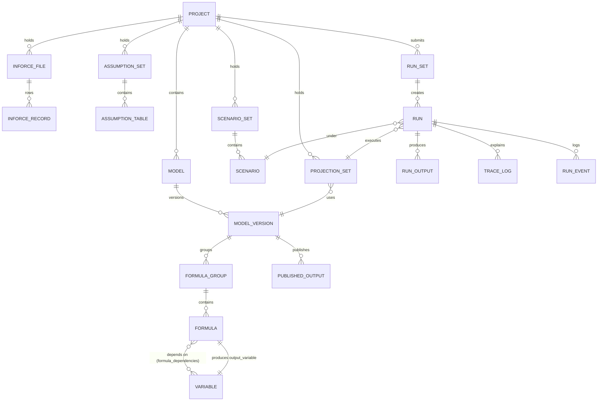

# MentorAmp — Backend ↔ Frontend Contract

**Version:** 1.2 (2026-09-30) — **Work Package 1 (Appendix D) and its correction pass (Appendix E) change the run, manifest, results, variables and access rules; read Appendices D and E first.** Where they and an earlier section disagree, E wins over D, and D over the rest.
**Status:** Working contract for Milestone 1 (binding for M1 endpoints marked `M1`); later milestones are specified so nothing from the CAS is dropped, and they will be refined before they are built.
**Owner:** Samuel Ayinla (Technical Lead). **Reviewers:** Noah Enemali (backend), Sam Yung (frontend).
**Backend branch implementing M1:** `feat/m1-first-real-run` (from `main` `6dd5e41`).
**Frontend baseline:** `BemaISLTD/mentor-amp` `main` `39913d6` ("volt-1.0_push"). All screen names and button labels below are copied from that source.

---

## How to use this document

| You are… | Read… |
|---|---|
| **Sam Yung** (wiring screens) | §C global rules, then your screen in §E, then Appendix A (TypeScript types) and Appendix B (wiring order). Every button in your code has a row in §E. |
| **Noah** (backend) | §C, §D (tables), §E (endpoints), §F (engine). |
| **Samuel** | Everything; §F and §G define the engine and demo data. |
| **Product Owner / QA** | §A, §E summaries, §H (what is not in M1), §I (traceability to the CAS). |

### Milestone tags used everywhere

| Tag | Meaning |
|---|---|
| **M1** | Built now. The endpoint exists on `feat/m1-first-real-run` and matches this document exactly. |
| **M2** | Next milestone (MYGA, import lifecycle, Formula Studio read, run cancel, convergence with Noah's `dev`). Shape specified; may be refined. |
| **M3** | Needs business inputs (expected results, tolerances, approvals): reconciliation, formula governance. |
| **LATER** | Launch scope after M3 (frameworks, Dagster, PySpark, GPU, reports, investigations, packaging). |
| **POST** | Post-launch per CAS §16 (scenario generator authoring, Mentor AI). Screens may stay as designs. |
| **UI-ONLY** | Pure navigation or presentation; no backend call. |

---

## Part A — Purpose, authority, glossary

### A.1 Purpose

Sam Yung's frontend is a complete design with hard-coded data and zero API calls. The backend has engine parts no screen uses. This document is the **single agreement** about what data crosses between them: tables, endpoints, JSON, statuses, and what every button does.

### A.2 Authority order (when documents disagree)

1. Consolidated Architecture and Delivery Specification (CAS) — what MentorAmp must do.
2. Master Requirement Tracker (`LR1-*` IDs) and recorded decisions.
3. This contract — what crosses the wire.
4. The implemented UI — what the user sees and clicks.
5. Sample data inside the UI — **never** a source of truth. Several sample values in the UI are inconsistent (see §E.0.4).

The UI never calculates authoritative actuarial values. It formats values that the backend calculated (CAS §4, MP §22).

### A.3 Glossary

| Term | Meaning in MentorAmp | Example |
|---|---|---|
| **Project** | Top-level workspace. Everything (models, data, runs) belongs to one project. | "MentorAmp Demo — SPIA (Illustrative)" |
| **Product** | Actuarial product family. | SPIA, MYGA, FIA, RILA, IDI, VA, PRT |
| **Model** | A named actuarial model for one product inside a project. | "SPIA Illustrative Model" |
| **Model Version** | An immutable-once-approved version of a model: its basis, methodology, formula groups and published outputs. | v0.1 |
| **Block / Profile / Basis** | The block of business, the profile and the valuation basis a model version targets. The UI shows them together. | Synthetic SPIA Block / Illustrative / Illustrative |
| **Methodology** | The valuation framework (VM-21, LDTI…). Separate from basis (CAS §7.1). | "Illustrative prospective reserve" in M1 |
| **Formula Group** | A named bundle of formulas inside a model version, with a lineage state (local, shared, inherited, overridden). | "SPIA core (illustrative)" |
| **Formula** | One controlled calculation that produces one output variable from input variables. | `pv_expected_payment = expected_payment × discount_factor` |
| **Variable** | A named value a formula can ask for. The resolver finds it from inforce, a table, a scenario, the run context, a prior period, or another formula. | `mortality_rate_annual`, `projection_month` |
| **Input dataset** | Versioned data used by runs: Liability Inforce, Asset Inforce, Assumption Tables, Factor Tables, Projection Inputs, Expected Results. | 25 synthetic SPIA policies |
| **Scenario** | A set of overrides applied to variables for a run. Scenarios are grouped in Scenario Sets. | "Low Interest Rate": discount rate set to 3.0% |
| **Projection Set** | A saved, validated configuration: which model version, which inputs, which scenarios, valuation date, horizon, outputs and trace scope. | "SPIA Illustrative — Q4 2026" |
| **Run Set** | One submission of one or more Projection Sets × scenarios. Creates one Run per (Projection Set, scenario). | "Base vs Low Rate" → 2 runs |
| **Run** | One execution of one Projection Set for one scenario. Has status, progress, events, outputs, trace and a manifest. | Run "…· Base" |
| **Manifest** | The immutable record of exactly what a run used (versions, fingerprints, settings) plus its outcome. | SHA-256 fingerprint |
| **Output** | One saved calculated value: run × policy × scenario × month × variable. | `reserve` of SPIA-0001 at month 12 |
| **Aggregate** | Outputs summed across policies and grouped by period (month or year). | Reserve by year |
| **Trace** | The explanation of one value: which formula, which inputs, which table row and keys. Captured during the run. | Tree for one value |
| **Comparison** | Output-by-output difference between two completed runs. | Base vs Low Rate |
| **Reconciliation** | Comparison of a run against **independently prepared expected results** within an approved tolerance, with exceptions and approval (M3). | Actuary's SPIA golden policy |
| **Illustrative** | Formulas written by developers for demonstration, **not actuarially approved**. Every M1 SPIA response carries `"illustrative": true`. | M1 SPIA model |

---

## Part B — The running system

```text
┌────────────────────────────┐   HTTPS/JSON    ┌──────────────────────────────────────────┐
│ Sam Yung's React app (Vite) │ ─────────────▶ │ FastAPI  /v1  (backend/app/api/*)        │
│  pages → API client         │ ◀───────────── │   thin routers → services                │
└────────────────────────────┘                 │   services (backend/app/services/*)      │
                                                │   engine (projection_engine/engine.py)   │
                                                │     pure Python, CPU reference path      │
                                                └───────────────┬──────────────────────────┘
                                                                │ SQLAlchemy
                                                ┌───────────────▼──────────────────────────┐
                                                │ PostgreSQL (Neon)                         │
                                                │ metadata, inputs, runs, outputs, trace    │
                                                └───────────────────────────────────────────┘
```

- **Local backend URL:** `http://localhost:8000` (uvicorn). All application endpoints start with `/v1`. Health: `GET /health`.
- **Frontend configuration:** `VITE_API_BASE_URL=http://localhost:8000/v1` in `.env.local`. Never hard-code the URL.
- **CORS:** allowed origins are configurable with `CORS_ORIGINS` (comma-separated). Default: `http://localhost:5173`, `http://127.0.0.1:5173`, `http://localhost:3000`.
- **Database:** Neon PostgreSQL for M1 (Samuel's new instance). Large results move to Parquet in M2 when Noah's `dev` converges (CAS §10.1, LR1-DATA-011).
- **Execution:** runs execute in a background task in the API process (M1). Dagster orchestration is LATER (CAS §9).
- **API explorer:** `http://localhost:8000/docs` (only when `DEBUG=true`).

---

## Part C — Global API rules

### C.1 Base path and versioning

- Every application endpoint is under `/v1`. Unversioned application routes do not exist.
- Breaking changes create `/v2` for that resource; additive fields do not.
- **Trailing slash:** the routers that existed before M1 are declared with a trailing slash — use `GET /v1/projects/`, `POST /v1/projects/`, `GET /v1/users/`, `GET /v1/formulas/`, `GET /v1/variables/`. Without it FastAPI answers `307` (redirect). All M1 endpoints have **no** trailing slash.

### C.2 Authentication in M1 (demo mode)

- Backend setting `AUTH_MODE=disabled` (allowed only when `DEBUG=true`; startup refuses otherwise).
- In demo mode **no token is needed**. Every request acts as the user `demo-admin@mentoramp.local` (role `admin`, all permissions). The user is created automatically on first request if missing.
- `GET /v1/auth/me` returns this user, so the top bar can show a real name and role instead of the hard-coded "Andrew Johnson · Actuary".
- When `AUTH_MODE=jwt` (the default, and later), the frontend must send `Authorization: Bearer <token>` from `POST /v1/auth/token`. **Build the API client so a token can be added later in one place.**

`GET /v1/auth/me` → `200`
```json
{
  "id": "0b7a3c1e-5f2d-4c8e-9a61-2d7f0e4b9c11",
  "email": "demo-admin@mentoramp.local",
  "full_name": "Demo Admin",
  "is_active": true,
  "roles": ["admin"],
  "created_at": "2026-09-30T07:58:12.114Z"
}
```

### C.3 Request headers

| Header | When | Value |
|---|---|---|
| `Content-Type` | JSON bodies | `application/json` |
| `Accept` | All | `application/json` (CSV export: `text/csv`) |
| `Authorization` | Only when `AUTH_MODE=jwt` | `Bearer <token>` |

### C.4 Error envelope (all errors, all endpoints)

Already implemented on `main` (`backend/app/api/errors.py`).

```json
{
  "error": {
    "code": "NOT_FOUND",
    "message": "Run '8c1…' not found.",
    "details": null
  }
}
```

| HTTP | `code` | When | What the UI shows |
|---|---|---|---|
| 400 | `BAD_REQUEST` | Request is well-formed but not allowed (e.g. comparing runs from different projects) | Inline error with `message` |
| 401 | `UNAUTHORIZED` | Only in `jwt` mode | Redirect to login (M2+) |
| 403 | `FORBIDDEN` | Missing permission | "You do not have permission…" and disable the action |
| 404 | `NOT_FOUND` | Object does not exist | Empty state with "not found" |
| 409 | `CONFLICT` | State does not allow the action (e.g. submitting a Projection Set that is not validated; comparing a run that is still running) | Toast with `message`; keep the user on the page |
| 422 | `VALIDATION_ERROR` | Invalid body or query; `details` is a list of `{loc, msg, type}` | Field-level errors using `details[].loc` |
| 500 | `INTERNAL_SERVER_ERROR` | Unexpected | "Something went wrong" and a retry button |

Some 404/409 responses carry a more specific code in `details.reason`, for example `{"reason": "TRACE_NOT_CAPTURED", "traced_policy_ids": [...]}`.

### C.5 Identifiers

- Every object has a server-generated `id` (UUID string, 36 characters). **The UI must never invent IDs** or reuse one sample ID for many rows (a current UI bug: all models show `mdl_01HR7Z2Q8Y9KJ2M556A1B3C4D`).
- Business keys are separate fields: `policy_id` (for example `SPIA-0001`), `version_label` (`v0.1`), `name`.
- **IDs travel in the URL** (Appendix B): `/projects/:projectId/models/:modelId`, so a reload keeps the user's place.

### C.6 Lists and pagination

List endpoints return:
```json
{ "<items>": [ ... ], "total": 60000, "limit": 1000, "offset": 0 }
```
- `limit` defaults vary per endpoint (stated in §E); the maximum is stated there too.
- Registries (models, scenarios, formulas) are small and may ignore paging in M1 but still return `total`.
- Large collections (results, trace, events) are **always** paged; never load everything into the browser (LR1-APP-005).

### C.7 Dates, numbers, units

| Kind | Format | Example |
|---|---|---|
| Timestamp | ISO 8601 with timezone (UTC `Z`) | `"2026-09-30T08:15:04.221Z"` |
| Business date | ISO date | `"2026-12-31"` |
| Money | JSON number, full precision, plus `unit` | `4889731.24`, `"unit": "USD"` |
| Rate / probability | JSON number as a decimal fraction | `0.045` means 4.5% |
| Percent change | JSON number already ×100 | `-7.83` means −7.83% |
| Missing value | `null` (never `0`, never `""`) | `"change_pct": null` |

The UI formats values (`$4.57M`, `4.50%`); the API never sends formatted strings for numbers.

### C.8 Status vocabularies and the UI `StatusBadge`

Sam Yung's `StatusBadge` accepts: `Validated`, `Needs review`, `Draft`, `Completed`, `Running`, `Paused`, `Cancelled`, `Stale`, `Shared`, `Inherited`, `Overridden`, `Local`.

**Lifecycle status** (models, model versions, inputs, scenarios, Projection Sets, formulas):

| API value | Meaning | UI badge |
|---|---|---|
| `draft` | Being edited; not usable in runs | Draft |
| `validated` | Passed validation; usable in runs | Validated |
| `needs_review` | Usable with warnings, or waiting for a reviewer | Needs review |
| `approved` | Approved by a reviewer (M3) | Validated (add an "Approved" badge in M3) |
| `active` | The approved version currently used (M3) | Validated |
| `superseded` | Replaced by a newer version | Stale |
| `retired` | No longer usable | Stale |

**Run status:**

| API value | Meaning | UI badge |
|---|---|---|
| `pending` | Queued, not started | Running (recommend adding a "Queued" badge) |
| `running` | Executing; see `progress` | Running |
| `success` | Every policy completed | Completed |
| `partial_success` | Some policies failed; results exist for the rest | Needs review |
| `failed` | Nothing usable; see events | **Add a "Failed" badge** (red). Until then: Needs review |
| `cancelled` | Stopped by a user (M2) | Cancelled |

**Run Set status** is derived from its runs: `queued` (all pending), `running` (any running), `success` (all success), `partial_success` (mixed), `failed` (all failed).

**Lineage state** (formula groups): `local`, `shared`, `inherited`, `overridden` → badges Local, Shared, Inherited, Overridden.

### C.9 Long-running work

- Commands that start work return **`202 Accepted`** immediately with the IDs to watch (`POST /v1/run-sets`).
- The UI **polls** `GET /v1/runs/{id}` every **2 seconds** while `status` is `pending` or `running`, and `GET /v1/runs/{id}/events?after_id=<last>` for the log drawer. Stop polling on `success`, `partial_success`, `failed` or `cancelled`.
- Server-sent events or WebSockets may replace polling in LATER; the response shapes stay the same.

### C.10 The `illustrative` flag

Every response that contains or depends on an M1 SPIA formula carries `"illustrative": true` (model versions, formulas, runs, summaries, aggregates, trace). **The UI must show a visible label** near the value, for example a small "Illustrative — not actuarially approved" badge. This protects the team and the business (W0R §2; ITD §12 "Do not invent actuarial expected results").

### C.11 Common UI states (every screen that calls the API)

| State | When | UI |
|---|---|---|
| Loading | Request in flight | Skeleton rows/cards; buttons disabled |
| Empty | `total = 0` | Message and the next action (e.g. "No runs yet — create a Run Set") |
| Error | Non-2xx | The envelope `message`, and a Retry button |
| Not found | 404 | "This item no longer exists" and a link back |
| Conflict | 409 | Toast with `message`; no navigation |
| Forbidden | 403 (jwt mode) | Disable the action and explain |
| Backend unavailable | Network error / `GET /health` fails | Banner "Backend not reachable at `VITE_API_BASE_URL`" |
| Illustrative | `illustrative: true` | Badge beside the value |

### C.12 Notifications (toasts) and navigation

- Today every toast in the UI is fake (for example "All systems are operational"). From M1, a toast appears **only after a real response**, and its text comes from §E.
- Navigation uses URLs (Appendix B). A button that "opens" something navigates to its URL; the back links use browser history.

---

## Part D — Data model (PostgreSQL)

Conventions for every table unless stated: `id` is `VARCHAR(36)` UUID primary key; timestamps are `TIMESTAMPTZ` in UTC; JSON columns are `JSON`; foreign keys to `projects` cascade on project delete (project deletion is **not** exposed by the API; archive comes in M2, per the PR #1 review).

### D.1 Tables that already exist on `main` (tag `EXISTS`)

| Table | Purpose | Key columns | Used in M1 |
|---|---|---|---|
| `projects` | Top-level workspace | `id`, `name`, `description`, `created_at`, `updated_at` | Yes |
| `users` | People | `id`, `email` (unique), `full_name`, `password_hash`, `is_active`, `created_at`, `updated_at` | Yes (demo user) |
| `roles`, `permissions`, `user_roles`, `role_permissions` | RBAC (`admin`, `actuary`; permissions `projects:read/write`, `registries:read/write`, `imports:write`, `runs:execute`) | names unique | Yes (demo user is `admin`) |
| `inforce_files` | One uploaded liability-inforce file | `id`, `project_id`, `filename`, `file_type` (tsv/csv/xlsx), `row_count`, `columns_detected` JSON, `uploaded_at` | Yes |
| `inforce_records` | One policy row of a file | `id` BIGINT, `file_id`, `policy_id` (indexed), `data` JSON (the raw row), `created_at` | Yes |
| `assumption_sets` | Named collection of assumption tables | `id`, `project_id`, `name`, `description`, `created_at` | Yes |
| `assumption_tables` | One assumption table | `id`, `set_id`, `table_name`, `table_type` (mortality, lapse…), `lookup_keys` JSON, `data` JSON (list of rows), `created_at` | Yes (mortality) |
| `factor_sets`, `factor_tables` | Same shape for factors (caps, participation, spreads) | as above | Listed only; used from M4 (FIA/RILA) |
| `scenario_sets` | Named collection of scenarios | `id`, `project_id`, `name`, `description`, `created_at` | Yes |
| `scenario_tables` | One scenario and its overrides | `id`, `set_id`, `scenario_name`, `description`, `overrides` JSON (list), `created_at` | Yes |
| `variable_registry` | Every variable and how to resolve it | `id`, `name` (unique), `display_name`, `description`, `data_type`, `source_type`, `source_table`, `lookup_keys` JSON, `default_value` JSON, `required`, `product_applicability` TEXT[], `basis_applicability` TEXT[], `version` | Yes |
| `formula_registry` | Every formula | `id`, `name`, `output_variable` (FK → `variable_registry.name`), `function_ref`, `category`, applicability arrays, `version`, `status`, `created_by`, timestamps | Yes |
| `formula_dependencies` | Formula → input variable edges | `id`, `formula_id`, `depends_on_variable` (FK → `variable_registry.name`) | Yes |
| `runs` | One run | `id`, `project_id`, `projection_key`, `status`, `started_at`, `completed_at`, `created_at` | Yes (extended in D.2) |
| `run_outputs` | One saved value | `id` BIGINT, `run_id`, `policy_id`, `scenario_id`, `projection_month`, `variable_name`, `value` JSON `{"value": n}`, `product`, `created_at`; index `(run_id, policy_id, scenario_id, projection_month)` | Yes |
| `trace_logs` | One trace event | `id` BIGINT, `run_id`, `policy_id`, `scenario_id`, `projection_month`, `formula_id` (FK, nullable), `variable_name`, `input_values` JSON, `output_value` JSON, `source_type`, `source_table`, `lookup_keys` JSON, `error_message`, `created_at` | Yes |

### D.2 New in M1 (tag `M1`) — one Alembic revision after `2f6d51e920a4`

**New table `models`**

| Column | Type | Rules |
|---|---|---|
| `id` | VARCHAR(36) | PK |
| `project_id` | VARCHAR(36) | FK `projects.id` ON DELETE CASCADE, not null |
| `name` | VARCHAR(255) | not null; unique with `project_id` |
| `product_code` | VARCHAR(50) | not null (`SPIA`, `MYGA`, `FIA`, `RILA`, `IDI`, `VA`, `PRT`) |
| `description` | TEXT | nullable |
| `owner_user_id` | VARCHAR(36) | FK `users.id` ON DELETE SET NULL |
| `status` | VARCHAR(30) | lifecycle (§C.8), default `draft` |
| `created_at`, `updated_at` | TIMESTAMPTZ | |

**New table `model_versions`**

| Column | Type | Rules |
|---|---|---|
| `id` | VARCHAR(36) | PK |
| `model_id` | VARCHAR(36) | FK `models.id` ON DELETE CASCADE |
| `version_label` | VARCHAR(30) | unique with `model_id` (`v0.1`) |
| `block_name` | VARCHAR(255) | "Synthetic SPIA Block" |
| `profile_name` | VARCHAR(255) | "Illustrative" |
| `basis` | VARCHAR(100) | "Illustrative" (later GAAP, Statutory, VM-21…) |
| `methodology` | VARCHAR(100) | "Illustrative prospective reserve" |
| `status` | VARCHAR(30) | lifecycle |
| `is_current` | BOOLEAN | the version shown by default |
| `illustrative` | BOOLEAN | default false; true for M1 SPIA |
| `notes` | TEXT | |
| `created_at`, `updated_at` | TIMESTAMPTZ | |

**New table `formula_groups`**

| Column | Type | Rules |
|---|---|---|
| `id` | VARCHAR(36) | PK |
| `model_version_id` | VARCHAR(36) | FK `model_versions.id` ON DELETE CASCADE |
| `name` | VARCHAR(255) | |
| `description` | TEXT | |
| `lineage_state` | VARCHAR(20) | `local` \| `shared` \| `inherited` \| `overridden`, default `local` |
| `version_label` | VARCHAR(30) | default `v1` |
| `sort_order` | INTEGER | display order |
| `created_at` | TIMESTAMPTZ | |

**New table `model_published_outputs`**

| Column | Type | Rules |
|---|---|---|
| `id` | VARCHAR(36) | PK |
| `model_version_id` | VARCHAR(36) | FK CASCADE; unique with `variable_name` |
| `variable_name` | VARCHAR(255) | the output variable |
| `display_name` | VARCHAR(255) | |
| `unit` | VARCHAR(50) | `USD`, `probability`, `factor` |
| `dimension` | VARCHAR(255) | "Policy × scenario × projection month" |
| `aggregation` | VARCHAR(20) | `sum` (flows) or `end_of_period` (balances) — drives §F.7 |
| `description` | TEXT | |
| `sort_order` | INTEGER | |

**New table `projection_sets`**

| Column | Type | Rules |
|---|---|---|
| `id` | VARCHAR(36) | PK |
| `project_id` | VARCHAR(36) | FK CASCADE |
| `name` | VARCHAR(255) | unique with `project_id` + `version_label` |
| `description` | TEXT | |
| `version_label` | VARCHAR(30) | default `v1` |
| `status` | VARCHAR(30) | `draft` → `validated` / `needs_review`; any edit returns it to `draft` |
| `model_version_id` | VARCHAR(36) | FK `model_versions.id` ON DELETE SET NULL |
| `inforce_file_ids` | JSON | list of `inforce_files.id` |
| `assumption_table_ids` | JSON | list of `assumption_tables.id` pinned for the run |
| `scenario_ids` | JSON | list of `scenario_tables.id` (default scenarios for Run Sets) |
| `valuation_date` | DATE | |
| `horizon_months` | INTEGER | 1–1200 |
| `time_step` | VARCHAR(20) | `monthly` (only value in M1) |
| `output_variables` | JSON | variables to persist |
| `trace_scope` | JSON | `{"mode": "none" \| "selected_policies" \| "all", "policy_ids": [...]}`; `all` is capped at 25 policies in M1 |
| `parameters` | JSON | run parameters (reserved; `{}` in M1) |
| `validation` | JSON | last validation result (§E.6) |
| `created_by` | VARCHAR(36) | FK `users.id` SET NULL |
| `created_at`, `updated_at` | TIMESTAMPTZ | |

**New table `run_sets`**

| Column | Type | Rules |
|---|---|---|
| `id` | VARCHAR(36) | PK |
| `project_id` | VARCHAR(36) | FK CASCADE |
| `name` | VARCHAR(255) | |
| `notes` | TEXT | |
| `projection_set_ids` | JSON | |
| `scenario_ids` | JSON | the scenarios requested (empty = each Projection Set's own) |
| `status` | VARCHAR(30) | derived (§C.8), kept up to date by the service |
| `created_by` | VARCHAR(36) | FK `users.id` SET NULL |
| `submitted_at`, `completed_at`, `created_at` | TIMESTAMPTZ | |

**New table `run_events`** (the monitor's log drawer)

| Column | Type | Rules |
|---|---|---|
| `id` | BIGINT | PK autoincrement (ordering and `after_id` paging) |
| `run_id` | VARCHAR(36) | FK `runs.id` CASCADE, indexed |
| `created_at` | TIMESTAMPTZ | |
| `level` | VARCHAR(10) | `info` \| `warning` \| `error` |
| `step` | VARCHAR(50) | `queued`, `load`, `validate`, `policy`, `valuation`, `persist`, `complete`, `failed` |
| `message` | TEXT | human-readable, safe to display |
| `data` | JSON | structured details (policy_id, counts, error type) |

**New columns on existing tables**

| Table | New column | Type | Purpose |
|---|---|---|---|
| `runs` | `name` | VARCHAR(255) | "SPIA Illustrative — Q4 2026 · Base" |
| `runs` | `run_set_id` | VARCHAR(36) FK `run_sets` SET NULL | |
| `runs` | `projection_set_id` | VARCHAR(36) FK `projection_sets` SET NULL | |
| `runs` | `model_version_id` | VARCHAR(36) FK `model_versions` SET NULL | filter runs by model |
| `runs` | `scenario_id` | VARCHAR(36) | the `scenario_tables.id` of this run |
| `runs` | `valuation_date` | DATE | copied from the Projection Set at submission |
| `runs` | `horizon_months` | INTEGER | copied |
| `runs` | `progress_total`, `progress_done` | INTEGER | policies total / finished |
| `runs` | `error_count`, `warning_count` | INTEGER | |
| `runs` | `summary` | JSON | run summary written at completion |
| `runs` | `manifest` | JSON | the manifest (§F.9) |
| `runs` | `manifest_fingerprint` | VARCHAR(64) | SHA-256 of the input part of the manifest |
| `runs` | `illustrative` | BOOLEAN | |
| `runs` | `triggered_by` | VARCHAR(36) FK `users.id` SET NULL | |
| `formula_registry` | `model_version_id` | VARCHAR(36) FK `model_versions` SET NULL | which model version owns the formula |
| `formula_registry` | `group_id` | VARCHAR(36) FK `formula_groups` SET NULL | |
| `formula_registry` | `expression_text` | TEXT | human-readable expression shown in Formula Detail and Trace |
| `formula_registry` | `explanation` | TEXT | plain-language explanation |
| `formula_registry` | `unit` | VARCHAR(50) | |
| `formula_registry` | `illustrative` | BOOLEAN | default false |
| `variable_registry` | `unit` | VARCHAR(50) | LR1-CORE-008 |
| `variable_registry` | `source` | JSON | full resolution rule (§F.3); older columns stay for compatibility |
| `inforce_files`, `assumption_tables`, `scenario_tables` | `status` | VARCHAR(30) | lifecycle, default `validated` |
| same | `version_label` | VARCHAR(30) | |
| same | `fingerprint` | VARCHAR(64) | SHA-256 of the canonical content |
| `assumption_tables` | `value_column` | VARCHAR(100) | which column holds the value (fixes the zero-value bug) |
| `scenario_tables` | `scenario_type` | VARCHAR(30) | `deterministic` \| `stochastic` |
| `scenario_tables` | `as_of_date` | DATE | |
| `scenario_tables` | `path_count` | INTEGER | 1 for deterministic |

> **Why the manifest is a column on `runs` and not a separate table.** Noah's `dev` branch already creates a `run_manifests` table in migration `91b4e26d7fa0`. Creating a table with the same name on `main` would break that migration when `dev` merges. Keeping the M1 manifest on `runs` avoids the collision; M2 convergence will move it into Noah's table.

### D.3 Planned tables (not built in M1)

| Table | Tag | Purpose |
|---|---|---|
| `run_manifests`, `run_artifacts` | M2 (from Noah's `dev`) | Manifest table; Parquet artifact index for large outputs/trace |
| `audit_logs` | M2 (from `dev`) | Immutable audit events for imports, model changes, runs, exports (CAS §10.3) |
| `products`, `product_mappings`, `asset_positions` | M2 (from `dev`) | Product catalogue; Asset Inforce |
| `import_sessions`, `mapping_profiles`, `validation_issues` | M2 | Upload → map → validate → commit lifecycle (LR1-DATA-007…010) |
| `formula_versions`, `formula_tests`, `formula_test_runs`, `approvals` | M3 | Formula Studio lifecycle (LR1-CORE-004…007) |
| `expected_result_sets`, `expected_result_rows` | M3 | Independent expected results from the actuary |
| `tolerance_profiles` | M3 | Approved tolerances |
| `reconciliations`, `reconciliation_items`, `reconciliation_exceptions` | M3 | Reconciliation workflow (§E.13) |
| `output_mappings`, `model_relationships` | LATER | Cross-model published-output mappings (output-as-input, LR1-CORE-028) |
| `derived_datasets` | LATER | Versioned outputs reused as inputs |
| `report_definitions`, `report_runs`, `report_artifacts` | LATER | Reports |
| `investigations`, `checkpoints`, `scratchpads`, `experiments` | LATER | Investigate workspace |
| `notifications`, `user_preferences` | M2 | Bell and profile |
| `mentor_conversations` | POST | Mentor AI |

### D.4 Relationships (M1)



---

## Part E — Screen-by-screen contract

Each screen section has:
1. **What the screen shows**, field by field, from the source file named.
2. **Endpoints** with request/response JSON. Headline numbers, aggregates, comparison and trace values are the **real outputs of the M1 demo run** (`backend/scripts/demo_run.py`, 2026-09-30); IDs are shortened with `…`. All values are illustrative (not actuarially approved).
3. **Button table**: every clickable control in the source (223 in total across the app, extracted from `39913d6`), with columns:
   - the control's exact label;
   - what it does today (mock);
   - the backend call;
   - what happens next (navigation or UI change);
   - the toast text, if any;
   - its milestone tag.
4. **States and corrections.**

---

### E.0 Global shell — `App.tsx`, `components/layout/*`, `components/ui/*`

#### E.0.1 What the shell shows

| Area | Today (hard-coded) | From M1 |
|---|---|---|
| Sidebar navigation (12 items in 4 groups: Build, Run, Understand, Workspace) | Static | Same items; each item navigates to a URL (Appendix B). **Add a 13th item "Reconciliation"** under Understand (CAS §11; shown as a placeholder until M3). |
| System status card | "All systems operational · Updated just now" | `GET /v1/system/status` every 60 s; show `ok` / `degraded` / `unreachable` and "Updated {n}s ago" |
| Top bar context pill | "MYGA • Model v3.2 • Q4-2024 GAAP Reserve — MYGA Base • Base scenario • 2026-12-31" | Built from the user's current selection: `product_code` • `model_version.version_label` • `projection_set.name` • `scenario.name` • `valuation_date`. Hide any part that is not selected. **No endpoint**; use objects already loaded. |
| Profile | "AJ · Andrew Johnson · Actuary" | `GET /v1/auth/me` → initials from `full_name`, role from `roles[0]` |
| Project | Not present | **New project picker** (top bar, left of the context pill) → `GET /v1/projects`. The selected `project_id` is part of every URL. |
| Page header (eyebrow, title, description) | From `workspaceMeta.ts` | Unchanged (UI-ONLY) |
| Toast | Fake messages | Only after real responses; texts from this contract |

#### E.0.2 Endpoints

`GET /health` → `200 {"status": "ok"}` (no `/v1`; liveness only) — **EXISTS**

`GET /v1/system/status` → `200` — **M1**
```json
{
  "status": "ok",
  "app": "MentorAmp",
  "version": "0.1.0",
  "code_version": "development",
  "auth_mode": "disabled",
  "database": { "status": "ok", "latency_ms": 41 },
  "engine": { "registered_functions": 5, "products": ["SPIA"], "execution_backend": "cpu" },
  "time": "2026-09-30T08:15:04.221Z"
}
```
`status` is `ok` when the database answers; `degraded` when the database is slow (> 2000 ms) or no formula functions are registered. If the request itself fails, the UI shows `unreachable`.

`GET /v1/projects` → `200` — **EXISTS**
```json
{
  "projects": [
    {
      "id": "5d2f1a0e-8b7c-4a61-9e3f-0c1d2e3f4a5b",
      "name": "MentorAmp Demo — SPIA (Illustrative)",
      "description": "Synthetic data and illustrative formulas for the first end-to-end run.",
      "created_at": "2026-09-30T07:58:12.114Z",
      "updated_at": "2026-09-30T07:58:12.114Z"
    }
  ],
  "total": 1
}
```
`GET /v1/projects/{project_id}` → one project (same fields) — **EXISTS**. `POST /v1/projects` and `PATCH /v1/projects/{id}` exist; project archive is M2; hard delete is not offered.

#### E.0.3 Button table — shell

| Control (source) | Today | Backend call | Then | Toast | Tag |
|---|---|---|---|---|---|
| Sidebar item ×12 (`Sidebar.tsx`) | Sets screen + toast "{label} workspace opened" | none | Navigate to the section URL | none (remove the fake toast) | UI-ONLY |
| [aria] Open navigation (mobile) | Nothing | none | Open the drawer | none | UI-ONLY |
| System status card | Toast "All systems are operational" | `GET /v1/system/status` | Show a small popover with database latency, engine functions, auth mode | none | M1 |
| [aria] Notifications (bell) | Toast "No new notifications" | `GET /v1/notifications` | Popover list (run completed / failed) | none | M2 (M1: popover "No notifications yet") |
| Avatar "AJ" / [aria] Profile menu | Toast "Profile menu opened" | `GET /v1/auth/me` (cached at app start) | Popover: name, email, role; "Sign out" appears only in `jwt` mode | none | M1 (sign-out M2) |
| Global search input (Models variant of the top bar) | Nothing | Models: `GET /v1/projects/{id}/models?search=` | Filter the Model Library | none | M1 (cross-object search M2: `GET /v1/search?q=`) |
| "Search" (`App.tsx`, non-Models screens) | Toast "Search opened" | `GET /v1/search?q=` | Search popover | none | M2 |
| "New model" (`App.tsx`) | Toast "New model flow opened" | `POST /v1/projects/{id}/models` | Create-model dialog | "Model created" | M2 |
| [aria] Dismiss (toast) | Clears toast | none | — | — | UI-ONLY |
| Toolbar search ↵ (`WorkspaceToolbar.tsx`) | Toast "Mock search applied: …" | The screen's list endpoint with `search=` | Filtered list | none | M1 where the list supports `search` (models, projection sets, runs, run sets, inputs); else M2 |
| Toolbar "Filters" | Toast "Mock filters ready" | The screen's list endpoint with filter params | Filter chips | none | M1 where listed per screen; else UI-ONLY |
| Toolbar "View" | Toast "Mock view options ready" | none | Toggle list/grid, sort | none | UI-ONLY |
| Toolbar action button (per screen: "Import input", "New scenario set", "New inheritance", "New Projection Set", "New Run Set", "Compare runs", "New report definition", "New investigation") | Screen-specific | See each screen | See each screen | See each screen | per screen |
| **New:** project picker | — | `GET /v1/projects` | Switch `project_id` in the URL | none | M1 |

#### E.0.4 Sample-data problems in the current UI that must not become API behaviour

| # | Problem in `39913d6` | Correct behaviour |
|---|---|---|
| 1 | Every model row and the detail panel show the same ID `mdl_01HR7Z2Q8Y9KJ2M556A1B3C4D` | Show each model's own `id` from the API |
| 2 | The model detail panel always says Product "MYGA" | Show the selected model's `product_code` |
| 3 | "Open model" opens the same MYGA workspace for every model | Navigate with the selected `model_id` and its `current_version.id` |
| 4 | Counts disagree: tabs All 5 / Owned 4 / Shared 8; cards Total 12 | Use `counts` and `total` from one response |
| 5 | Net reserve is $2.0B (Dashboard), $2.2B (Results header) and $1,245.6M (Results table) | One value from the API (`headline`), formatted once |
| 6 | Trace path Net reserve → `reserve_t` → `lapse_rate` → `mat-001`, but the formula shown does not use `lapse_rate` | Render the tree from `GET /v1/runs/{id}/trace`; children are exactly the formula's inputs |
| 7 | "Export PDF" downloads a `.txt` file; exports are hard-coded strings | Download server files from export endpoints (CSV in M1; PDF LATER) |
| 8 | Context says "Q4-2024" while the valuation date is 2026-12-31 | Build the context pill from real objects (§E.0.1) |
| 9 | `AnalysisPages.tsx`, `AuthoringPages.tsx` contain 9 unused screen versions | Delete them (or move to an `archive/` folder) to avoid wiring the wrong file |
| 10 | Hard-coded "All systems operational" | `GET /v1/system/status` |

---

### E.1 Dashboard — `pages/DashboardPage.tsx`, `components/ui/DashboardPrimitives.tsx`

**Requirements:** LR1-APP-001 (Workspace: recent runs), LR1-APP-005.

#### E.1.1 What the screen shows → where the data comes from

| UI element | Field |
|---|---|
| Card "Active models" (value, "As of …") | `models.total`, `as_of` |
| Card "Runs this week" (value, "vs last week N · +x%") | `runs.last_7_days`, `runs.previous_7_days`, `runs.week_over_week_pct` |
| Card "Investigations" (value, "N pinned") | `investigations.total`, `investigations.pinned` (both 0 until LATER; `investigations.available=false` → show "Coming later") |
| Card "Net reserve" (value, "As of", scenario) | `headline.value` + `headline.unit`, `headline.as_of`, `headline.scenario_name`; show the `illustrative` badge. **Rename the label to `headline.label`.** |
| Hero "Continue investigation" | `continue_investigation` — `null` in M1 → hide the hero, or show "No investigation in progress" |
| Panel "Continue investigation" (drivers, "Top driver impact" bps bar) | `latest_comparison` in M1 (headline difference between two scenario runs); the per-driver bps breakdown needs attribution → **M3**. Until then, show the comparison totals and hide the bps bar. |
| Panel "Recent projection runs" (name, scenario, as-of date, status, modified) | `recent_runs[]`: `name`, `scenario_name`, `valuation_date`, `status`, `completed_at`/`created_at` |
| Panel "Recent investigations" | `recent_investigations[]` (empty in M1) |
| Quick actions (4) | Navigation (see buttons) |

#### E.1.2 Endpoint — `GET /v1/projects/{project_id}/dashboard` — **M1**

```json
{
  "project_id": "5d2f1a0e-8b7c-4a61-9e3f-0c1d2e3f4a5b",
  "as_of": "2026-09-30T08:20:00.000Z",
  "models": { "total": 1, "by_status": { "validated": 1 } },
  "runs": {
    "total": 2,
    "last_7_days": 2,
    "previous_7_days": 0,
    "week_over_week_pct": null,
    "by_status": { "success": 2 }
  },
  "inputs": { "total": 2, "validated": 2, "needs_review": 0 },
  "investigations": { "available": false, "total": 0, "pinned": 0 },
  "headline": {
    "run_id": "8c1d2e3f-0a1b-4c2d-9e8f-7a6b5c4d3e2f",
    "run_name": "SPIA Illustrative — Q4 2026 · Base",
    "scenario_name": "Base",
    "metric": "reserve",
    "label": "Reserve at valuation (illustrative)",
    "value": 4889731.24,
    "unit": "USD",
    "as_of": "2026-12-31",
    "illustrative": true,
    "trace_policy_id": "SPIA-0001"
  },
  "latest_comparison": {
    "baseline_run_id": "8c1d2e3f-0a1b-4c2d-9e8f-7a6b5c4d3e2f",
    "current_run_id": "9d2e3f4a-1b2c-4d3e-8f9a-0b1c2d3e4f5a",
    "baseline_label": "Base",
    "current_label": "Low Interest Rate",
    "metric": "reserve",
    "baseline_value": 4889731.24,
    "current_value": 5541437.41,
    "difference": 651706.17,
    "difference_pct": 13.33,
    "changed_inputs": [ { "variable": "discount_rate_annual", "baseline": 0.045, "current": 0.03 } ]
  },
  "recent_runs": [
    {
      "id": "9d2e3f4a-1b2c-4d3e-8f9a-0b1c2d3e4f5a",
      "name": "SPIA Illustrative — Q4 2026 · Low Interest Rate",
      "scenario_name": "Low Interest Rate",
      "valuation_date": "2026-12-31",
      "status": "success",
      "created_at": "2026-09-30T08:16:00.000Z",
      "completed_at": "2026-09-30T08:16:21.000Z"
    }
  ],
  "recent_investigations": [],
  "continue_investigation": null
}
```
`headline.trace_policy_id` is the first traced policy of that run (use it for "Trace this result"). `headline` is `null` when no run has succeeded. Then show the card with "No completed run yet" and the button "Start projection run".

#### E.1.3 Button table — Dashboard

| Control | Today | Backend call | Then | Toast | Tag |
|---|---|---|---|---|---|
| Card "Active models" | Go to Models | none | `/projects/:p/models` | none | UI-ONLY |
| Card "Runs this week" | Go to Runs | none | `/projects/:p/runs` | none | UI-ONLY |
| Card "Investigations" | Go to Investigate | none | `/projects/:p/investigate` | none | UI-ONLY |
| Card "Net reserve" | Go to Results | none | `/projects/:p/results/runs/:headline.run_id` | none | M1 |
| Hero "Resume" | Opens Investigate (trace JR-20261231-001) | none | Hidden in M1 (`continue_investigation = null`) | none | LATER |
| Panel "Open" / "Resume investigation" | Opens trace | none | M1: go to the comparison `/projects/:p/results/compare?baseline=…&current=…` from `latest_comparison` | none | M1 |
| "Trace this result" | Opens trace | none (the trace screen loads it) | `/projects/:p/investigate/trace?run=:headline.run_id&variable=reserve&month=0&policy=:first traced policy` | none | M1 |
| Runs "View all" | Go to Runs | none | `/projects/:p/runs` | none | UI-ONLY |
| Run row | Go to Results | none | `/projects/:p/results/runs/:run_id` | none | M1 |
| Investigations "View all" | Go to Investigate | none | `/projects/:p/investigate` | none | UI-ONLY |
| Investigation row | Opens trace | `GET /v1/investigations/{id}` | Saved investigation | none | LATER |
| Quick action "Open model" | Go to Models | none | `/projects/:p/models` | none (remove "Model library opened") | UI-ONLY |
| Quick action "Start projection run" | Go to Projections | none | `/projects/:p/projections` | none | UI-ONLY |
| Quick action "Trace a result" | Opens trace | none | Same as "Trace this result" | none | M1 |
| Quick action "Try in scratchpad" | Opens scratchpad | none | Scratchpad screen (placeholder) | none | LATER |

**States:** loading → skeleton cards; `headline = null` → "No completed run yet"; error → retry.

---

### E.2 Models — `pages/ModelsPage.tsx`, `pages/ModelWorkspaceScreens.tsx`, `pages/CrossModelScreens.tsx`, `pages/FormulaScreens.tsx` (Inheritance Wizard)

**Requirements:** LR1-APP-001 (model versions), LR1-CORE-001/002, LR1-CORE-028 (output-as-input, for the cross-model views).

#### E.2.1 Model Library — what it shows

| UI element | Field |
|---|---|
| Tabs "All N", "Owned N", "Shared N" | `counts.all`, `counts.owned`, `counts.shared` |
| "All products" dropdown | `products[]` facet → filter `product_code` |
| Summary cards "Total models", "Owned by you", "Shared with you" (+ "% of total") | `total`, `counts.owned`, `counts.shared` (compute % in UI) |
| Row: product icon, name, ID, version, owner (initials, name, "You"/"Owner"), last updated, status badge | `product_code`, `name`, `id`, `current_version.version_label`, `owner.full_name`, `owner.is_current_user`, `updated_at`, `status` |
| Footer "N of N models" | `models.length` of `total` |
| Detail panel: name, ID, version, owner, Active pill, tabs Overview / Versions (n) / Access (n), fields Product / Latest version ("Released …") / Source (basis) / Description | `GET /v1/models/{id}`: `product_code`/`product_name`, `current_version.version_label`/`created_at`, `current_version.basis`, `description`, `versions.length`, `access.length` |

#### E.2.2 Endpoints — Model Library — **M1**

`GET /v1/projects/{project_id}/models?product_code=&status=&owner=me|others&search=&sort=updated_desc|name_asc`
```json
{
  "models": [
    {
      "id": "a1b2c3d4-e5f6-4a7b-8c9d-0e1f2a3b4c5d",
      "project_id": "5d2f1a0e-8b7c-4a61-9e3f-0c1d2e3f4a5b",
      "name": "SPIA Illustrative Model",
      "product_code": "SPIA",
      "product_name": "Single Premium Immediate Annuity",
      "description": "Illustrative SPIA reserve model: monthly survival, expected payments and a prospective reserve. Not actuarially approved.",
      "status": "validated",
      "owner": { "id": "0b7a3c1e-5f2d-4c8e-9a61-2d7f0e4b9c11", "full_name": "Demo Admin", "is_current_user": true },
      "current_version": {
        "id": "b2c3d4e5-f6a7-4b8c-9d0e-1f2a3b4c5d6e",
        "version_label": "v0.1",
        "basis": "Illustrative",
        "methodology": "Illustrative prospective reserve",
        "status": "validated",
        "illustrative": true,
        "created_at": "2026-09-30T07:58:13.000Z"
      },
      "version_count": 1,
      "run_count": 2,
      "updated_at": "2026-09-30T07:58:13.000Z"
    }
  ],
  "total": 1,
  "counts": { "all": 1, "owned": 1, "shared": 0 },
  "products": [ { "code": "SPIA", "name": "Single Premium Immediate Annuity", "count": 1 } ]
}
```

`GET /v1/models/{model_id}`
```json
{
  "id": "a1b2c3d4-e5f6-4a7b-8c9d-0e1f2a3b4c5d",
  "project_id": "5d2f1a0e-8b7c-4a61-9e3f-0c1d2e3f4a5b",
  "name": "SPIA Illustrative Model",
  "product_code": "SPIA",
  "product_name": "Single Premium Immediate Annuity",
  "description": "Illustrative SPIA reserve model …",
  "status": "validated",
  "owner": { "id": "0b7a3c1e-…", "full_name": "Demo Admin", "is_current_user": true },
  "current_version": { "id": "b2c3d4e5-…", "version_label": "v0.1", "basis": "Illustrative", "methodology": "Illustrative prospective reserve", "status": "validated", "illustrative": true, "created_at": "2026-09-30T07:58:13.000Z" },
  "versions": [
    { "id": "b2c3d4e5-…", "version_label": "v0.1", "basis": "Illustrative", "methodology": "Illustrative prospective reserve", "status": "validated", "is_current": true, "illustrative": true, "created_at": "2026-09-30T07:58:13.000Z", "notes": "First illustrative version for M1." }
  ],
  "access": [ { "user": { "id": "0b7a3c1e-…", "full_name": "Demo Admin" }, "role": "owner" } ],
  "run_count": 2,
  "updated_at": "2026-09-30T07:58:13.000Z"
}
```

#### E.2.3 Button table — Model Library

| Control | Today | Backend call | Then | Toast | Tag |
|---|---|---|---|---|---|
| Tab "All N" | Visual only | `GET …/models` | Show all | none | M1 |
| Tab "Owned N" | Visual only | `GET …/models?owner=me` | Filter | none | M1 |
| Tab "Shared N" | Visual only | `GET …/models?owner=others` | Filter | none | M1 |
| "All products" | Toast "Product filter opened" | `GET …/models?product_code=` | Dropdown from `products[]` | none | M1 |
| Filter icon | Toast "Model filters opened" | `GET …/models?status=` | Status filter popover | none | M1 |
| "Last updated" (sort) | Toast "Sort options opened" | `GET …/models?sort=` | Re-order | none | M1 |
| Grid / list icons | Toasts "Grid view selected" / "List view selected" | none | Change layout | none | UI-ONLY |
| Row (click) | Selects row | `GET /v1/models/{id}` | Open detail panel | none | M1 |
| Star | Nothing | `POST /v1/models/{id}/favorite` | Toggle | none | M2 |
| "Open model" (row and panel) | Opens the one MYGA workspace | none (workspace loads its data) | `/projects/:p/models/:modelId/versions/:current_version.id` | none | M1 |
| Row menu (⋮) | Opens workspace | — | Menu: Duplicate, Archive | "Model archived" | M2 |
| [aria] Close model details | Closes panel | none | — | none | UI-ONLY |
| Tab "Overview" / "Versions (n)" / "Access (n)" | Visual only | data already in `GET /v1/models/{id}` | Switch tab | none | M1 |
| "Show more" | Toast "Description expanded" | none | Expand text | none | UI-ONLY |
| "View versions" | Toast "Model versions opened" | none | Switch to the Versions tab | none | M1 |

#### E.2.4 Model Workspace, Block/Profile/Basis, Published Outputs, Relationship Map — **M1 (read)**

**What it shows** (`ModelWorkspaceScreens.tsx`):

| UI element | Field |
|---|---|
| Hero: model name, "Model v0.1 · SPIA · Illustrative · …", status | `model_version.model_name`, `version_label`, `product_code`, `basis`, `status`; show the `illustrative` badge |
| Tabs Hierarchy / Block / Profile / Basis / Published Outputs | UI-ONLY switch |
| Tree rows (label, meta, depth) | `hierarchy[]` in order: `label`, `meta`, `depth`, `level` |
| "Validated" chip | `validation.status` |
| "What this model owns": Logic, Inputs, Outputs, Consumers | `facts.formula_group_count` · `facts.formula_count`; `facts.input_variable_count` · `facts.linked_dataset_count`; `facts.published_output_count`; `facts.projection_set_count` · `facts.run_count` |
| Basis detail: "Logic composition" rows (state badge, title, "N formulas · source group vX") | `formula_groups[]`: `lineage_state`, `name`, `formula_count`, `version_label` |
| Basis metadata: Product, Validation, Projection consumers | `hierarchy` product row, `validation.status`, `facts.projection_set_count` |
| Published Outputs table: variable, Type, Dimension, Consumers; callout "Interface contract validated" | `GET …/published-outputs`: `variable_name`, `unit`, `dimension`, `consumer_count`; `contract_status` |
| Relationship map (Group → Basis → Formula → Published output) and "Relationship checks" | Built **in the UI** from `structure.formula_groups`, `GET …/formula-groups` and `GET …/published-outputs`. The checks list comes from `validation.checks`. |

`GET /v1/model-versions/{model_version_id}/structure`
```json
{
  "model_version": {
    "id": "b2c3d4e5-f6a7-4b8c-9d0e-1f2a3b4c5d6e",
    "model_id": "a1b2c3d4-e5f6-4a7b-8c9d-0e1f2a3b4c5d",
    "model_name": "SPIA Illustrative Model",
    "product_code": "SPIA",
    "version_label": "v0.1",
    "block_name": "Synthetic SPIA Block",
    "profile_name": "Illustrative",
    "basis": "Illustrative",
    "methodology": "Illustrative prospective reserve",
    "status": "validated",
    "illustrative": true
  },
  "hierarchy": [
    { "level": "model", "depth": 0, "id": "a1b2c3d4-…", "label": "SPIA Illustrative Model", "meta": "Model · v0.1" },
    { "level": "product", "depth": 1, "id": null, "label": "SPIA", "meta": "Domain / product" },
    { "level": "basis", "depth": 2, "id": "b2c3d4e5-…", "label": "Synthetic SPIA Block · Illustrative", "meta": "Block · profile · basis" },
    { "level": "formula_group", "depth": 3, "id": "c3d4e5f6-…", "label": "SPIA core (illustrative)", "meta": "Formula Group · Local · v1", "lineage_state": "local" },
    { "level": "inputs", "depth": 2, "id": null, "label": "Inputs and assumptions", "meta": "7 variables · 2 linked datasets" },
    { "level": "published_outputs", "depth": 2, "id": null, "label": "Published outputs", "meta": "4 interface variables" }
  ],
  "facts": {
    "formula_group_count": 1,
    "formula_count": 5,
    "input_variable_count": 7,
    "linked_dataset_count": 2,
    "published_output_count": 4,
    "projection_set_count": 1,
    "run_count": 2
  },
  "formula_groups": [
    { "id": "c3d4e5f6-…", "name": "SPIA core (illustrative)", "description": "Survival, expected payment and discounting.", "lineage_state": "local", "version_label": "v1", "formula_count": 5 }
  ],
  "validation": {
    "status": "validated",
    "checks": [
      { "code": "functions_registered", "label": "Every formula has a registered implementation", "status": "pass", "message": "5 of 5 registered" },
      { "code": "graph_acyclic", "label": "Dependency graph has no cycles", "status": "pass", "message": "No cycles" },
      { "code": "dependencies_registered", "label": "Every dependency is a registered variable", "status": "pass", "message": "All 9 dependencies registered" },
      { "code": "outputs_published", "label": "Published outputs exist as variables", "status": "pass", "message": "4 of 4" }
    ]
  }
}
```

`GET /v1/model-versions/{model_version_id}/published-outputs`
```json
{
  "model_version_id": "b2c3d4e5-…",
  "contract_status": "validated",
  "outputs": [
    { "variable_name": "reserve", "display_name": "Reserve (PV of remaining expected payments)", "unit": "USD", "dimension": "Policy × scenario × projection month", "aggregation": "end_of_period", "description": "Illustrative prospective reserve at the end of each month.", "consumer_count": 1 },
    { "variable_name": "expected_payment", "display_name": "Expected payment", "unit": "USD", "dimension": "Policy × scenario × projection month", "aggregation": "sum", "description": "Monthly payment × probability of survival.", "consumer_count": 1 },
    { "variable_name": "pv_expected_payment", "display_name": "PV of expected payment", "unit": "USD", "dimension": "Policy × scenario × projection month", "aggregation": "sum", "description": "Expected payment discounted to the valuation date.", "consumer_count": 1 },
    { "variable_name": "survival_probability", "display_name": "Survival probability", "unit": "probability", "dimension": "Policy × scenario × projection month", "aggregation": "sum", "description": "Probability the annuitant is alive at month end. Summed across policies = expected lives in force.", "consumer_count": 1 }
  ]
}
```
`consumer_count` = number of Projection Sets that list the variable in `output_variables`.

#### E.2.5 Button table — Model Workspace and Basis

| Control | Today | Backend call | Then | Toast | Tag |
|---|---|---|---|---|---|
| "Back to Model Library" | Back | none | `/projects/:p/models` | none | UI-ONLY |
| Tab "Hierarchy" | Visual | none (data loaded) | — | none | UI-ONLY |
| Tab "Block / Profile / Basis" | Opens basis view | none | `…/versions/:v/basis` | none | M1 |
| Tab "Published Outputs" | Opens interface view | `GET …/published-outputs` | `…/versions/:v/outputs` | none | M1 |
| Tree row "Block · profile · basis" | Opens basis | none | `…/basis` | none | M1 |
| Tree row "Published outputs" | Opens interface | none | `…/outputs` | none | M1 |
| Tree row "Formula Group" | Nothing | none | `/projects/:p/formulas/groups/:groupId` | none | M1 |
| "Validated" chip | Nothing | none | Popover listing `validation.checks` | none | M1 |
| "Inspect active basis" | Opens basis | none | `…/basis` | none | M1 |
| Basis: composition row (group) | Nothing | none | `/projects/:p/formulas/groups/:groupId` | none | M1 |
| "Back to Model Workspace" | Back | none | `…/versions/:v` | none | UI-ONLY |
| "Inherit from another group" | Opens wizard | see E.2.7 | Wizard | — | M3 |
| "Open relationship map" | Opens map | none (compose from loaded data) | `…/relationships` | none | M1 |
| "Back to Basis detail" | Back | none | `…/basis` | none | UI-ONLY |
| Published output row | Opens Output Mapping | none | M1: show the output's detail drawer (unit, dimension, consumers); cross-model mapping is LATER | none | M1 / LATER |
| "Open output mapping" | Opens mapping | see E.2.6 | Empty state "Cross-model mapping is not enabled yet" | none | LATER |

#### E.2.6 Output Mapping, Cross-model Trace, Run Linkage — `CrossModelScreens.tsx` — **LATER** (LR1-CORE-028)

These screens connect one model's published outputs to another model's inputs (output-as-input). No second model exists in M1. Until LATER, show an empty state that explains the feature.

Planned endpoints:
- `GET /v1/model-versions/{id}/output-mappings`, `POST /v1/model-versions/{id}/output-mappings` (`{producer_model_version_id, producer_variable, consumer_variable, transformation, unit_check, dimension_check}`) → validation `{units_compatible, dimensions_compatible, warnings[]}`.
- `GET /v1/runs/{id}/lineage` → producer run(s), mapping version, and snapshot from both manifests.
- Cross-model trace = the normal trace (§E.10) extended with a `boundary` node that links to the producer run's trace.

**Run Linkage can be partly shown in M1:** the "execution snapshot" is the run manifest (`GET /v1/runs/{id}/manifest`, §E.7.4).

| Control | Today | Backend call | Then | Tag |
|---|---|---|---|---|
| "Back to Published Outputs" | Back | none | `…/outputs` | UI-ONLY |
| "Trace across boundary" | Opens cross-model trace | `GET /v1/runs/{id}/trace` + `boundary` | Cross-model trace | LATER |
| "Open run linkage" | Opens linkage | `GET /v1/runs/{id}/lineage` | Linkage screen | LATER (manifest part M1) |
| "Back to Output Mapping" | Back | none | — | UI-ONLY |

#### E.2.7 Inheritance Wizard ("New Block / Profile", "Inherit from another group", "New inheritance") — **M3**

A 3-step flow: 1 Sources (choose formula groups) → 2 Select formulas → 3 Resolve conflicts and save. It changes governed model content, so it needs the formula-version lifecycle (M3, LR1-CORE-007).

Planned: `POST /v1/model-versions/{id}/inheritance-previews` body `{source_group_ids, formula_ids}` → `{conflicts:[{output_variable, candidates:[…]}], resulting_structure}`; `POST /v1/model-versions/{id}/formula-groups:inherit` body `{source_group_ids, formula_ids, conflict_resolutions}` → a new **draft** model version.

| Control | Today | Backend call | Then | Toast | Tag |
|---|---|---|---|---|---|
| Step checkboxes | Local | none | — | none | UI-ONLY |
| "Continue" | Next step | step 2→3: `POST …/inheritance-previews` | Show conflicts | none | M3 |
| "Review conflicts" | Nothing | none | Conflict list | none | M3 |
| "Cancel" | Back | none | Back | none | UI-ONLY |
| "Save profile" | Toast "New profile saved with inherited formulas" | `POST …/formula-groups:inherit` | New draft version | "Draft profile created — submit it for review" | M3 |

---

### E.3 Inputs — `pages/InputScreens.tsx`

**Requirements:** LR1-APP-002, LR1-API-003, LR1-DATA-007…010.

#### E.3.1 What the screen shows

| UI element | Field |
|---|---|
| Sub-navigation: Input Library, Mappings, Liability Inforce, Asset Inforce, Assumption Tables, Factor Tables, Projection Inputs, Validation Center | `categories[]` (with `count` and `milestone`) |
| Tiles "Input objects", "Validated", "Needs review", "Mappings" | `summary.total`, `summary.validated`, `summary.needs_review`, `summary.mapping_count` |
| Panel eyebrow "MYGA · Model v3.2 · GAAP" | The selected model version: `product_code` · `version_label` · `basis` |
| Table row: name, detail, version, scope, count, status | `name`, `description`, `version_label`, `scope`, `record_count` + `record_unit`, `status` |
| Callout "3 issues need review" | `GET …/validation-issues` → `total` |
| Liability detail "Source and mapping preview": Source file, Imported at, Records, Segments/LOB, Existing business, Future purchases | `filename`, `uploaded_at`, `record_count`; the last three are **M2** (segmentation needs the canonical data model) → show "—" |
| Mapping flow: Source records → Mapped fields → Projection inputs | `record_count` → `mapping.mapped_count`/`mapping.required_count` → `mapping.status` |
| Assumption detail "Dimension and slice preview", factor grid | `GET /v1/inputs/assumption-tables/{id}`: `lookup_keys`, `value_column`, `rows` (grid: first key down the side, second key across) |
| Checks: Schema compatible / Effective dates covered / No blocking issues | `validation.checks[]` |
| Mappings table: Source field, Target variable, Transformation, Status | `GET …/input-mappings` |
| Validation Center issues: category, message, status | `GET …/validation-issues` |

#### E.3.2 Endpoints

`GET /v1/projects/{project_id}/inputs?category=&search=` — **M1**
```json
{
  "inputs": [
    {
      "id": "d4e5f6a7-b8c9-4d0e-8f1a-2b3c4d5e6f70",
      "category": "liability_inforce",
      "category_label": "Liability Inforce",
      "name": "synthetic_spia_inforce.csv",
      "description": "25 synthetic SPIA policies (SYNTHETIC — not real policyholders)",
      "version_label": "v2026.12",
      "scope": "SPIA",
      "record_count": 25,
      "record_unit": "records",
      "status": "validated",
      "fingerprint": "7c9e…a41b",
      "updated_at": "2026-09-30T07:58:14.000Z"
    },
    {
      "id": "e5f6a7b8-c9d0-4e1f-8a2b-3c4d5e6f7081",
      "category": "assumption_table",
      "category_label": "Assumption Tables",
      "name": "SYNTH_MORT_GOMPERTZ_2026",
      "description": "Synthetic Gompertz mortality by age and gender (SYNTHETIC — not a published table)",
      "version_label": "v1",
      "scope": "SPIA",
      "record_count": 222,
      "record_unit": "rows",
      "status": "validated",
      "fingerprint": "1f3a…9b0c",
      "updated_at": "2026-09-30T07:58:14.000Z"
    }
  ],
  "total": 2,
  "summary": { "total": 2, "validated": 2, "needs_review": 0, "mapping_count": 3 },
  "categories": [
    { "key": "liability_inforce", "label": "Liability Inforce", "count": 1, "milestone": "M1" },
    { "key": "asset_inforce", "label": "Asset Inforce", "count": 0, "milestone": "M2" },
    { "key": "assumption_table", "label": "Assumption Tables", "count": 1, "milestone": "M1" },
    { "key": "factor_table", "label": "Factor Tables", "count": 0, "milestone": "M1" },
    { "key": "projection_inputs", "label": "Projection Inputs", "count": 0, "milestone": "M2" },
    { "key": "expected_results", "label": "Expected Results", "count": 0, "milestone": "M3" }
  ]
}
```
> **Add "Expected Results"** to the sub-navigation (CAS §11 Data Manager, LR1-APP-002). Reconciliation (M3) needs it. Show "Coming in M3" until then.

`GET /v1/inputs/inforce/{file_id}` — **M1**
```json
{
  "id": "d4e5f6a7-…",
  "project_id": "5d2f1a0e-…",
  "category": "liability_inforce",
  "name": "synthetic_spia_inforce.csv",
  "file_type": "csv",
  "version_label": "v2026.12",
  "status": "validated",
  "record_count": 25,
  "columns": ["policy_id", "product_type", "issue_date", "issue_age", "gender", "premium", "monthly_payment"],
  "fingerprint": "7c9e…a41b",
  "uploaded_at": "2026-09-30T07:58:14.000Z",
  "mapping": { "required_count": 2, "mapped_count": 2, "status": "validated" },
  "validation": {
    "status": "validated",
    "checks": [
      { "code": "schema_compatible", "label": "Schema compatible", "status": "pass", "message": "All mapped columns present" },
      { "code": "unique_policy_ids", "label": "Policy IDs unique", "status": "pass", "message": "25 unique" },
      { "code": "blocking_issues", "label": "No blocking issues", "status": "pass", "message": "0 errors, 0 warnings" }
    ]
  },
  "preview": [
    { "policy_id": "SPIA-0001", "product_type": "SPIA", "issue_date": "2022-03-01", "issue_age": "67", "gender": "M", "premium": "250000", "monthly_payment": "1650" }
  ]
}
```

`GET /v1/inputs/inforce/{file_id}/records?limit=100&offset=0` — **M1** (max `limit` 1000)
```json
{ "records": [ { "policy_id": "SPIA-0001", "data": { "policy_id": "SPIA-0001", "issue_age": "67", "gender": "M", "monthly_payment": "1650" } } ], "total": 25, "limit": 100, "offset": 0 }
```
`data` is the raw imported row (values keep their imported text form). Typed values are produced by the resolver during runs.

`GET /v1/inputs/assumption-tables/{table_id}?limit=500&offset=0` — **M1**
```json
{
  "id": "e5f6a7b8-…",
  "category": "assumption_table",
  "set": { "id": "f6a7b8c9-…", "name": "Illustrative assumptions" },
  "name": "SYNTH_MORT_GOMPERTZ_2026",
  "table_type": "mortality",
  "description": "Synthetic Gompertz mortality … (SYNTHETIC)",
  "lookup_keys": ["age", "gender"],
  "value_column": "qx",
  "columns": ["age", "gender", "qx"],
  "version_label": "v1",
  "status": "validated",
  "fingerprint": "1f3a…9b0c",
  "rows": [ { "age": 40, "gender": "F", "qx": 0.000949 }, { "age": 40, "gender": "M", "qx": 0.001424 } ],
  "total": 222,
  "limit": 500,
  "offset": 0
}
```
`GET /v1/inputs/factor-tables/{table_id}` — same shape (**M1** read; no factor tables are seeded in M1, so the list is empty).

`GET /v1/projects/{project_id}/input-mappings?inforce_file_id=` — **M1** (read-only; derived from the variable registry)
```json
{
  "mappings": [
    { "source_field": "gender", "target_variable": "gender", "transformation": "Direct (text, upper-case)", "status": "validated", "inforce_file_id": "d4e5f6a7-…" },
    { "source_field": "monthly_payment", "target_variable": "monthly_payment", "transformation": "Direct (number, USD)", "status": "validated", "inforce_file_id": "d4e5f6a7-…" },
    { "source_field": "issue_age", "target_variable": "attained_age", "transformation": "issue_age + completed policy years (context)", "status": "validated", "inforce_file_id": "d4e5f6a7-…" }
  ],
  "total": 3
}
```
A mapping has `status = "needs_review"` when the source column is missing from the file.

`GET /v1/projects/{project_id}/validation-issues` — **M1** (derived from mapping checks and Projection Set validations)
```json
{
  "issues": [
    {
      "id": "projection_set:0f1e…:trace_scope",
      "category": "projection_inputs",
      "category_label": "Projection Inputs",
      "severity": "warning",
      "status": "needs_review",
      "title": "Projection Inputs",
      "message": "Trace capture scope is not explicitly selected.",
      "target": { "type": "projection_set", "id": "0f1e…" }
    }
  ],
  "total": 1
}
```
`target` tells the UI where "Open issue" navigates: `inforce_file` → Liability Inforce detail; `assumption_table` → Assumption Tables detail; `projection_set` → Projection Set editor.

`POST /v1/imports/inforce?project_id=` (multipart `file`) — **EXISTS**, response:
```json
{ "row_count": 25, "stored_count": 25, "columns": ["policy_id", "issue_age", "gender", "monthly_payment"], "errors": [] }
```
`errors[]` items: `{type, message, column, row, value, severity}`; `severity: "warning"` still stores the file. From M1, stored files get `status = "validated"` (no warnings) or `needs_review` (warnings).

**M2 import lifecycle** (LR1-DATA-007…010): `POST /v1/import-sessions` → `POST /v1/import-sessions/{id}/files` → `GET …/preview` → `PUT …/mapping` → `POST …/validate` → `GET /v1/validation-runs/{id}/issues` → `POST …/commit` (new immutable version with fingerprint) → approve. Also Asset Inforce (from Noah's `dev` `asset_positions`), Projection Inputs, and Expected Results (M3).

#### E.3.3 Button table — Inputs

| Control | Today | Backend call | Then | Toast | Tag |
|---|---|---|---|---|---|
| Toolbar "Import input" | Toast "Import input flow opened" | `POST /v1/imports/inforce?project_id=` (file picker) | Refresh library; show `errors[]` | "Imported N records" / "Import blocked: N errors" | M1 (inforce only; other categories M2) |
| Sub-nav items (8) | Switch view | the matching GET | Switch view | none | M1 for Library, Mappings, Liability Inforce, Assumption Tables, Factor Tables, Validation Center; M2 for Asset Inforce, Projection Inputs |
| "Validation Center" (panel link) | Opens validation | `GET …/validation-issues` | Validation view | none | M1 |
| Library row (5) | Opens category detail | `GET /v1/inputs/inforce/{id}` or `/assumption-tables/{id}` | Detail view by `category` | none | M1 |
| "Review issues" | Opens validation | `GET …/validation-issues` | Validation view | none | M1 |
| "Back to Input Library" | Back | none | Library | none | UI-ONLY |
| "Import new version" | Toast "Import wizard opened" | M1: `POST /v1/imports/inforce` (creates a new file); M2: import session with version link | Refresh | "Imported N records" | M1 / M2 |
| "Save and validate" | Toast "Input changes saved" | `PATCH` input metadata + re-validate | — | "Saved and validated" | M2 (M1: hide or disable, tooltip "Editing inputs arrives in M2") |
| "Ask Mentor" | Toast "Mentor context opened" | `POST /v1/mentor/questions` | Mentor | — | POST |
| "Run validation" | Opens factor detail | `GET …/validation-issues` (re-computed on each call) | Refresh list | "Validation complete: N issues" | M1 |
| Issue row | Navigates to the related input | none | Navigate by `target` | none | M1 |
| "Validate mappings" | Toast "Mapping validation completed" | `GET …/input-mappings` (re-computed) | Refresh | "Mappings validated: N of N" | M1 |
| Mapping row | Toast "{field} mapping selected" | none | Row drawer with details | none | UI-ONLY (editing M2) |

---

### E.4 Scenarios — `pages/ScenarioScreens.tsx`

**Requirements:** LR1-APP-002 (scenarios as data), LR1-APP-004 (scenario selection), LR1-CORE-011 (scenario source). Generators are CAS §16 expansion (**POST**).

#### E.4.1 What the screen shows

| UI element | Field |
|---|---|
| Library row: name, "type · as of date", paths, status | `name`, `scenario_type`, `as_of_date`, `path_count`, `status` |
| Selected-set panel: path chart, Variables, Source, Consumers, Provenance | `overrides[]` (M1: deterministic values — draw a flat line per overridden variable over the horizon), `variables`, `set.name`, `consumers.projection_sets.length`, `created_at` |
| Detail: variable table (variable, value/range, dimension) | `overrides[]`: `target_variable`, `operation` + `value`, "All periods" or `applies_from_period`–`applies_to_period` |
| Detail provenance: Generator, Version, paths/horizon, consumers | `source_label` ("Defined manually" in M1), `version_label`, `path_count`, `consumers` |
| Compare: two cards (name, headline value, detail), "Changed assumptions and outputs" | `GET /v1/scenarios/compare` |

#### E.4.2 Endpoints

`GET /v1/projects/{project_id}/scenario-sets` — **M1**
```json
{
  "scenario_sets": [
    {
      "id": "a7b8c9d0-…",
      "name": "Illustrative deterministic scenarios",
      "description": "Base and a lower discount rate. SYNTHETIC.",
      "scenario_count": 2,
      "scenarios": [
        { "id": "b8c9d0e1-…", "name": "Base", "description": "Discount rate 4.5% (the variable default).", "scenario_type": "deterministic", "as_of_date": "2026-12-31", "path_count": 1, "status": "validated", "version_label": "v1", "override_count": 0, "variables": [], "consumer_count": 1 },
        { "id": "c9d0e1f2-…", "name": "Low Interest Rate", "description": "Discount rate set to 3.0%.", "scenario_type": "deterministic", "as_of_date": "2026-12-31", "path_count": 1, "status": "validated", "version_label": "v1", "override_count": 1, "variables": ["discount_rate_annual"], "consumer_count": 1 }
      ]
    }
  ],
  "total": 1
}
```

`GET /v1/scenarios/{scenario_id}` — **M1**
```json
{
  "id": "c9d0e1f2-…",
  "set": { "id": "a7b8c9d0-…", "name": "Illustrative deterministic scenarios" },
  "name": "Low Interest Rate",
  "description": "Discount rate set to 3.0%.",
  "scenario_type": "deterministic",
  "as_of_date": "2026-12-31",
  "path_count": 1,
  "status": "validated",
  "version_label": "v1",
  "fingerprint": "5b1c…0d2e",
  "source_label": "Defined manually",
  "overrides": [
    { "target_variable": "discount_rate_annual", "operation": "set", "value": 0.03, "applies_from_period": null, "applies_to_period": null, "unit": "rate" }
  ],
  "consumers": { "projection_sets": [ { "id": "0f1e2d3c-…", "name": "SPIA Illustrative — Q4 2026" } ] },
  "created_at": "2026-09-30T07:58:14.000Z"
}
```
Override operations (§F.3.3): `set`, `add`, `subtract`, `multiply`, `percent_change`. Periods are projection months (inclusive); `null` = all months.

`GET /v1/scenarios/compare?baseline_id=&compare_id=` — **M1**
```json
{
  "baseline": { "id": "b8c9d0e1-…", "name": "Base" },
  "compare": { "id": "c9d0e1f2-…", "name": "Low Interest Rate" },
  "input_differences": [
    { "variable": "discount_rate_annual", "baseline": { "operation": null, "value": 0.045, "source": "variable default" }, "compare": { "operation": "set", "value": 0.03, "source": "scenario override" }, "difference": -0.015 }
  ],
  "downstream": {
    "available": true,
    "projection_set": { "id": "0f1e2d3c-…", "name": "SPIA Illustrative — Q4 2026" },
    "metric": "reserve",
    "label": "Reserve at valuation (illustrative)",
    "baseline_value": 4889731.24,
    "compare_value": 5541437.41,
    "difference_pct": 13.33,
    "baseline_run_id": "8c1d…",
    "compare_run_id": "9d2e…"
  }
}
```
`downstream.available = false` when no successful run exists for both scenarios on the same Projection Set.

`POST /v1/projection-sets/{projection_set_id}/scenarios` body `{"scenario_id": "c9d0e1f2-…"}` — **M1** ("Attach to Projection"). Adds the scenario to the Projection Set's default scenarios. The Projection Set returns to `draft` and must be validated again. Response: the updated Projection Set (§E.6).

**M2:** `POST /v1/projects/{id}/scenario-sets`, `POST /v1/scenario-sets/{id}/scenarios` with overrides; scenario import (`POST /v1/imports/scenarios` currently validates only). **POST (CAS §16):** generators, generated batches.

#### E.4.3 Button table — Scenarios

| Control | Today | Backend call | Then | Toast | Tag |
|---|---|---|---|---|---|
| Toolbar "New scenario set" | Opens detail | `POST /v1/projects/{id}/scenario-sets` | Create dialog | "Scenario set created" | M2 |
| Sub-nav "Scenario Library" | View | `GET …/scenario-sets` | — | none | M1 |
| Sub-nav "Generator Library" / "Generator library" | Opens generators | — | Placeholder "Scenario generation is planned after Launch 1.0 (CAS §16)" | none | POST |
| Sub-nav "Generated Batches" | Opens batch | — | Same placeholder | none | POST |
| Sub-nav "Scenario Comparison" | Opens compare | `GET /v1/scenarios/compare` (first two scenarios by default) | Compare view | none | M1 |
| Scenario row | Opens detail | `GET /v1/scenarios/{id}` | Detail | none | M1 |
| "Open scenario detail" | Opens detail | `GET /v1/scenarios/{id}` | Detail | none | M1 |
| "Back to Scenario Library" | Back | none | — | none | UI-ONLY |
| "Attach to Projection" | Opens attach | `GET …/projection-sets` (for the options) | Attach view | none | M1 |
| Attach radio options | Local | none | Choose a Projection Set; show compatibility (the scenario's variables exist in the model version) | none | M1 |
| "Confirm attachment" | Toast "Scenario attached to Projection Set" | `POST /v1/projection-sets/{id}/scenarios` | Back to detail | "Scenario attached — validate the Projection Set again" | M1 |
| "Compare scenarios" | Opens compare | `GET /v1/scenarios/compare?baseline_id=&compare_id=` | Compare | none | M1 |
| "New generator", generator card, "Back to Generator Library", "Generate batch", "Attach batch to Projection Set", "Back to Scenario Detail" | Various | — | Placeholder | none | POST |

---

### E.5 Formulas — `pages/FormulaScreens.tsx`

**Requirements:** LR1-APP-003, LR1-CORE-001…007, LR1-API-004. M1 = **read only**. Editing, testing, approval and inheritance are **M3**.

#### E.5.1 What the screen shows

| UI element | Field |
|---|---|
| Group row: name, "N formulas · N consumers", lineage badge | `name`, `formula_count`, `consumer_count`, `lineage_state` |
| Selected-group panel: Members, Consumers, Version | `formula_count`, `consumer_count`, `version_label` |
| Formula detail header: name, "group · version · used by N consumers", lineage badge | `output_variable`, `group.name`, `version`, `consumer_count`, `group.lineage_state` |
| Expression (`fx` box) | `expression_text` |
| "Readable explanation" | `explanation` |
| Cards "Inputs", "Dependencies", "Dependents" | `inputs[]` (data variables), `formula_dependencies[]` (outputs of other formulas and prior-period values), `dependents[]` (formulas using this output) |
| "Provenance and checks": Source, inherited by, "N tests passing", "Trace lineage available" | `group.name` + `group.version_label`; `lineage`; `tests` (M3); `trace.available` |

#### E.5.2 Endpoints

`GET /v1/model-versions/{model_version_id}/formula-groups` — **M1**
```json
{
  "model_version_id": "b2c3d4e5-…",
  "groups": [
    {
      "id": "c3d4e5f6-…",
      "name": "SPIA core (illustrative)",
      "description": "Survival, expected payment and discounting.",
      "lineage_state": "local",
      "version_label": "v1",
      "formula_count": 5,
      "consumer_count": 1,
      "formulas": [
        { "id": "d4e5f6a7-…", "name": "Monthly mortality", "output_variable": "q_monthly", "expression_text": "q_monthly = 1 − (1 − mortality_rate_annual)^(1/12)", "version": "v1", "status": "validated", "illustrative": true },
        { "id": "…", "name": "Survival probability", "output_variable": "survival_probability", "expression_text": "survival_probability = survival_prev × (1 − q_monthly)", "version": "v1", "status": "validated", "illustrative": true }
      ]
    }
  ]
}
```

`GET /v1/formulas/{formula_id}/detail` — **M1**
```json
{
  "id": "f7a8b9c0-…",
  "name": "PV of expected payment",
  "output_variable": "pv_expected_payment",
  "function_ref": "spia_illustrative.pv_expected_payment",
  "expression_text": "pv_expected_payment = expected_payment × discount_factor",
  "explanation": "The expected payment for the month, discounted to the valuation date.",
  "unit": "USD",
  "version": "v1",
  "status": "validated",
  "illustrative": true,
  "group": { "id": "c3d4e5f6-…", "name": "SPIA core (illustrative)", "lineage_state": "local", "version_label": "v1" },
  "model_version": { "id": "b2c3d4e5-…", "model_name": "SPIA Illustrative Model", "version_label": "v0.1" },
  "inputs": [],
  "formula_dependencies": [
    { "variable": "expected_payment", "kind": "formula", "formula_id": "e6f7a8b9-…" },
    { "variable": "discount_factor", "kind": "formula", "formula_id": "a8b9c0d1-…" }
  ],
  "dependents": [],
  "consumer_count": 1,
  "lineage": { "source": "SPIA core (illustrative) v1", "inherited_by": [] },
  "tests": { "available": false, "passing": 0, "total": 0, "message": "Formula tests arrive in M3 with the actuarial reference cases." },
  "trace": { "available": true, "latest_run_id": "9d2e3f4a-…" }
}
```
`inputs[]` items: `{variable, kind, unit, source_summary}`, e.g. `{"variable": "mortality_rate_annual", "kind": "assumption", "unit": "probability", "source_summary": "SYNTH_MORT_GOMPERTZ_2026 by age, gender → qx"}`.

Existing, unchanged: `GET /v1/formulas`, `GET /v1/formulas/{id}`, `GET /v1/formulas/{id}/dependencies` (nodes/edges for a dependency graph), `GET /v1/variables`, `GET /v1/variables/{name}`.

**M3 lifecycle** (LR1-CORE-004…007): `POST /v1/formulas/{id}/versions` (draft), `POST /v1/formula-versions/{id}/validate`, `POST /v1/formula-versions/{id}/tests`, `POST …/submit`, `POST …/approve`, `POST …/activate`, `POST …/rollback`, `GET /v1/formulas/{id}/versions/compare?a=&b=`; inheritance: restore, rebase, fork as explicit audited commands.

#### E.5.3 Button table — Formulas

| Control | Today | Backend call | Then | Toast | Tag |
|---|---|---|---|---|---|
| Toolbar "New inheritance" | Opens wizard | see E.2.7 | Wizard | — | M3 |
| Sub-nav "Formula Groups" | View | `GET /v1/model-versions/{v}/formula-groups` | — | none | M1 |
| Sub-nav "Formula Detail" | Opens detail | `GET /v1/formulas/{id}/detail` (first formula of the selected group) | Detail | none | M1 |
| Sub-nav "Inheritance Map" | Opens map | — | Placeholder until M3 (M1 can show "No inheritance: this group is Local") | none | M3 |
| Sub-nav "New Block / Profile" | Opens wizard | see E.2.7 | — | — | M3 |
| "All states" filter | Nothing | none | Filter groups by `lineage_state` in the UI | none | M1 |
| Group row | Opens detail | none | Select the group; show its formulas list | none | M1 |
| Formula row inside a group (**add a list**) | — | `GET /v1/formulas/{id}/detail` | Formula detail | none | M1 |
| "Open group detail" | Opens detail | `GET /v1/formulas/{first}/detail` | Detail | none | M1 |
| "View inheritance map" | Opens map | — | Placeholder | none | M3 |
| "Back to Formula Groups" | Back | none | — | none | UI-ONLY |
| Dependency item (arrow) | Nothing | `GET /v1/formulas/{formula_id}/detail` | Navigate to that formula | none | M1 |
| "Trace formula" | Opens Investigate (JR-20261231-001) | `GET /v1/runs?model_version_id=&status=success&limit=1` (or use `trace.latest_run_id`) | `/projects/:p/investigate/trace?run=:id&variable=:output_variable&month=12&policy=:first traced` | none | M1 |
| "Compare source / local" / "Open override compare" | Opens compare | — | Placeholder | none | M3 |
| "Back to Inheritance Map" | Back | none | — | none | UI-ONLY |
| "Restore source" / "Rebase" / "Fork" | Local state + toasts | `POST /v1/formula-versions/{id}/restore` \| `/rebase` \| `/fork` | New draft version | "Draft created from source" / "Draft rebased" / "Local fork created (draft)" | M3 |

---

### E.6 Projections — `pages/ProjectionScreens.tsx`

**Requirements:** LR1-APP-004 (Run Center configuration), LR1-API-005, LR1-CORE-016, LR1-CORE-029.

#### E.6.1 What the screen shows

| UI element | Field |
|---|---|
| Library card: name, "version · scenario", status, horizon, "N inputs", "N formulas", "Output capture complete" | `name`, `version_label`, `scenarios[0].name` (+ "+N"), `status`, derived horizon text (`valuation_date` + `horizon_months`), `counts.input_count`, `counts.formula_count`, `output_variables.length > 0` |
| Readiness callout | `validation` of the first Projection Set: "compatible with Model {version} …" |
| Editor rows: "Model / block / basis", "Liabilities and assets", "Assumptions and scenarios", "Projection characteristics", "Output capture and trace scope" | `model_version`, `inputs.inforce_files`, `inputs.assumption_tables` + `scenarios`, `valuation_date` + `horizon_months` + `time_step`, `output_variables` + `trace_scope` |
| Editor validation panel (4 checks) | `validation.checks[]` |
| Validation screen (checks list) | `validation.checks[]` |

#### E.6.2 The Projection Set object (all Projection Set endpoints return this)

```json
{
  "id": "0f1e2d3c-4b5a-4968-8776-655443322110",
  "project_id": "5d2f1a0e-…",
  "name": "SPIA Illustrative — Q4 2026",
  "description": "Illustrative SPIA valuation for the M1 demo.",
  "version_label": "v1",
  "status": "validated",
  "illustrative": true,
  "model_version": { "id": "b2c3d4e5-…", "model_id": "a1b2c3d4-…", "model_name": "SPIA Illustrative Model", "version_label": "v0.1", "product_code": "SPIA", "basis": "Illustrative", "methodology": "Illustrative prospective reserve" },
  "inputs": {
    "inforce_files": [ { "id": "d4e5f6a7-…", "name": "synthetic_spia_inforce.csv", "record_count": 25 } ],
    "assumption_tables": [ { "id": "e5f6a7b8-…", "name": "SYNTH_MORT_GOMPERTZ_2026" } ]
  },
  "scenarios": [ { "id": "b8c9d0e1-…", "name": "Base" }, { "id": "c9d0e1f2-…", "name": "Low Interest Rate" } ],
  "valuation_date": "2026-12-31",
  "horizon_months": 600,
  "time_step": "monthly",
  "output_variables": ["survival_probability", "expected_payment", "pv_expected_payment", "reserve"],
  "trace_scope": { "mode": "selected_policies", "policy_ids": ["SPIA-0001", "SPIA-0002", "SPIA-0003"] },
  "parameters": {},
  "counts": { "input_count": 2, "formula_count": 5, "scenario_count": 2, "policy_count": 25 },
  "validation": {
    "status": "validated",
    "validated_at": "2026-09-30T07:58:15.000Z",
    "checks": [
      { "code": "model_version_selected", "label": "Model version selected and validated", "status": "pass", "message": "SPIA Illustrative Model v0.1" },
      { "code": "inputs_mapped", "label": "All required inputs mapped", "status": "pass", "message": "2 of 2 inforce columns present" },
      { "code": "assumption_tables_pinned", "label": "Assumption tables pinned", "status": "pass", "message": "SYNTH_MORT_GOMPERTZ_2026" },
      { "code": "scenarios_compatible", "label": "Scenario subset compatible", "status": "pass", "message": "2 scenarios; overridden variables exist" },
      { "code": "horizon_valid", "label": "Projection characteristics valid", "status": "pass", "message": "600 monthly steps from 2026-12-31" },
      { "code": "outputs_configured", "label": "Output capture configured", "status": "pass", "message": "4 published outputs" },
      { "code": "trace_scope_selected", "label": "Trace capture scope selected", "status": "pass", "message": "3 policies" },
      { "code": "engine_ready", "label": "Formulas registered and graph valid", "status": "pass", "message": "5 formulas, no cycles" }
    ]
  },
  "created_by": { "id": "0b7a3c1e-…", "full_name": "Demo Admin" },
  "created_at": "2026-09-30T07:58:15.000Z",
  "updated_at": "2026-09-30T07:58:15.000Z"
}
```
Check `status` values: `pass`, `warning`, `fail`. Overall `validation.status`: any `fail` → `invalid` (the Projection Set stays `draft`); any `warning` → `needs_review` (Projection Set status `needs_review`); else `validated`. **Runnable statuses:** `validated` and `needs_review` (warnings are advisory); `draft` cannot be submitted.

#### E.6.3 Endpoints — **M1**

| Method and path | Body | Response | Notes |
|---|---|---|---|
| `GET /v1/projects/{project_id}/projection-sets?search=&status=` | — | `{"projection_sets": [ProjectionSet…], "total": n}` | |
| `POST /v1/projects/{project_id}/projection-sets` | see below | `201` ProjectionSet (`status: "draft"`) | |
| `GET /v1/projection-sets/{id}` | — | ProjectionSet | |
| `PATCH /v1/projection-sets/{id}` | any subset of the create body | ProjectionSet | Any change sets `status = "draft"` and clears `validation` |
| `POST /v1/projection-sets/{id}/validate` | — | ProjectionSet with the new `validation` and `status` | Always `200`; read `validation.status` |
| `POST /v1/projection-sets/{id}/duplicate` | `{"version_label": "v2"}` (optional) | `201` new ProjectionSet (`draft`) | "Duplicate version" |
| `POST /v1/projection-sets/{id}/scenarios` | `{"scenario_id": "…"}` | ProjectionSet | See E.4 |

Create body:
```json
{
  "name": "SPIA Illustrative — Q4 2026",
  "description": "Illustrative SPIA valuation.",
  "model_version_id": "b2c3d4e5-…",
  "inforce_file_ids": ["d4e5f6a7-…"],
  "assumption_table_ids": ["e5f6a7b8-…"],
  "scenario_ids": ["b8c9d0e1-…", "c9d0e1f2-…"],
  "valuation_date": "2026-12-31",
  "horizon_months": 600,
  "time_step": "monthly",
  "output_variables": ["survival_probability", "expected_payment", "pv_expected_payment", "reserve"],
  "trace_scope": { "mode": "selected_policies", "policy_ids": ["SPIA-0001", "SPIA-0002", "SPIA-0003"] },
  "parameters": {}
}
```
Rules: `horizon_months` 1–1200; `time_step` must be `monthly`; `output_variables` must be published outputs of the model version; `trace_scope.mode = "all"` is allowed only when the inforce has 25 policies or fewer (M1 size guard for Neon).

#### E.6.4 Button table — Projections

| Control | Today | Backend call | Then | Toast | Tag |
|---|---|---|---|---|---|
| Toolbar "New Projection Set" | Opens editor | none until Save | Empty editor | none | M1 |
| Sub-nav "Projection Set Library" | View | `GET …/projection-sets` | — | none | M1 |
| Sub-nav "Create / Edit" | Opens editor | `GET /v1/projection-sets/{id}` (selected) | Editor | none | M1 |
| Sub-nav "Validation" / "Validation" link | Opens validation | `GET /v1/projection-sets/{id}` | Validation view | none | M1 |
| Projection card | Opens editor | `GET /v1/projection-sets/{id}` | `/projects/:p/projections/:id` | none | M1 |
| "Create Run Set" (callout) | Goes to Runs | none | `/projects/:p/runs/new?projection_set=:id` | none | M1 |
| "Back to Projection Set Library" | Back | none | — | none | UI-ONLY |
| Editor row "Model / block / basis" | Select row | `GET /v1/projects/{p}/models` (picker) | Edit `model_version_id` | none | M1 |
| Editor row "Liabilities and assets" | Select row | `GET …/inputs?category=liability_inforce` | Edit `inforce_file_ids` (assets M2) | none | M1 |
| Editor row "Assumptions and scenarios" | Select row | `GET …/inputs?category=assumption_table`, `GET …/scenario-sets` | Edit `assumption_table_ids`, `scenario_ids` | none | M1 |
| Editor row "Projection characteristics" | Select row | none | Edit `valuation_date`, `horizon_months` (`time_step` fixed monthly) | none | M1 |
| Editor row "Output capture and trace scope" | Select row | `GET /v1/model-versions/{v}/published-outputs`, `GET /v1/inputs/inforce/{id}/records` (policy picker) | Edit `output_variables`, `trace_scope` | none | M1 |
| "Save Projection Set" | Toast "Projection Set saved" | `POST` (new) or `PATCH` (existing), then `POST …/validate` | Back to library | "Projection Set saved — validation: {validation.status}" | M1 |
| "Duplicate version" | Toast "Projection Set duplicated" | `POST /v1/projection-sets/{id}/duplicate` | Open the new draft | "Draft {version_label} created" | M1 |
| Validation check row | Nothing | none | Jump to the editor section of that check | none | M1 |

---

### E.7 Runs — `pages/ExecutionScreens.tsx`

**Requirements:** LR1-APP-004, LR1-API-005, LR1-CORE-016…020, LR1-CORE-029/030.

#### E.7.1 What the screen shows

| UI element | Field |
|---|---|
| Tiles "Run Sets", "Ready to run", "Active executions", "Needs recovery" | `stats.run_set_count`, `stats.ready_projection_set_count`, `stats.active_run_count`, `stats.needs_recovery_run_count` |
| Library row: name, "N Projection Sets", scenarios, "N reports", status | `name`, `projection_sets.length`, `scenario_names`, `report_count` (0 until LATER), `status` |
| Editor sections: Projection Sets, Scenario range, Reports and capture | Validated Projection Sets; scenarios; reports (LATER) and trace scope (read from each Projection Set) |
| Preflight (4 checks) | `POST /v1/run-sets/preflight` → `checks[]` |
| Monitor header: "Execution Center · {run set}", "Immutable snapshot {id} · started {time}", status | `run_set.name`, each run's `manifest_fingerprint` (first 12 characters), `submitted_at`, `status` |
| Progress bar, "x% · N of M jobs complete", ETA | Sum across runs of `progress.done`/`progress.total`; runs finished / runs total; max `progress.eta_seconds` |
| Job list (one row per job) | One row per **run**: `name`, `status` (a Run Set with 1 Projection Set × 2 scenarios has 2 jobs) |
| Logs drawer | `GET /v1/runs/{id}/events` |
| "Compute and controls": GPU / CPU cards | `compute.backend` = `cpu` ("Local CPU reference path"). **Show GPU as unavailable** until LATER (CAS §9). |
| Recovery: failure code, message, preserved outputs | Failed or partial runs: last `error` event (`data.error_type`, `message`), `summary.failed_policy_count` |

#### E.7.2 Endpoints — **M1**

`GET /v1/projects/{project_id}/run-sets?limit=50&offset=0`
```json
{
  "run_sets": [
    {
      "id": "1a2b3c4d-5e6f-4a7b-8c9d-0e1f2a3b4c5d",
      "name": "SPIA Illustrative — Base vs Low Rate",
      "status": "success",
      "projection_sets": [ { "id": "0f1e2d3c-…", "name": "SPIA Illustrative — Q4 2026" } ],
      "scenario_names": ["Base", "Low Interest Rate"],
      "run_count": 2,
      "runs_by_status": { "success": 2 },
      "report_count": 0,
      "submitted_at": "2026-09-30T08:16:00.000Z",
      "completed_at": "2026-09-30T08:16:42.000Z",
      "illustrative": true
    }
  ],
  "total": 1,
  "limit": 50,
  "offset": 0,
  "stats": { "run_set_count": 1, "ready_projection_set_count": 1, "active_run_count": 0, "needs_recovery_run_count": 0 }
}
```

`POST /v1/run-sets/preflight` (same body as submit; creates nothing)
```json
{
  "ok": true,
  "checks": [
    { "code": "projection_sets_validated", "label": "Projection compatibility", "status": "pass", "message": "1 of 1 Projection Sets validated" },
    { "code": "inputs_pinned", "label": "Input versions pinned", "status": "pass", "message": "1 inforce file, 1 assumption table (fingerprinted)" },
    { "code": "formulas_ready", "label": "Formula lineage captured", "status": "pass", "message": "5 formulas registered; graph valid" },
    { "code": "scenarios_valid", "label": "Scenarios valid", "status": "pass", "message": "2 scenarios" },
    { "code": "reports_attached", "label": "Report attachment valid", "status": "pass", "message": "No reports attached (reports arrive later)" }
  ],
  "planned_runs": [
    { "projection_set_id": "0f1e2d3c-…", "scenario_id": "b8c9d0e1-…", "name": "SPIA Illustrative — Q4 2026 · Base" },
    { "projection_set_id": "0f1e2d3c-…", "scenario_id": "c9d0e1f2-…", "name": "SPIA Illustrative — Q4 2026 · Low Interest Rate" }
  ]
}
```

`POST /v1/run-sets` → **`202 Accepted`**
Body:
```json
{
  "project_id": "5d2f1a0e-…",
  "name": "SPIA Illustrative — Base vs Low Rate",
  "projection_set_ids": ["0f1e2d3c-…"],
  "scenario_ids": ["b8c9d0e1-…", "c9d0e1f2-…"],
  "notes": ""
}
```
`scenario_ids` is optional; when empty, each Projection Set runs with its own `scenarios`. One run is created per (Projection Set, scenario).

Response:
```json
{
  "run_set": { "id": "1a2b3c4d-…", "name": "SPIA Illustrative — Base vs Low Rate", "status": "queued", "run_count": 2, "submitted_at": "2026-09-30T08:16:00.000Z" },
  "runs": [
    { "id": "8c1d2e3f-…", "name": "SPIA Illustrative — Q4 2026 · Base", "status": "pending", "scenario": { "id": "b8c9d0e1-…", "name": "Base" }, "projection_set": { "id": "0f1e2d3c-…", "name": "SPIA Illustrative — Q4 2026" } },
    { "id": "9d2e3f4a-…", "name": "SPIA Illustrative — Q4 2026 · Low Interest Rate", "status": "pending", "scenario": { "id": "c9d0e1f2-…", "name": "Low Interest Rate" }, "projection_set": { "id": "0f1e2d3c-…", "name": "SPIA Illustrative — Q4 2026" } }
  ]
}
```
Errors: `409 CONFLICT` "Projection Set '…' is not validated (status: draft). Validate it first." (`details.reason = "PROJECTION_SET_NOT_VALIDATED"`) — returned when a Projection Set is neither `validated` nor `needs_review`; `404` for unknown IDs; `422` for an empty `projection_set_ids`.

`GET /v1/run-sets/{run_set_id}` → the run set plus `runs: [RunView…]` (below).

`GET /v1/runs?project_id=&run_set_id=&model_version_id=&projection_set_id=&status=&limit=50&offset=0` → `{"runs": [RunView…], "total", "limit", "offset"}` (newest first).

`GET /v1/runs/{run_id}` → **RunView**
```json
{
  "id": "8c1d2e3f-0a1b-4c2d-9e8f-7a6b5c4d3e2f",
  "name": "SPIA Illustrative — Q4 2026 · Base",
  "project_id": "5d2f1a0e-…",
  "run_set": { "id": "1a2b3c4d-…", "name": "SPIA Illustrative — Base vs Low Rate" },
  "projection_set": { "id": "0f1e2d3c-…", "name": "SPIA Illustrative — Q4 2026", "version_label": "v1" },
  "model_version": { "id": "b2c3d4e5-…", "model_name": "SPIA Illustrative Model", "version_label": "v0.1", "basis": "Illustrative", "methodology": "Illustrative prospective reserve", "product_code": "SPIA" },
  "scenario": { "id": "b8c9d0e1-…", "name": "Base" },
  "valuation_date": "2026-12-31",
  "horizon_months": 600,
  "status": "running",
  "progress": { "total": 25, "done": 11, "percent": 44.0, "unit": "policies", "eta_seconds": 9 },
  "error_count": 0,
  "warning_count": 0,
  "compute": { "backend": "cpu", "description": "Local CPU reference path" },
  "created_at": "2026-09-30T08:16:00.000Z",
  "started_at": "2026-09-30T08:16:01.000Z",
  "completed_at": null,
  "duration_seconds": 7.4,
  "triggered_by": { "id": "0b7a3c1e-…", "full_name": "Demo Admin" },
  "manifest_fingerprint": "3e8a51c2d9f0…",
  "illustrative": true,
  "summary": null
}
```
`summary` is filled at completion (same object as `GET /v1/runs/{id}/summary`).

`GET /v1/runs/{run_id}/events?after_id=0&limit=200`
```json
{
  "events": [
    { "id": 101, "created_at": "2026-09-30T08:16:00.100Z", "level": "info", "step": "queued", "message": "Run queued.", "data": null },
    { "id": 102, "created_at": "2026-09-30T08:16:01.020Z", "level": "info", "step": "load", "message": "Loaded 25 policies, 7 variables, 5 formulas, 1 table.", "data": { "policies": 25, "formulas": 5 } },
    { "id": 103, "created_at": "2026-09-30T08:16:01.300Z", "level": "info", "step": "policy", "message": "Policy SPIA-0001 complete (600 months).", "data": { "policy_id": "SPIA-0001" } },
    { "id": 140, "created_at": "2026-09-30T08:16:21.900Z", "level": "info", "step": "complete", "message": "Run completed: 25 of 25 policies.", "data": { "status": "success" } }
  ],
  "last_id": 140
}
```

`GET /v1/runs/{run_id}/manifest` (§F.9 lists every field) — **superseded by Appendix D.3** (the response now separates the run package from the final manifest; the example below is the M1 shape).
```json
{
  "run_id": "8c1d2e3f-…",
  "fingerprint": "3e8a51c2d9f0…",
  "manifest": {
    "schema_version": "m1",
    "app_version": "0.1.0",
    "engine_version": "m1-cpu-1",
    "code_version": "development",
    "user": { "id": "0b7a3c1e-…", "full_name": "Demo Admin" },
    "project": { "id": "5d2f1a0e-…", "name": "MentorAmp Demo — SPIA (Illustrative)" },
    "model_version": { "id": "b2c3d4e5-…", "version_label": "v0.1", "product_code": "SPIA", "basis": "Illustrative", "methodology": "Illustrative prospective reserve" },
    "projection_set": { "id": "0f1e2d3c-…", "name": "SPIA Illustrative — Q4 2026", "version_label": "v1" },
    "scenario": { "id": "b8c9d0e1-…", "name": "Base", "fingerprint": "…", "overrides": [] },
    "valuation_date": "2026-12-31",
    "horizon_months": 600,
    "time_step": "monthly",
    "formulas": [ { "id": "…", "output_variable": "q_monthly", "function_ref": "spia_illustrative.q_monthly", "version": "v1", "expression_text": "…" } ],
    "variables": [ { "name": "mortality_rate_annual", "kind": "assumption", "version": "v1" } ],
    "datasets": [ { "type": "liability_inforce", "id": "d4e5f6a7-…", "name": "synthetic_spia_inforce.csv", "record_count": 25, "fingerprint": "7c9e…" } ],
    "assumption_tables": [ { "id": "e5f6a7b8-…", "name": "SYNTH_MORT_GOMPERTZ_2026", "fingerprint": "1f3a…" } ],
    "output_variables": ["survival_probability", "expected_payment", "pv_expected_payment", "reserve"],
    "trace_scope": { "mode": "selected_policies", "policy_ids": ["SPIA-0001", "SPIA-0002", "SPIA-0003"] },
    "execution_backend": "cpu",
    "environment": { "python": "3.14.2", "platform": "Windows-11" },
    "illustrative": true,
    "not_yet_captured": ["approval_state", "factor_set", "methodology_version", "code_commit"],
    "outcome": { "status": "success", "started_at": "…", "completed_at": "…", "warnings": 0, "errors": 0 }
  }
}
```
The fingerprint covers every input field; it excludes `user`, `environment` and `outcome`, so two runs with identical inputs have identical fingerprints on any machine.

**M2:** `POST /v1/runs/{id}/cancel` → `status = "cancelled"` (checked between policies); `POST /v1/runs/{id}/retry` → a new run with the same configuration. Run Set drafts. Notifications on completion. **LATER:** pause/resume and checkpoints (only if the execution backend supports them), GPU/PySpark backends, Dagster run steps.

#### E.7.3 Button table — Runs

| Control | Today | Backend call | Then | Toast | Tag |
|---|---|---|---|---|---|
| Toolbar "New Run Set" | Opens editor | `GET …/projection-sets?status=validated`, `GET …/scenario-sets` | Editor | none | M1 |
| Sub-nav "Run Set Library" | View | `GET …/run-sets` | — | none | M1 |
| Sub-nav "Execution Monitor" | Opens monitor | `GET /v1/run-sets/{latest active}` | Monitor | none | M1 |
| Sub-nav "Recovery" | Opens recovery | `GET /v1/runs?project_id=&status=failed` (and `partial_success`) | Recovery | none | M1 (retry M2) |
| Run Set row | Running → monitor; else toast "{name} detail opened with pinned inputs and outputs" | `GET /v1/run-sets/{id}` | Monitor (any status) | none | M1 |
| "Back to Run Set Library" | Back | none | — | none | UI-ONLY |
| Section "+" buttons and checkboxes (Projection Sets, Scenario range) | Local | none | Build the request | none | M1 |
| Section "Reports and capture" | Local | none | Show each Projection Set's `trace_scope`; reports disabled ("Reports arrive later") | none | M1 (reports LATER) |
| Preflight list | Static checks | `POST /v1/run-sets/preflight` (on every change, debounced) | Show `checks[]`; disable Submit if `ok = false` | none | M1 |
| "Submit to Execution Center" | Goes to monitor + toast "Run Set submitted to Execution Center" | `POST /v1/run-sets` | `/projects/:p/runs/sets/:runSetId` (monitor) | "Run Set submitted — N runs queued" | M1 |
| "Save draft" | Toast "Run Set saved as draft" | `POST /v1/run-sets?draft=true` | — | "Draft saved" | M2 (M1: hide) |
| Monitor "Logs" / "Hide logs" | Toggle | `GET /v1/runs/{id}/events?after_id=` (poll every 2 s while running) | Drawer | none | M1 |
| Job row (**make clickable**) | — | none | `/projects/:p/results/runs/:runId` when finished | none | M1 |
| Compute cards GPU / CPU | Static (GPU selected) | none | CPU selected; GPU disabled ("GPU path arrives later") | none | M1 display / LATER |
| "Pause" / "Resume" | Local state + toasts | — | Hidden (not supported by the CPU path) | none | LATER |
| "Cancel" | Local state + toast "Run cancelled; completed outputs preserved" | `POST /v1/runs/{id}/cancel` | — | "Cancel requested" | M2 (M1: hide) |
| "Cancelled" | Toast "Cancelled run is read-only" | none | — | — | M2 |
| "Recovery" | Opens recovery | `GET /v1/runs?status=failed` | Recovery | none | M1 |
| "Back to monitor" | Back | none | — | none | UI-ONLY |
| "Retry failed job" | Back to monitor + toast | `POST /v1/runs/{id}/retry` | Monitor of the new run | "Retry queued" | M2 |
| "Refresh report definition" | Nothing | — | Hidden | none | LATER |
| "Open execution logs" | Nothing | `GET /v1/runs/{id}/events` | Logs drawer | none | M1 |

---

### E.8 Results — `pages/ResultScreens.tsx`

**Requirements:** LR1-APP-005, LR1-API-005/006, LR1-CORE-018/019, LR1-CORE-027 (period/version comparison).

#### E.8.1 What the screen shows

| UI element | Field |
|---|---|
| Card "Net reserve" | `summary.headline` (label, value, unit, as_of); illustrative badge |
| Card "Change vs prior" ("Primary driver: …") | M1 has no prior valuation. **Rename to "Change in first projection year"** = `aggregates.rows[1].change_pct.reserve`. When a comparison is open, show the comparison difference and `attribution[0].driver`. |
| Card "Outputs captured" ("N published outputs") | `summary.output_variable_count`, `summary.output_row_count` |
| Card "Trace ready" ("All values have lineage") | `summary.trace.captured_policy_count` / `summary.policy_count`. **Say "Trace captured for 3 of 25 policies"**, not "100%". |
| Explorer header "Run {id}", "{model} · {basis}" | `run.name`, `run.model_version` |
| Chart (2026 … 2045) | `GET …/aggregates?group_by=projection_year&variables=reserve` |
| Grid row: year, reserve, change %, 4th column, "Trace value" | `rows[].period_label`, `values.reserve`, `change_pct.reserve`; **4th column = `values.expected_payment`** ("Expected payments") instead of the old lapse rate |
| Inspector: value, status, provenance (run, model version, scenario, basis) | Selected row value; `run.status`; `run.id`, `model_version.version_label`, `scenario.name`, `model_version.basis` |
| Run History rows: run ID, run set, scenario, valuation date, status | `GET /v1/runs?project_id=&status=…`: `id`, `run_set.name`, `scenario.name`, `valuation_date`, `status` |
| Compare header "Base vs Low Interest Rate", "Model v3.2 · same input snapshot · scenario-only difference" | `baseline.scenario_name`, `current.scenario_name`, `same_projection_set`, `changed_inputs` |
| Compare cards (value, change %) | `totals[reserve]` |
| "Changed dimensions" (input and output differences) | `changed_inputs[]` + `totals[]` |
| Driver / Variance waterfall | `attribution[]` (M1: only when exactly one input changed; else M3) |

#### E.8.2 Endpoints — **M1**

`GET /v1/runs/{run_id}/summary`
```json
{
  "run_id": "8c1d2e3f-…",
  "status": "success",
  "illustrative": true,
  "scenario": { "id": "b8c9d0e1-…", "name": "Base" },
  "valuation_date": "2026-12-31",
  "policy_count": 25,
  "failed_policy_count": 0,
  "period_count": 600,
  "output_variable_count": 4,
  "output_row_count": 60025,
  "error_count": 0,
  "warning_count": 0,
  "headline": { "metric": "reserve", "label": "Reserve at valuation (illustrative)", "value": 4889731.24, "unit": "USD", "as_of": "2026-12-31" },
  "totals": {
    "expected_payment": { "label": "Total expected payments (undiscounted)", "value": 7419301.21, "unit": "USD" },
    "pv_expected_payment": { "label": "PV of expected payments", "value": 4889731.24, "unit": "USD" }
  },
  "trace": { "captured": true, "mode": "selected_policies", "captured_policy_count": 3, "policy_ids": ["SPIA-0001", "SPIA-0002", "SPIA-0003"] }
}
```
`headline.value` = the sum over policies of `reserve` at month 0 (the valuation date). It equals `totals.pv_expected_payment.value`; this is an engine consistency check (§F.8).

`GET /v1/runs/{run_id}/results?policy_id=&variable=&month=&month_from=&month_to=&limit=1000&offset=0` (max `limit` 5000)
```json
{
  "run_id": "8c1d2e3f-…",
  "rows": [
    { "policy_id": "SPIA-0001", "scenario_id": "b8c9d0e1-…", "month": 12, "projection_year": 1, "period_end_date": "2027-12-31", "variable": "reserve", "value": 184321.55, "unit": "USD" }
  ],
  "total": 25,
  "limit": 1000,
  "offset": 0,
  "illustrative": true
}
```
Month 0 is the valuation date (only `reserve` has a month-0 value). `projection_year = ceil(month / 12)` (0 for month 0).

`GET /v1/runs/{run_id}/aggregates?group_by=projection_year&variables=reserve,expected_payment&policy_id=`
```json
{
  "run_id": "8c1d2e3f-…",
  "group_by": "projection_year",
  "valuation_date": "2026-12-31",
  "illustrative": true,
  "variables": [
    { "name": "reserve", "display_name": "Reserve (PV of remaining expected payments)", "unit": "USD", "aggregation": "end_of_period" },
    { "name": "expected_payment", "display_name": "Expected payment", "unit": "USD", "aggregation": "sum" }
  ],
  "rows": [
    { "period": 0, "period_label": "2026 (valuation)", "period_end_date": "2026-12-31", "values": { "reserve": 4889731.24, "expected_payment": null }, "change_pct": { "reserve": null, "expected_payment": null } },
    { "period": 1, "period_label": "2027", "period_end_date": "2027-12-31", "values": { "reserve": 4625595.30, "expected_payment": 474413.66 }, "change_pct": { "reserve": -5.40, "expected_payment": null } }
  ]
}
```
Aggregation rules (§F.7): `sum` variables add all months in the period and all policies; `end_of_period` variables take the value at the period's last month, summed across policies. `change_pct` compares with the previous row (`null` when the previous value is `null` or `0`). `group_by=projection_month` returns one row per month (up to 601 rows).

`GET /v1/runs/{run_id}/export.csv?group_by=projection_year&variables=reserve,expected_payment,pv_expected_payment`
- `200 text/csv`, `Content-Disposition: attachment; filename="mentoramp-run-8c1d2e3f-projection_year.csv"`.
- Columns: `period,period_label,period_end_date,<variable>…`. Headers: `X-MentorAmp-Run-Id`, `X-MentorAmp-Illustrative: true`.
- The UI must download the server file; it must not build CSV in the browser.

`GET /v1/comparisons?baseline_run_id=&current_run_id=&variables=reserve,expected_payment,pv_expected_payment&group_by=projection_year`
```json
{
  "baseline": { "run_id": "8c1d…", "name": "SPIA Illustrative — Q4 2026 · Base", "scenario_name": "Base", "status": "success" },
  "current": { "run_id": "9d2e…", "name": "SPIA Illustrative — Q4 2026 · Low Interest Rate", "scenario_name": "Low Interest Rate", "status": "success" },
  "same_projection_set": true,
  "same_model_version": true,
  "illustrative": true,
  "changed_inputs": [
    { "variable": "discount_rate_annual", "baseline": 0.045, "current": 0.03, "source": "scenario override", "unit": "rate" }
  ],
  "totals": [
    { "variable": "reserve", "label": "Reserve at valuation", "baseline": 4889731.24, "current": 5541437.41, "difference": 651706.17, "difference_pct": 13.33, "unit": "USD" },
    { "variable": "expected_payment", "label": "Total expected payment", "baseline": 7419301.21, "current": 7419301.21, "difference": 0.0, "difference_pct": 0.0, "unit": "USD" }
  ],
  "by_period": [
    { "period": 0, "period_label": "2026 (valuation)", "values": { "reserve": { "baseline": 4889731.24, "current": 5541437.41, "difference": 651706.17, "difference_pct": 13.33 } } }
  ],
  "attribution": {
    "method": "single_changed_input",
    "available": true,
    "note": "Exactly one input differs between the runs, so the whole difference is attributed to it. Multi-driver attribution arrives in M3.",
    "drivers": [ { "driver": "discount_rate_annual", "label": "Discount rate", "amount": 651706.17, "unit": "USD" } ]
  }
}
```
Errors: `409` when either run is not finished; `400` when the runs belong to different projects. When several inputs differ, `attribution.available = false` (M3 introduces step-by-step attribution runs; LR1-CORE-027).

#### E.8.3 Button table — Results

| Control | Today | Backend call | Then | Toast | Tag |
|---|---|---|---|---|---|
| Toolbar "Compare runs" | Opens compare | `GET /v1/runs?project_id=&status=success` (pickers) | Compare view with pickers | none | M1 |
| Sub-nav "Results Explorer" | View | `GET /v1/runs/{id}`, `/summary`, `/aggregates` | — | none | M1 |
| Sub-nav "Run History" | View | `GET /v1/runs?project_id=` | — | none | M1 |
| Sub-nav "Compare runs" | View | `GET /v1/comparisons` | — | none | M1 |
| Sub-nav "Driver / Variance" | View | from `GET /v1/comparisons` → `attribution` | Waterfall | none | M1 (single driver) / M3 |
| "Filters" | Toast "Result filters opened" | `…/aggregates?policy_id=` and `…/results?policy_id=&variable=` | Filter panel: policy, variable, month range | none | M1 |
| "Compare" (explorer) | Opens compare | `GET /v1/comparisons?baseline_run_id=:this&current_run_id=:other` | Compare | none | M1 |
| "Export" | Browser download of a hard-coded CSV + toast "Results CSV downloaded" | `GET /v1/runs/{id}/export.csv` | Download | "Export downloaded" | M1 |
| Grid row / "Trace value" | Opens trace | `GET /v1/runs/{id}/results?variable=reserve&month=<12×year>` | **Policy breakdown drawer** (policies sorted by value); each **traced** policy row has "Trace value" → trace screen | none | M1 |
| "Trace this value" (inspector) | Opens trace | none | `/projects/:p/investigate/trace?run=:id&variable=reserve&month=<m>&policy=<first traced>` | none | M1 |
| "Add to Scratchpad" | Opens scratchpad | `POST /v1/scratchpads/{id}/blocks` | — | "Added to scratchpad" | LATER |
| History row | Opens explorer | none | `/projects/:p/results/runs/:runId` | none | M1 |
| History "Filters" | Nothing | `GET /v1/runs?status=&run_set_id=` | Filter | none | M1 |
| "Back to Results Explorer" | Back | none | — | none | UI-ONLY |
| "Open driver variance" | Opens variance | none (data in comparison) | Variance view | none | M1 |
| "Back to comparison" | Back | none | — | none | UI-ONLY |

---

### E.9 Reports — `pages/ReportScreens.tsx` — **LATER** (M1: CSV export only)

**Requirements:** LR1-API-006 (export), CAS §15 criterion 2 ("export an approved package"), MP §8.1 (Excel/CSV/TSV outputs).

In M1 the only real export is the run export (`GET /v1/runs/{id}/export.csv`, §E.8). Report definitions, attachment to Run Sets, generation and PDF come later, on top of proven results.

Planned endpoints:
- `GET/POST /v1/projects/{id}/report-definitions`
- `POST /v1/report-definitions/{id}/versions`
- `POST /v1/report-runs` (`{run_id, report_definition_id, format: "csv"|"xlsx"|"pdf"}`) → `202`
- `GET /v1/report-runs/{id}`
- `GET /v1/report-artifacts/{id}/download`

Every artifact records the source run, definition version, parameters, user, checksum and audit event.

| Control | Today | Backend call | Then | Toast | Tag |
|---|---|---|---|---|---|
| Toolbar "New report definition", sub-nav (Report Library, Definition / Preview, Run Set attachment, Completed Reports), "All report types", report cards, "Back to Report Library", "Attach to Run Set", "Save definition", attachment checkboxes, "Back to report definition", "Confirm attachment" | Local views and toasts | endpoints above | Placeholder screen: "Reports arrive after results and reconciliation. Use Results → Export for CSV." | none | LATER |
| "Export PDF" | Downloads a `.txt` | `POST /v1/report-runs` (pdf) | Download | "Report generated" | LATER |
| "Export CSV" | Downloads hard-coded CSV | M1: `GET /v1/runs/{id}/export.csv` | Download | "Export downloaded" | M1 |
| "Open source results" | Toast "Run results opened" | none | `/projects/:p/results/runs/:runId` | none | M1 |

---

### E.10 Investigate — `pages/InvestigationScreens.tsx`

**Requirements:** LR1-APP-006 (Trace & Debug), LR1-CORE-023/024. **Trace Explorer is M1.** Saved investigations, checkpoints and the scratchpad are LATER.

#### E.10.1 Trace Explorer — what it shows

| UI element | Field |
|---|---|
| Header "Why did net reserve change?" and "Run … · Model … · scenario · date" | M1 header: "Trace: {display_name} · {policy_id} · {period_end_date}"; the subtitle is from `run` (name, model version, scenario, valuation date) |
| "Trace backward" / "Trace forward" | Backward = `GET …/trace` (tree of inputs); forward = `GET …/trace/dependents` |
| "Root locked · branch exploration enabled" | UI-ONLY |
| Breadcrumb (Result → root → selected branch) | Path from `root` to the selected node |
| Path cards (icon, title, meta, "Open source") | Each node: `kind` icon, `display_name`, `value` + `unit`, and `formula.expression_text` or `source` summary |
| "Contributing path" panel | The tree. Children are **exactly** the formula's inputs (fixes the current `lapse_rate` inconsistency). |
| Pinned checkpoints | Local UI state in M1 (not saved) |

#### E.10.2 Endpoints — **M1**

`GET /v1/runs/{run_id}/trace/policies`
```json
{ "run_id": "8c1d…", "mode": "selected_policies", "policy_ids": ["SPIA-0001", "SPIA-0002", "SPIA-0003"], "months": 600 }
```

`GET /v1/runs/{run_id}/trace?policy_id=SPIA-0001&month=12&variable=pv_expected_payment&depth=4`
```json
{
  "run_id": "8c1d2e3f-…",
  "policy_id": "SPIA-0001",
  "scenario": { "id": "b8c9d0e1-…", "name": "Base" },
  "month": 12,
  "period_end_date": "2027-12-31",
  "illustrative": true,
  "root": {
    "variable": "pv_expected_payment",
    "display_name": "PV of expected payment",
    "kind": "formula",
    "month": 12,
    "value": 1533.20932,
    "unit": "USD",
    "formula": { "id": "f7a8b9c0-…", "name": "PV of expected payment", "function_ref": "spia_illustrative.pv_expected_payment", "expression_text": "pv_expected_payment = expected_payment × discount_factor", "version": "v1", "illustrative": true },
    "source": null,
    "children": [
      {
        "variable": "expected_payment", "display_name": "Expected payment", "kind": "formula", "month": 12, "value": 1602.203739, "unit": "USD",
        "formula": { "id": "e6f7…", "name": "Expected payment", "expression_text": "expected_payment = monthly_payment × survival_probability", "version": "v1", "illustrative": true },
        "source": null,
        "children": [
          { "variable": "monthly_payment", "display_name": "Monthly payment", "kind": "input", "month": 12, "value": 1650.0, "unit": "USD", "formula": null,
            "source": { "type": "input", "table": "synthetic_spia_inforce.csv", "column": "monthly_payment", "lookup_keys": { "policy_id": "SPIA-0001" }, "dataset_id": "d4e5f6a7-…" }, "children": [] },
          { "variable": "survival_probability", "display_name": "Survival probability", "kind": "formula", "month": 12, "value": 0.971033, "unit": "probability",
            "formula": { "id": "…", "expression_text": "survival_probability = survival_prev × (1 − q_monthly)", "version": "v1", "illustrative": true },
            "source": null,
            "children": [
              { "variable": "survival_prev", "display_name": "Survival at previous month end", "kind": "prior_output", "month": 12, "value": 0.97347, "unit": "probability", "formula": null,
                "source": { "type": "prior_output", "of_variable": "survival_probability", "of_month": 11 }, "children": [], "truncated": true },
              { "variable": "q_monthly", "display_name": "Monthly mortality rate", "kind": "formula", "month": 12, "value": 0.002503, "unit": "probability",
                "formula": { "id": "…", "expression_text": "q_monthly = 1 − (1 − mortality_rate_annual)^(1/12)", "version": "v1", "illustrative": true },
                "source": null,
                "children": [
                  { "variable": "mortality_rate_annual", "display_name": "Annual mortality rate (qx)", "kind": "assumption", "month": 12, "value": 0.029631, "unit": "probability", "formula": null,
                    "source": { "type": "assumption", "table": "SYNTH_MORT_GOMPERTZ_2026", "column": "qx", "lookup_keys": { "age": 72, "gender": "M" }, "dataset_id": "e5f6a7b8-…" }, "children": [] }
                ] }
            ] }
        ]
      },
      {
        "variable": "discount_factor", "display_name": "Discount factor", "kind": "formula", "month": 12, "value": 0.956938, "unit": "factor",
        "formula": { "id": "…", "expression_text": "discount_factor = (1 + discount_rate_annual)^(−projection_month / 12)", "version": "v1", "illustrative": true },
        "source": null,
        "children": [
          { "variable": "discount_rate_annual", "display_name": "Annual discount rate", "kind": "manual", "month": 12, "value": 0.045, "unit": "rate", "formula": null,
            "source": { "type": "manual", "note": "Variable default" }, "scenario_override": null, "children": [] },
          { "variable": "projection_month", "display_name": "Projection month", "kind": "context", "month": 12, "value": 12, "unit": "month", "formula": null,
            "source": { "type": "context", "field": "projection_month" }, "children": [] }
        ]
      }
    ]
  }
}
```
Rules:
- `kind` ∈ `formula`, `input`, `assumption`, `factor`, `manual`, `context`, `prior_output`, `valuation`.
- A node changed by a scenario has `"scenario_override": {"scenario": "Low Interest Rate", "operation": "set", "value": 0.03, "base_value": 0.045}`.
- `depth` limits expansion (default 4, max 10). A `prior_output` node is not expanded (`truncated: true`); the UI can ask again with `month = of_month` to walk back in time.
- `reserve` nodes have `kind: "valuation"` with `formula.expression_text = "reserve_t = Σ_{k>t} expected_payment_k × (1 + i)^(−(k−t)/12)"`, and the children `discount_rate_annual` and `expected_payment` (month t+1) shown as a sample.
- Errors: `404` with `details.reason = "TRACE_NOT_CAPTURED"` and `details.traced_policy_ids` when the policy was not traced; `404` when the variable or month does not exist.

`GET /v1/runs/{run_id}/trace/dependents?policy_id=&month=&variable=` ("Trace forward")
```json
{ "variable": "survival_probability", "month": 12, "dependents": [ { "variable": "expected_payment", "kind": "formula", "month": 12, "value": 1602.203739, "formula_id": "e6f7…" }, { "variable": "survival_prev", "kind": "prior_output", "month": 13, "value": 0.971033, "formula_id": null } ] }
```

#### E.10.3 Button table — Investigate

| Control | Today | Backend call | Then | Toast | Tag |
|---|---|---|---|---|---|
| Toolbar "New investigation" | Opens trace | none | Trace picker: run → policy (from `/trace/policies`) → variable → month | none | M1 |
| Sub-nav "Trace Explorer" | View | `GET …/trace` | — | none | M1 |
| Sub-nav "Saved Investigations" | View | `GET /v1/projects/{id}/investigations` | Placeholder | none | LATER |
| Sub-nav "Scratchpad" | View | — | Placeholder | none | LATER |
| "Trace backward" | Local | `GET …/trace` | Tree | none | M1 |
| "Trace forward" | Local | `GET …/trace/dependents` | Dependents list | none | M1 |
| Node card (select) | Local | none | Highlight; breadcrumb | none | UI-ONLY |
| Node "Open source" | Nothing | none | formula → `/formulas/:id`; assumption → assumption table detail filtered to `lookup_keys`; input → inforce record `policy_id`; scenario override → scenario detail | none | M1 |
| "Pin checkpoint" / "Return" / [aria] Remove checkpoint | Local | `POST /v1/investigations/{id}/checkpoints` | Local list in M1 | none | M1 local / LATER saved |
| "Compare with another run" | Opens compare list | `GET /v1/runs?projection_set_id=&status=success` | List of other runs | none | M1 |
| Compare list row | Select | none | — | none | UI-ONLY |
| "Open paired trace" | Back to trace | `GET /v1/runs/{other}/trace` (same policy, month, variable) | Two trees side by side; differing values highlighted | none | M1 |
| "Add path to Scratchpad" | Opens scratchpad | — | Placeholder | none | LATER |
| "Ask Mentor about this branch" | Opens Mentor | — | Mentor placeholder | none | POST |
| "Save investigation" | Toast "Investigation saved" | `POST /v1/investigations` | — | "Investigation saved" | LATER |
| "Back to Trace Explorer" | Back | none | — | none | UI-ONLY |
| Saved list "Filter", saved card | Local | `GET /v1/investigations` | — | none | LATER |
| Scratchpad: block buttons (Linked value, Table, Chart, Formula, Note, Mentor), "Freeze snapshot" / "Unfreeze references", "Save notebook", "Compare baseline", "Promote for review", "Discard experiment", block remove | Local state and toasts | `POST /v1/experiments`… | Placeholder | none | LATER |

---

### E.11 Mentor — `pages/MentorScreens.tsx`, `components/ui/MentorHint.tsx` — **POST**

CAS §16 places "AI formula assistance, model explanation, reconciliation assistance…" **after** Launch 1.0 unless the owner moves it forward. The screen is labelled "mock AI conversation" today and must keep a clear "Preview — not connected" label.

Planned (when approved): `POST /v1/mentor/questions` (`{question, context: {run_id, variable, policy_id, month}}`) → an answer with `facts[]` (deterministic, citing trace/result IDs) kept separate from `interpretation` (AI text), `GET /v1/mentor/conversations`. Mentor must never bypass permissions and never present AI text as approved actuarial judgement.

| Control | Today | Backend call | Then | Tag |
|---|---|---|---|---|
| Sub-nav "Contextual Mentor" / "Mentor History", "History", "Open Mentor History", "Back to Contextual Mentor", history rows, "Filters", prompt chips, [aria] Send message, "Compare", "Propose scratchpad experiment", "Helpful", "Explain this model" (MentorHint) | Keyword mock replies and toasts | none | Keep as a labelled preview | POST |

---

### E.12 Admin / Settings — `pages/SettingsPage.tsx`

| Control | Today | Backend call | Then | Toast | Tag |
|---|---|---|---|---|---|
| "Workspace settings" | Toast "{title} opened" | `GET/PATCH /v1/projects/{id}` | Project name and description form | "Project updated" | M1 (`PATCH` exists) |
| "Access and permissions" | Toast | `GET /v1/users` (exists, admin), `POST /v1/users` | Users and roles list | "User created" | M2 (the UI needs login first) |
| "Notifications" | Toast | `GET/PATCH /v1/users/me/preferences` | — | — | M2 |
| "Data and retention" | Toast | retention policy endpoints | — | — | LATER |
| "Security" | Toast | session/API credential endpoints | — | — | LATER |
| System status panel ("All systems operational…", checks) | Static | `GET /v1/system/status` | Real status and checks | none | M1 |
| "Appearance preferences" | Toast | none (local storage) | Theme options | none | UI-ONLY |
| "API access" | Toast | — | — | — | LATER |

---

### E.13 Reconciliation workspace — **NEW, M3** (required by CAS §11 and §15, LR1-APP-007, LR1-CORE-025…027)

This area does not exist in the UI. It is required. Sam Yung should design it now so it is ready when the business sends expected results.

**Flow:** load approved expected results → choose the actual run and comparison level → apply an approved tolerance → see pass/fail by level → assign exceptions → record explanations → re-run or re-test → approve and lock the evidence.

**Screens to design:**

| Screen | Content |
|---|---|
| Expected Results Library | Uploaded expected-result packages: name, product, source (actuary), version, row count, fingerprint, status |
| New reconciliation | Pick run, expected package, tolerance profile, levels (aggregate / policy / month / variable) |
| Reconciliation result | Summary (pass count, fail count, max absolute/relative difference); grid by level with expected, actual, difference, tolerance, pass/fail; drill-down to trace |
| Exceptions | Owner, explanation, disposition (accepted difference / defect / data issue), status |
| Approval | Approver, date, locked evidence package |

**Planned endpoints:**
- `POST /v1/projects/{id}/expected-result-sets` (upload)
- `GET /v1/projects/{id}/expected-result-sets`
- `GET/POST /v1/tolerance-profiles`
- `POST /v1/reconciliations` (`{run_id, expected_result_set_id, tolerance_profile_id, levels}`) → `202`
- `GET /v1/reconciliations/{id}`
- `GET /v1/reconciliations/{id}/items?level=&status=fail`
- `PATCH /v1/reconciliation-exceptions/{id}` (`{owner_user_id, explanation, disposition}`)
- `POST /v1/reconciliations/{id}/approve`

**Tables:** listed in §D.3.

Until M3, the run-vs-run comparison (§E.8) is available and must be labelled **"Comparison"**, not "Reconciliation".

---

## Part F — Engine contract (what happens when a run executes)

**Requirements:** LR1-CORE-010…024, LR1-CORE-029/030, MP §22 architecture rules.

### F.1 Run pipeline

```text
POST /v1/run-sets
  1. Check every Projection Set is validated              → 409 if not
  2. Create run_set + one run per (Projection Set, scenario), status "pending"
  3. Build each run's manifest (inputs + fingerprints) and store it on the run
  4. Event "queued"; return 202
Background task (runs of the set, one after another):
  5. status "running", started_at, event "load"
  6. LOAD ONCE (the only database reads):
       formulas of the model version · every variable they need
       inforce records of the pinned files · pinned assumption tables
       the run's scenario overrides
  7. Order formulas with the Dependency Engine (topological sort; cycles → failed)
  8. For each policy (sorted by policy_id):
       for month t = 1 … horizon:
         build context (projection_month, policy_year, attained_age, dates)
         for each formula in order: resolve its inputs → call its function → keep value
       valuation step: reserve_t for t = horizon … 0
       write outputs (selected variables) in one batch; write trace rows if traced
       progress_done += 1; event "policy"
       on error: event "error", error_count += 1, continue with the next policy
  9. Self-checks (§F.8); summary; manifest outcome; status; completed_at; event "complete"
 10. Update the Run Set status
```

Architecture rules this respects: the engine runs without the UI; formulas never touch storage (step 6 is the only place that reads the database); the Variable Resolver owns data lookup; the Dependency Engine owns order; trace is captured **during** calculation; CPU is the reference path (MP §22).

### F.2 Context (the "run parameters" a formula can ask for)

| Field | Definition |
|---|---|
| `projection_month` | t = 1 … horizon (t = 0 is the valuation date) |
| `months_in_force_at_valuation` | (valuation year − issue year) × 12 + (valuation month − issue month); 0 if `issue_date` is missing |
| `policy_month` | `months_in_force_at_valuation + t` |
| `policy_year` | ⌊(`policy_month` − 1) / 12⌋ + 1 |
| `attained_age` | `issue_age` + ⌊(`policy_month` − 1) / 12⌋ — the age during month t |
| `period_end_date` | valuation date + t months (end of month) |

### F.3 Variable sources (the resolver's rules)

Every variable has a `source` JSON (stored in `variable_registry.source`).

| Kind | `source` example | Rule |
|---|---|---|
| `input` | `{"type": "input", "column": "monthly_payment"}` (optional `"transform": "upper"`) | Read the policy's inforce row; convert by `data_type` (number → float; string → trimmed text). Missing or blank → `missing_value` (unless the variable has a default) |
| `context` | `{"type": "context", "field": "attained_age"}` | Read from §F.2 |
| `assumption` | `{"type": "assumption", "table": "SYNTH_MORT_GOMPERTZ_2026", "value_column": "qx", "key_map": {"age": "attained_age", "gender": "gender"}}` | Resolve each key variable, then look up the **exact** row: numbers compare as integers when whole; text is compared upper-case. No row → `lookup_failed`. Duplicate keys in a table → the run fails at load with `lookup_failed` ("ambiguous table"). **No first-row fallback.** |
| `factor` | Same shape with `"type": "factor"` | Same rule |
| `manual` | `{"type": "manual", "value": 0.045}` | Constant (the variable's default) |
| `prior_output` | `{"type": "prior_output", "variable": "survival_probability", "offset": 1, "initial_value": 1.0}` | Value of `variable` at month t − offset; when t − offset ≤ 0, use `initial_value` (required) |
| `formula` | `{"type": "formula"}` | The value computed this month by the formula whose `output_variable` is this variable |
| `output` | `{"type": "valuation", "method": "illustrative_prospective_reserve"}` | Produced by the valuation step; formulas cannot depend on it in M1 |

#### F.3.1 Defaults and required values

If a value is missing and the variable has `default_value`, the default is used and the trace row records `was_defaulted: true`. A required variable with no value and no default is an error.

#### F.3.2 Value checks

Numbers must be finite. Variables with unit `probability` must be within [0, 1]. A violation raises `invalid_data_type`.

#### F.3.3 Scenario overrides

After the base value of a **non-formula** variable is resolved, every override of the run's scenario whose `target_variable` equals the variable, and whose period covers month t, is applied in list order:

| Operation | Result |
|---|---|
| `set` | v |
| `add` | base + v |
| `subtract` | base − v |
| `multiply` | base × v |
| `percent_change` | base × (1 + v), where v is a fraction (−0.10 = −10%) |

Overrides that target formula outputs are rejected at Projection Set validation (`scenario_override_failed`). The trace node records the override and the base value.

### F.4 Formula function contract

- A formula's implementation is a registered Python function `f(**inputs) -> float` under its `function_ref` (for example `spia_illustrative.pv_expected_payment`).
- The keyword names are exactly the formula's dependency variable names.
- Functions are **pure**: no database, no files, no clock, no randomness, no global state. They are deterministic and return a finite number.
- Functions are registered at application startup by `app/products/registry.py` (`register_all_products()`). `GET /v1/system/status` reports the count.
- `expression_text` and `explanation` are stored with the formula for display and trace. The controlled expression language that replaces Python functions for ordinary formulas is M3 (CAS §5, LR1-CORE-003).
- Errors: a `ZeroDivisionError` → `division_by_zero`; any other exception → `invalid_formula`.

### F.5 SPIA illustrative model (M1) — **not actuarially approved**

**Timing convention:** monthly steps; the annuitant must survive to the end of month t to receive that month's payment (annuity-immediate, payable monthly in arrears). The valuation date is t = 0.

**Variables**

| Name | Display | Kind | Type / unit | Source |
|---|---|---|---|---|
| `gender` | Gender | input | string | column `gender`, upper-case |
| `monthly_payment` | Monthly payment | input | number / USD | column `monthly_payment` |
| `attained_age` | Attained age | context | number / years | field `attained_age` (uses the inforce `issue_age` and `issue_date`) |
| `projection_month` | Projection month | context | number / month | field `projection_month` |
| `mortality_rate_annual` | Annual mortality rate (qx) | assumption | number / probability | `SYNTH_MORT_GOMPERTZ_2026`, `qx`, keys `age ← attained_age`, `gender ← gender` |
| `discount_rate_annual` | Annual discount rate | manual | number / rate | 0.045 (Base). Low Interest Rate scenario: `set` 0.03 |
| `survival_prev` | Survival at previous month end | prior_output | number / probability | `survival_probability` at t − 1; `initial_value` 1.0 |
| `q_monthly` | Monthly mortality rate | formula | number / probability | formula |
| `survival_probability` | Survival probability | formula | number / probability | formula |
| `expected_payment` | Expected payment | formula | number / USD | formula |
| `discount_factor` | Discount factor | formula | number / factor | formula |
| `pv_expected_payment` | PV of expected payment | formula | number / USD | formula |
| `reserve` | Reserve (PV of remaining expected payments) | output | number / USD | valuation step |

**Formulas** (group "SPIA core (illustrative)", version v1, `illustrative = true`)

| Output | `function_ref` | Dependencies | Expression |
|---|---|---|---|
| `q_monthly` | `spia_illustrative.q_monthly` | `mortality_rate_annual` | q_monthly = 1 − (1 − mortality_rate_annual)^(1/12) |
| `survival_probability` | `spia_illustrative.survival_probability` | `survival_prev`, `q_monthly` | survival_probability = survival_prev × (1 − q_monthly) |
| `expected_payment` | `spia_illustrative.expected_payment` | `monthly_payment`, `survival_probability` | expected_payment = monthly_payment × survival_probability |
| `discount_factor` | `spia_illustrative.discount_factor` | `discount_rate_annual`, `projection_month` | discount_factor = (1 + discount_rate_annual)^(−projection_month / 12) |
| `pv_expected_payment` | `spia_illustrative.pv_expected_payment` | `expected_payment`, `discount_factor` | pv_expected_payment = expected_payment × discount_factor |

**Valuation step** (methodology "Illustrative prospective reserve"):

```text
reserve_H = 0
reserve_t = (reserve_{t+1} + expected_payment_{t+1}) × (1 + i)^(−1/12),   t = H−1 … 0
          = Σ_{k=t+1..H} expected_payment_k × (1 + i)^(−(k−t)/12)
i = discount_rate_annual (scenario-adjusted), constant over the horizon in M1
```
`reserve_0` is the reserve at the valuation date. It must equal Σ_t `pv_expected_payment_t` (checked in §F.8).

**Known simplifications, to be replaced by the business's reference case (D3):**
1. There are no expenses, no certain period and no refund features.
2. There is one flat discount rate (no yield curve).
3. Mortality is synthetic; there is no improvement scale.
4. The horizon is truncated at 600 months (survivors beyond it are ignored; with terminal age 120 this matters only for annuitants younger than 70 at valuation).
5. Monthly mortality comes from annual q by constant force within the year.

### F.6 Trace capture

- **Scope** is set by the Projection Set's `trace_scope`: `none`, `selected_policies` (listed IDs), or `all` (≤ 25 policies in M1).
- For each traced policy and month, the engine writes to `trace_logs`:
  - one **resolution row** per non-formula variable used (`formula_id` null; `source_type`, `source_table`, `lookup_keys`, `output_value`, and `input_values` holding `{column | field | of_variable, was_defaulted, scenario_override}`);
  - one **formula row** per formula (`formula_id`, `input_values` = `{dependency: value}`, `output_value`);
  - one **valuation row** for `reserve` (`source_type = "valuation"`, `input_values` = `{discount_rate_annual, expected_payment_next, reserve_next}`).
- The API builds the tree (§E.10) from these rows. Nothing is reconstructed by re-running.
- Size: about 13 rows × 600 months ≈ 7,800 rows per traced policy.

### F.7 Outputs and aggregation

- `run_outputs` stores one row per policy × month × variable in `output_variables`, plus `reserve` at month 0. Value JSON is `{"value": <number>}`.
- Aggregation follows each published output's `aggregation`:
  - `sum` (flows: `expected_payment`, `pv_expected_payment`, and `survival_probability` = expected lives in force): add across policies, and across the months of a year when `group_by=projection_year`;
  - `end_of_period` (balances: `reserve`): add across policies the value at the period's last month (month 12 × year; month 0 for the valuation row).

### F.8 Self-checks at completion (engine consistency, **not** actuarial validation)

| Check | Tolerance | On failure |
|---|---|---|
| Σ `reserve_0` = Σ `pv_expected_payment` (per policy) | relative 1e-9 | `warning` event, `warning_count` + 1 |
| `survival_probability` is non-increasing and in [0, 1] | exact | `warning` event |
| All outputs are finite numbers | exact | policy fails (`invalid_data_type`) |

A separate unit test compares the engine with an independent closed-form calculation for one policy (`backend/tests/unit/test_spia_illustrative_engine.py`).

### F.9 Manifest fields (CAS §12.1, LR1-CORE-029/030)

| CAS §12.1 field | Manifest key | M1 |
|---|---|---|
| Application version and engine version | `app_version`, `engine_version` | Yes |
| Source-code commit/build identifier | `code_version` | From the `CODE_VERSION` setting ("development" unless set) |
| Product and methodology configuration | `model_version.product_code`, `methodology`, `basis` | Yes |
| Formula set | `formulas[]` (id, output, function_ref, version, expression) | Yes |
| Assumption set | `assumption_tables[]` with fingerprints | Yes |
| Factor set | — | Not used in M1 (listed in `not_yet_captured`) |
| Scenario set | `scenario` with overrides and fingerprint | Yes |
| Input fingerprints | `datasets[].fingerprint` | Yes |
| Projection horizon | `horizon_months`, `time_step`, `valuation_date` | Yes |
| Output selection | `output_variables`, `trace_scope` | Yes |
| Execution backend | `execution_backend` = `cpu` | Yes |
| Environment | `environment` (Python version, platform) | Yes |
| Start/end time | `outcome.started_at`, `outcome.completed_at` | Yes |
| User | `user` | Yes (demo user in M1) |
| Approval state | — | M3 (`not_yet_captured`) |
| Status, warnings, error summary | `outcome` | Yes |

### F.10 Error types

The existing `CalculationErrorType` values are used in events (`data.error_type`):

| Error type | Example |
|---|---|
| `missing_variable` | A formula depends on an unregistered variable |
| `missing_value` | Inforce column is blank |
| `lookup_failed` | No mortality row for age 121 |
| `invalid_data_type` | "abc" in a number column; probability outside [0, 1] |
| `invalid_formula` | Function missing or raised an error |
| `division_by_zero` | Division by zero in a formula |
| `circular_dependency` | Formula cycle (the run fails at load) |
| `scenario_override_failed` | Override targets a formula output |

A policy error stops that policy only. The run ends `partial_success` if some policies succeeded, and `failed` if none did.

### F.11 Determinism and performance

- **Determinism:** policies are sorted by `policy_id`; formula order is a stable topological sort; there is no randomness. The same inputs give the same outputs and the same manifest fingerprint.
- **Performance:**
  - Loading a run takes about 13 database round trips.
  - Results and trace rows are then written with table-level (Core) multi-row inserts every 5 policies. The ORM bulk-insert path must not be used: it splits rows with different `None` columns into tiny batches.
  - Measured on Neon from a laptop: about 55 s per run (25 policies × 600 months; 60,025 result rows plus 23,403 trace rows ≈ 18 MB). It is bandwidth-bound; calculation is 0.2 s.
  - The UI should rely on `progress` and `eta_seconds`, not on a fixed time.

---

## Part G — Demo seed data (M1) — all SYNTHETIC

Created by `backend/scripts/seed_demo.py` (idempotent: running it twice creates nothing new). Sample files live in `samples/spia/`.

| Object | Value |
|---|---|
| User | `demo-admin@mentoramp.local`, "Demo Admin", role `admin` |
| Project | "MentorAmp Demo — SPIA (Illustrative)" |
| Model / version | "SPIA Illustrative Model", product SPIA, version v0.1, block "Synthetic SPIA Block", profile "Illustrative", basis "Illustrative", methodology "Illustrative prospective reserve", status `validated`, `illustrative = true` |
| Formula group | "SPIA core (illustrative)", `local`, v1, 5 formulas |
| Published outputs | `reserve` (end_of_period), `expected_payment` (sum), `pv_expected_payment` (sum), `survival_probability` (sum) |
| Variables and formulas | §F.5 |
| Mortality table | `SYNTH_MORT_GOMPERTZ_2026`, table type `mortality`, keys `age`, `gender`, value column `qx`, ages 40–150 × {F, M} = 222 rows. Gompertz: q_x = 1 − exp(−B·c^x·(c − 1)/ln c), with c = 1.10, B = 3.0 × 10⁻⁵ (M) and 2.0 × 10⁻⁵ (F), rounded to 6 decimals. **Terminal age 120:** q_x = 1 for x ≥ 120, so survival is 0 beyond it; rows continue to age 150 so a 600-month horizon never looks up a missing age (a missing row fails loudly by design, §F.3). **This is not a published mortality table.** |
| Inforce | `synthetic_spia_inforce.csv`: 25 policies `SPIA-0001` … `SPIA-0025`; columns `policy_id, product_type, issue_date, issue_age, gender, premium, monthly_payment`; issue dates 2021–2026, issue ages 58–82, monthly payments 500–3,000 USD; premium ≈ payment × 12 × 12 (for display only; not used in M1 formulas) |
| Scenario set | "Illustrative deterministic scenarios": **Base** (no overrides; the discount rate default is 4.5%) and **Low Interest Rate** (`discount_rate_annual` `set` 0.03) |
| Projection Set | "SPIA Illustrative — Q4 2026", v1: the model version above, the inforce file, the mortality table, both scenarios, valuation date 2026-12-31, 600 months, monthly; outputs as above; trace `selected_policies` SPIA-0001…0003; validated |

---

## Part H — Not in M1 (and where it comes)

| Capability | CAS reference | Milestone |
|---|---|---|
| Login, logout, role-aware UI | §10.3 | M2 (backend auth already exists; demo mode bypasses it) |
| MYGA illustrative model | §6 | M2 |
| Upload → map → validate → version → approve lifecycle; Asset Inforce | §8.1 | M2 |
| Run cancel/retry, notifications, Run Set drafts | §11 Run center | M2 |
| Parquet results store, audit logs, products (from Noah's `dev`) | §10.1, §10.3 | M2 |
| Formula Studio edit/test/approve/activate/rollback; inheritance | §5, §15.3 | M3 |
| Reconciliation against expected results with tolerances | §11, §12, §15.2 | M3 |
| Approved SPIA/MYGA formulas (replacing illustrative) | §3.1, §6 | M3 (needs D3 answers) |
| FIA, RILA (+ representative block), IDI, VA, PRT | §6, §15.4, §15.7 | LATER |
| VM-21, VM-22, LDTI, DAC, MRB, ASC 815, rollforwards, attribution | §7, §15.6 | LATER |
| Dagster, PySpark, GPU with CPU parity | §9, §15.8–10 | LATER |
| Reports, governed exports (PDF/Excel), investigations, scratchpad | §11, §15.2 | LATER |
| Cross-model output mapping (output-as-input) | §3 scope, LR1-CORE-028 | LATER |
| Electron packaging | §10.1, §15 | Decision requested in D3 |
| Scenario generator authoring, Mentor AI | §16 | POST |

---

## Part I — Traceability (contract section → CAS → requirement IDs)

| Contract section | CAS | Requirement IDs |
|---|---|---|
| §C Global rules | §4 layer 2, §10.3 | LR1-API-001, LR1-SEC-003 |
| §D Data model | §8, §10.1, §12.1 | LR1-DATA-001…006, LR1-DATA-011/012 |
| §E.0 Shell / project picker | §11 Workspace | LR1-APP-001 |
| §E.1 Dashboard | §11 Workspace (recent runs) | LR1-APP-001 |
| §E.2 Models | §5, §11 Workspace (model versions) | LR1-APP-001, LR1-CORE-001/002, LR1-CORE-028 |
| §E.3 Inputs | §8.1, §11 Data manager | LR1-APP-002, LR1-API-003, LR1-DATA-007…010 |
| §E.4 Scenarios | §5 (scenarios), §11 Run center | LR1-CORE-011, LR1-APP-004 |
| §E.5 Formulas | §5 Formula Registry/Studio | LR1-APP-003, LR1-CORE-001…007, LR1-API-004 |
| §E.6 Projections | §11 Run center, §12.1 | LR1-APP-004, LR1-CORE-016 |
| §E.7 Runs | §11 Run center, §12.1 | LR1-API-005, LR1-CORE-017…020, LR1-CORE-029/030 |
| §E.8 Results / comparison | §11 Results explorer | LR1-APP-005, LR1-CORE-027 |
| §E.9 Reports | §15.2 export | LR1-API-006 |
| §E.10 Trace | §11 Trace and debug, §5 Trace Engine | LR1-APP-006, LR1-CORE-023/024 |
| §E.13 Reconciliation | §11 Reconciliation, §12 | LR1-APP-007, LR1-CORE-025…027 |
| §F Engine | §5, §9 (CPU reference), §12.1 | LR1-CORE-010…024, LR1-CORE-029/030 |
| §G Seed | §3.3 (synthetic data only) | LR1-GOV-006/007 |

---

## Appendix A — TypeScript types for the frontend (copy into `src/api/types.ts`)

```ts
export type ID = string;
export type ISODate = string;      // "2026-12-31"
export type ISODateTime = string;  // "2026-09-30T08:15:04.221Z"

export interface ApiError { error: { code: string; message: string; details?: unknown } }
export interface Page { total: number; limit: number; offset: number }

export type LifecycleStatus = 'draft' | 'validated' | 'needs_review' | 'approved' | 'active' | 'superseded' | 'retired';
export type RunStatus = 'pending' | 'running' | 'success' | 'partial_success' | 'failed' | 'cancelled';
export type RunSetStatus = 'queued' | 'running' | 'success' | 'partial_success' | 'failed';
export type LineageState = 'local' | 'shared' | 'inherited' | 'overridden';
export type CheckStatus = 'pass' | 'warning' | 'fail';

export interface User { id: ID; email: string; full_name: string; is_active: boolean; roles: string[]; created_at: ISODateTime }
export interface Project { id: ID; name: string; description: string | null; created_at: ISODateTime; updated_at: ISODateTime }

export interface SystemStatus {
  status: 'ok' | 'degraded'; app: string; version: string; code_version: string; auth_mode: 'disabled' | 'jwt';
  database: { status: 'ok' | 'error'; latency_ms: number | null };
  engine: { registered_functions: number; products: string[]; execution_backend: string };
  time: ISODateTime;
}

export interface Check { code: string; label: string; status: CheckStatus; message: string }
export interface Validation { status: 'validated' | 'needs_review' | 'invalid'; validated_at?: ISODateTime; checks: Check[] }

export interface ModelVersionRef {
  id: ID; version_label: string; basis: string; methodology: string | null; status: LifecycleStatus;
  illustrative: boolean; created_at?: ISODateTime; is_current?: boolean; notes?: string | null;
}
export interface ModelSummary {
  id: ID; project_id: ID; name: string; product_code: string; product_name: string; description: string | null;
  status: LifecycleStatus; owner: { id: ID; full_name: string; is_current_user: boolean } | null;
  current_version: ModelVersionRef | null; version_count: number; run_count: number; updated_at: ISODateTime;
}
export interface ModelList { models: ModelSummary[]; total: number; counts: { all: number; owned: number; shared: number }; products: { code: string; name: string; count: number }[] }
export interface ModelDetail extends ModelSummary { versions: ModelVersionRef[]; access: { user: { id: ID; full_name: string }; role: string }[] }

export interface HierarchyRow { level: 'model' | 'product' | 'basis' | 'formula_group' | 'inputs' | 'published_outputs'; depth: number; id: ID | null; label: string; meta: string; lineage_state?: LineageState }
export interface FormulaGroupSummary { id: ID; name: string; description: string | null; lineage_state: LineageState; version_label: string; formula_count: number; consumer_count?: number }
export interface ModelStructure {
  model_version: ModelVersionRef & { model_id: ID; model_name: string; product_code: string; block_name: string | null; profile_name: string | null };
  hierarchy: HierarchyRow[];
  facts: { formula_group_count: number; formula_count: number; input_variable_count: number; linked_dataset_count: number; published_output_count: number; projection_set_count: number; run_count: number };
  formula_groups: FormulaGroupSummary[];
  validation: Validation;
}
export interface PublishedOutput { variable_name: string; display_name: string; unit: string; dimension: string; aggregation: 'sum' | 'end_of_period'; description: string | null; consumer_count: number }

export interface FormulaListItem { id: ID; name: string; output_variable: string; expression_text: string | null; version: string; status: string; illustrative: boolean }
export interface FormulaGroup extends FormulaGroupSummary { formulas: FormulaListItem[] }
export interface FormulaDetail {
  id: ID; name: string; output_variable: string; function_ref: string; expression_text: string | null; explanation: string | null;
  unit: string | null; version: string; status: string; illustrative: boolean;
  group: { id: ID; name: string; lineage_state: LineageState; version_label: string } | null;
  model_version: { id: ID; model_name: string; version_label: string } | null;
  inputs: { variable: string; kind: string; unit: string | null; source_summary: string }[];
  formula_dependencies: { variable: string; kind: string; formula_id: ID | null }[];
  dependents: { variable: string; formula_id: ID }[];
  consumer_count: number; lineage: { source: string; inherited_by: string[] };
  tests: { available: boolean; passing: number; total: number; message: string };
  trace: { available: boolean; latest_run_id: ID | null };
}

export type InputCategory = 'liability_inforce' | 'asset_inforce' | 'assumption_table' | 'factor_table' | 'projection_inputs' | 'expected_results';
export interface InputItem { id: ID; category: InputCategory; category_label: string; name: string; description: string | null; version_label: string | null; scope: string; record_count: number; record_unit: 'records' | 'rows'; status: LifecycleStatus; fingerprint: string | null; updated_at: ISODateTime }
export interface InputList { inputs: InputItem[]; total: number; summary: { total: number; validated: number; needs_review: number; mapping_count: number }; categories: { key: InputCategory; label: string; count: number; milestone: string }[] }
export interface InputMapping { source_field: string; target_variable: string; transformation: string; status: LifecycleStatus; inforce_file_id: ID }
export interface ValidationIssue { id: string; category: InputCategory; category_label: string; severity: 'error' | 'warning'; status: LifecycleStatus; title: string; message: string; target: { type: 'inforce_file' | 'assumption_table' | 'projection_set'; id: ID } }

export interface Override { target_variable: string; operation: 'set' | 'add' | 'subtract' | 'multiply' | 'percent_change'; value: number; applies_from_period: number | null; applies_to_period: number | null; unit?: string }
export interface ScenarioSummary { id: ID; name: string; description: string | null; scenario_type: 'deterministic' | 'stochastic'; as_of_date: ISODate | null; path_count: number; status: LifecycleStatus; version_label: string | null; override_count: number; variables: string[]; consumer_count: number }
export interface ScenarioSet { id: ID; name: string; description: string | null; scenario_count: number; scenarios: ScenarioSummary[] }

export interface ProjectionSet {
  id: ID; project_id: ID; name: string; description: string | null; version_label: string; status: LifecycleStatus; illustrative: boolean;
  model_version: { id: ID; model_id: ID; model_name: string; version_label: string; product_code: string; basis: string; methodology: string | null } | null;
  inputs: { inforce_files: { id: ID; name: string; record_count: number }[]; assumption_tables: { id: ID; name: string }[] };
  scenarios: { id: ID; name: string }[];
  valuation_date: ISODate; horizon_months: number; time_step: 'monthly';
  output_variables: string[];
  trace_scope: { mode: 'none' | 'selected_policies' | 'all'; policy_ids: string[] };
  parameters: Record<string, unknown>;
  counts: { input_count: number; formula_count: number; scenario_count: number; policy_count: number };
  validation: Validation | null;
  created_by: { id: ID; full_name: string } | null; created_at: ISODateTime; updated_at: ISODateTime;
}

export interface RunView {
  id: ID; name: string; project_id: ID;
  run_set: { id: ID; name: string } | null;
  projection_set: { id: ID; name: string; version_label: string } | null;
  model_version: { id: ID; model_name: string; version_label: string; basis: string; methodology: string | null; product_code: string } | null;
  scenario: { id: ID; name: string } | null;
  valuation_date: ISODate | null; horizon_months: number | null; status: RunStatus;
  progress: { total: number; done: number; percent: number; unit: 'policies'; eta_seconds: number | null };
  error_count: number; warning_count: number; compute: { backend: string; description: string };
  created_at: ISODateTime; started_at: ISODateTime | null; completed_at: ISODateTime | null; duration_seconds: number | null;
  triggered_by: { id: ID; full_name: string } | null; manifest_fingerprint: string | null; illustrative: boolean;
  summary: RunSummary | null;
}
export interface RunEvent { id: number; created_at: ISODateTime; level: 'info' | 'warning' | 'error'; step: string; message: string; data: Record<string, unknown> | null }
export interface Money { label?: string; value: number; unit: string }
export interface RunSummary {
  run_id: ID; status: RunStatus; illustrative: boolean; scenario: { id: ID; name: string } | null; valuation_date: ISODate | null;
  policy_count: number; failed_policy_count: number; period_count: number; output_variable_count: number; output_row_count: number;
  error_count: number; warning_count: number;
  headline: (Money & { metric: string; label: string; as_of: ISODate }) | null;
  totals: Record<string, Money>;
  trace: { captured: boolean; mode: string; captured_policy_count: number; policy_ids: string[] };
}
export interface ResultRow { policy_id: string; scenario_id: ID; month: number; projection_year: number; period_end_date: ISODate; variable: string; value: number | null; unit: string | null }
export interface Aggregates {
  run_id: ID; group_by: 'projection_year' | 'projection_month'; valuation_date: ISODate; illustrative: boolean;
  variables: { name: string; display_name: string; unit: string; aggregation: 'sum' | 'end_of_period' }[];
  rows: { period: number; period_label: string; period_end_date: ISODate; values: Record<string, number | null>; change_pct: Record<string, number | null> }[];
}
export interface TraceNode {
  variable: string; display_name: string; kind: 'formula' | 'input' | 'assumption' | 'factor' | 'manual' | 'context' | 'prior_output' | 'valuation';
  month: number; value: number | string | null; unit: string | null;
  formula: { id: ID | null; name?: string; function_ref?: string; expression_text: string; version?: string; illustrative: boolean } | null;
  source: Record<string, unknown> | null;
  scenario_override?: { scenario: string; operation: string; value: number; base_value: number } | null;
  was_defaulted?: boolean; children: TraceNode[]; truncated?: boolean;
}
export interface Comparison {
  baseline: { run_id: ID; name: string; scenario_name: string; status: RunStatus };
  current: { run_id: ID; name: string; scenario_name: string; status: RunStatus };
  same_projection_set: boolean; same_model_version: boolean; illustrative: boolean;
  changed_inputs: { variable: string; baseline: number | string | null; current: number | string | null; source: string; unit?: string }[];
  totals: { variable: string; label: string; baseline: number | null; current: number | null; difference: number | null; difference_pct: number | null; unit: string }[];
  by_period: { period: number; period_label: string; values: Record<string, { baseline: number | null; current: number | null; difference: number | null; difference_pct: number | null }> }[];
  attribution: { method: string; available: boolean; note: string; drivers: { driver: string; label: string; amount: number; unit: string }[] };
}
```

---

## Appendix B — URLs, wiring order and UI changes for Sam Yung

### B.1 Routes (add React Router; IDs live in the URL)

| URL | Screen |
|---|---|
| `/` | Redirect to `/projects/:first/dashboard` (first project from `GET /v1/projects`) |
| `/projects/:projectId/dashboard` | Dashboard |
| `/projects/:projectId/models` | Model Library (`?model=:id` opens the detail panel) |
| `/projects/:projectId/models/:modelId/versions/:versionId` | Model Workspace (`/basis`, `/outputs`, `/relationships`) |
| `/projects/:projectId/inputs` | Input Library (`/mappings`, `/validation`, `/inforce/:id`, `/assumption-tables/:id`) |
| `/projects/:projectId/scenarios` | Scenario Library (`/:scenarioId`, `/compare?baseline=&compare=`) |
| `/projects/:projectId/formulas` | Formula Groups (`/groups/:groupId`, `/:formulaId`) |
| `/projects/:projectId/projections` | Projection Set Library (`/new`, `/:projectionSetId`, `/:projectionSetId/validation`) |
| `/projects/:projectId/runs` | Run Set Library (`/new?projection_set=`, `/sets/:runSetId`, `/recovery`) |
| `/projects/:projectId/results` | Run History (`/runs/:runId`, `/compare?baseline=&current=`, `/variance?baseline=&current=`) |
| `/projects/:projectId/investigate/trace?run=&policy=&month=&variable=` | Trace Explorer |
| `/projects/:projectId/reconciliation` | Reconciliation (placeholder until M3) |
| `/projects/:projectId/reports`, `/mentor`, `/settings` | As today |

### B.2 Wiring order (one slice at a time; each slice demoed before the next)

1. **Foundation:** pnpm lockfile; `VITE_API_BASE_URL`; `src/api/client.ts` (fetch wrapper that parses the error envelope and has one place for an auth header later); `src/api/types.ts` (Appendix A); React Router; project picker; `GET /v1/auth/me` in the top bar; `GET /v1/system/status` in the sidebar card; delete the dead pages.
2. **Models:** library, detail panel, workspace structure, basis, published outputs.
3. **Inputs and Scenarios:** library lists and details, mappings, validation issues, scenario compare.
4. **Formulas:** groups and formula detail (read-only).
5. **Projections:** library, editor (create/patch), validate, duplicate.
6. **Runs:** preflight, submit, monitor (polling), events drawer, recovery list.
7. **Results:** explorer (summary + aggregates + chart), policy breakdown, export, history, compare, variance (single driver).
8. **Trace Explorer:** tree, open source, forward, paired trace.
9. **Dashboard** last (it aggregates everything above).

### B.3 UI changes the contract needs

| Change | Why |
|---|---|
| Add a "Reconciliation" navigation item (placeholder until M3) | CAS §11 requires it |
| Add an "Expected Results" input category (placeholder until M3) | CAS §11 Data manager |
| Add `StatusBadge` values "Failed", "Queued", "Approved" | Run and lifecycle statuses (§C.8) |
| Add an "Illustrative — not actuarially approved" badge | §C.10 |
| Add a project picker to the top bar | §E.0 |
| Build the context pill from real objects | §E.0.4 #8 |
| Results grid 4th column → "Expected payments"; the "Trace ready" card shows captured policies | §E.8 |
| The Run monitor shows one job per run; CPU is the compute target; GPU disabled; Pause/Resume hidden | §E.7 |
| Show placeholders (not fake data) for LATER/POST features | Avoid presenting mocks as working features (CAS §15.13) |
| Remove `AnalysisPages.tsx` and `AuthoringPages.tsx`; fix the README | Dead code, incorrect documentation |

---

## Appendix C — Endpoint index

| Method | Path | Screen | Tag |
|---|---|---|---|
| GET | `/health` | Shell | EXISTS |
| GET | `/v1/system/status` | Shell, Settings | M1 |
| GET | `/v1/auth/me` | Shell | EXISTS (demo mode M1) |
| POST | `/v1/auth/token`, `/v1/auth/bootstrap` | Login | EXISTS (used from M2) |
| GET, POST | `/v1/users` | Settings | EXISTS |
| GET, POST | `/v1/projects` | Shell | EXISTS |
| GET, PATCH | `/v1/projects/{id}` | Shell, Settings | EXISTS |
| GET | `/v1/projects/{id}/dashboard` | Dashboard | M1 |
| GET | `/v1/projects/{id}/models` | Models | M1 |
| GET | `/v1/models/{id}` | Models | M1 |
| GET | `/v1/model-versions/{id}/structure` | Models | M1 |
| GET | `/v1/model-versions/{id}/published-outputs` | Models, Projections | M1 |
| GET | `/v1/model-versions/{id}/formula-groups` | Formulas, Models | M1 |
| GET | `/v1/formulas/{id}/detail` | Formulas | M1 |
| GET | `/v1/formulas`, `/v1/formulas/{id}`, `/v1/formulas/{id}/dependencies` | Formulas | EXISTS |
| GET | `/v1/variables`, `/v1/variables/{name}` | Formulas | EXISTS |
| GET | `/v1/projects/{id}/inputs` | Inputs | M1 |
| GET | `/v1/inputs/inforce/{id}`, `/v1/inputs/inforce/{id}/records` | Inputs | M1 |
| GET | `/v1/inputs/assumption-tables/{id}`, `/v1/inputs/factor-tables/{id}` | Inputs | M1 |
| GET | `/v1/projects/{id}/input-mappings` | Inputs | M1 |
| GET | `/v1/projects/{id}/validation-issues` | Inputs | M1 |
| POST | `/v1/imports/inforce` | Inputs | EXISTS |
| GET | `/v1/projects/{id}/scenario-sets` | Scenarios | M1 |
| GET | `/v1/scenarios/{id}` | Scenarios | M1 |
| GET | `/v1/scenarios/compare` | Scenarios | M1 |
| GET, POST | `/v1/projects/{id}/projection-sets` | Projections | M1 |
| GET, PATCH | `/v1/projection-sets/{id}` | Projections | M1 |
| POST | `/v1/projection-sets/{id}/validate` | Projections | M1 |
| POST | `/v1/projection-sets/{id}/duplicate` | Projections | M1 |
| POST | `/v1/projection-sets/{id}/scenarios` | Scenarios | M1 |
| GET | `/v1/projects/{id}/run-sets` | Runs | M1 |
| POST | `/v1/run-sets/preflight` | Runs | M1 |
| POST | `/v1/run-sets` | Runs | M1 |
| GET | `/v1/run-sets/{id}` | Runs | M1 |
| GET | `/v1/runs` | Runs, Results | M1 |
| GET | `/v1/runs/{id}` | Runs, Results | M1 |
| GET | `/v1/runs/{id}/events` | Runs | M1 |
| GET | `/v1/runs/{id}/manifest` | Runs, Models (linkage) | M1 |
| GET | `/v1/runs/{id}/summary` | Results | M1 |
| GET | `/v1/runs/{id}/results` | Results | M1 |
| GET | `/v1/runs/{id}/aggregates` | Results, Dashboard | M1 |
| GET | `/v1/runs/{id}/export.csv` | Results, Reports | M1 |
| GET | `/v1/runs/{id}/trace/policies` | Investigate | M1 |
| GET | `/v1/runs/{id}/trace` | Investigate | M1 |
| GET | `/v1/runs/{id}/trace/dependents` | Investigate | M1 |
| GET | `/v1/comparisons` | Results, Dashboard | M1 |
| POST | `/v1/runs/{id}/cancel`, `/v1/runs/{id}/retry` | Runs | M2 |
| GET | `/v1/notifications` | Shell | M2 |
| POST | `/v1/import-sessions` … | Inputs | M2 |
| POST | `/v1/formula-versions/{id}/…` | Formulas | M3 |
| POST | `/v1/reconciliations` … | Reconciliation | M3 |
| POST | `/v1/report-runs` … | Reports | LATER |
| POST | `/v1/investigations` … | Investigate | LATER |
| POST | `/v1/mentor/questions` | Mentor | POST |

---

## Appendix D — Work Package 1 changes (2026-09-30)

Work Package 1 makes every submitted run reproducible and every project-owned object access-controlled. The changes the frontend must know:

### D.1 Runs execute an immutable run package

- Submitting a Run Set freezes one **run package** per run: the exact model version, formulas, variables, Projection Set parameters, pinned datasets (by ID and fingerprint), scenario overrides, output/trace settings and build identity. Editing a formula, variable, table, scenario or Projection Set afterwards never changes a submitted run.
- `POST /v1/run-sets` and `POST /v1/run-sets/preflight` validate everything again at submission. Failures return **422 `RUN_PACKAGE_INVALID`** with `details.problems[]` (`{code, message}`), for example `SCENARIO_NOT_IN_PROJECT`, `SCENARIO_CHANGED`, `TABLE_NOT_PINNED`, `TABLE_AMBIGUOUS`, `INPUT_NOT_RUNNABLE`, `INPUT_NOT_FINGERPRINTED`. Nothing is created when any run fails to freeze. Preflight now also returns `problems[]` and a per-run `ok`/`problems`.
- Each run in the submit response has `run_package_id` and `run_package_fingerprint`.
- If a referenced dataset changed after submission, the run **fails before calculation** (event `failed`, attempt `error_type` `DATASET_FINGERPRINT_MISMATCH`, `PACKAGE_TAMPERED`, `ENGINE_VERSION_MISMATCH`…).

### D.2 Run view (`GET /v1/runs/{id}`, lists)

New fields: `run_package_fingerprint`, `final_manifest_fingerprint`, `attempt_count`, `accepted_attempt_number`, `results_available`, `results_complete`, `legacy_run` (true for runs submitted before Work Package 1). `manifest_fingerprint` remains as a **deprecated alias** of `run_package_fingerprint` (use it for the "Immutable snapshot {id}" label).

### D.3 New and changed run endpoints

| Method | Path | Returns |
|---|---|---|
| GET | `/v1/runs/{id}/package` | `{run_id, run_package_id, fingerprint, schema_version, created_at, package}`; 404 `LEGACY_RUN_WITHOUT_PACKAGE` for legacy runs |
| GET | `/v1/runs/{id}/attempts` | `{run_id, accepted_attempt_number, attempts[]}` (number, status, accepted, worker, timestamps, error, cleanup, row counts, metrics) |
| GET | `/v1/runs/{id}/manifest` | `{run_id, status, legacy_run, run_package: {id, fingerprint, schema_version} | null, final_manifest: {fingerprint, schema_version, attempt_number, created_at, manifest} | null, fingerprint (deprecated = package fingerprint), manifest (deprecated = final manifest)}`. `final_manifest` is null until the run finishes. |

Final manifest document: `{schema_version: "mentoramp.run_manifest/v1", run: {...}, configuration: {run_package_id, run_package_fingerprint, model, model_version, projection_set, formulas[], variables[], datasets{}, scenario, outputs, submitted_build, illustrative, ...}, runtime: {status, submitted_at, started_at, completed_at, triggered_by, attempt{...}, executed_build, environment, warnings[], errors[], reconciliation_status, approval_state}}`.

### D.4 Results are only for finished, complete runs

- `results`, `aggregates`, `export.csv`, `trace`, `trace/policies`, `trace/dependents` and `/v1/comparisons` return data only for `success` runs. Otherwise **409**: `RESULTS_NOT_AVAILABLE` (pending, running, failed, cancelled) or `RESULTS_INCOMPLETE` (partial_success).
- `partial_success` results need `?include_partial=true`; responses then carry `complete: false`, the CSV file name ends `-INCOMPLETE` and the header `X-MentorAmp-Complete: false`. **The UI must show an "incomplete results" banner whenever `complete` is false.**
- Responses gain `complete` and `attempt_number`; `/summary` works for every status and adds `complete` and `results_available` (headline/totals only when results are available).
- The dashboard headline and latest comparison only use `success` runs.

### D.5 Project access (all endpoints)

- A user sees a project only as a platform **admin** or a **project member** (`owner`, `editor`, `viewer`). Objects of other projects return **404** (never 403), exactly like unknown IDs. Lists (`/projects/`, `/runs`, legacy `/formulas/`) only contain accessible projects.
- Changing or running needs `owner`/`editor` (a `viewer` gets 403). Creating a project makes the creator its owner.
- New: `GET /v1/projects/{id}/members`, `POST /v1/projects/{id}/members` `{user_id, role}` (admin or project owner).
- Projection Sets can only reference objects of their own project: **422 `CROSS_PROJECT_REFERENCE`** on create, edit or attach.

### D.6 Projection Sets and inputs

- Projection Sets have `factor_table_ids` (create/edit/duplicate, and `inputs.factor_tables` in responses). Every assumption or factor table a model reads must be pinned by ID, exactly once per table name.
- Input statuses: `uploaded`, `draft`, `needs_review`, `validated`, `approved`, `rejected`, `superseded`, `legacy_unvalidated`. Only `validated`/`approved` inputs can run. Show `legacy_unvalidated` as "Needs validation".

### D.7 Demo mode

Demo mode (`AUTH_MODE=disabled`) now also requires `APP_ENV=local` (or `test`). The demo user is created by `backend/scripts/seed_demo.py`; if it is missing, requests return 503 with that instruction. `GET /v1/system/status` adds `app_env` and `engine.engine_version`.

---

## Appendix E — Work Package 1 correction pass (2026-09-30)

### E.1 Variables are defined per model version
- `GET /v1/model-versions/{id}/variables` → `{model_version_id, variables: [{id, variable_name, display_name, description, kind, data_type, unit, required, default_value, source, allow_scenario_override, version}], total}`.
- `PATCH /v1/model-versions/{id}/variables/{name}` with any of `display_name, description, unit, required, default_value, source, allow_scenario_override`. It needs `registries:write` and an owner or editor role in the project. Each effective change bumps `version` (v1 → v2). A `source` must keep the variable's `kind`.
- The legacy `/v1/variables` endpoints are now the **semantic catalog** only. Their POST, PUT and DELETE are platform-admin only (403 for others), and catalog values are never used to resolve a model.
- The new problem code `VARIABLE_NOT_DEFINED` replaces `VARIABLE_NOT_REGISTERED`.

### E.2 Scenario overrides are governed
An override may target only a numeric variable whose model-version definition has `allow_scenario_override: true`. Periods are whole months from 0 to 1200 with `from ≤ to`. Two overrides of one variable may not overlap. New problem codes:
- `SCENARIO_TARGET_NOT_OVERRIDABLE`
- `SCENARIO_TARGET_NOT_NUMERIC`
- `SCENARIO_PERIOD_RANGE_INVALID`
- `SCENARIO_OVERRIDE_OVERLAP`

### E.3 Run Sets record the resolved scenarios
- `scenario_ids` is now the list of scenarios **actually submitted**, in first-appearance order.
- The new `resolution` field is `{requested_scenario_ids, projection_sets: [{projection_set_id, scenario_source: "request"|"projection_set", scenario_ids, runs: [{run_id, scenario_id}]}]}`.

### E.4 Preflight
- The `reports_attached` check now has status **`deferred`**, meaning not implemented yet: neither a pass nor a failure. The UI should show it as grey or "coming later".
- `ok` ignores deferred checks.

### E.5 New run failure codes (attempt `error_type` and the `failed` event)
| Code | Meaning |
|---|---|
| `FORMULA_IMPLEMENTATION_MISMATCH` | The code registered for a frozen formula is different |
| `BUILD_IDENTITY_MISMATCH` | This worker runs a different build |
| `BUILD_IDENTITY_UNAVAILABLE` | No immutable build identity is available |
| `PACKAGE_IDENTITY_MISMATCH` | The package does not belong to this run |
| `RUN_INDEX_MISMATCH` | The run row disagrees with its package |
| `DATASET_INVALID` | For example, duplicate policy IDs |
| `DATASET_FINGERPRINT_SCHEME_UNSUPPORTED` | The dataset was fingerprinted with a scheme this build does not verify |
| `INPUT_FINGERPRINT_OUTDATED` | Returned at submission: the inforce file must be re-validated |

All of them fail the run before any calculation.

### E.6 Results need consistent terminal evidence
- Results also return **409** with `details.reason = "FINALIZATION_INCONSISTENT"` if the run's accepted attempt, final manifest and statuses disagree.
- Run views keep `results_available` accurate.
- After the `complete` event, the event log has an informational `finalized` event: `{finalization_seconds, recovered, state}`.

### E.7 Packages
- Run package schema is `mentoramp.run_package/v2`:
  - formula entries carry `implementation {module, qualname, implementation_version, implementation_fingerprint}`;
  - variable entries carry `allow_scenario_override` and `definition_id`;
  - inforce entries carry `fingerprint_scheme` (`inforce-v2`);
  - `build` carries `build_fingerprint`, `source_dirty` and `identity_source`.
- Final manifest schema is `mentoramp.run_manifest/v2`.
- Output and trace rows carry the frozen scenario ID.

