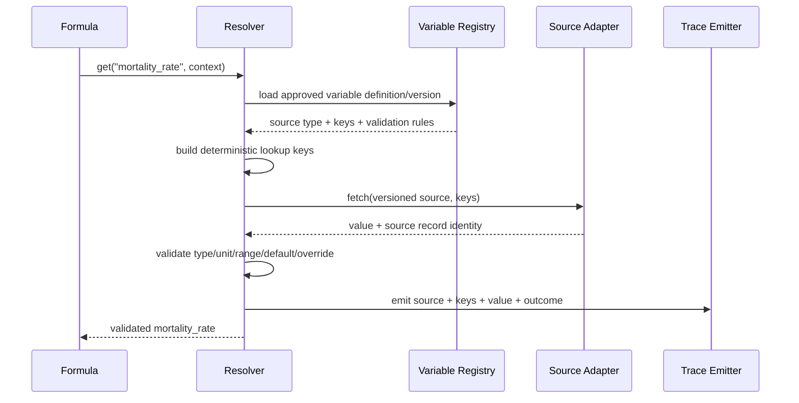
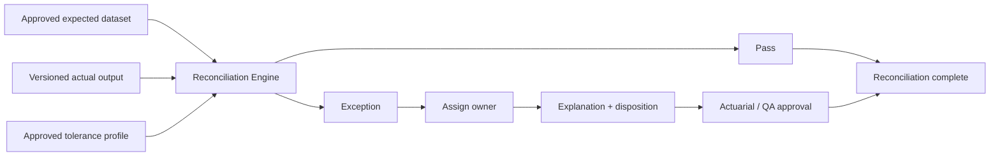

# MentorAmp — Data, Calculation, Trace, and Reconciliation Flow

**Version:** 0.1  
**Owner:** Samuel Ayinla  
**Status:** Working draft  
**Requirements:** LR1-ARCH-009, LR1-DATA-001 through LR1-DATA-010, LR1-CORE-023 through LR1-CORE-030

## 1. Why this flow exists

MentorAmp must answer two questions for every reported number:

1. How was this value calculated?
2. Can the same versions and inputs reproduce it?

The data flow produces the value. The trace flow explains it. The run manifest identifies the complete versioned package required to reproduce it. Reconciliation checks it against approved expectations.

## 2. End-to-end flow

```mermaid
flowchart LR
    A[Authorized source data] --> B[Import definition]
    B --> C[Parse + canonical mapping]
    C --> D[Validation]
    D -->|invalid| E[Rejected records + errors]
    D -->|valid| F[Versioned dataset + fingerprint]
    F --> G[Run configuration + Projection Key]
    G --> H[Run Manifest]
    H --> I[Variable Resolution]
    I --> J[Dependency Graph]
    J --> K[Projection]
    K --> L[Cash Flows + Selected Outputs]
    L --> M[Valuation + Aggregation]
    M --> N[Persisted Results]
    N --> O[Reconciliation]
    O --> P[Reports + Approved Export]

    I -. source and lookup trace .-> T[Trace Store]
    K -. formula/input/intermediate/output trace .-> T
    M -. methodology/aggregation trace .-> T
    O -. difference/tolerance/exception .-> T
    H -. versions/environment/status .-> T
```



## 3. Data ingestion flow

### Step 1 — Receive authorized input

Supported launch inputs include CSV, TSV, Excel, Parquet, authorized database extracts, assumptions, factors, scenarios, expected results, and prior/derived datasets.

Each input receives:

- source identity and provenance;
- content fingerprint;
- import-definition version;
- mapping-profile version;
- uploader and timestamp;
- data classification/authorization;
- raw record count.

### Step 2 — Map into canonical fields

Source column names are mapped to stable MentorAmp meanings.

**Example:** A client file might use `POL_NUM`, while another uses `contract_id`. Both can map to canonical `policy_id`. Product formulas continue requesting `policy_id`; they do not change for each file layout.

### Step 3 — Validate before execution

Validation covers:

- required fields;
- data types and units;
- missing and duplicate records;
- ranges and plausible values;
- referential integrity;
- effective dates;
- record counts and fingerprints;
- product/basis/methodology compatibility.

Rejected records, warnings, mapping decisions, and validation results are retained. A run cannot silently ignore invalid data.

### Step 4 — Create versioned dataset

Approved data receives a stable dataset identity and immutable version. PostgreSQL stores its metadata. Large content may be stored in versioned Parquet or another approved columnar format, referenced by URI and fingerprint.

## 4. Run configuration and manifest flow

A run configuration references identities and versions rather than mutable “latest” values.

```text
Run R-2026-00042
  product_version: rila-product/3
  basis: statutory
  methodology: vm21/2026.1
  projection_key: rila-monthly-rn/2
  inforce_dataset: rila-block/7
  assumption_set: base-assumptions/4
  factor_set: market-factors/9
  scenario_set: rn-1000/5
  formula_set: rila-formulas/12
  code_commit: abc123...
  execution_backend: cpu
```

The manifest also records application/engine versions, input fingerprints, horizon, selected outputs, environment, user, start/end times, approval state, status, warnings, and errors.

If any mandatory reference is missing, the run must fail validation before calculation.

## 5. Variable-resolution flow



### Simple example

A payment formula needs mortality rate for a 67-year-old male in duration 2.

The formula says:

```text
mortality_rate = get("mortality_rate")
```

The resolver may construct:

```text
table_version = "annuity-mortality/4"
lookup = {age: 67, gender: "M", duration: 2}
```

It returns `0.0142` and records the table version, lookup keys, source row, validation result, and any override. The formula never knows whether that table came from PostgreSQL or Parquet.

## 6. Calculation flow

1. Load the approved formula and variable versions.
2. Build and validate the dependency graph.
3. Reject cycles, missing inputs, and conflicting outputs.
4. Build execution partitions.
5. For each required policy/scenario/segment/cohort/time context:
   - resolve semantic inputs;
   - execute formulas in topological order;
   - update state and derived values;
   - emit trace events during execution;
   - retain configured cash flows and selected outputs;
   - record deterministic structured errors.
6. Apply methodology-specific valuation and aggregation.
7. Persist results and fingerprints.
8. Finalize status and manifest.

## 7. Canonical dimensions carried into outputs

| Dimension group | Required examples |
|---|---|
| Run | project, model, run, valuation date, basis, methodology, projection key, model/code version, backend |
| Contract | tenant/company, block, policy, coverage, rider, participant, segment, account, cohort, product |
| Scenario/time | scenario set, scenario, projection date, time step, duration, attained age, economic period |
| Cash flow | category, benefit/charge type, source formula, sign, currency, unit, amount, timing |
| Valuation | curve/rate, RN/RW, locked/current basis, tax/accounting attributes, reserve component |
| Audit | source dataset/record, formula/assumption/scenario versions, override, trace ID, timestamp, approval |

A dimension may be null only when the approved contract says it is not applicable. It must not disappear because an implementation path forgot to carry it.

## 8. Trace model

Trace is produced as calculations happen. A minimum trace record includes:

| Area | Minimum fields |
|---|---|
| Identity | trace ID, run ID, run-step ID, parent trace ID, sequence |
| Context | project, product, policy/block, scenario, segment/cohort, time/duration |
| Calculation | formula ID/version, output variable, execution backend, methodology |
| Inputs | variable name, resolved value, units, source type, dataset/table/version, source record, lookup keys |
| Intermediates | named intermediate values needed to explain the result |
| Output | value, units, output identity, persistence reference |
| Control | timestamp, status, warnings, structured error, code/build version |

Trace levels should be configurable to manage data volume, but every accepted workflow must retain enough information to explain selected results and errors.

## 9. Result-to-source trace example

Suppose Results Explorer shows:

```text
Policy P1001, Scenario S0042, Month 24
Present value of expected payment = 8,742.16
```

Trace & Debug should show a path such as:

```text
present_value_of_expected_payment@v3
  output: 8,742.16
  inputs:
    expected_payment@v5 = 9,160.24
      payment_amount = 10,000.00
        source: inforce/rila-block-v7, record P1001
      survival_probability@v4 = 0.916024
        mortality_rate = 0.0142
          source: assumption-table/annuity-mortality-v4
          lookup: age=67, gender=M, duration=2
    discount_rate = 0.0475
      source: factor-set/discount-curve-v9
      lookup: month=24
  methodology: VM-21/2026.1
  code commit: abc123...
  execution backend: CPU
```

The numbers above illustrate the trace shape only. They are not authoritative actuarial expected results.

## 10. Reconciliation flow



Reconciliation must support:

- expected vs actual;
- policy and aggregate levels;
- CPU vs PySpark;
- CPU vs GPU;
- period comparisons;
- model-version comparisons;
- source-to-output totals;
- configurable absolute/relative tolerance;
- exception assignment, explanation, disposition, and approval.

Developers do not choose authoritative tolerances. The Actuarial Product Owner supplies or approves numerical tolerances, and QA verifies their use.

## 11. Failure and status flow

| Stage | Example failure | Required record/action |
|---|---|---|
| Import | Duplicate policy ID | Rejected record, validation error, import remains unapproved |
| Run validation | Missing scenario-set version | Run rejected before execution with structured error |
| Resolution | Missing mortality lookup key | Calculation error with variable, source, and lookup trace |
| Dependency | Formula cycle | Graph validation failure before policy loops |
| Execution | Unsupported GPU capability | Recorded safe fallback to CPU or approved hard failure |
| Persistence | Temporary store failure | Controlled retry through orchestration; no silent partial success |
| Reconciliation | Difference exceeds tolerance | Exception created; completion not approved until disposition |

Run status and step status must distinguish at least queued, validating, running, completed, completed-with-warnings where approved, failed, cancelled, and rejected. Final vocabulary requires contract review.

## 12. Output-as-input flow

A prior result may become a later run input only through a versioned `Derived Dataset`:

1. Select approved outputs from the source run.
2. Materialize an immutable dataset with schema, dimensions, URI, and fingerprint.
3. Link it to its source run/output versions and approval state.
4. Reference its exact version in the next run manifest.
5. Resolve values through the Variable Resolver as a derived/prior-output source.

The next run must never query an unversioned mutable result set by accident.

## 13. Acceptance checks

- [ ] Import evidence retains provenance, mappings, rejects, validation, counts, and fingerprints.
- [ ] Run configuration references immutable versions.
- [ ] Mandatory manifest validation rejects incomplete runs.
- [ ] Resolver trace records source and lookup keys.
- [ ] Formula trace records inputs, intermediates, and outputs.
- [ ] Valuation trace records basis and methodology.
- [ ] Results retain canonical dimensions.
- [ ] Selected result traces back to source records and versions.
- [ ] Expected and actual datasets reconcile at required levels.
- [ ] Exceptions have owners, explanations, and approvals.
- [ ] Output-as-input uses immutable derived datasets.
- [ ] Repeating the same approved run package produces deterministic CPU results.
