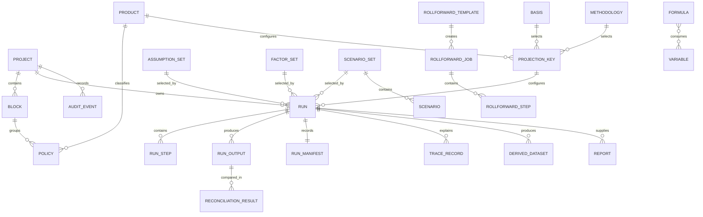

# MentorAmp Launch Release 1.0 — Core Domain Object Catalogue

**Version:** 0.1  
**Owner:** Samuel Ayinla  
**Status:** Working draft for Samuel/Noah/API/database review  
**Requirement:** LR1-ARCH-015

## 1. Purpose

This catalogue gives the backend, database, engine, API, and frontend one shared meaning for the main MentorAmp objects. It is a logical model. It does not require every object to become one database table or one API endpoint.

### Simple example

A `Run` does not contain a mutable copy of “whatever assumptions are current.” It references an exact `Assumption Set` version. That makes the run reproducible even after a newer assumption set is approved.

## 2. Common identity and lifecycle rules

Unless a contract explicitly says otherwise, versioned objects use:

- immutable technical ID;
- stable business key or semantic name;
- integer or semantic version;
- effective-from/effective-to dates where business applicability is time-based;
- lifecycle status;
- owner;
- created/updated timestamps and actors;
- change reason;
- approval state and approver;
- content fingerprint where content is material;
- supersedes/superseded-by relationship;
- optimistic concurrency/version field where mutable draft editing is allowed.

Recommended lifecycle vocabulary:

```text
Draft → In Review → Approved → Active → Superseded → Retired
```

Execution records use a different status vocabulary because they describe operational progress rather than approval lifecycle.

## 3. Workspace and contract objects

| Object | Purpose | Key fields | Relationships | Version/lifecycle | Main consumers |
|---|---|---|---|---|---|
| Project | Top-level workspace for related models, data, runs, reports, users, and governance. | project_id, name, description, owner, status, default valuation context | Has Blocks, Products/configurations, datasets, Runs, Reports; grants user access | Usually stable identity with mutable metadata and active/archived status | Workspace UI, API, authorization, run service, reporting |
| Product | Defines an actuarial product family/configuration assembled from shared modules and formulas. | product_id, code, name, type, config version, supported bases/methodologies, module references | Used by Policies/Blocks, Projection Keys, Formulas, Runs | Versioned/approved; run references exact version | Formula Studio, Run Center, engine, product UI, tests |
| Policy | Canonical contract/policy record used during projection. | policy_id, source record ID, product, issue/valuation attributes, status, coverage/account/segment links | Belongs to Block/Project; references Product; may own Coverages, Riders, Accounts, Segments | Input dataset version controls immutability; not silently mutated during a run | Data Manager, resolver, projection, trace, result filters |
| Block | Named group of policies/participants used for execution, aggregation, access, and reporting. | block_id, project_id, name, product mix, valuation date, dataset version, status | Contains Policies/Participants; used by Runs and Reports | Versioned membership or immutable dataset reference | Workspace, Run Center, planner, aggregation, block tests |

### Example

`Project = 2026 RILA Valuation`, `Block = RILA NY Block`, and `Policy = P1001`. A run may target the block, while results and trace still retain `P1001` for policy-level review.

## 4. Model-definition objects

| Object | Purpose | Key fields | Relationships | Version/lifecycle | Main consumers |
|---|---|---|---|---|---|
| Formula | Controlled definition of one calculation output. | formula_id, semantic name, description, representation/implementation ref, inputs, output, units, applicability, owner | References Variables; produces one/more declared outputs; participates in dependency graph; has Formula Tests | Immutable approved versions; draft/review/approved/active/superseded/retired | Formula Studio, Dependency Engine, Projection/Valuation, Trace, QA |
| Variable | Semantic description of a value that a formula can request. | variable_id, name, display name, type, units, dimensions, source type, lookup keys, default, required, validation, applicability, override policy | Resolves through datasets/tables/parameters/derived/formula sources; used by Formulas | Versioned and effective-dated where needed | Resolver, Formula Studio, validation, trace, API |
| Projection Key | Versioned bundle selecting product, basis, methodology, model/config versions, execution conventions, and default output/trace behavior. | projection_key_id, name, product version, basis, methodology, formula set, resolver/config refs, time step, default horizon | Used by Run; connects Product, Basis, Methodology, model definitions | Draft/review/approved/active/superseded | Run Center, run validator, engine, manifest |
| Basis | Business/valuation basis under which assumptions and calculations are selected. | basis_id, code, name, description, applicability, selection rules | Referenced by Projection Key, Formula applicability, Assumption Sets, Runs | Versioned/approved where rules change | Resolver, valuation, Run Center, reports |
| Methodology | Explicit calculation/valuation framework such as VM-21, LDTI, DAC, MRB, or ASC 815. | methodology_id, code, version, description, eligibility, calculation steps, required inputs/outputs, aggregation/rollforward rules | Referenced by Projection Key, Run, valuation modules, reports | Versioned/approved; independently testable | Valuation Engine, Run Center, reports, QA |

### Formula example

```text
Formula: expected_payment@v5
Inputs: payment_amount, survival_probability
Output: expected_payment
Applicability: SPIA
Status: Active
Tests: SPIA-GOLDEN-001
```

The formula references semantic inputs. It does not store `SELECT ... FROM assumption_tables` or a Spark-specific implementation.

## 5. Assumption, factor, and scenario objects

| Object | Purpose | Key fields | Relationships | Version/lifecycle | Main consumers |
|---|---|---|---|---|---|
| Assumption Set | Approved collection of assumption-table versions used together. | assumption_set_id, name, version, basis/product applicability, table-version members, effective dates, owner/approval | Contains exact Assumption Table versions; referenced by Projection Key/Run | Immutable after approval; superseded by new set version | Resolver, Run Center, manifest, QA |
| Assumption Table | Versioned multidimensional actuarial/business assumption data. | table_id, name, version, dimensions/keys, value type/unit, schema, content URI/rows, fingerprint | Member of one/more sets; source for Variables | Draft/imported/validated/approved/active/superseded | Resolver, Data Manager, Formula Studio tests, trace |
| Factor Set | Approved collection of factor-table versions. | factor_set_id, name, version, applicability, table members, effective dates, owner/approval | Contains Factor Tables; referenced by Run | Immutable after approval | Resolver, Run Center, manifest |
| Factor Table | Versioned factors such as caps, participation, spreads, curves, option budgets, or yields. | factor_table_id, name, version, dimensions, unit, schema, content/fingerprint | Member of Factor Set; source for Variables | Imported/validated/approved/active/superseded | Resolver, FIA/RILA modules, valuation, trace |
| Scenario Set | Versioned collection/configuration of economic, behavior, or prescribed scenarios. | scenario_set_id, name, version, type, measure (RN/RW), scenario count, schema, fingerprint, generator/source metadata | Contains Scenarios; referenced by Run | Imported/generated/validated/approved/active/superseded | Run Center, planner, projection, valuation, manifest |
| Scenario | One scenario path or prescribed scenario within a set. | scenario_id, scenario_set_id, ordinal/key, variables/time series, weight, metadata | Belongs to Scenario Set; used across projection time | Immutable within approved set version | Projection, resolver, trace, aggregation |

### Example

A run references `assumption_set = base-2026/4`, not “the current assumptions.” That set might contain mortality table version 4 and expense table version 2. The manifest records both the set and content fingerprints.

## 6. Execution objects

| Object | Purpose | Key fields | Relationships | Version/lifecycle | Main consumers |
|---|---|---|---|---|---|
| Run | One requested execution against exact approved versions and inputs. | run_id, project/block, valuation date, product, basis, methodology, projection key, dataset/set versions, horizon, outputs, trace level, requested backend, user, status | Has Run Steps, Run Outputs, Trace Records, Audit Events, Derived Datasets, Reports; owns a Run Manifest | Operational statuses; configuration becomes immutable after submission | Run Center, orchestrator, planner, engine, results, QA |
| Run Step | One observable workflow/execution stage. | run_step_id, run_id, name/type, dependency IDs, attempt, backend, started/ended, status, error, lineage refs | Belongs to Run; may consume/produce datasets | queued/running/completed/failed/retrying/cancelled | Dagster adapter, monitoring UI, audit, recovery |
| Run Manifest | Reproducibility record for a run. | versions, configurations, fingerprints, code/build, environment, user, times, outputs, backend, status, warnings/errors, approval | One per Run with append-only/finalized state; references all material versions | Immutable/finalized; corrections require controlled superseding record | QA, audit, rerun, support, release evidence |
| Run Output | One selected persisted result or a reference to a versioned result dataset. | output_id, run/context dimensions, variable/measure, value/unit or dataset URI, formula/version, trace_id, fingerprint | Belongs to Run; may feed Report, Reconciliation, Derived Dataset | Immutable for completed run; status follows run/finalization | Results Explorer, reconciliation, exports, trace |
| Derived Dataset | Immutable dataset created from controlled outputs for reuse in later runs or reporting. | dataset_id, name, version, schema, source run/output refs, URI, fingerprint, approval | Produced by Run; consumed by later Run through resolver/import contracts | draft/validated/approved/active/superseded | Resolver, Run Center, reporting, lineage |

### Run status proposal

```text
Draft → Queued → Validating → Running → Completed
                              ↘ Failed
Queued/Running → Cancelled (only through approved cancellation)
Validation failure → Rejected
```

`Completed with warnings` may be added only after the contract defines which warnings still allow approval.

## 7. Cash-flow and result objects

Cash flows may be represented as rows in a versioned columnar dataset rather than one relational row per projected value. The logical object still has a stable contract.

| Object | Purpose | Key fields | Relationships | Version/lifecycle | Main consumers |
|---|---|---|---|---|---|
| Cash Flow | Canonical projected monetary/non-monetary flow used by valuation and reporting. | run/contract/scenario/time dimensions, category, benefit/charge type, formula, sign, currency, unit, amount, timing | Produced by Projection; consumed by Valuation, Reports, Reconciliation | Immutable within run output package | Valuation, reporting, trace, exports |
| Valuation Result | Methodology-specific result derived from cash flows and inputs. | run/context dimensions, basis, methodology, reserve/accounting component, amount/unit, source dataset refs, trace | Produced by Valuation; aggregated/reported/reconciled | Immutable within run output package | Results, reports, rollforwards, QA |

These logical objects supplement the required catalogue and make the data/valuation boundary explicit.

## 8. Rollforward objects

| Object | Purpose | Key fields | Relationships | Version/lifecycle | Main consumers |
|---|---|---|---|---|---|
| Rollforward Template | Approved definition of steps/components for one methodology/reporting need. | template_id, name, methodology, version, ordered components, source rules, tolerance profile | Creates Rollforward Jobs; references formulas/datasets/methodology | Draft/review/approved/active/superseded | Run Center, valuation/reporting, QA |
| Rollforward Job | Execution instance comparing beginning/end and attribution components. | job_id, template version, project/block, period, source runs/datasets, status, owner | Has Rollforward Steps; produces results/report | queued/running/completed/failed/approved | Results Explorer, Reconciliation, reports |
| Rollforward Step | One ordered attribution/reconciliation component. | step_id, job_id, order, component type, source/target refs, amount, difference, tolerance, status | Belongs to Job; derives from outputs/datasets | Operational + reviewed/approved disposition | Valuation, reconciliation, trace, QA |

Required configurable components include beginning balance, expected change, actual experience, assumption change/unlock, market/discount movement, new business, benefits/cash flows, remeasurement, other approved components, and ending balance.

## 9. Reporting, audit, and explanation objects

| Object | Purpose | Key fields | Relationships | Version/lifecycle | Main consumers |
|---|---|---|---|---|---|
| Report | Versioned definition or generated package for results, reserves, attribution, rollforwards, disclosures, or exports. | report_id, type, definition version, source run/dataset refs, filters/grouping, format, URI, fingerprint, generated/approved by/time | References Runs, Outputs, Derived Datasets, Rollforward Jobs | Definition versioned; generated package immutable; approval recorded | Results Explorer, exports, reviewers, handoff |
| Audit Event | Immutable record of a governed user/system action. | event_id, actor, action, object type/id/version, before/after or reason, timestamp, environment, correlation/run ID | Linked to imports, model changes, approvals, runs, exports, retention/deletion | Append-only/immutable; retention controlled | Governance, security, support, QA |
| Trace Record | Runtime explanation event for a calculated/resolved value. | trace_id, parent/sequence, run/step/context, formula/variable versions, source/keys, inputs, intermediates, output, backend, status/error | Belongs to Run/Step; links Outputs to source records and model versions | Append-only for run; may use trace-level retention | Trace & Debug, QA, reconciliation, support |
| Reconciliation Result | Comparison between actual and expected/reference values. | reconciliation_id, actual/expected refs, level/dimensions, values, difference, tolerance, pass/fail, exception owner/disposition/approval | References Run Outputs, expected datasets, tolerance profile, Trace Records | Draft/open exception/resolved/approved | Reconciliation UI, actuarial, QA, release gate |

## 10. Relationship overview



This is a logical diagram. Junction objects and storage choices will be defined in the database design.

## 11. Persistence mapping direction

| Domain area | Likely PostgreSQL responsibility | Likely columnar responsibility |
|---|---|---|
| Projects/products/configuration | Identity, versions, lifecycle, relationships | Usually none |
| Formulas/variables | Metadata, expressions/references, versions, approvals, test metadata | Large test input/output packages if needed |
| Assumptions/factors/scenarios | Set/table metadata, schema, versions, approvals, content references | Large multidimensional/time-series content |
| Policies/blocks | Dataset metadata, mapping, versions, access, fingerprints | Large canonical policy/participant datasets |
| Runs/steps/manifests | Identity, status, configuration references, summary, audit | Detailed operational datasets if large |
| Outputs/cash flows/trace | Dataset metadata, selected scalar/summary results, URIs/fingerprints | Policy/scenario/time values, large trace and cash-flow sets |
| Reports/reconciliation | Definitions, status, summaries, exceptions, approvals, package refs | Large comparison/output packages |

This boundary requires volume, query, retention, and recovery review with Noah before approval.

## 12. API mapping direction

| API area | Primary domain objects |
|---|---|
| Projects/Workspace | Project, Block, Product, Policy summaries |
| Data Manager | Dataset/import metadata, Assumption/Factor/Scenario Sets and Tables, Derived Dataset |
| Formula Studio | Formula, Variable, formula tests, dependency graph, approvals |
| Run Center | Projection Key, Basis, Methodology, Run, Run Step, Run Manifest |
| Results Explorer | Run Output, Cash Flow, Valuation Result, Report, Rollforward objects |
| Trace & Debug | Trace Record and source/model references |
| Reconciliation | Reconciliation Result, expected dataset, tolerance/exception/approval |
| Audit/Governance | Audit Event, lifecycle/approval history, manifest |

## 13. Decisions still required

- Stable ID format and tenant/company scope.
- Formula-set and model-version aggregation object design.
- Whether approved configuration is immutable or revisioned through draft copies.
- Exact status vocabularies and allowed transitions.
- Coverage, rider, participant, account, segment, and cohort representation.
- Tolerance-profile domain object and ownership.
- Expected-result package domain model.
- PostgreSQL vs columnar boundary by workload and retention.
- Event/audit immutability mechanism.
- Soft deletion versus retention-controlled physical deletion.
- Repository ownership of shared schemas/contracts.

## 14. Catalogue acceptance checks

- [ ] Every authoritative core object is represented.
- [ ] Every object has purpose, fields, relationships, version/lifecycle, and consumers.
- [ ] API and persistence mappings cover every object.
- [ ] Run references immutable versions rather than mutable latest values.
- [ ] Product and methodology are distinct.
- [ ] Run Output, Trace, Audit, and Reconciliation remain distinct concepts.
- [ ] Output-as-input uses a Derived Dataset.
- [ ] Large data can live outside PostgreSQL without losing metadata, fingerprint, lineage, or traceability.
- [ ] Noah approves persistence/API mapping direction.
- [ ] Sam Yung confirms UI workflows use the same vocabulary.
- [ ] Actuarial Product Owner confirms product, basis, methodology, and output meanings.
- [ ] QA confirms objects support acceptance and reproduction evidence.
