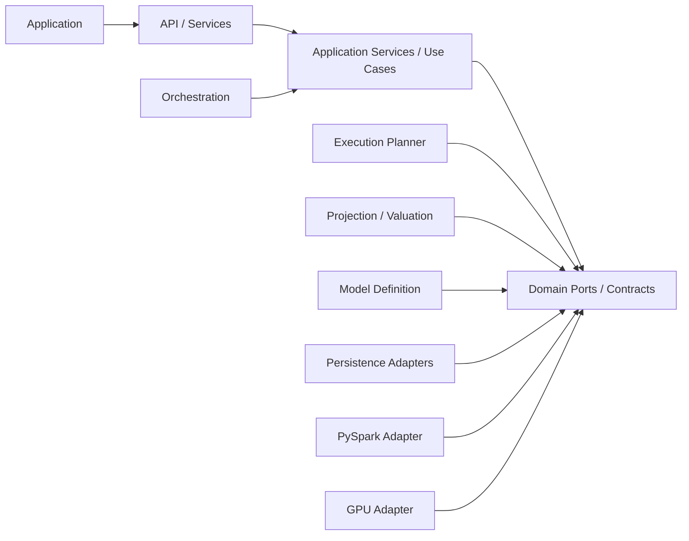

# MentorAmp — Layer Ownership and Dependency Rules

**Version:** 0.1  
**Owner:** Samuel Ayinla  
**Status:** Working draft  
**Requirements:** LR1-ARCH-001 through LR1-ARCH-014

## 1. Why ownership matters

Layer ownership answers two practical questions for every piece of code:

1. Where does this responsibility belong?
2. Which interfaces may it call?

Without these rules, projection logic can leak into API routes, UI components, Dagster jobs, or Spark/GPU adapters. That makes results difficult to test, trace, and reproduce.

## 2. Ownership table

| Layer | Primary technical owner | Owns | Does not own | Main contracts |
|---|---|---|---|---|
| 1. Application | Sam Yung; Samuel reviews boundary | Electron/React screens, navigation, forms, presentation, client-side state, API client, user workflow states, accessibility | Actuarial formulas, authoritative tolerances, database access, projection loops, reserve logic | OpenAPI-generated/typed client, view models, event/status models |
| 2. API/Services | Noah; Samuel owns architecture-sensitive contracts | Authentication/authorization boundary, request validation, use-case services, lifecycle commands, response/error schemas, API versioning | UI rendering, direct formula logic, projection loop implementation, backend-specific execution kernels | Project, data, formula, run, result, trace, reconciliation, export, manifest APIs |
| 3. Orchestration | Samuel with Noah integration support | Workflow sequencing, dependencies, datasets, status, retries, schedules, lineage, operational failure handling | Formula definitions, actuarial calculations, alternate product logic | Workflow commands/events, run-service interface, dataset references |
| 4. Model Definition | Samuel; Actuarial owns intent/expected values | Formula/variable registries, resolver metadata, assumptions, factors, scenarios, product config, basis, methodology, projection keys, dependency graph, versions/approvals | Physical storage paths, UI behavior, Spark/GPU-specific formulas | Registry, resolver, graph, product/methodology configuration contracts |
| 5. Execution Planner | Samuel | Backend selection, capability checks, partitions, batching, data movement, fallback, backend metadata | Formula intent, product-specific alternate models, UI workflow | Stable execution request/result, CPU/PySpark/GPU adapter interfaces |
| 6. Projection/Valuation | Samuel; Actuarial validates behavior | Execution context, policy/scenario/segment/cohort/time loops, state, formula execution, cash flows, valuation, aggregation, reserves, rollforwards, trace emission | UI, API transport, physical source lookup, workflow scheduling | Projection, valuation, cash-flow, aggregation, trace-emitter contracts |
| 7. Persistence/Trace | Noah; Samuel owns semantic contracts | PostgreSQL models/repositories, migrations, columnar references, run/output/trace storage, manifests, audit, retention, expected-result storage | Actuarial calculation rules, UI presentation, workflow decisions | Repository interfaces, unit-of-work, dataset store, manifest/audit schemas |

## 3. Allowed dependency direction

The normal compile-time dependency direction is toward stable domain contracts, not toward delivery technology.



`Ports / Contracts` are stable interfaces owned by the model/core architecture. Technology adapters implement those interfaces.

### Allowed

- UI → API client.
- API route → application service.
- Application service → domain/core interface.
- Dagster operation → application service or execution interface.
- Projection Engine → Formula Registry, Variable Resolver, Dependency Graph, trace emitter, output repository interfaces.
- Resolver → source repository interfaces.
- PostgreSQL/Parquet adapters → domain persistence interfaces.
- PySpark/GPU adapter → stable execution interface and common model definition.

### Prohibited

- UI → database.
- UI → actuarial formula implementation.
- API route → raw projection loop or product-specific calculation.
- Formula → SQLAlchemy model, table name, file path, Spark DataFrame, or GPU array.
- Dagster job → actuarial formula implementation.
- Product module → alternate projection engine.
- PySpark/GPU adapter → alternate formula library.
- Persistence adapter → business decision or methodology rule.
- Trace UI → reconstructed calculations that were not captured during execution.

## 4. Simple examples

### Example A — Resolving mortality rate

**Correct:**

```text
Formula asks for "mortality_rate"
→ Variable Resolver reads variable metadata
→ Resolver builds approved lookup keys
→ Assumption repository fetches the versioned value
→ Resolver validates it and emits source/lookup trace
→ Formula receives the value
```

**Incorrect:**

```text
Formula imports SQLAlchemy and queries assumption_tables directly
```

Why incorrect: the formula is now tied to a physical table, cannot execute cleanly on another data source, and is harder to trace and test.

### Example B — Submitting a run

**Correct:** The FastAPI route validates the request and calls `RunService.submit(run_definition)`. The service creates the run/manifest and invokes the execution/orchestration interface.

**Incorrect:** The route contains nested policy/scenario/month loops.

Why incorrect: HTTP delivery concerns and actuarial execution become coupled, making the engine hard to run without the UI/API.

### Example C — GPU execution

**Correct:** A GPU adapter receives the same approved formula graph and accelerates a supported numerical kernel. It returns the stable execution result and records fallback/parity metadata.

**Incorrect:** A separate CUDA calculation uses different formulas from CPU.

Why incorrect: CPU and GPU would represent different actuarial models, so parity would not prove correctness.

### Example D — Dagster retry

**Correct:** Dagster retries an operational projection step after a transient storage failure and records lineage/status.

**Incorrect:** The Dagster step contains a hardcoded reserve formula.

Why incorrect: the orchestrator would become a second actuarial engine.

## 5. Layer-to-code mapping target

This is a target map, not a classification of existing files.

| Target area | Suggested responsibility boundary |
|---|---|
| Frontend application | Electron/React code and typed API client in the frontend repository |
| API routes | Thin FastAPI transport modules |
| Application services | Use-case coordination such as importing, approving, submitting, cancelling, reconciling, exporting |
| Domain/model contracts | Technology-neutral Python types/interfaces for formulas, variables, runs, cash flows, trace, and reconciliation |
| Core engine | Formula, resolver, dependency, projection, valuation, and trace execution |
| Product/framework modules | Configuration and reusable formula/module composition; methodology-specific valuation modules |
| Infrastructure adapters | SQLAlchemy/PostgreSQL, Parquet, Dagster, PySpark, GPU, filesystem, export formats |
| Tests/evidence | Unit, golden, block, integration, parity, regression, recovery, packaging |

Whether these areas live in one monorepo or separate repositories requires a repository-boundary ADR. The layer boundaries remain the same either way.

## 6. Ownership of correctness

| Question | Accountable owner |
|---|---|
| Is the architecture followed? | Samuel |
| Is the API/service contract implemented correctly? | Noah, reviewed by Samuel for architecture-sensitive changes |
| Is the UI connected correctly and free of actuarial source logic? | Sam Yung, reviewed with Noah/Samuel |
| Is the actuarial method/formula intent correct? | Actuarial Product Owner |
| Are expected results and tolerances authoritative? | Actuarial Product Owner |
| Is evidence independently reproducible and sufficient? | QA Reviewer |
| Is launch scope/change control approved? | Project Sponsor with technical/actuarial/QA input |

Samuel can implement backend/core code while remaining accountable for the boundary. Code review from Noah or another qualified reviewer is still required for Samuel’s architecture-sensitive implementation.

## 7. Boundary-review checklist

- [ ] Each module has one primary layer.
- [ ] Public interfaces use domain language rather than database/UI/backend details.
- [ ] FastAPI routes remain thin.
- [ ] Engine entry points run without HTTP or UI.
- [ ] Formula and product modules do not import infrastructure adapters.
- [ ] Resolver is the controlled source-resolution boundary.
- [ ] Dependency Engine owns calculation order.
- [ ] Projection Engine owns execution state.
- [ ] Valuation methods are explicit.
- [ ] Trace is emitted during execution.
- [ ] Dagster owns operational coordination only.
- [ ] PySpark/GPU use common definitions and interfaces.
- [ ] Persistence code does not decide actuarial behavior.
- [ ] Tests exist at contract and integration boundaries.

## 8. Review required

Samuel, Noah, and Sam Yung must review implementation boundaries. The Actuarial Product Owner must review the separation between product projection and methodology-specific valuation. QA must review testability and evidence boundaries.
