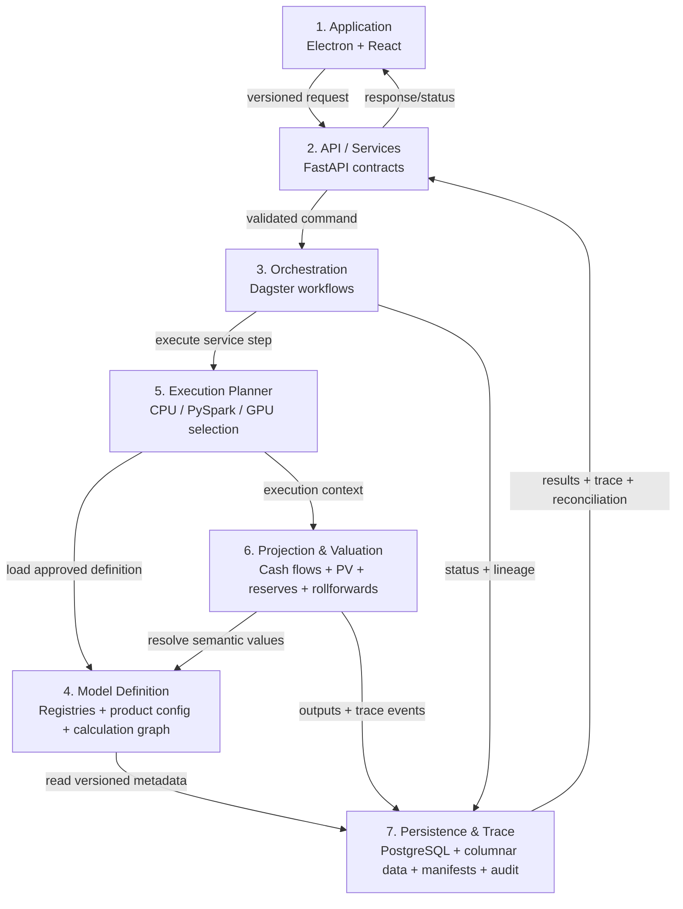
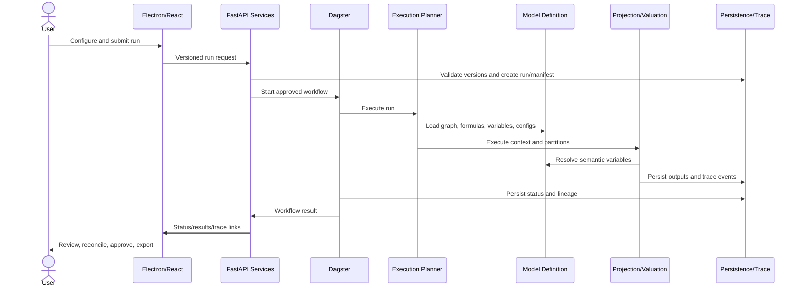
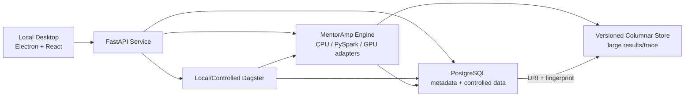

# MentorAmp Launch Release 1.0 — Target Architecture

**Version:** 0.1  
**Owner:** Samuel Ayinla — Technical Lead / Core Backend Architecture  
**Status:** Working draft for team review  
**Requirements:** LR1-ARCH-001 through LR1-ARCH-014

## 1. What this architecture is for

MentorAmp must behave as one coherent actuarial modeling system. A user imports controlled data, configures a model, runs calculations, reviews results, traces individual values, reconciles them to expected results, and exports an approved package.

The architecture separates responsibilities so that:

- frontend code cannot become the actuarial source of truth;
- formulas do not depend on PostgreSQL, files, Dagster, Spark, or GPU libraries;
- the same approved model definition can execute through CPU, PySpark, or GPU paths;
- every important result can be reproduced and explained;
- products share one engine and reusable modules;
- methodology-specific valuation remains explicit and independently testable.

## 2. Simple mental model

Think of MentorAmp like a controlled factory:

- The **Application** is the front desk where a user submits a job and reviews it.
- **API/Services** checks the request and turns it into a controlled work order.
- **Orchestration** coordinates the steps and retries failed operational work.
- **Model Definition** describes what must be calculated.
- The **Execution Planner** decides where and how to process the workload.
- **Projection/Valuation** performs the actuarial calculations.
- **Persistence/Trace** stores the inputs, results, versions, explanations, and audit evidence.

The front desk never calculates the reserve. The scheduler never invents a formula. The GPU never uses a different actuarial model.

## 3. Seven-layer architecture

The arrows describe runtime collaboration. They do not allow arbitrary imports between code modules. The dependency rules are defined in `layer-ownership.md`.

## 4. Layer responsibilities

### Layer 1 — Application

Provides the Electron/React experience for Workspace, Data Manager, Formula Studio, Run Center, Results Explorer, Trace & Debug, and Reconciliation.

It owns presentation, interaction, client-side form state, and calls to approved APIs. It does not own actuarial formulas, reserve calculations, authoritative tolerances, or model-version rules.

**Example:** The Run Center lets a user select `RILA`, `VM-21`, assumption set `2026-Q3`, scenario set `RN-1000`, and `CPU`. It sends those IDs to the API. It does not calculate a RILA credit or reserve in TypeScript.

### Layer 2 — API and Services

Provides stable FastAPI contracts for projects, datasets, formulas, variables, model configuration, runs, results, trace, reconciliation, exports, manifests, and governance.

It validates identity, authorization, request shape, and lifecycle rules, then calls application services. It must not contain UI-specific actuarial logic.

**Example:** `POST /runs` verifies that the selected formula, assumption, factor, and scenario versions exist and are approved. It creates or submits a run through the run service. The route handler does not contain the projection loop.

### Layer 3 — Orchestration

Dagster coordinates import, validation, calculation, aggregation, reconciliation, reporting, dependencies, retries, schedules, datasets, status, and lineage.

It calls MentorAmp services through stable interfaces. It never becomes the home of actuarial formulas.

**Example:** A Dagster job may run `validate_inputs → execute_projection → aggregate_outputs → reconcile → build_report`. The `execute_projection` step calls the engine service; it does not reproduce the projection formulas inside the Dagster job.

### Layer 4 — Model Definition

Owns formulas, variables, assumptions, factors, scenarios, product configuration, projection keys, basis, methodology, formula tests, versions, approvals, and the calculation graph.

Formula definitions request semantic variables and remain independent of physical storage and execution backend.

**Example:** A formula requests `mortality_rate` for a policy/context. It does not query `assumption_tables` directly. The Variable Resolver decides which approved source and lookup keys provide that value.

### Layer 5 — Execution Planner

Builds execution partitions and selects the CPU, PySpark, or GPU-capable path according to the run definition and supported workload.

It owns batching, partitioning, data movement, backend selection, fallback, and execution metadata. It does not create alternate actuarial logic.

**Example:** A 10-policy golden case selects CPU. A 500,000-policy scenario workload may select PySpark. Both receive the same run configuration, formula versions, graph, and expected output definitions.

### Layer 6 — Projection and Valuation

Runs policy, scenario, segment, cohort, and time loops. It maintains state, executes formulas in dependency order, generates cash flows, applies methodology-specific valuation, aggregates results, and emits trace events.

Product configuration chooses shared modules. Methodologies such as VM-21, LDTI, and MRB remain explicit even when they consume the same projected cash flows.

**Example:** The RILA product projection calculates segment values and cash flows. A VM-21 valuation consumes those approved cash flows and applies its methodology. The RILA projection and VM-21 valuation are related but are not one hidden function.

### Layer 7 — Persistence and Trace

Stores controlled metadata, versions, status, mappings, manifests, audit events, expected results, trace records, and references to large columnar datasets.

PostgreSQL is the default metadata and controlled-data store. Large scenario, cash-flow, trace, and result datasets may use versioned Parquet or another approved columnar store referenced from PostgreSQL.

**Example:** PostgreSQL stores a run manifest and the URI/fingerprint of a Parquet cash-flow dataset. A reviewer can prove exactly which file, formula set, assumption set, scenario set, code commit, and execution backend produced the result.

## 5. End-to-end RILA run example

1. In **Run Center**, a user selects a project, RILA product version, VM-21 methodology, data versions, scenario set, output package, trace level, and CPU backend.
2. **FastAPI** validates the request, permissions, lifecycle states, and version references.
3. The run service creates a `Run` and immutable initial `Run Manifest`.
4. **Dagster** starts the approved workflow and records status/lineage.
5. The **Execution Planner** selects CPU and builds policy/scenario partitions.
6. The **Model Definition** layer loads the approved formulas, variables, product configuration, basis, methodology, and dependency graph.
7. The **Variable Resolver** loads semantic values from inforce, assumptions, factors, scenarios, parameters, prior outputs, or formula outputs.
8. The **Projection Engine** runs policy → scenario → segment → time calculations and emits cash flows, outputs, errors, and trace events.
9. The **Valuation Engine** applies VM-21-specific calculation and aggregation to the projected cash flows.
10. **Persistence** saves outputs, columnar dataset references, trace, audit, and final manifest status.
11. **Reconciliation** compares policy and aggregate outputs with approved expected results and tolerances.
12. The API returns status/results to the UI, where the user can select a value and follow its trace back to formula, variables, lookup keys, and source record.

## 6. Runtime flow

## 7. Deployment view

Coolify, Vercel, and Neon remain development/demo candidates until their actual configuration, ownership, data classification, limits, and security are verified. They are not assumed production stores for client actuarial data.

## 8. Cross-cutting controls

These controls apply across all seven layers:

- stable identity and versioning;
- effective dates and lifecycle/approval status;
- authentication and authorization;
- deterministic validation and structured errors;
- immutable manifests and audit events;
- trace captured during execution;
- authorized data and provenance;
- requirement/test/evidence links;
- reproducible dependency and environment versions;
- numerical tolerance ownership;
- retention and secure deletion.

## 9. Architecture acceptance checks

- [ ] Every runtime component maps to exactly one primary layer owner.
- [ ] Dependencies comply with `layer-ownership.md`.
- [ ] Engine execution works without Electron/React.
- [ ] UI contains no actuarial source-of-truth calculations.
- [ ] Formulas contain no physical storage or backend-specific paths.
- [ ] Dagster contains no actuarial formulas.
- [ ] CPU, PySpark, and GPU conform to one execution interface.
- [ ] Methodology-specific valuation is explicit and testable.
- [ ] Trace is produced during calculation.
- [ ] Every completed run has a reproducible manifest.
- [ ] Large data has versioned storage, fingerprint, and PostgreSQL metadata reference.
- [ ] A reference result traces to all inputs, versions, and source records.

## 10. Review status

This is the greenfield target architecture. Existing code has not yet been classified against it. Approval requires review by Samuel, Noah, Sam Yung, the Actuarial Product Owner, and QA.
