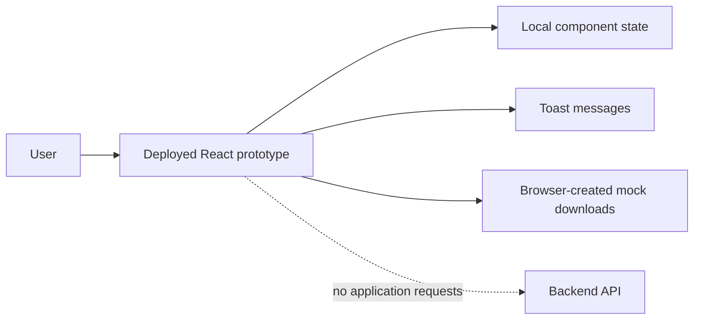
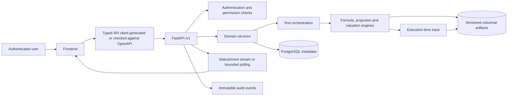

# MentorAmp Frontend Review and Frontend-to-Backend Integration Plan

**Review date:** 2026-09-29  
**Owner:** Samuel Ayinla — Technical Lead / Backend Support  
**Frontend contributor:** Sam Yung  
**Backend contributor:** Noah  
**Status:** Working integration baseline; exact deployed frontend source and contract review are still required  
**Decision:** Continue with the deployed UI as a visual and workflow foundation. Do not treat it as an implemented application or as the source of actuarial requirements.

> **Status update — 2026-09-29 evening.** §3.3 and §15 item 1 are partly superseded. Sam Yung pushed the deployed source to `BemaISLTD/mentor-amp` `main` as `39913d6` (direct push, no PR). Still open: the build is not reproducible with `npm ci` (lockfile out of sync; `bun.lock` also present), and equivalence with the Netlify deployment is unverified (BLK-015). The frontend's own `docs/backend-api-requirements.md` describes the *old* app and must not be used as the contract (BLK-017). Backend `dev` still carries the unfixed PR #1 defects (BLK-016). Current next actions are in `MENTORAMP_CONTINUATION_HANDOFF.md` §7.

## 1. The direct answer

Samuel should continue using the Consolidated Architecture and Delivery Specification and the requirement tracker. They remain the authority for what MentorAmp must do. Sam Yung's interface is useful because it shows how a user may move through MentorAmp, but a screen cannot remove a requirement from the consolidated specification or define actuarial truth.

The work should now move from separate “frontend tasks” and “backend tasks” to **end-to-end slices**. Each slice begins with a user action in the UI, passes through an agreed API contract, persists or calculates on the backend, and returns a result that the UI can display.

For example, the `Start run` button is not complete because it changes a card on the screen. It becomes complete when:

1. the UI sends an approved, versioned run definition;
2. the backend validates the exact model, formula, input, scenario, and projection versions;
3. the backend creates an immutable run manifest;
4. execution records status, outputs, errors, and trace;
5. the UI displays live status and retrieves the real result;
6. tests prove the result against an independently prepared expected value.

This is the working method for the rest of the project.

## 2. Evidence reviewed

This review used all of the following evidence:

- the nine-page `mentor_amp_frontend_update.pdf` supplied on 2026-09-29;
- every page rendered and visually inspected, including the two tables on page 5;
- the deployed site at `https://mentoramp.netlify.app/`;
- all 12 primary deployed screens;
- 40 distinct reachable nested screens and states, including model structure, inputs, scenarios, formulas, projections, runs, results, reports, investigation, and Mentor views;
- the deployed JavaScript and CSS bundles;
- the browser network log and console;
- the local `MentorAmp-frontend` repository and its current `main` source;
- the current backend `main`, `dev`, feature branches, and Noah PR #1 review;
- the master requirement tracker, architecture documents, domain catalogue, trace contract, assessment matrix, gap register, and earlier UI review.

The PDF is a contributor status report. Its statements were checked as claims; they were not treated as instructions that override the user's request or the consolidated specification.

The mechanical list of every visible control is preserved in `docs/handoff/07_ui/2026-09-29-deployed-ui-control-inventory.md`. Screenshots and browser-captured page data are under `reviews/site-audit/main/` and `reviews/site-audit/deep/`.

## 3. What the evidence proves

### 3.1 What is strong

The deployed UI is a strong visual and workflow prototype. It has a coherent information hierarchy, a consistent visual language, and useful concepts for:

- model hierarchy and published interfaces;
- formula reuse, inheritance, override, rebase, and fork;
- input libraries, mappings, and validation;
- scenario generation and comparison;
- projection-set preparation;
- run-set monitoring and recovery;
- result comparison, variance, and trace;
- report definitions and run attachments;
- saved investigations and a controlled scratchpad.

The cross-model trace and formula provenance concepts are especially useful. They can become real features once they receive backend contracts and runtime trace evidence.

### 3.2 What is not implemented

The deployed site made **zero application API, fetch, or XHR requests** during the audit. Its only requests were for the document, JavaScript, CSS, favicon, Netlify support code, and fonts. Buttons change local React state, display a toast, or create a browser-generated mock download.

Examples:

- import, validate, save, run, retry, restore, rebase, and fork actions do not persist server state;
- completed report export creates a browser blob from hard-coded content;
- Mentor identifies itself in the interface as a mock conversation;
- admin/settings cards display placeholder notifications;
- “All systems operational” is hard-coded and is not based on a health service;
- formula and run state changes disappear after a reload;
- results, trace, dates, people, model versions, IDs, and calculations are sample data.

The deployed interface therefore earns **IMPROVE as a visual/workflow asset** and **DO NOT COUNT as backend-integrated functionality**.

### 3.3 Source-control blocker

The exact source used for the Netlify deployment is not present on the locally checked-out `MentorAmp-frontend/main` branch at commit `b9f70a7`. The local application has a different route structure and a mock service in `src/lib/api.ts`; it does not contain the deployed Models, Projection Sets, cross-model trace, or inheritance workflows.

Before integration work can begin safely, Sam Yung must push the exact deployed source to `BemaISLTD/mentor-amp` in a branch and open a pull request. The handoff must include:

- exact commit SHA and branch;
- lockfile and supported Node/package-manager versions;
- `.env.example` containing names only, never secrets;
- build, lint, and test commands;
- Netlify deployment association or deployment ID;
- a clear list of mock modules and hard-coded fixtures;
- confirmation of which screens are intended for Launch 1.0;
- a mapping from deployed screens to source components.

Until this is supplied, backend developers cannot create reliable integration branches against the deployed code.

## 4. Authority and decision rules

Use this order when two artifacts disagree:

1. approved Consolidated Architecture and Delivery Specification;
2. approved requirement tracker and recorded product/actuarial decisions;
3. approved architecture and domain contracts;
4. approved OpenAPI and event/file contracts;
5. implemented UI behavior;
6. visual mockups and sample copy.

The UI can reveal a missing requirement or suggest a better workflow. The change must still be recorded in the requirement tracker and, when necessary, approved through change control.

Examples:

- The UI contains formula `Restore source`, `Rebase`, and `Fork` actions. These are good workflow ideas, but their permitted transitions, audit records, version behavior, and reviewer roles must be defined before implementation.
- The UI lacks a first-class Reconciliation workspace. Reconciliation remains required because the consolidated specification requires it.
- The UI shows a net reserve and attributes its source to `mat-001`. That table may supply one assumption, but it cannot be presented as the sole source of a calculated reserve. The backend trace must show formula, direct dependencies, exact input records, versions, and intermediates.

## 5. Current and target architecture

### Current deployed behavior

### Target behavior

The UI formats and presents results. The backend owns permissions, lifecycle transitions, version resolution, calculations, persistence, trace, reconciliation, report creation, and audit.

## 6. Shared API rules to agree before building screens

All screen APIs should follow one set of rules:

| Concern | Required rule |
|---|---|
| Base path | Use `/v1`; do not mix versioned and unversioned application endpoints. |
| Identity | Server-generated stable IDs; never reuse the same sample ID for different models. |
| Authentication | Short-lived access token or approved session mechanism; `/v1/auth/me` returns user, roles, permissions, and workspace memberships. |
| Authorization | Check permissions on every endpoint. Hiding a button is only a UI convenience. |
| Errors | One serializable envelope with code, message, field/details, correlation ID, and retry guidance where relevant. |
| Pagination | Cursor pagination is preferred for large result/trace/event collections; bounded offset pagination is acceptable for small registries. |
| Filtering | Server-side filtering for models, datasets, results, trace, audit, and logs. |
| Versioning | Runs reference immutable version IDs and fingerprints. “Latest” must never silently alter a rerun. |
| Concurrency | Version number or ETag on mutable drafts; reject stale updates with `409`. |
| Idempotency | Require an idempotency key on submit/generate/import commands that can be retried. |
| Long work | Return `202` plus job/run ID; expose status and events. Do not keep a request open for a long calculation. |
| Files | Use controlled upload sessions, type/size checks, checksums, provenance, scanning policy, and versioned stored artifacts. |
| Exports | Generate governed server artifacts with user, parameters, classification, checksum, retention, and audit event. |
| Dates/units | ISO 8601 timestamps with timezone; explicit valuation date, currency, unit, scale, precision, and rounding. |
| Trace | Capture during execution. Include run, policy/record, scenario, time, formula/version, inputs, exact sources/keys, intermediates, outputs, overrides, and errors. |
| Lifecycle | Define separate status vocabularies for drafts/approval, imports, runs, reconciliation, and reports. |

## 7. Screen-by-screen integration map

The endpoint paths below are proposed contract families. They become binding only after Samuel, Noah, and Sam Yung review request fields, responses, permissions, statuses, errors, and examples.

### 7.1 Global shell and workspace context

**Visible controls:** global navigation, search, active product/model/run/scenario/date context, system status, notifications, profile, and profile menu.

**Backend needed:**

- `POST /v1/auth/token`
- `GET /v1/auth/me`
- `GET /v1/workspaces/{workspace_id}/context`
- `PATCH /v1/users/me/preferences`
- `GET /v1/notifications`
- `PATCH /v1/notifications/{notification_id}`
- `GET /health` for basic liveness and an authorized operational-status endpoint for component health
- search endpoint or domain-specific server searches

**Important behavior:** the visible navigation and permitted actions must derive from permissions. The current hard-coded Andrew Johnson identity and hard-coded health status must be removed.

**Priority:** P0 foundation.

### 7.2 Dashboard

**Visible areas/actions:** active-model count, weekly run count, investigations, net reserve, resume/open investigation, trace result, recent runs, recent investigations, open model, start projection run, trace a result, and scratchpad.

**Backend needed:**

- `GET /v1/workspaces/{id}/dashboard?as_of_date=...`
- links or IDs in the response for each recent model, run, result, and investigation;
- result summary derived from a completed run, including unit, currency, precision, model/run/scenario/version context;
- system-generated or saved investigation metadata;
- permission-filtered recent activity.

**Correction:** do not label `mat-001` as the source of net reserve. Show `Calculated by`, `Direct dependencies`, `Selected input source`, and `Run context` separately.

**Priority:** P1 after the underlying model/run/result APIs exist. A dashboard should aggregate real capabilities rather than become the first custom backend.

### 7.3 Models: library, workspace, basis, interface, relationship and cross-model views

**Nested views inspected:** Model Library, Model Workspace, GAAP Reserve Base, published outputs, output mapping, cross-model trace, run linkage, inheritance wizard, and relationship map.

**Visible actions:** search/filter models, open model, select basis/profile/block, open formula or output, publish/map output, trace across a model boundary, inspect linked runs, add inheritance, and open relationship map.

**Domain objects:** `Project`, `Model`, `ModelVersion`, `Block`, `Profile`, `Basis`, `ModelComponent`, `PublishedOutput`, `OutputMapping`, `ModelRelationship`, and approval records.

**Backend needed:**

- `GET/POST /v1/projects/{project_id}/models`
- `GET /v1/models/{model_id}`
- `POST /v1/models/{model_id}/versions`
- `GET /v1/model-versions/{version_id}/structure`
- `GET /v1/model-versions/{version_id}/components`
- `GET /v1/model-versions/{version_id}/published-outputs`
- `POST /v1/model-versions/{version_id}/output-mappings`
- `GET /v1/model-versions/{version_id}/relationships`
- `GET /v1/runs?model_version_id=...`
- lifecycle commands for submit, review, approve, activate, retire, and archive when approved

**Rules:** every model row needs a unique ID. Published-output mappings must be versioned and validated for type, unit, dimension, grain, and required/optional semantics. Cross-model lineage must come from model metadata and actual run manifests/trace.

**Priority:** P0 read path for the first integration slice; P1 authoring and governance.

### 7.4 Inputs: library, import, mapping, validation, and details

**Nested views inspected:** Input Library, Mappings, Validation Center, factor-table detail, asset-inforce detail, and projection-input detail.

**Visible actions:** search/filter, select category, import input, open dataset/table, create/edit mappings, validate, inspect invalid records, and save corrections.

**Domain objects:** `ImportDefinition`, `ImportSession`, `SourceFile`, `CanonicalMapping`, `ValidationRun`, `ValidationIssue`, `Dataset`, `DatasetVersion`, `TableVersion`, provenance, fingerprint, and approval record.

**Backend needed:**

- `POST /v1/import-sessions`
- `POST /v1/import-sessions/{id}/files` or approved object-storage upload flow
- `GET /v1/import-sessions/{id}/preview`
- `PUT /v1/import-sessions/{id}/mapping`
- `POST /v1/import-sessions/{id}/validate`
- `GET /v1/validation-runs/{id}/issues`
- `POST /v1/import-sessions/{id}/commit`
- `GET /v1/datasets` and `GET /v1/dataset-versions/{id}`
- approval/retirement operations and import audit events

**Required categories:** liability inforce, asset inforce/supporting assets, assumptions, factors, scenarios, actual experience, independently prepared expected results, prior outputs, and other approved sources.

**Example:** `Pol_ID` in an uploaded CSV maps to canonical `policy_id`. Duplicate IDs and invalid dates appear as validation issues. Only a committed, approved dataset version with a checksum becomes selectable in a projection set.

**Current backend relation:** `main` has four import endpoints plus preview, but the complete versioned import/mapping/validation/approval lifecycle is not present. The APIs must be assessed against this contract rather than wired directly by name.

**Priority:** P0, immediately after authentication/workspace/model read integration.

### 7.5 Scenarios: sets, generators, batches, comparison, and detail

**Nested views inspected:** scenario library, generator library, generated batches, scenario comparison, and scenario detail.

**Visible actions:** create/open a scenario set, select generator, configure/generate a batch, inspect a scenario, compare sets or runs, and attach scenarios to projection preparation.

**Domain objects:** `ScenarioSet`, `ScenarioSetVersion`, `ScenarioGenerator`, `GeneratorConfiguration`, `ScenarioBatch`, `ScenarioPath`, artifact fingerprint, and validation result.

**Backend needed:**

- `GET/POST /v1/scenario-sets`
- `POST /v1/scenario-sets/{id}/versions`
- `GET /v1/scenario-generators`
- `POST /v1/scenario-batches`
- `GET /v1/scenario-batches/{id}` and events/status
- `GET /v1/scenario-set-versions/{id}/scenarios`
- `POST /v1/scenario-comparisons`
- approval/activation operations

**Rules:** generators, seed, calibration/configuration, number of scenarios, date grid, units, artifact checksum, and approval status must be reproducible. Comparison must refuse incompatible dimensions or explain the permitted transformation.

**Priority:** P1 after the basic deterministic run thread; P0 only for the reference scenario data needed by that thread.

### 7.6 Formulas: groups, detail, inheritance, overrides, and tests

**Nested views inspected:** Formula Groups, Formula Detail, Inheritance Map, new inheritance wizard, relationship map, and the final source-versus-local override comparison containing `Restore source`, `Rebase`, and `Fork`.

**Visible actions:** search/filter, open group/detail, trace formula, compare source/local, create inheritance, restore source, rebase, fork, and create a block/profile.

**Domain objects:** `FormulaDefinition`, `FormulaVersion`, `FormulaGroup`, `VariableDefinition`, `DependencyEdge`, `InheritanceLink`, `Override`, `FormulaTestCase`, `FormulaTestRun`, and lifecycle/audit records.

**Backend needed:**

- `GET/POST /v1/formulas`
- `GET /v1/formulas/{id}/versions/{version_id}`
- `POST /v1/formulas/{id}/versions`
- `POST /v1/formula-versions/{id}/validate`
- `POST /v1/formula-versions/{id}/tests`
- `GET /v1/formula-versions/{id}/dependencies`
- `POST /v1/formula-inheritance-links`
- commands for restore, rebase, fork, submit, review, approve, activate, retire, and rollback
- impact/consumer query for proposed changes

**Rules:** each change creates a draft version; approved production versions are immutable. Restore, rebase, and fork must be explicit audited transitions with conflict information. The UI must never evaluate the authoritative reserve formula.

**Current backend relation:** `main` has formula CRUD and a dependency endpoint. The assessed formula/variable contracts lack the complete version, lifecycle, unit/dimension, approval, trace, and permission behavior required by these screens.

**Priority:** P0 contract and read/query behavior; P1 controlled authoring and inheritance lifecycle.

### 7.7 Projections: create/edit, validation, and immutable preparation

**Nested views inspected:** projection list, create/edit, validation, and new Projection Set.

**Visible actions:** create a Projection Set, select exact model/input/scenario/output context, edit draft configuration, validate, and move a valid set toward a run.

**Domain object:** `ProjectionSet` with immutable `ProjectionSetVersion` after validation/approval.

**Minimum version content:** project, model version, product configuration, basis, methodology, valuation date, projection key, horizon/frequency, inforce version, assumption versions, factor versions, scenario-set version, asset version, prior-output versions, output package/granularity, trace level, and requested execution target.

**Backend needed:**

- `GET/POST /v1/projection-sets`
- `GET/PATCH /v1/projection-sets/{id}` for drafts
- `POST /v1/projection-sets/{id}/versions`
- `POST /v1/projection-set-versions/{id}/validate`
- `GET /v1/projection-set-versions/{id}/validation`
- `POST /v1/projection-set-versions/{id}/approve`

**Rules:** validation errors block submission; warnings require an approved acknowledgement policy. A run references one exact Projection Set version.

**Priority:** P0 for the first run thread.

### 7.8 Runs: Run Sets, execution monitor, linkage, and recovery

**Nested views inspected:** Runs, Run Set editor, Execution Monitor, Recovery, and run linkage from models.

**Visible actions:** new Run Set, add/select Projection Sets, validate, submit, inspect manifest, monitor, pause/resume/cancel, retry/recover, and open results/logs/linked model.

**Domain objects:** `RunSet`, `RunSetVersion`, `Run`, `RunManifest`, `RunEvent`, `RunLog`, `RunArtifact`, retry relationship, and execution allocation.

**Backend needed:**

- `GET/POST /v1/run-sets`
- `POST /v1/run-sets/{id}/validate`
- `GET /v1/run-sets/{id}/manifest-preview`
- `POST /v1/run-sets/{id}/submit`
- `GET /v1/runs` and `GET /v1/runs/{id}`
- `GET /v1/runs/{id}/manifest`
- `GET /v1/runs/{id}/events` through SSE/WebSocket or bounded polling
- `GET /v1/runs/{id}/logs`
- commands such as cancel, retry, and restart-from-approved-checkpoint when supported

**Status example:** `draft → validating → ready → queued → running → success | partial_success | failed | cancelled`. Pause/resume must only appear if the execution backend truly supports it.

**Current backend relation:** `dev` has queue/list/get/manifest plus result, trace, and reconciliation endpoints. It uses an in-process FastAPI background task, has only a limited run definition, and does not supply the full Run Set, lifecycle, event, cancellation, retry, distributed execution, or recovery behavior shown in the UI. These endpoints are useful evidence, but they are not yet the complete contract.

**Priority:** P0 thin end-to-end run thread; P1 operational controls and scale.

### 7.9 Results: history, comparison, variance, trace, and export

**Nested views inspected:** Results Explorer, Run History, Compare Runs, Driver/Variance, and Trace This Value.

**Visible actions:** filter/search, select a result, change dimension/grain, compare runs, inspect variance drivers, trace one value, and export.

**Backend needed:**

- `GET /v1/runs/{id}/summary`
- `GET /v1/runs/{id}/results` with server filters and pagination
- `POST /v1/result-comparisons`
- `GET /v1/result-comparisons/{id}/variance`
- `GET /v1/runs/{id}/trace` or a focused trace query accepting result coordinates
- `POST /v1/exports` and `GET /v1/exports/{id}`

**Required result context:** run ID, model/formula/input/scenario versions, product, basis, methodology, valuation date, policy/block/segment/cohort where applicable, time, variable, value, unit, currency, scale, precision, rounding, and approval/reconciliation state.

**Rules:** large data must be queried from server-side artifacts; never load an entire result or trace dataset into the browser. Export must be a governed backend artifact, not a hard-coded browser file.

**Current backend relation:** `dev` can filter Parquet-backed results and calculate a summary, but it lacks the complete dimensional contract, comparison/variance service, governed export, and full trace required by the screen.

**Priority:** P0 summary and one focused trace in the thin thread; P1 full analysis features.

### 7.10 Reports: definitions, attachments, completed reports, and export

**Nested views inspected:** Reports, Definition/Preview, Run Set attachment, Completed Reports, and New Report Definition.

**Visible actions:** create/edit definition, preview, attach a Run Set, generate, inspect status, open/download completed report, and manage report metadata.

**Domain objects:** `ReportDefinition`, `ReportDefinitionVersion`, `ReportRun`, `ReportArtifact`, `ReportSection`, attachment links, approval, and audit records.

**Backend needed:**

- `GET/POST /v1/report-definitions`
- `POST /v1/report-definitions/{id}/versions`
- `POST /v1/report-runs`
- `GET /v1/report-runs/{id}` and events
- `GET /v1/report-artifacts/{id}` using authorized download links
- approval and publication operations where required

**Rules:** reports identify exact source runs and versions. Server generation records template version, data selection, checksum, user, timestamps, and approval status.

**Priority:** P1 after reliable results; P0 only if a release gate explicitly requires one reference report.

### 7.11 Investigate: active, saved, comparison, scratchpad, and promotion

**Nested views inspected:** Investigate, Saved Investigations, Compare With Another Run, and Scratchpad.

**Visible actions:** ask/select a question, open trace evidence, save/pin, compare runs, modify experimental inputs, recalculate an experiment, and promote a finding/change.

**Domain objects:** `Investigation`, `InvestigationVersion`, `EvidenceReference`, `Checkpoint`, `Scratchpad`, `Experiment`, `ExperimentResult`, and `PromotionRequest`.

**Backend needed:**

- `GET/POST /v1/investigations`
- `PATCH /v1/investigations/{id}`
- `POST /v1/investigations/{id}/checkpoints`
- `POST /v1/experiments`
- `POST /v1/experiments/{id}/run`
- `POST /v1/experiments/{id}/promotion-requests`
- links to result, trace, formula, variable, and dataset evidence

**Rules:** scratchpad changes never mutate production. Promotion creates a governed draft/change request with review and test requirements. Saved investigations retain evidence references and versions so they do not silently change later.

**Priority:** P2 after trace works; a minimal saveable investigation may be P1.

### 7.12 Mentor

**Nested views inspected:** Mentor conversation and Mentor History.

**Visible actions:** ask a question, use suggested prompts, open history, and follow evidence links.

**Backend needed:**

- `POST /v1/mentor/questions`
- `GET /v1/mentor/conversations`
- approved evidence-retrieval service constrained by user permissions;
- citations to exact run/result/trace/formula/input versions;
- prompt/model/configuration logging under an approved retention and security policy.

**Rules:** distinguish model facts, deterministic explanations, AI interpretations, and suggestions. Never present generated text as approved actuarial judgment. Mentor must not bypass endpoint permissions or expose data that the user cannot access elsewhere.

**Priority:** P2. Do not let this delay import, run, result, trace, or reconciliation work.

### 7.13 Admin and settings

**Visible actions:** workspace settings, access and permissions, notifications, data/retention, security, appearance, and API access.

**Backend needed:**

- `GET/PATCH /v1/workspaces/{id}`
- membership endpoints;
- user, role, permission, and role-assignment endpoints;
- retention-policy and export-policy endpoints;
- session/API credential management under an approved security design;
- `GET /v1/audit-events`;
- notification-preference endpoints;
- operational health/status endpoint.

**Rules:** each settings card needs permission gates, validation, audit, and meaningful empty/error/loading states. Cards must not claim controls are active until the backend enforces them.

**Current backend relation:** Noah PR #1 begins auth, users, roles, permissions, and error envelopes, but it has four merge blockers: missing permission enforcement, destructive project deletion, a validation-error 500, and a Compose database-readiness race. It must be fixed before use as the integration foundation.

**Priority:** P0 auth/current-user/permissions; P1 administration and policy settings.

### 7.14 Missing first-class Reconciliation workspace

The deployed sidebar still has no dedicated Reconciliation area. This is a Launch 1.0 requirement and must be added.

**Required flow:**

`load approved expected results → choose actual run and comparison grain → apply approved tolerance → classify differences → assign exceptions → explain/correct → rerun/retest → approve and lock evidence`

**Backend needed:**

- expected-results import/version endpoints;
- `POST /v1/reconciliations`;
- `GET /v1/reconciliations/{id}`;
- paginated comparison details and bridges;
- tolerance-rule versions;
- exception assignment, explanation, retest, approval, reopen, and audit endpoints.

**Current backend relation:** `dev` has a useful prior-run-versus-current-run comparison endpoint. It does not implement approved expected-result packages, tolerance rules, exception ownership, explanations, retesting, or approval. Name it comparison until the full reconciliation contract exists.

**Priority:** P0/P1 release-critical, depending on the agreed reference vertical.

## 8. Cross-screen journeys and dependency order

The screens should be built in dependency order rather than sidebar order.

### Journey A — controlled access and context

`Sign in → retrieve user/roles/permissions → choose workspace/project → load allowed models and context`

This journey supplies the identity and scope used by every later request.

### Journey B — versioned data preparation

`Import file → map source fields → preview → validate → correct/reject → commit version → approve`

The output is an immutable dataset version and fingerprint.

### Journey C — governed model and formula preparation

`Open model version → inspect structure → edit formula draft → validate/test → review/approve → activate`

The output is an immutable active model/formula configuration.

### Journey D — scenario preparation

`Choose/import/generate scenarios → validate dimensions → persist version/artifact → approve`

The output is an immutable Scenario Set version.

### Journey E — projection and execution

`Create Projection Set → select exact versions → validate → create Run Set → preview manifest → submit → monitor`

The output is a completed run with immutable manifest, artifacts, logs, events, and trace.

### Journey F — results and trace

`Open completed run → query summary/results → select one value → query trace → open exact formula/input source`

This is the first complete MentorAmp value story and should be the first major end-to-end acceptance target.

### Journey G — reconciliation

`Load expected package → compare → apply tolerance → manage exceptions → retest → approve`

The output is a locked reconciliation evidence package.

### Journey H — report and export

`Select approved run/reconciliation → generate report → review/approve → download governed artifact`

### Journey I — investigation and Mentor

`Ask/open question → retrieve permitted evidence → save/checkpoint → experiment → raise governed promotion request`

## 9. Current backend capability versus the UI

| Capability | `main` evidence | `dev` / feature evidence | Integration assessment |
|---|---|---|---|
| Projects | Create/list/get | Update/delete added | Partial. Permission and lifecycle contract need correction. |
| Auth/users/RBAC | Absent | PR/`dev` implementation | Useful start; PR #1 has four high merge blockers and incomplete five-role model. |
| Audit | Absent | Audit endpoint/events in `dev` | Partial; verify immutability, coverage, permissions, retention, and query contract. |
| Imports | Inforce, assumptions, factors, scenarios, preview | Same on `dev` | Partial prototype; version/mapping/validation/approval lifecycle incomplete. |
| Variables | Basic CRUD | Same on `dev` | Refactor/rebuild contract; current resolver has a proven zero-value correctness defect. |
| Formulas | Basic CRUD/dependencies | Same on `dev` | Partial; versioned lifecycle, tests, inheritance/override, permissions, and trace incomplete. |
| Products/assets | Absent | `feat/products-assets` adds CRUD/mappings | Unmerged evidence; assess contracts and tests before reuse. |
| Projection Sets | Absent | Absent as the UI-defined object | Build. |
| Run Sets | Absent | Individual run queue/manifest in `dev` | Build Run Set and expand individual-run lifecycle. |
| Execution | Existing projection runner | In-process queued background task | Not production orchestration; scale, recovery, cancellation, eventing, and trace guarantees remain. |
| Results | Absent | Parquet-backed query and summary in `dev` | Useful partial base; needs full dimensional contract and governed export. |
| Trace | Basic internal hooks assessed | Parquet-backed event query in `dev` | Partial; current trace content and execution instrumentation do not meet the target trace contract. |
| Reconciliation | Absent | prior-run comparison in `dev` | Useful comparison primitive; full reconciliation workflow remains to build. |
| Reports | Absent | Absent | Build after results contract. |
| Investigations/Mentor | Absent | Absent | Build later. |

No branch should be described as complete merely because endpoints exist. Reuse requires contract fit, permission enforcement, persistence, trace/audit behavior, meaningful tests, and acceptance evidence.

## 10. Recommended implementation sequence

### Step 0 — source and contract handoff (immediate)

1. Sam Yung pushes the exact Netlify source and opens a frontend PR.
2. Record the deployment commit and mock-data locations.
3. Samuel creates one screen/API worksheet from this document for the first slice.
4. Noah fixes PR #1's four blockers and requests re-review.
5. Samuel, Noah, and Sam Yung agree base URL, authentication, error envelope, IDs, lifecycle statuses, pagination, version references, and local environment variables.

**Exit evidence:** the deployed source builds from the PR; the backend foundation PR passes re-review; one reviewed OpenAPI contract can be used by frontend and backend.

### Step 1 — first live slice: identity, workspace, and model read

Build:

- login/current user;
- permissions and allowed navigation;
- project/workspace selection;
- model list and one model-version detail;
- frontend loading, empty, error, unauthorized, and success states.

This is intentionally small. It proves that authentication, CORS/configuration, response schemas, API client behavior, and deployment environments work together.

### Step 2 — second live slice: one input dataset

Use one authorized synthetic CSV and implement:

- upload;
- canonical mapping;
- preview;
- validation issues;
- committed immutable version and checksum;
- approval if the reference workflow requires it.

Do this for one data category first, then reuse the pattern for assumptions, factors, scenarios, assets, actuals, and expected results.

### Step 3 — first actuarial thin thread

Use one approved product/framework reference case and implement:

1. one approved model/formula version;
2. one approved input version;
3. one approved scenario version;
4. one Projection Set;
5. one Run Set and immutable manifest;
6. one backend calculation;
7. one results summary;
8. trace for one output value;
9. independent expected-value comparison.

Example acceptance story: “An authorized actuary selects the MYGA reference configuration, submits a projection, sees the run finish, opens net reserve, and traces the value through the exact formula and input record used.”

### Step 4 — reconcile and govern

Add expected-result packages, tolerance rules, exceptions, explanations, retest, approval, and locked evidence. Add audit coverage to all earlier mutations.

### Step 5 — broaden the same pattern

Add more inputs, formulas, scenarios, products, methodologies, result dimensions, comparisons, and operational controls. Do not create a separate engine per product.

### Step 6 — reports, investigations, and Mentor

Implement these on top of proven results, trace, permissions, and governance. Their evidence links should reuse the earlier contracts.

## 11. Team responsibilities

### Samuel — technical lead and backend support

- maintain the authority hierarchy, requirements, domain contracts, and decisions;
- define formula, variable, resolver, Projection Set, Run Set, manifest, trace, and reconciliation semantics;
- write concrete request/response examples with Noah and Sam Yung;
- review backend correctness and frontend actuarial meaning;
- prevent UI mock data from becoming an accidental backend contract;
- ensure each slice has requirement IDs and acceptance evidence.

### Noah — backend

- fix PR #1 and provide the secure API foundation;
- implement migrations, persistence, services, endpoints, permissions, audit, and background execution contracts;
- keep endpoint handlers thin and domain behavior testable;
- provide OpenAPI, representative fixtures, and local integration instructions;
- implement negative tests, lifecycle tests, migration tests, and failure behavior.

### Sam Yung — frontend

- push the exact deployed source and keep deploys tied to commits;
- replace mocks screen by screen using the agreed typed client;
- show loading, empty, validation, forbidden, conflict, failure, retry, and success states;
- pass stable IDs between screens rather than copying hard-coded objects;
- never calculate authoritative actuarial values in React;
- add component, accessibility, and live integration tests for each completed slice.

### QA and actuarial reviewer

- QA owns reproducible acceptance evidence, negative cases, permissions, accessibility, and end-to-end tests;
- the actuarial reviewer supplies and approves formula intent, reference inputs, expected outputs, intermediate values, and tolerances;
- neither frontend appearance nor backend endpoint presence substitutes for independent expected-value evidence.

## 12. Working agreement for every feature

Before coding, the three implementers should complete one small contract table:

| Question | Example answer |
|---|---|
| User and permission | Actuary with `runs:create` |
| Trigger | Click `Submit Run Set` |
| Request | Run Set version ID plus idempotency key |
| Immediate response | `202`, run IDs, status `queued`, correlation ID |
| Persistent change | Run, immutable manifest, audit event |
| Long-running behavior | Queue/worker updates events and status |
| Success response | Results/trace artifact references and summary availability |
| Failure response | Stable code, actionable message, retryability, failed component |
| UI states | validating, queued, running, partial, failed, cancelled, complete |
| Acceptance evidence | contract test, permission test, expected-value test, UI E2E |

Then implement backend and frontend against that same contract. Review the running slice together before moving its requirement to Complete.

## 13. Definition of done for an integrated screen

A screen is complete only when:

- its requirement and owner are recorded;
- every visible action has real behavior or is visibly disabled and identified as future scope;
- request, response, status, error, and permission contracts are agreed;
- data comes from the backend in normal operation;
- mutations persist and produce audit evidence;
- actuarial calculations run outside the UI;
- IDs and version context survive navigation and reload;
- loading, empty, validation, forbidden, conflict, failure, retry, and success states are implemented where applicable;
- keyboard, screen-reader name, focus, contrast, zoom, and Electron/window behavior are tested;
- backend contract/permission tests and frontend integration/E2E tests pass;
- an independent expected value validates any actuarial result;
- trace/reconciliation evidence exists where required;
- the requirement tracker and evidence links are updated.

## 14. Product and UI decisions still required

These questions do not stop the first identity/model-read slice, but owners must resolve them before affected work is accepted:

- exact Launch 1.0 reference product/framework cases, expected results, and tolerances;
- lifecycle/status vocabulary for models, datasets, formulas, Projection Sets, runs, reconciliation, and reports;
- whether the final desktop target remains Electron and how the deployed web application is packaged;
- repository boundary and shared/generated API-client ownership;
- PostgreSQL versus columnar storage thresholds and retention;
- execution service/queue and real support for pause, resume, cancellation, checkpoint, and distributed targets;
- report approval/publication rules;
- Mentor model/provider, evidence policy, retention, and guardrails;
- responsive behavior and the single final design-system typography/logo/navigation standard.

## 15. Immediate action list

Do these next, in this order:

1. **Sam Yung:** push the exact deployed frontend source and open a PR linked to the Netlify deployment.
2. **Noah:** correct PR #1's permission enforcement, project deletion, validation serialization, and database readiness findings.
3. **Samuel:** schedule one 60–90 minute contract review using only the first slice: login → current user → projects/workspace → model list → model detail.
4. **Samuel + Noah:** publish the reviewed OpenAPI examples and permission matrix for that slice.
5. **Sam Yung:** replace those screen mocks with the typed API client and implement all five basic states: loading, empty, forbidden, error, success.
6. **QA:** add a browser test that signs in, opens a permitted model, and proves a forbidden mutation is rejected by the backend.
7. **Team:** demo the real slice, record evidence, and only then start the one-dataset import slice.

The first coding action for Samuel should be to help close Noah's PR #1 blockers and define the read-only workspace/model contract. Building more isolated backend endpoints before this shared contract exists would increase integration drift.

## 16. Final technical decision

Continue with the UI. It contains valuable workflow thinking and should not be discarded. Require the exact source handoff, correct the semantic problems, add the missing Reconciliation workflow, and integrate it one vertical slice at a time.

Continue with the consolidated document as the authority. Use the deployed UI to decide what the user sees and which end-to-end slice to build next. Use approved domain/API contracts to decide what data crosses the boundary. Use backend calculation, persistence, trace, reconciliation, security, and test evidence to decide when the feature is actually complete.
